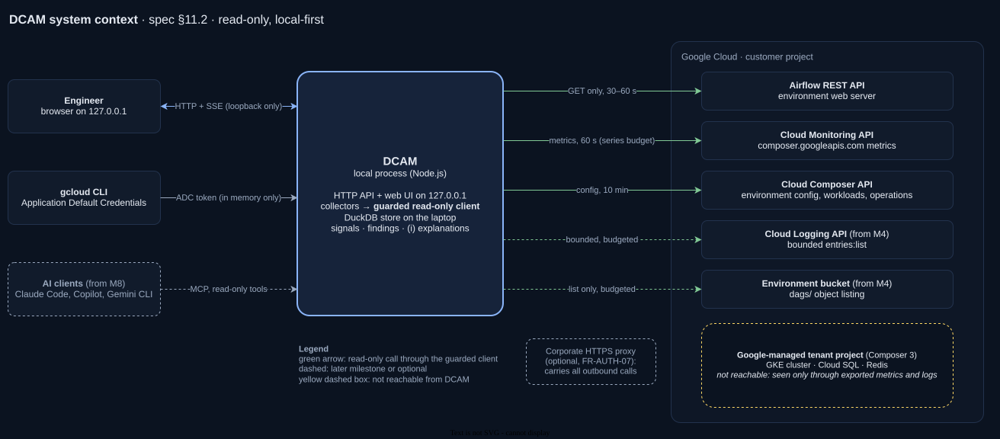

# deep-gcp-airflow-monitoring (DCAM)

**A local-first, read-only observability and advisory cockpit for Google Cloud's Managed Service for
Apache Airflow (formerly Cloud Composer).**

DCAM answers the questions the default dashboards leave open, for environments with thousands of DAGs:

- **Which DAGs consume the environment?** A DAG league table ranked by executor slot-seconds, with the
  Pareto view ("23 of 2,000 DAGs use 80 % of capacity").
- **Why is work waiting?** Waiting time attributed to the limit that actually binds: pools,
  `parallelism`, `max_active_tasks`, worker slots at `max_count`, autoscaling lag, the triggerer.
- **What should we tune next?** Evidence-backed findings with copy-paste snippets that you review and apply.

It runs on your laptop, reads only public Google Cloud and Airflow APIs with your own identity, never
changes anything, and keeps all data on your machine.

> **Status: the M1 to M3 features are built; the reality check on a real environment is next.** Live mode reads
> Composer 3 / Airflow 2.11.1 environments read-only and fills every page: the DAG league table, DAG detail (duration
> against a 28-day baseline, failures and flakiness, an estimated critical path, concurrency against
> `max_active_tasks`, impact on the environment, run comparison), DAG comparison across environments, bottlenecks
> with their evidence, capacity with a 24-hour forecast, schedule collisions, the advisor and local alerts. A global
> context bar sets the range (15 minutes to 90 days) and the time zone; every table exports as CSV; Ctrl/Cmd+K jumps
> to any page, environment or DAG; "Open in" opens the Cloud console and the Airflow UI. A background backfill reads
> the last 7 days of task instances and 14 days of worker metrics, and the local store keeps to its retention and
> disk budget. Tested end to end against the local Airflow 2.11.1 emulator; see
> [First run against a real environment](docs/first-run.md). `pnpm dcam --demo` shows every page on synthetic data.
> See the [roadmap](docs/spec/dcam-spec.md#222-milestone-overview).

## Quickstart (demo mode)

Requirements: Node.js 22.12 or later, and pnpm 11 through Corepack.

```bash
git clone https://github.com/albertols/deep-gcp-airflow-monitoring.git
cd deep-gcp-airflow-monitoring
corepack enable          # if "corepack" is missing: npm i -g corepack && corepack enable
pnpm i
pnpm dcam --demo         # opens http://127.0.0.1:8787 with synthetic data for the fictitious "acme" org
```

`pnpm dcam doctor` checks the prerequisites.

## Run against your environment

DCAM reads your Managed Airflow (Composer) environments with your own Google identity, read-only, from your
laptop. It works on macOS, Linux and Windows, and through a corporate proxy that inspects TLS. The full guide is
[spec §17.6](docs/spec/dcam-spec.md#176-run-against-your-environment).

**You need:** Node.js 22.12 or later, pnpm 11 through Corepack (see the quickstart), the
[Google Cloud CLI](https://cloud.google.com/sdk/docs/install), and network access to `*.googleapis.com` and to
your environment's Airflow web server, directly or through the proxy.

1. **Sign in** with your own credentials. DCAM asks the Google Cloud CLI for an access token
   (`gcloud auth application-default print-access-token`), keeps it in memory only and reuses it for up to
   30 minutes ([ADR-0016](docs/adr/0016-authentication.md)):

   ```bash
   gcloud auth application-default login
   ```

2. **Check your access.** Your identity needs `roles/composer.viewer` and `roles/monitoring.viewer` on the
   environment's project, and an Airflow role in the environment. `Viewer` is all DCAM needs. The first time you
   call the Airflow API, Composer 3 registers you as `Op`; ask an administrator to assign `Viewer` instead.
3. **Quota project.** DCAM bills Google API quota to each environment's own project, which needs
   `serviceusage.services.use` there. To bill another project instead, set `auth.quotaProjectId` in the
   configuration file.
4. **Proxy and CA.** Set the proxy before you start DCAM. If the proxy inspects TLS, also point
   `NODE_EXTRA_CA_CERTS`, or `network.caBundlePath` in the configuration file, at your organisation's root CA
   bundle in PEM format. DCAM sends both the Google API and the Airflow web server calls through the proxy.

   ```bash
   # macOS and Linux
   export HTTPS_PROXY=http://proxy.example.com:3128
   export NO_PROXY=localhost,127.0.0.1
   export NODE_EXTRA_CA_CERTS=~/certs/root-ca.pem
   ```

   ```powershell
   # Windows PowerShell
   $env:HTTPS_PROXY = 'http://proxy.example.com:3128'
   $env:NO_PROXY = 'localhost,127.0.0.1'
   $env:NODE_EXTRA_CA_CERTS = "$HOME\certs\root-ca.pem"
   ```

   The Google Cloud CLI has proxy and CA settings of its own; see
   [Configuring the gcloud CLI to use a proxy](https://cloud.google.com/sdk/docs/proxy-settings).

5. **Configure.** Copy the example and set `projectId`, `location` and `environment` for each environment
   (`gcloud composer environments list --project <project> --locations <region>` lists them). The copy is
   git-ignored: never commit it, because the repository is public.

   ```bash
   cp dcam.config.example.yaml dcam.config.yaml
   ```

6. **Run the doctor.** It checks Node.js, DuckDB, the data folder, the Google Cloud CLI and your token, the
   proxy and CA settings, then per environment Composer access, the Airflow web server and your Airflow role,
   Cloud Monitoring and the clock. It prints a fix you can copy for each problem, and exits with code 1 when a
   check fails.

   ```bash
   pnpm dcam doctor                 # or: pnpm dcam doctor --env <id> --json
   ```

   [First run against a real environment](docs/first-run.md) says which checks matter behind a corporate proxy and
   what to note on the first day.

7. **Start DCAM.** `pnpm dcam` (or `pnpm dcam --config <file>`) opens http://127.0.0.1:8787. Collection runs in
   the background within a request budget per environment: the `standard` profile, the default for `prod`,
   allows 12 Airflow API requests a minute. The pages fill as data arrives: first the configuration and the
   DAG list, then live snapshots and finished task instances. The **DCAM health** page shows what each
   collector is doing and how many requests DCAM made. If the configuration file is missing or invalid, DCAM
   starts in setup mode and the page lists what to fix. Press Ctrl+C to stop.

**What stays on your laptop.** Everything DCAM collects is stored in `~/.dcam/data/`, a folder only you can
read (`DCAM_DATA_DIR` moves it). DCAM makes no calls except the read-only API calls on its allowlist, and it
sends no telemetry. Do not attach that folder, or screenshots of real environments, to public issues.

To try live mode without Google Cloud first, run the local Airflow 2.11.1 emulator
([tools/emulator](tools/emulator/README.md)).

## Safety by design

- **Read-only by construction.** Every call to a monitored system goes through one guarded client with a
  default-deny allowlist: Airflow is `GET`-only and never reads configuration, connections, variables or
  XCom; redirects are never followed; encoded path tricks are rejected ([ADR-0006](docs/adr/0006-guarded-read-only-outbound-client.md)).
- **Do no harm.** Request and time-series budgets per API; DCAM lowers its own fidelity before it adds load
  or Cloud Monitoring cost.
- **Local and private.** Binds to 127.0.0.1 with Host-header checks and a strict Content Security Policy.
  No telemetry.

## Development

```bash
pnpm check               # format, lint, typecheck, architecture boundaries, tests, hygiene scan
pnpm dev                 # server + UI with hot reload (UI on http://127.0.0.1:5173)
pnpm --filter @dcam/domain test
git config core.hooksPath .githooks   # hygiene pre-commit hook
```

| Path                             | What it is                                                       |
| -------------------------------- | ---------------------------------------------------------------- |
| `packages/domain`                | Pure analytics core (occupancy sweep: slot-seconds, concurrency) |
| `packages/adapters/http-guard`   | The only network path to monitored systems                       |
| `packages/adapters/duckdb-store` | Embedded DuckDB store (2.0 LTS)                                  |
| `packages/contracts`             | OpenAPI 3.1 contract, generated types and client                 |
| `apps/server`, `apps/web`        | Fastify API on loopback, React + MUI UI                          |
| `docs/spec/dcam-spec.md`         | Product and technical specification (v2)                         |
| `docs/adr/`                      | Architecture decision records (MADR 4.0)                         |
| `.claude/`                       | Claude Code harness: guard hooks, subagents, commands, skills    |

DCAM is built spec-first and test-first, largely with Claude Code under human review. Read
[CONTRIBUTING.md](CONTRIBUTING.md) and [CLAUDE.md](CLAUDE.md) before your first change.



## Licence and trademarks

Apache License 2.0. DCAM is an independent project, not affiliated with Google LLC or the Apache Software
Foundation; see [NOTICE](NOTICE).
