# deep-gcp-airflow-monitoring (DCAM)

> **An open-source, local-first, read-only observability and advisory cockpit for Google Cloud Composer (managed Apache Airflow).**
> Planning-ready product and technical specification, written to be consumed by humans *and* by Claude Code (spec-driven development, TDD, ADRs).

| Field | Value |
|---|---|
| Document | `ready-for-planning-with-claude-code-oss-gcp-composer-deep-monitroing.md` |
| Status | Draft 1.0 ― ready for planning |
| Supersedes | `gcp-composer-deep-monitroing.md` (original brief, kept for history; see [Appendix I](#appendix-i-traceability-to-the-original-brief)) |
| Working name | deep-gcp-airflow-monitoring, short **DCAM** (final OSS name is an open question, see [§25](#25-open-questions)) |
| Audience | Maintainers, contributors, reviewers, and Claude Code acting as planner and implementer |
| Normative sections | §3, §7–§11, §13–§19, §21 (requirements use RFC 2119 keywords) |
| Informative sections | §1, §2, §4–§6, §12, §20, §22–§25 and appendices, unless a requirement ID appears |

> **Trademark notice.** DCAM is an independent open-source project. It is not affiliated with, endorsed by, or sponsored by Google LLC or the Apache Software Foundation. "Google Cloud", "Cloud Composer", "Cloud Monitoring", "Cloud Logging" and "Google Kubernetes Engine" are trademarks of Google LLC. "Apache", "Apache Airflow" and "Airflow" are trademarks of The Apache Software Foundation.

---

## Table of contents

- [0. Document control and how to use this spec](#0-document-control-and-how-to-use-this-spec)
- [1. Executive summary](#1-executive-summary)
- [2. Problem statement and context](#2-problem-statement-and-context)
- [3. Goals, non-goals and guiding principles](#3-goals-non-goals-and-guiding-principles)
- [4. Personas, jobs-to-be-done and key journeys](#4-personas-jobs-to-be-done-and-key-journeys)
- [5. Scope and release overview](#5-scope-and-release-overview)
- [6. Domain model and glossary](#6-domain-model-and-glossary)
- [7. Data sources and agentless collection](#7-data-sources-and-agentless-collection)
- [8. Hidden metrics and derived signals catalog](#8-hidden-metrics-and-derived-signals-catalog)
- [9. Functional requirements](#9-functional-requirements)
- [10. Non-functional requirements](#10-non-functional-requirements)
- [11. Architecture](#11-architecture)
- [12. UX and visual design](#12-ux-and-visual-design)
- [13. Recommendation engine and rule catalog](#13-recommendation-engine-and-rule-catalog)
- [14. Config Advisor](#14-config-advisor)
- [15. Interactive wiki and runbooks](#15-interactive-wiki-and-runbooks)
- [16. Alerting](#16-alerting)
- [17. Configuration reference](#17-configuration-reference)
- [18. Security, privacy and compliance](#18-security-privacy-and-compliance)
- [19. Testing, validation and quality strategy](#19-testing-validation-and-quality-strategy)
- [20. Local Airflow emulator, synthetic load and demo mode](#20-local-airflow-emulator-synthetic-load-and-demo-mode)
- [21. Claude Code harness](#21-claude-code-harness)
- [22. Roadmap and milestones](#22-roadmap-and-milestones)
- [23. Success metrics](#23-success-metrics)
- [24. Risks and mitigations](#24-risks-and-mitigations)
- [25. Open questions](#25-open-questions)
- [Appendix A. Cloud Composer metric catalog](#appendix-a-cloud-composer-metric-catalog)
- [Appendix B. Airflow REST API usage](#appendix-b-airflow-rest-api-usage)
- [Appendix C. Cloud Logging query library](#appendix-c-cloud-logging-query-library)
- [Appendix D. Config knowledge base seed](#appendix-d-config-knowledge-base-seed)
- [Appendix E. IAM permissions](#appendix-e-iam-permissions)
- [Appendix F. Starter harness files](#appendix-f-starter-harness-files)
- [Appendix G. OSS landscape and positioning](#appendix-g-oss-landscape-and-positioning)
- [Appendix H. References](#appendix-h-references)
- [Appendix I. Traceability to the original brief](#appendix-i-traceability-to-the-original-brief)

---

## 0. Document control and how to use this spec

### 0.1 Purpose

This document is the single source of truth for **what** DCAM is, **why** it exists, **what it must do**, **how it is architected**, and **how it is built** (harness, process, quality gates). It is deliberately exhaustive: Claude Code (or any engineer) must be able to plan and implement every milestone from this document plus the official documentation it links to, without access to the original authors.

### 0.2 How Claude Code should use this document

1. **Read for context first:** §1–§6 (why, who, what, vocabulary). Do not start implementation from these sections.
2. **Bootstrap the harness (milestone M0):** create the repository skeleton, `CLAUDE.md`, `.claude/` (settings, hooks, subagents, commands, skills), Spec Kit scaffolding and the first ADRs from [§21](#21-claude-code-harness) and the drafts in [Appendix F](#appendix-f-starter-harness-files).
3. **Derive the constitution** (`.specify/memory/constitution.md`) from the principles in [§3.3](#33-guiding-principles) and the engineering rules in [§21.8](#218-spec-driven-development-with-spec-kit).
4. **Plan per epic, not per document.** For each epic in [§9](#9-functional-requirements), in milestone order ([§22](#22-roadmap-and-milestones)), run the spec-driven loop from [§21.8](#218-spec-driven-development-with-spec-kit): *specify → clarify → plan → tasks → analyze → implement → converge*. Each feature spec MUST cite the requirement IDs it implements (for example `FR-BOTL-03`, `HM-006`, `NFR-RES-01`).
5. **Write tests first.** Every requirement ID gets at least one failing test before implementation ([§19](#19-testing-validation-and-quality-strategy)). EARS acceptance criteria in §9 translate 1:1 into test cases.
6. **Record decisions.** Any decision that changes a structural choice listed in the ADR backlog ([§21.9](#219-architecture-decision-records)) MUST be captured as a MADR-format ADR before or with the implementing change.
7. **Resolve open questions** ([§25](#25-open-questions)) before starting the milestone that depends on them, via an ADR or a spec clarification.
8. **Validate the UI** for every user-facing change with the browser validation loop ([§19.6](#196-browser-driven-ui-validation-loop)): Claude in Chrome against the running app, with Playwright MCP as the headless and CI fallback.
9. **Keep traceability current:** requirement → spec → tests → code → docs ([§21.8](#218-spec-driven-development-with-spec-kit)).

### 0.3 Conventions

- **Keywords.** MUST, MUST NOT, SHOULD, SHOULD NOT and MAY are used as defined in RFC 2119 and RFC 8174.
- **Acceptance criteria** use EARS (Easy Approach to Requirements Syntax):

  | EARS pattern | Template |
  |---|---|
  | Ubiquitous | The system shall *response*. |
  | Event-driven | When *trigger*, the system shall *response*. |
  | State-driven | While *state*, the system shall *response*. |
  | Unwanted behaviour | If *condition*, then the system shall *response*. |
  | Optional feature | Where *feature is enabled*, the system shall *response*. |

- **Priority** uses MoSCoW: **M**ust, **S**hould, **C**ould, **W**on't (this release).
- **Identifiers** are stable; never renumber. Deprecated IDs are marked `~~deprecated~~` and kept.

  | Prefix | Meaning | Example |
  |---|---|---|
  | `G`, `NG`, `P` | Goal, non-goal, principle | `G-3`, `P-2` |
  | `PER`, `Q`, `J` | Persona, top question, journey | `PER-1`, `Q-03`, `J-3` |
  | `SRC` | Data source | `SRC-MON` |
  | `HM` | Hidden metric or derived signal | `HM-006` |
  | `FR-<EPIC>` | Functional requirement | `FR-ADV-04` |
  | `NFR-<CAT>` | Non-functional requirement | `NFR-RES-02` |
  | `REC-<CAT>` | Recommendation rule | `REC-PARSE-02` |
  | `AL` | Default alert rule | `AL-05` |
  | `RB` | Runbook | `RB-03` |
  | `ADR` | Architecture decision record | `ADR-0005` |
  | `M` | Milestone | `M3` |

- **Names.** "Composer" means Google Cloud Composer. Google's documentation now calls it *Managed Service for Apache Airflow* ("Gen 3" is Composer 3), while API names, metric prefixes and `gcloud composer` commands are unchanged. "Airflow" means Apache Airflow. "Environment" means one Composer environment. "Fleet" means all environments configured in one DCAM workspace.
- **Versions.** "Composer 3" and "Composer 2" refer to Cloud Composer major versions. "Airflow 2" means Airflow 2.10 or later 2.x; "Airflow 3" means Airflow 3.0 or later. At the time of writing, Composer 3 offers Airflow 2.11 builds (the default) and Airflow 3.2 and 3.3 builds ([§2.3](#23-composer-3-realities)).
- **Time.** All timestamps are stored in UTC with time zone-aware types. The UI displays the user's chosen time zone (default: browser), and can switch to the environment's `core.default_timezone`.
- **Placeholders.** Example values such as `acme-data-dev`, `europe-west1` and `orders_daily` are fictitious.

### 0.4 Fact verification policy

Statements about Google Cloud and Airflow APIs, metric names, quotas and defaults were checked against official documentation when this document was written (sources in [Appendix H](#appendix-h-references)). Cloud products change frequently, therefore:

- Facts marked **⚠️ VERIFY** are uncertain or version-dependent, and MUST be confirmed during the M1 "API reality check" spike ([§22.5](#225-m1-reality-check-spike)) before code depends on them.
- Every adapter MUST encode such assumptions as **contract tests** against recorded fixtures, so drift is detected rather than silently mis-reported.
- When reality differs from this document, the implementer MUST update this document (or a linked ADR) in the same change.

---

## 1. Executive summary

**Vision.** Give every Cloud Composer team a professional, explainable, *DAG-centric* view of their Airflow platform: which DAGs consume the environment, why tasks wait, what changed, how the configuration really behaves, and what to tune next. DCAM does this from a laptop, safely, across many projects and environments, without installing anything in production.

**Problem.** Cloud Composer exposes many signals (Cloud Monitoring metrics, Cloud Logging, the Composer API, the Airflow REST API, the environment bucket), but they are scattered, environment-centric and largely non-comparative. With Composer 3 the cluster and database run in a Google-managed tenant project, so low-level visibility shrinks exactly when teams need evidence to re-tune after migration. At the scale of thousands of DAGs, nobody can answer "which DAGs are eating our capacity, and why are we queuing at 02:00?" without days of ad-hoc querying.

**Solution.** DCAM is a local web application (TypeScript, React) that:

1. **Collects agentlessly and gently** from official APIs, with a strict *observer budget* so it never degrades the environments it observes.
2. **Derives hidden metrics** that no default dashboard shows: slot-seconds per DAG, queue wait, throttle reasons, critical paths, sensor waste, schedule collisions, parse cost per file, noisy neighbours, load forecasts and cost showback.
3. **Compares** DAG versus DAG, task versus baseline, environment versus environment (drift).
4. **Advises** with deterministic, evidence-backed recommendations, ready-to-apply snippets (Terraform `airflow_config_overrides`, `gcloud`, DAG code) and a before/after verification loop.
5. **Explains** every configuration option in context ((i) popovers: meaning, effect of increasing or decreasing it, related settings, live evidence, official docs).
6. **Alerts** locally, and exports durable alert policies to Cloud Monitoring or Terraform for 24/7 coverage.
7. **Teaches** with an interactive wiki whose architecture diagrams are wired to live data and runbooks.
8. **Integrates with AI tools, optionally**: a built-in MCP server and "copy as prompt" for GitHub Copilot, Claude Code or Gemini CLI. An LLM explainer exists but is off by default.

**Differentiators.**

| # | Differentiator | Why it matters |
|---|---|---|
| 1 | DAG-level resource accounting (slot-seconds, attributed CPU/memory, cost share) | Allocate capacity and cost fairly; find the 20 DAGs that drive 80 % of load |
| 2 | Causal bottleneck analysis (throttle reason classifier) | Moves from "tasks are queued" to "pool `etl` is full and workers are at max" |
| 3 | Schedule intelligence (collision heatmap, 24 h load forecast, stagger suggestions) | Flatten peaks instead of buying capacity |
| 4 | Config intelligence (effective value, provenance, semantics, interactions, drift) | Safe tuning after a Composer 2 → 3 migration |
| 5 | Change intelligence (unified change timeline overlaid on every chart) | "What changed?" answered in one place |
| 6 | Explainable advisor with verification loop | Recommendations that can be trusted, measured and closed |
| 7 | Do-no-harm collection | Safe to point at production |
| 8 | Multi-project, multi-environment, comparative by default | One cockpit for dev, test and production |
| 9 | Interactive wiki and runbooks linked to live data | Faster onboarding, shared mental model |
| 10 | OSS-grade, extensible, contract-first, embeddable later | Community contributions; future embedding in Airflow or Composer |

**Quality bar ("world class").** First insight within 10 minutes of `git clone`; aggregated views respond in under one second at 5,000 DAGs and 10 million task instances; idle footprint under 2 % of one CPU core; WCAG 2.2 AA; every recommendation is reproducible from stored evidence; every requirement is traceable to tests.

---

## 2. Problem statement and context

### 2.1 Signals exist, but they are scattered

| Signal family | Where it lives today | Typical limitation |
|---|---|---|
| Environment and workload metrics | Cloud Monitoring (`composer.googleapis.com/...`) | Environment-centric; no ranking or attribution per DAG; sampling and ingestion delay |
| Per-DAG and per-task run metrics | Cloud Monitoring workflow metrics, Airflow UI | Hard to compare thousands of DAGs; no normalisation; no causality |
| Logs (scheduler, workers, DAG processor, triggerer, web server) | Cloud Logging | Unstructured text; read quotas; costs; exclusion filters may hide evidence |
| Environment configuration and operations | Composer API, Cloud console | Overrides only, not *effective* values; no explanations; no drift view |
| DAG, run, task instance, pool, import error data | Airflow REST API and UI | Per-DAG views; no fleet analytics; heavy to page through at scale |
| DAG source code and deploy history | Environment bucket (Cloud Storage) | Not linked to parse cost, failures or performance |
| Infrastructure (GKE, database, broker) | Composer 2: project-visible GKE; Composer 3: Google-managed tenant project | In Composer 3 only exported metrics and logs are reachable |

### 2.2 Gap analysis

| Operator question | What default tooling shows | Gap | DCAM answer |
|---|---|---|---|
| Which 20 DAGs consume 80 % of worker capacity this week? | Worker CPU and task counts per environment | No per-DAG resource accounting or ranking | `HM-003`, `HM-004`, `HM-021`; DAG league table (`FR-DAGX-*`) |
| Why were tasks queued between 02:00 and 02:30? | Queue length and running tasks over time | No cause attribution | Throttle reason classifier `HM-006` (`FR-BOTL-*`) |
| Is the worker `max_count` too low or too high? | Worker count over time | No saturation-at-ceiling vs. demand analysis | `HM-011`, `HM-012`, `HM-027` |
| Which DAG files make parsing slow? Will DAGs disappear as "stale"? | Total parse time, import errors | No per-file cost; no stale-risk model | `HM-013`, `REC-PARSE-*` |
| Which DAG runs start late, by how much, and why? | Partial per-DAG signals | No fleet view; no cause | `HM-002`, `HM-006` |
| Which schedules collide, and how should they be staggered? | Nothing | Missing entirely | `HM-009`, `HM-010` |
| Which sensors waste slots? | Nothing aggregated | Missing entirely | `HM-008`, `REC-DAG-05` |
| Which DAG is a noisy neighbour for others? | Nothing | Missing entirely | `HM-017` |
| What changed right before this degradation? | Audit logs, operations, bucket history, Airflow event log, separately | No unified timeline | Change timeline (`FR-CHG-*`) |
| What does `worker_concurrency` really do here, and what if I raise it? | Documentation pages | No effective value, provenance, interactions or evidence | Config Advisor (`FR-CFG-*`, [§14](#14-config-advisor)) |
| How do dev, test and production differ? | Manual comparison | No drift view | `HM-025`, `FR-CFG-06` |
| Which tasks are flaky, and what are the top error signatures? | Per-run logs | No aggregation or clustering | `HM-015` |
| How much of the logging bill comes from DAG X? | Logging usage per project | No attribution per DAG or component | `HM-020` |
| What should we fix first this week? | Nothing | No prioritised, evidence-backed backlog | Advisor (`FR-ADV-*`) |

### 2.3 Composer 3 realities

- **Managed infrastructure is less visible.** In Composer 3 the environment's cluster and Airflow database run in a Google-managed tenant project. Users cannot use `kubectl` against it or connect to the database directly. Insight must come from metrics and logs that Composer exports to the customer project, the Composer API and the Airflow REST API. Composer 2 environments still expose the GKE cluster in the customer project and can be inspected more deeply (optional adapter, [§7.8](#78-optional-and-future-sources)).
- **Workloads are sized declaratively.** Scheduler, DAG processor, triggerer, web server and workers are configured by CPU, memory and count (workers by `min_count` and `max_count`). Performance depends on how these sizes interact with Airflow concurrency settings.
- **Defaults and allowed overrides differ from Composer 2** and from upstream Airflow. Composer 3 blocks overrides of many options, for example:
  - `[scheduler] parsing_processes`;
  - the whole `[metrics]` section, so there is no custom StatsD export;
  - `[logging]` and `[cli]`.

  Composer 3 also limits others, for example `celery.worker_concurrency` to 1–24 and `scheduler.min_file_process_interval` to at least 30 s. See [Appendix D](#appendix-d-config-knowledge-base-seed).
- **The effective configuration is not readable read-only.** The Composer API returns overrides only. The Airflow `/config` endpoint needs the `Op` role, and the CLI configuration commands are blocked. DCAM therefore resolves effective values from overrides, a versioned knowledge base and inference from observed behaviour, and labels each value with its provenance ([§14.1](#141-effective-configuration-resolution), `HM-032`).
- **Telemetry has limits.**
  - Cloud Monitoring keeps Composer metrics for six weeks.
  - Per-DAG workflow metrics exist only for completed runs and carry no environment label.
  - On Composer 3, task logs are stored only in Cloud Logging (not in the environment bucket), and Logging read quotas are small and shared ([§7.3](#73-cloud-logging-src-log)).
  - Long-term baselines are therefore something DCAM must keep itself.
- **Two Airflow generations coexist.** The default Composer 3 build runs Airflow 2.11, and Airflow 3.2 and 3.3 builds are offered alongside it. Upstream, Airflow 2 reached end of life on 2026-04-22, so Airflow 3 adoption will grow. Moving to Airflow 3 is a migration to a new environment, not an in-place upgrade, so both generations often run side by side for a while. The REST API generation (v1 or v2), task states, configuration keys and some scheduler semantics differ. DCAM therefore uses separate adapters behind one port (ADR-0013) and documents every difference that changes a signal ([§7.5](#75-airflow-rest-api-src-af-api)).
- **A common migration pattern** is that hand-tuned Composer 2 concurrency settings perform worse on Composer 3, and teams revert to defaults, then need *evidence* to re-tune safely. DCAM exists to provide that evidence.

### 2.4 Scale realities (thousands of DAGs)

- **Parse loops of many minutes.** With around 1,000 DAG files, a full parse loop can exceed 10 minutes. Google's guidance is to keep total parse time under 5 minutes. On Airflow 2, if the loop is longer than `[scheduler] dag_stale_not_seen_duration`, DAGs can be deactivated and vanish from the UI until re-parsed. Deploy-to-visible latency grows.
- **Schedule collisions.** Many DAGs scheduled at round minutes (`0 * * * *`, `0 2 * * *`) create synchronized bursts that trigger autoscaling, queueing and late starts.
- **Opaque concurrency stack.** `core.parallelism`, `celery.worker_concurrency` × number of workers, pool slots, `max_active_tasks_per_dag`, `max_active_runs_per_dag` and per-task `pool_slots` all cap concurrency; the binding limit changes over the day.
- **Metadata database growth** degrades the scheduler and UI unless retention is managed.
- **Logging volume** grows with DAG count and verbosity, increasing cost and sometimes leading to exclusion filters that later hide diagnostic evidence.
- **Human scale.** Thousands of DAGs cannot be reviewed one by one; ranking, normalisation, distributions and outlier detection are required.

### 2.5 Why local-first and agentless first

- **Zero production footprint:** no deployment, change request or security review of in-cluster components to get value.
- **Many projects, one cockpit:** a single laptop instance can observe development, test and production in different projects with the user's own identity and permissions.
- **Low friction for OSS adoption:** `git clone`, one command, sign in with `gcloud`.
- **Path to more:** the same contract-first core can later run as a shared team server or be embedded in Airflow or Composer ([§11.11](#1111-deployment-targets)), and an optional in-environment companion can add event-level fidelity ([§7.9](#79-future-in-environment-companion)).

---

## 3. Goals, non-goals and guiding principles

### 3.1 Goals

| ID | Goal | Measured by |
|---|---|---|
| G-1 | Answer the top operator questions ([§4.3](#43-top-questions-dcam-must-answer)) in three clicks or fewer, for any configured environment | UX acceptance tests per question |
| G-2 | Provide DAG-level resource accounting and DAG-versus-DAG comparison for 5,000 or more DAGs per environment | `NFR-SCALE-*`, league table performance tests |
| G-3 | Explain bottlenecks causally and attribute contention to DAGs, pools and limits | Precision of the throttle classifier on emulator scenarios |
| G-4 | Produce explainable, prioritised recommendations with ready-to-apply snippets and post-change verification | Advisor acceptance tests; scenario library |
| G-5 | Make configuration understandable: effective value, provenance, semantics, interactions and drift | Config Advisor coverage of the seed option set |
| G-6 | Deliver near-real-time insight (configurable, default 30 s for live Airflow signals and 60 s for Cloud Monitoring) with a sustainable local footprint | `NFR-FRESH-*`, `NFR-RES-*` |
| G-7 | Observe many projects and environments from one local instance, with project IDs fully configurable | Configuration tests; multi-environment E2E |
| G-8 | Teach Composer and Airflow through an interactive wiki and runbooks connected to live data | Wiki coverage checklist |
| G-9 | Be safe: read-only, bounded load, least privilege, no secrets at rest | Read-only enforcement tests; observer budget tests |
| G-10 | Be OSS-grade, extensible and embeddable | Plugin SDK, contract tests, docs, ADRs, release pipeline |

### 3.2 Non-goals (v1)

| ID | Non-goal | Rationale |
|---|---|---|
| NG-1 | Replace Cloud Monitoring as the 24/7 paging system | A laptop sleeps. DCAM exports durable alert policies instead ([§16.6](#166-export-to-cloud-monitoring)) |
| NG-2 | Change monitored environments (pause, clear, trigger, update) | Read-only by design; guarded actions are a future opt-in ([§22.10](#2210-future-backlog)) |
| NG-3 | Be a general log store or APM | DCAM stores derived signals and bounded samples, not raw log archives |
| NG-4 | Deploy agents, plugins or DAGs into Composer | Agentless v1; the listener companion is a documented future task ([§7.9](#79-future-in-environment-companion)) |
| NG-5 | Author or edit DAGs | Static analysis is advisory; fixes are suggested as diffs |
| NG-6 | Multi-tenant SaaS | Team-server mode is future and single-tenant |
| NG-7 | Exact billing reconciliation | DCAM provides estimates and showback, clearly labelled |
| NG-8 | First-class support for non-Composer Airflow (self-managed, other managed services) | Airflow-only features may work through the Airflow adapter but are not targeted or tested |

### 3.3 Guiding principles

These principles are normative and seed the Spec Kit constitution.

| ID | Principle | Consequence for design |
|---|---|---|
| P-1 | **Read-only by construction** | HTTP clients use an allowlist of read methods and endpoints; a test suite proves no mutating call can be issued ([§18.2](#182-read-only-guarantee)) |
| P-2 | **Do no harm (observer budget)** | Every collector has an explicit request budget per environment; DCAM degrades its own fidelity before adding load ([§7.11](#711-observer-budget-do-no-harm)) |
| P-3 | **Evidence over opinion** | Every finding stores its query, inputs, thresholds, confidence and charts; findings are reproducible |
| P-4 | **Local-first and private** | Data stays on the machine; no telemetry by default; redaction before anything leaves the machine (exports, prompts) |
| P-5 | **Honest freshness and precision** | Show source lag and "data as of"; label estimates; never imply more precision than the source provides |
| P-6 | **DAG-centric and comparative** | Rankings, normalisation, distributions (p50, p95, p99), baselines and peers by default, not averages alone |
| P-7 | **Explain, don't just show** | An (i) explanation and official documentation link for every metric, chart, config option and finding |
| P-8 | **Extensible through data** | Metrics, rules, wiki pages and notifiers are declarative and pluggable; no fork needed |
| P-9 | **Contract-first and deployment-agnostic** | OpenAPI 3.1 is the source of truth; core logic is independent of runtime, so a Python implementation can serve the same contract inside Airflow later |
| P-10 | **Sustainable** | Adaptive polling, incremental fetch, columnar storage, bounded memory, "eco mode" |
| P-11 | **Professional and accessible** | Google Cloud console conventions, Airflow state colours, WCAG 2.2 AA, sentence-case UX writing |
| P-12 | **Test-first and spec-driven** | No production code without a failing test and a requirement ID |

---

## 4. Personas, jobs-to-be-done and key journeys

### 4.1 Personas

| ID | Persona | Primary jobs-to-be-done | Success looks like |
|---|---|---|---|
| PER-1 | **Platform/SRE engineer** (owns environments) | Keep environments healthy, sized and upgraded; control cost; tune configuration | Fewer incidents; capacity decisions backed by data; confident tuning |
| PER-2 | **Data engineer / DAG author** (owns DAGs) | Understand failures and slowness of own DAGs; fix code smells; meet delivery times | Faster root cause; fewer retries; shorter critical paths |
| PER-3 | **Team lead / capacity planner** | Allocate capacity and cost across teams; prioritise improvements | Fair showback; ranked improvement backlog |
| PER-4 | **On-call responder** | Triage an incident in minutes | One screen with correlated metrics, logs, changes and runbook |
| PER-5 | **Newcomer / learner** | Understand Composer and Airflow architecture and concepts | Productive in days, not weeks |
| PER-6 | **OSS contributor** | Add a collector, metric, rule, panel or wiki page | Clear SDK, examples, fast tests, friendly review |

### 4.2 Jobs-to-be-done statements

- *When* the environment slows down, *I want to* know which limit is binding and which DAGs drive the load, *so I can* fix the cause instead of adding capacity blindly. (PER-1, PER-4)
- *When* I plan next quarter's capacity, *I want to* see each DAG's and team's share of slot-time, CPU and cost, with trends, *so I can* allocate fairly and target optimisation. (PER-3)
- *When* my DAG is late or flaky, *I want to* compare it against its own baseline and its neighbours, *so I can* tell whether the problem is my code or the platform. (PER-2)
- *When* I change a configuration option, *I want to* understand its effect and verify the outcome with data, *so I can* tune safely. (PER-1)
- *When* I join the team, *I want to* explore how Composer works with real data, *so I can* reason about incidents myself. (PER-5)

### 4.3 Top questions DCAM must answer

Each question MUST be answerable within three clicks from the fleet overview (`G-1`).

| ID | Question | Primary screen | Signals |
|---|---|---|---|
| Q-01 | Is each environment healthy now? If not, which component is degraded? | Fleet overview → environment cockpit | `HM-028`, Composer health metrics |
| Q-02 | Which DAGs consume the most slot-time, estimated CPU, memory and cost, and how is that trending? | DAG league table | `HM-003`, `HM-004`, `HM-021` |
| Q-03 | Why are tasks waiting right now, and which limit is binding? | Bottlenecks | `HM-001`, `HM-006` |
| Q-04 | Are workers sized correctly, and is autoscaling keeping up? | Capacity | `HM-011`, `HM-012`, `HM-027` |
| Q-05 | Which DAG files make parsing slow, and are DAGs at risk of going stale? | DAG processing | `HM-013`, `HM-014` |
| Q-06 | Which DAGs and tasks fail most, which are flaky, and what are the top error signatures? | Reliability | `HM-015` |
| Q-07 | Which tasks run longer than their own baseline? | Task analytics | `HM-016` |
| Q-08 | Which DAG runs start late, by how much, and why? | Timeliness | `HM-002`, `HM-006` |
| Q-09 | Which schedules collide, and how should they be staggered? | Schedule intelligence | `HM-009` |
| Q-10 | What will demand look like in the next 24 hours versus capacity? | Schedule intelligence | `HM-010` |
| Q-11 | Which DAGs are noisy neighbours for others? | Bottlenecks | `HM-017` |
| Q-12 | What changed before this degradation? | Change timeline | Change events (`FR-CHG-*`) |
| Q-13 | What is the effective value of option X, where does it come from, what does it do, and what if I change it? | Config Advisor | Config KB, `HM-025` |
| Q-14 | How do dev, test and production differ in configuration, sizing, versions and behaviour? | Compare environments | `HM-025` |
| Q-15 | Which sensors or long waits are wasting slots? | Bottlenecks | `HM-008` |
| Q-16 | What is the critical path of this DAG, and where can it be parallelised? | DAG detail | `HM-007` |
| Q-17 | Is the metadata database healthy, and is retention adequate? | Environment cockpit → database | `HM-019` |
| Q-18 | Which DAGs and components generate the most logs (and cost)? | Logs and cost | `HM-020` |
| Q-19 | What should we fix first this week? | Advisor | All rules, ranked |
| Q-20 | Are we ready for the next Airflow or Composer upgrade? | Upgrade readiness | `HM-026` |

### 4.4 Key journeys

**J-1 First run (PER-1, PER-6).** Clone the repository → run one command (`pnpm dcam` or `./dcam start`) → the browser opens the onboarding wizard → the doctor detects `gcloud` and Application Default Credentials (ADC) and offers **Sign in with Google Cloud** → the user adds project IDs (or a folder for discovery) → DCAM discovers Composer environments and runs preflight checks (APIs, IAM, Airflow role, network) with fix instructions → the first insights appear. *Success:* first meaningful insight within 10 minutes, with no manual file editing required (`NFR-UX-01`).

**J-2 Morning check (PER-1, PER-3).** Fleet overview shows production in amber → environment cockpit → "Workers at `max_count` for 47 min last night while 180 tasks were queued" → evidence chart → recommendation with a Terraform snippet → copy link to share with the team.

**J-3 Incident: tasks stuck in queued (PER-4).** A local alert fires → the incident workspace opens on the alert window with correlated metrics, logs, changes and Airflow events → the throttle classifier says "pool `default_pool` exhausted (128/128) and global parallelism reached" → linked runbook `RB-01` → recommended actions → copy incident context as a prompt for an AI assistant (optional).

**J-4 Capacity review (PER-3).** DAG league table sorted by share of slot-seconds → Pareto shows 23 DAGs use 80 % → compare the top three DAGs → schedule heatmap reveals collisions at minute 00 → stagger suggestion with expected peak reduction → 24 h forecast confirms headroom.

**J-5 Configuration tuning (PER-1).** Config Advisor → (i) on `celery.worker_concurrency` → meaning, provenance (Composer default versus override), effect of increasing and decreasing, related settings and formula, live evidence (worker memory p95, queue wait) → copy the Terraform override → after the change is deployed, DCAM detects the configuration change and shows a before/after verification panel.

**J-6 DAG author deep-dive (PER-2).** DAG detail → "duration regression: p95 +38 % versus 28-day baseline" → Gantt with queue wait and run time split → critical path highlighted → code insight "`Variable.get` at module top level" → suggested diff.

**J-7 Upgrade readiness (PER-1).** Upgrade readiness view → deprecated imports and parameters per DAG (for example `schedule_interval`, `days_ago`, legacy operator import paths) → image version support status → export CSV for owners.

**J-8 Learning (PER-5).** Wiki → Composer 3 architecture diagram → click **Scheduler** → explanation, live health and metrics, related configuration knobs, common failure modes and runbooks, official documentation links.

---

## 5. Scope and release overview

| Capability | MVP (M1–M3) | v1.0 (M4–M8) | Future |
|---|---|---|---|
| Multi-environment configuration, discovery, sign-in, doctor | ✅ | Polished wizard | Team server SSO |
| Agentless collectors (Monitoring, Logging, Composer API, Airflow API v1, GCS) | ✅ (core set) | Full set, Airflow API v2 adapter, Composer 2 GKE adapter | In-environment listener companion |
| Local storage, retention, rollups | ✅ | Export, import, replay | Optional BigQuery sink for team analytics |
| Fleet overview and environment cockpit | ✅ | ✅ | |
| DAG league table, DAG detail, task analytics | ✅ (core) | Compare, critical path, regressions | |
| Hidden metrics | Core: `HM-001`–`HM-005`, `HM-006` v0, `HM-011`, `HM-013`, `HM-015`, `HM-016`, `HM-018`, `HM-019`, `HM-021` (estimate), `HM-022`, `HM-026` (image), `HM-028`, `HM-030`–`HM-032` | All in [§8](#8-hidden-metrics-and-derived-signals-catalog) | ML-assisted anomaly models |
| Bottleneck analysis and schedule intelligence | Throttle classifier v0 | Full classifier, collisions, forecast, noisy neighbours | What-if simulator |
| Advisor (recommendations) | | ✅ seed rule pack ([§13](#13-recommendation-engine-and-rule-catalog)) | Community rule packs |
| Config Advisor | Effective config view | (i) explanations, relationships, drift, verification | |
| Interactive wiki and runbooks | | ✅ | Community content |
| Alerting | | Local rules, notifiers, export to Cloud Monitoring and Terraform | |
| Change timeline | Basic | Full overlays | |
| DAG static analysis | | ✅ | Autofix pull requests (opt-in) |
| Reports and export | CSV | Parquet, HTML report, Prometheus endpoint | Scheduled reports in team server |
| AI integration | | MCP server, copy-as-prompt, optional LLM explainer | |
| Deployment targets | Local | Local, Docker | Cloud Run behind IAP, Airflow 3 plugin embedding |
| Actions on environments | ❌ | ❌ | Guarded, opt-in actions |

---

## 6. Domain model and glossary

### 6.1 Core entities

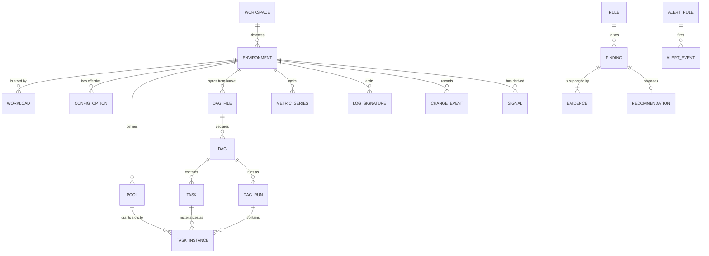

| Entity | Key attributes | Source |
|---|---|---|
| Workspace | Local DCAM instance: environments, preferences, budgets | `dcam.config.yaml` |
| Environment | Project ID, location, name, tier label (dev, test, prod…), Composer version, image version, environment size, resilience mode, Airflow URI, bucket, maintenance window | Composer API |
| Workload | Type (scheduler, dag-processor, triggerer, web-server, worker), CPU, memory, storage, count or min/max | Composer API |
| ConfigOption | Section, key, effective value, provenance (Airflow default, Composer default, override, environment variable), sensitive flag | Composer API, Airflow API, KB |
| DagFile | Bucket path, size, hash, generation, last update, DAG IDs declared, parse duration, import errors | GCS, Airflow API, logs, Composer CLI |
| Dag | `dag_id`, file, schedule or timetable, owners, tags, `max_active_tasks`, `max_active_runs`, `catchup`, paused, active, last parsed, next run | Airflow API |
| Task | `task_id`, operator, pool, `pool_slots`, queue, `priority_weight`, retries, `execution_timeout`, `trigger_rule`, downstream tasks, mapped flag | Airflow API |
| DagRun | `run_id`, run type, logical date, data interval, queued at, start, end, state | Airflow API |
| TaskInstance | Try number, map index, state, queued when, start, end, duration, hostname, pool, queue, operator, executor | Airflow API |
| Pool | Slots, occupied, running, queued, scheduled, open, deferred | Airflow API |
| MetricSeries | Metric type, resource labels, metric labels, points | Cloud Monitoring |
| LogSignature | Normalised message template, component, severity, counts, sample references | Cloud Logging |
| ChangeEvent | Type (config, image, workload, DAG file, pause, trigger, clear, maintenance, upgrade), actor, time, diff, source | Composer operations, GCS, Airflow event log, audit logs |
| Signal | Derived metric (`HM-*`) at a scope (environment, pool, DAG, task, file) and grain | DCAM analytics |
| Rule / Finding / Evidence / Recommendation | Rule definition; raised instance with scope, severity, confidence, impact, state; evidence queries and snapshots; actions and snippets | DCAM advisor |
| AlertRule / AlertEvent | Condition, duration, severity, routing; firing and resolved instances | DCAM alerting |

### 6.2 Glossary (core terms)

| Term | Definition |
|---|---|
| **Slot** | A unit of execution capacity. Celery slots = workers × `celery.worker_concurrency`. Pool slots limit concurrency per pool. A task instance occupies `pool_slots` slots of its pool while running. |
| **Effective concurrency** | The minimum of all applicable limits at a moment: `core.parallelism` per scheduler, executor slots, pool open slots, DAG `max_active_tasks`, `max_active_runs` and task-level limits such as `max_active_tis_per_dag`. |
| **Binding limit** | The limit that currently prevents more tasks from running (`HM-006`). |
| **Queue wait** | Time between a task instance being queued and starting (`start_date − queued_when`). |
| **Scheduling delay** | Time between when a DAG run *should* start (end of data interval for scheduled runs) and when it actually starts. |
| **Slot-seconds** | Running time summed over task instance tries; the base unit of DAG resource accounting (`HM-003`). *Executor slot-seconds* count one worker slot per running try. *Pool slot-seconds* multiply by `pool_slots`. |
| **Critical path** | The longest dependency chain in a DAG run measured by actual durations; it determines run duration. |
| **Deferral** | A task releases its worker slot and waits in the triggerer for an event (deferrable operators). |
| **Parse loop** | One full pass of the DAG processor over all DAG files. |
| **Stale DAG** | A DAG not seen by the DAG processor for longer than `dag_stale_not_seen_duration`; it may be deactivated. |
| **Zombie / heartbeat timeout** | A running task instance whose heartbeat stopped; the scheduler fails it. |
| **Noisy neighbour** | A DAG whose activity measurably increases queue wait or failures of other DAGs. |
| **Observer budget** | The maximum load DCAM may impose on a monitored environment and its APIs. |
| **Source lag** | Delay between an event happening and DCAM being able to read it from a source. |
| **Tenant project** | Google-managed project that hosts Composer 3 infrastructure (cluster, database) on the customer's behalf. |
| **DCU** | Data Compute Unit, the Composer 3 billing unit for environment compute, billed in DCU-hours. Google does not publish a conversion from workload sizes to DCUs, so DCAM uses billing data or user-entered rates (`HM-021`). |
| **Provenance** | Where an effective configuration value comes from: observed, environment variable, override, inferred, Composer default or Airflow default ([§14.1](#141-effective-configuration-resolution)). |

The complete glossary lives in the wiki ([§15](#15-interactive-wiki-and-runbooks)) and is generated from the same content source.

---

## 7. Data sources and agentless collection

DCAM v1 is **agentless**. It reads only through public Google Cloud APIs and the Airflow REST API, using the signed-in identity or an impersonated read-only service account. It installs nothing in monitored environments (`NG-4`).

This section is normative for collectors. For each source it states what the source provides, how DCAM reads it, the source's limits, and how DCAM degrades when the source is unavailable. Exact metric, endpoint and query details are in [Appendix A](#appendix-a-cloud-composer-metric-catalog), [Appendix B](#appendix-b-airflow-rest-api-usage) and [Appendix C](#appendix-c-cloud-logging-query-library).

> **Naming note.** Google's documentation now calls Cloud Composer *Managed Service for Apache Airflow*: Composer 3 is "Gen 3" and Composer 2 is "Gen 2". The API name (`composer.googleapis.com`), the metric prefixes and the `gcloud composer` commands are unchanged. This document keeps the Composer names.

### 7.1 Source matrix

| ID | Source | Access | What DCAM reads | Main consumers | Status |
|---|---|---|---|---|---|
| `SRC-COMPOSER` | Composer API v1 | `composer.googleapis.com` REST | Environments: state, configuration overrides, sizing, image, retention, maintenance. Also workload status, long-running operations, image versions and database properties | Inventory, Config Advisor, change timeline, `HM-025`, `HM-026`, `HM-028` | Core (M1) |
| `SRC-MON` | Cloud Monitoring API v3 | `timeSeries.list`, `metricDescriptors.list`; optionally the Prometheus-compatible query API | Composer metrics at three levels: environment, workflow (per DAG and task) and workload (per component instance) | Health, capacity, scheduler, parsing, database, triggerer, per-DAG cross-checks | Core (M1) |
| `SRC-AF-API` | Airflow REST API (v1 for Airflow 2, v2 for Airflow 3) | Environment web server (`config.airflowUri`) with a Google OAuth bearer token | DAGs, tasks, DAG runs, task instances and their tries, pools, import errors, event log, health and version. Task logs only on demand | All DAG-level analytics, the occupancy sweep and the throttle classifier | Core (v1 in M1, v2 in M3) |
| `SRC-LOG` | Cloud Logging API v2 | `entries.list`, `logs.list` | Bounded, narrow queries for log-derived signals and samples: OOM kills, evictions, zombies, import errors, database errors. Also error signatures | `HM-015`, `HM-018`, incident workspace | Core (M3) |
| `SRC-GCS` | Cloud Storage JSON API | Object list and get on the environment bucket | Inventory of `dags/` objects (name, size, generation, update time). DAG source for static analysis (opt-in) | `HM-014`, change timeline, `FR-SCAN-*` | Core (M2); source download (M7) |
| `SRC-AF-CLI` | Airflow CLI through the Composer API | `executeAirflowCommand`, `pollAirflowCommand` | Allowlisted read-only subcommands, for example `dags report` | Enrichment of `HM-013` | Optional and opt-in; needs an elevated permission ([§7.8](#78-optional-and-future-sources)) |
| `SRC-AUDIT` | Cloud Audit Logs (Admin Activity), read through Cloud Logging | `entries.list` on `cloudaudit.googleapis.com%2Factivity` | Who changed an environment, and when | Change timeline actor (`FR-CHG-01`) | Optional (M6) |
| `SRC-CAI` | Cloud Asset Inventory | `searchAllResources` | Composer environments across folders or the organization | Discovery (`FR-SETUP-04`) | Optional (M1) |
| `SRC-BQ` | BigQuery, read-only queries | `jobs.query` with a byte cap | Cloud Billing export (actual environment cost). `INFORMATION_SCHEMA.JOBS` labels for BigQuery cost per DAG | `HM-021` | Optional (M7) |
| `SRC-GKE` | GKE and Kubernetes APIs (Composer 2 only) | Read-only cluster, pod and event listing | Pod states, restarts, events, node pressure | Composer 2 depth | Optional (M8) |
| `SRC-COMPANION` | In-environment listener companion | Events from an Airflow listener plugin | Exact state transitions and timestamps | Event-level fidelity | Future ([§7.9](#79-future-in-environment-companion)) |

Collection rules (normative):

1. **Manifests.** Every collector declares, in a manifest:
   - its source and endpoint templates, which must match the read-only allowlist ([§18.2](#182-read-only-guarantee));
   - its cadence per profile, budget and watermark strategy;
   - its output schema and the capabilities it provides (`FR-COLL-01`).
2. **Capability probing.** At first contact and then daily, each adapter probes and stores a capability map per environment:
   - the Airflow version and REST API generation;
   - which metric descriptors exist and which log names exist;
   - which permissions are granted (`testIamPermissions`).

   Analytics read capability flags, never raw version strings.
3. **Graceful degradation.** A missing source disables only the dependent parts of a signal. The panel explains the cause and the fix, for example a missing permission, a disabled API or a collector that is turned off (`FR-UI-07`). Missing data is never shown as zero (`NFR-DATA-03`).
4. **Minimal raw data.** Adapters keep only the fields they need. They drop sensitive or heavy fields at the boundary: environment variable values, rendered templates, XCom values and connection details.
5. **Time.** Source timestamps are normalised to UTC. Every batch records its newest source timestamp and its fetch time, so source lag is always known (`NFR-FRESH-04`).

### 7.2 Cloud Monitoring (SRC-MON)

**What Composer exports.** About 128 metric types under `composer.googleapis.com/`, on three monitored resource types:

| Resource type | Labels | Granularity | Examples |
|---|---|---|---|
| `cloud_composer_environment` | `project_id`, `location`, `environment_name` | Environment | `environment/healthy`, `environment/scheduler_heartbeat_count`, `environment/executor/queued_tasks`, `environment/pool/open_slots`, `environment/dag_processing/total_parse_time`, `environment/database/cpu/utilization`, `environment/num_celery_workers` |
| `cloud_composer_workflow` | `project_id`, `location`, `workflow_name` (the DAG ID) | DAG and task; completed runs only | `workflow/run_duration`, `workflow/schedule_delay`, `workflow/task_instance/queued_duration`, `workflow/task/cpu_usage`, `workflow/task/log_file_size` |
| `cloud_composer_workload` | `project_id`, `location`, `environment_name`, `workload_name`, `type` | Component instance: scheduler, DAG processor, triggerer, web server, worker, Redis | `workload/cpu/usage_time`, `workload/memory/bytes_used`, `workload/restart_count`, `workload/trigger/num_running`, `workload/scheduler/loop_duration` |

Every metric carries the metric label `image_version`. The full catalog, with kinds, units, labels and sampling periods, is in [Appendix A](#appendix-a-cloud-composer-metric-catalog).

**Query strategy (ADR-0014).**

- **Endpoint and filter.** Use `projects.timeSeries.list`. The `filter` names both `metric.type` and `resource.type`, because every Composer metric is also published under an `internal_composer_*` resource type.
- **Server-side alignment.** `aggregation.alignmentPeriod` is never shorter than the metric's sampling period. `perSeriesAligner` depends on the metric kind:

  | Metric kind | Aligner |
  |---|---|
  | GAUGE | `ALIGN_MEAN` or `ALIGN_MAX` |
  | DELTA | `ALIGN_SUM` or `ALIGN_RATE` |
  | CUMULATIVE | `ALIGN_DELTA` or `ALIGN_RATE` |
  | DISTRIBUTION | `ALIGN_DELTA`, then percentile reducers |

- **Server-side reduction.** Use `crossSeriesReducer` with `groupByFields` wherever DCAM does not need per-series detail, for example total worker CPU per environment. This cuts response size and quota use.
- **Batching.** One request per metric type and project covers every monitored environment in that project (`resource.labels.environment_name = one_of(…)`).
- **No MQL.** Google ended customer support for MQL in July 2025, and `timeSeries.query` is marked deprecated. PromQL through the Prometheus-compatible HTTP API (`…/location/global/prometheus/api/v1/query_range`) MAY be used for multi-series arithmetic. Every selector MUST include `monitored_resource="cloud_composer_…"`.
- **Discovery.** `metricDescriptors.list` with the filter `metric.type = starts_with("composer.googleapis.com/")` runs at first contact and then daily, and feeds the capability map. If an environment does not expose a metric, the dependent parts of a signal are disabled; they are never shown as zero.

**Freshness.**

- Most Composer metrics are sampled every 60 s and become visible up to 120 s later; database and Airflow API metrics up to 180 s later.
- Health-check metrics are sampled every 600 s, `environment/healthy` every 300 s, and `worker/scale_factor_target` every 30 s.
- Query windows end at `now − ingestion delay`, and the trailing window is re-read to fill late points (`FR-COLL-07`).

**Retention.** Cloud Monitoring keeps Composer metrics for six weeks. DCAM's rollups keep longer baselines: by default 400 days at a 1-hour grain ([§11.7](#117-data-architecture-and-storage), `FR-STORE-02`). These long baselines are a core part of DCAM's value.

**Gotchas (each encoded as a contract test).**

1. **Workflow metrics have no `environment_name` label.** When several environments share a project and location, per-DAG workflow series can collide on DAG ID. DCAM detects DAG IDs that exist in more than one such environment, marks their series as "ambiguous", and uses Airflow API data for them instead (⚠️ VERIFY in M1 whether any label disambiguates).
2. **Workflow metrics exist only for completed DAG runs and task instances.** Live views therefore use the Airflow API.
3. **Per-task CPU and memory metrics.** `workflow/task/cpu_usage` and `workflow/task/mem_usage` (percent) come from Airflow's task utilisation sampling, which uses psutil every 5 s and was added in Airflow 2.10.
   - Upstream Airflow 3 does not emit them (checked in 3.1 and 3.3.2; ⚠️ VERIFY on Composer's Airflow 3 builds).
   - They measure only the task process.
   - Memory is a percentage of the memory the process can see.
   - CPU can exceed 100 % on multi-core workers (`HM-004`).
4. **Units differ between similar metrics.** `workflow/run_duration` is in seconds; `workflow/dag/run_duration` is in milliseconds. DCAM converts units from the metric descriptors, never from names.
5. **Counters are DELTA or CUMULATIVE.** A missing point is a gap, not a zero. Absence counts as a signal only for heartbeat-style metrics, and is then evaluated explicitly.
6. **The liveness DAG.** `environment/healthy` reflects a Composer-managed liveness DAG (`airflow_monitoring`). DCAM tags it as a system DAG and leaves it out of DAG rankings by default.
7. **Deprecated metrics are not used.** These include the smart-sensor metrics and the legacy web server CPU and memory metrics.
8. **Documentation naming drift.** Some Composer pages use metric names that differ from the descriptors, for example for triggerer metrics. The descriptors are authoritative.

**Cost.** Reading metrics through the API may be billed above a free allotment (⚠️ VERIFY current Cloud Monitoring read pricing). DCAM counts time series returned per project per day and shows the estimate on its health page (`FR-SELF-01`).

### 7.3 Cloud Logging (SRC-LOG)

**What Composer writes.**

- Composer logs use the `cloud_composer_environment` resource type, with `environment_name` and `location` labels.
- Confirmed log names include `airflow-scheduler`, `airflow-worker`, `airflow-webserver` and `dag-processor-manager`.
- Other log names MUST be discovered with `projects.logs.list` rather than hard-coded (⚠️ VERIFY names in M1). Examples are triggerer logs, database retention logs, and the OOM-event and workload start-up failure logs added in 2026.
- Task log entries carry labels such as `workflow` (the DAG ID), `execution-date` and `try-number`. `task-id` and `map-index` labels are expected but not confirmed (⚠️ VERIFY).

**Composer 3 specifics.** Task logs are stored only in Cloud Logging, not in the environment bucket. How long they remain available depends on the log bucket's retention, which is 30 days by default for the `_Default` bucket.

**Quota is the binding constraint.** `entries.list` allows **60 requests per minute per project, and this quota cannot be increased**. Every reader of that project's logs shares it. Live tailing is limited to 10 sessions per project. Therefore:

- **Budget.** By default DCAM uses at most 20 % of the quota, shared fairly across environments in the same project (`NFR-OBS-02`).
- **Metrics before logs for counts.** DCAM counts these events from metrics:

  | Event | Source |
  |---|---|
  | OOM kills | `environment/health/container_restart_count`, by `reason` |
  | Evictions | `environment/health/pod_event_count` and the `…/pod_eviction_count` metrics |
  | Zombie tasks | `environment/zombie_task_killed_count` |
  | Externally killed tasks | `environment/scheduler/task/externally_killed_count` |
  | Import errors | Airflow API |

  Logs are used only for samples and for attribution: which DAG, task or worker.
- **Narrow queries.** Every query states:
  - the resource type and environment name;
  - explicit log names;
  - a closed time window;
  - a severity floor;
  - indexed label filters.

  Full-text matching happens only inside these bounds ([Appendix C](#appendix-c-cloud-logging-query-library)).
- **Polling, not tailing.** v1 does not use `entries.tail`. Polling uses a timestamp watermark with an overlap window and deduplicates entries by `insertId`.
- **Resumable backfills.** Page tokens expire after 24 hours, so backfills resume from watermarks, not from tokens.
- **Redaction and samples.** Entries are redacted at ingest, and only bounded samples are stored (`FR-INC-03`).

**Cost.** Reading entries adds no ingestion charge; the quota is the real limit. `HM-020` analyses log volume itself.

### 7.4 Composer API (SRC-COMPOSER)

| Method | What DCAM uses | Cadence (`standard`) | Notes |
|---|---|---|---|
| `environments.list`, `environments.get` | Core: `state`, `config.airflowUri`, `config.dagGcsPrefix`, `storageConfig.bucket`, `updateTime`, `labels`.<br>Software: `softwareConfig` (`imageVersion`, `airflowConfigOverrides`, `envVariables` names, `pypiPackages`, `pythonVersion`).<br>Sizing: `workloadsConfig` (CPU, memory, storage and counts for the scheduler, DAG processor, triggerer, web server and workers), `environmentSize`, `resilienceMode`.<br>Operations: `maintenanceWindow`, `dataRetentionConfig`, `recoveryConfig`, network access settings | 10 min; snapshots are diffed into change events | Returns **overrides only**, not the effective Airflow configuration ([§14.1](#141-effective-configuration-resolution)). DCAM discards `envVariables` values at the adapter boundary unless the user opts in |
| `environments.workloads.list` | Status of each component instance (scheduler, DAG processor, triggerer, web server, Celery and Kubernetes workers, Redis), with `state` and status messages | Every `airflowFacts` cycle | Composer 2 and 3; the read-only scope is sufficient |
| `operations.list` | Create, update, upgrade, snapshot, failover, hibernate and resume operations, with state and times | With `environments.get`; every minute while the environment is `UPDATING` | Google does not document how long operations are retained, so DCAM persists them |
| `imageVersions.list` (`includePastReleases=true`) | Release date, default flag, upgrade-disabled and creation-disabled flags, supported Python versions | Daily | Basis for image support status (`REC-UPG-01`). Each Composer 3 build is supported for 12 months from its release |
| `environments.fetchDatabaseProperties` | Primary and secondary zones; whether a failover replica is available | Hourly | Relevant for high-resilience environments |

**Methods DCAM does not call.** `checkUpgrade` starts a long-running operation, so it is excluded. So are `patch`, `create`, `delete`, the snapshot methods, database failover and web server restart. `executeAirflowCommand` is optional and opt-in ([§7.8](#78-optional-and-future-sources)).

**Environment state handling.**

| State | DCAM behaviour |
|---|---|
| `HIBERNATED` | Pause Airflow API and bucket collection; keep Composer collection; show the state in every header |
| `UPDATING` | Keep collecting with patient-mode budgets ([§7.11](#711-observer-budget-do-no-harm)); mark the period as a change window on the timeline |
| `ERROR` | Collect at the `eco` cadence; show the state prominently |

### 7.5 Airflow REST API (SRC-AF-API)

**Access.** The base URL is `{config.airflowUri}/api/v1` for Airflow 2 or `/api/v2` for Airflow 3. Requests carry a Google OAuth 2.0 access token. The identity needs `composer.environments.get` plus an Airflow role. The `Viewer` role covers everything DCAM reads ([§18.3](#183-authentication-and-identity)).

**Load model.** The API is served by the environment's Airflow web server (Airflow 2) or API server (Airflow 3), and it queries the metadata database. Every DCAM call therefore costs the environment CPU and database time, and the web server's IP access rules apply. For this reason the Airflow API has the tightest budget (`NFR-OBS-01`).

**Endpoints (Airflow 2, v1).** The full table is in [Appendix B](#appendix-b-airflow-rest-api-usage).

| Purpose | Endpoint | Strategy |
|---|---|---|
| Version and capabilities | `GET /version`, `GET /health` | At connect; health every minute |
| DAG inventory | `GET /dags` (paged), `GET /dags/{dag_id}/details`, `GET /dags/{dag_id}/tasks` | Full listing trickled across the hour at background priority. Details and tasks are refreshed when the DAG's file generation or `last_parsed_time` changes |
| Non-terminal work | `GET /dags/~/dagRuns/~/taskInstances` with `state` in queued, scheduled, running, deferred, up_for_retry, up_for_reschedule (and awaiting_input on Airflow 3.3 and later) | Snapshot every live cycle, at most two pages per cycle (queued first) |
| Finished work | The same endpoint with finished states and an `updated_at` window from `watermark − overlap` to the window end ([Appendix B.3](#b3-example-incremental-task-instance-facts-airflow-2)) | Every fact cycle, with a watermark per environment. Unlike `end_date`, `updated_at` also changes when a finished task instance is marked again by hand |
| DAG runs | `GET /dags/~/dagRuns` with `state`, plus an `updated_at` window for finished runs, sorted with `order_by` | Live snapshot of queued and running runs; watermark for finished runs |
| Retries | `GET …/taskInstances/{task_id}/tries` (Airflow 2.10 and later; also in API v2) | Only for failed or retried task instances |
| Pools | `GET /pools` | Every live cycle. One request returns per-pool running, queued, scheduled, open and deferred slot counts, which makes it the cheapest live aggregate |
| Import errors and warnings | `GET /importErrors`, `GET /dagWarnings` | Every fact cycle |
| Airflow audit events | `GET /eventLogs` with a time filter | Every fact cycle, with a watermark (`FR-CHG-01`) |
| Task logs | `GET …/logs/{try_number}` | On demand only (`FR-TASK-06`) |

**`GET` only.** Every Airflow REST API read is a `GET`. DCAM does not use the batch `POST …/list` endpoints: the `GET` list endpoints accept every filter DCAM needs, including the `updated_at` windows that the API v1 batch endpoints lack, and a `GET`-only allowlist is simpler to audit ([§18.2](#182-read-only-guarantee)).

**Never requested.**

- Configuration: `/config` needs the `Op` role and is often disabled.
- Connections, variables, XCom values, rendered templates, users and roles.

**Pagination and consistency.** Paging behaviour differs by API generation (checked in the Airflow 2.11.1 and 3.3.2 source):

- **Airflow 2 (API v1).** The task instance list endpoints (`GET …/taskInstances` and the batch `POST …/taskInstances/list`) return rows in no defined order and do not cap `limit`. The DAG run list endpoints and `listMapped` accept `order_by`.
- **Airflow 3 (API v2).** `GET` list endpoints accept `order_by`, return 50 rows unless `limit` is set, and cap `limit` at `[api] maximum_page_limit` (100 by default). The batch bodies do not cap `page_limit`. From Airflow 3.2.2, `GET` DAG runs and task instances also support keyset paging with `cursor`.

Offset paging over unordered or changing data can skip or repeat rows. DCAM therefore:

- always sends an explicit page size of at most 100, because an uncapped page is an expensive query for the environment (VC-11 confirms Composer's limits);
- reads **closed time windows** and splits a window until it fits in one page, using the response's `total_entries` ([Appendix B.3](#b3-example-incremental-task-instance-facts-airflow-2)). Sorting alone is not enough: rows that leave a window while it is being paged shift the offsets of the rows behind them. From Airflow 3.2.2, keyset paging with `cursor` replaces splitting;
- filters fact windows on finished states, because the rows of running work change often (on Airflow 3, every task heartbeat updates the task instance row);
- re-reads an overlap window;
- upserts idempotently on natural keys (`dag_id`, `run_id`, `task_id`, `map_index`, `try_number`);
- keeps the number of fact queries low. The task instance and DAG run tables have no index on `updated_at` or `end_date` (checked in Airflow 2.10.5 and 3.3.2), so each window query costs more as the metadata database grows. DCAM measures the latency of its own queries (`HM-030`) and backs off when it rises ([§7.11](#711-observer-budget-do-no-harm)).

Live snapshots take exact counts from `total_entries`; when a state has more rows than the page budget allows, the rows read are a sample and are labelled as such.

**Version differences handled by the adapters (ADR-0013).**

| Concern | Airflow 2 (API v1) | Airflow 3 (API v2) |
|---|---|---|
| Logical date | `execution_date` and `logical_date` | `logical_date` (nullable), plus `run_after` |
| DAG source | `GET /dagSources/{file_token}` | `GET /dagSources/{dag_id}` |
| Data-aware scheduling | Datasets | Assets |
| Health | `/health` | `/monitor/health` |
| Scheduled timestamp on task instances | Not exposed (capability off) | `scheduled_when` (with `queued_when` and `run_after`) |
| Per-task CPU and memory metrics | Emitted from Airflow 2.10 | Not emitted upstream (⚠️ VERIFY on Composer) |
| Paging | Task instance lists have no defined order and no `limit` cap | `GET` lists: 50 rows by default, at most 100, with `order_by`; `cursor` from 3.2.2 |
| DAG run queue time | Not exposed | `queued_at` |
| `max_active_tasks` scope | Per DAG | Per DAG run ([HM-005](#hm-005-dag-self-throttling)) |
| Task-level limits (`max_active_tis_per_dag`, `max_active_tis_per_dagrun`) | Count running and queued tries | Also count deferred tries from 3.2.2, and awaiting-input tries from 3.3 |
| New task state | ― | `awaiting_input` (human-in-the-loop operators), from 3.3 |
| SLAs | `sla` and `sla_miss_callback` | Removed in 3.0; Deadline Alerts (experimental) from 3.1 |

### 7.6 Environment bucket (SRC-GCS)

- **Bucket.** The bucket name comes from `storageConfig.bucket` or `config.dagGcsPrefix`.
- **Inventory.** `objects.list` with `prefix=dags/` and a `fields` mask (`name`, `size`, `generation`, `updated`, `md5Hash`) builds the file inventory.
  - Generation changes become change events (`FR-CHG-01`).
  - They also feed deploy propagation latency (`HM-014`).
- **Downloads.** `objects.get` (media) downloads DAG source only when static analysis is enabled, only for changed generations, and only within size limits (`FR-SCAN-01`).
- **`.airflowignore`.** These files are honoured, to predict which files the DAG processor actually parses.
- **Folders read.** `plugins/` is read only when enabled. `data/` and `logs/` are never read.
- **Permissions.** DCAM needs object read on this bucket only ([Appendix E](#appendix-e-iam-permissions)). Composer's combined "environment and storage object viewer" role grants object read on every bucket in the project, so it is not recommended.

### 7.7 Cadences, watermarks and freshness

Cadences come from the active profile ([§17.2](#172-annotated-example)). When no UI client is visible, the `background` profile applies; a focused environment uses `live` (`FR-COLL-05`).

| Collector | Source and scope | Profile key | Default `live` / `standard` / `eco` | Watermark and strategy | Overlap |
|---|---|---|---|---|---|
| `af.live` | Airflow API: non-terminal task instances and runs, pools | `airflowLive` | 10 s / 30 s / 120 s | Snapshot, diffed into state transitions | ― |
| `af.facts` | Airflow API: finished task instances and runs, import errors, event log, health | `airflowFacts` | 30 s / 60 s / 300 s | `updated_at` watermark per environment, finished states only | 10 min |
| `af.inventory` | Airflow API: DAGs, details, tasks | `airflowFacts` × 10 | 5 / 10 / 50 min | Snapshot and diff; details on change | ― |
| `mon.core` | Monitoring: environment and workload metrics | `monitoring` | 60 s / 60 s / 300 s | Window ends at now − ingestion delay; trailing re-read | 10 min |
| `mon.slow` | Monitoring: 600-second health metrics, workflow metrics, per-file parse metrics | `monitoring` × 5 | 5 / 5 / 25 min | Same as `mon.core` | 20 min |
| `composer.config` | Composer API: environment and operations (workloads use the `airflowFacts` cadence) | `composer` | 5 / 10 / 30 min | Snapshot hash; operations by `createTime` | 1 h |
| `gcs.dags` | Bucket listing | `bucket` | 5 / 15 / 60 min | Generation diff | ― |
| `log.signals` | Logging: signal queries and samples | `monitoring` × 2 | 2 / 2 / 10 min | `timestamp` plus `insertId` | 10 min |
| `af.cli` | Opt-in Airflow CLI | Per environment | 60 min | Snapshot | ― |

Freshness semantics:

- **Data as of.** For each panel, "data as of" is the oldest "as of" among its inputs. Source lag is shown next to it (`NFR-FRESH-04`).
- **Late data.** Late-arriving data marks windows dirty. Dirty windows are widened by the overlap and recomputed ([§11.8](#118-analytics-pipeline-and-incremental-computation)).
- **Gaps.** Sleep, offline periods and denied calls are recorded as explicit gaps (`FR-COLL-10`).
- **Backfill.** When an environment is first added, backfill runs at background priority within the budget (`FR-COLL-04`).

### 7.8 Optional and future sources

**Optional sources (opt-in in v1).**

- **`SRC-AF-CLI`: Airflow CLI through the Composer API.**

  What Composer 3 permits:

  | Allowed (examples) | Not allowed |
  |---|---|
  | Every `dags` subcommand, including `report` and `list-import-errors`; `pools`; `db check`; `config lint` | `config list`, `config get-value`, `db clean`, `jobs check` |

  Two constraints shape how DCAM uses it:
  - The permission `composer.environments.executeAirflowCommand` is included only in administrator-level and editor-level predefined roles.
  - Each command runs in a pod inside the environment.

  Therefore:
  - It is disabled by default.
  - It needs a dedicated identity with a custom role that contains this permission.
  - The guarded client allows only `dags report`, `dags list-import-errors`, `dags list` and `version`, with validated arguments.
  - It runs at most one command per configured interval (default 60 minutes, minimum 30 minutes, `NFR-OBS-04`).
  - The doctor warns that this identity could run other commands outside DCAM.

  Per-file parse metrics are available in Cloud Monitoring (`HM-013`), so this source is an enrichment only.
- **`SRC-AUDIT`.** Admin Activity audit logs supply the actor (principal) for environment changes. Reads count against the logging budget.
- **`SRC-CAI`.** Discovery of environments across folders or the whole organization.
- **`SRC-BQ`.** Read-only BigQuery, for two purposes:
  - actual environment cost from the Cloud Billing export;
  - BigQuery job cost per DAG and task, from the `airflow-dag` and `airflow-task` job labels. `BigQueryInsertJobOperator` adds these labels automatically in `apache-airflow-providers-google` 10.17.0 and later. Values are lowercased, and labels are added only when the IDs match `^[\w-]{0,63}$`.

  Every query runs a dry run first and sets `maximumBytesBilled`.
- **`SRC-GKE` (Composer 2 only).** Read-only GKE and Kubernetes APIs for pods, restarts, events and node pressure in the customer-project cluster. This is impossible on Composer 3, where the cluster runs in the tenant project.

**Future candidates** (backlog in [§22.10](#2210-future-backlog)):

- **Offline database forensics.** On Composer 3, an environment snapshot contains a database dump. The user can import it into their own Cloud SQL instance for deep offline analysis. DCAM could document and support this manual path.
- **Data lineage** from the Data Lineage API, when Composer's lineage integration is enabled.
- **Cloud Billing Catalog API** for list prices.
- **Google's remote MCP server for Composer.** It is complementary to DCAM's own MCP server rather than a data source. See [Appendix G](#appendix-g-oss-landscape-and-positioning).

### 7.9 Future in-environment companion

**Goal.** Event-level fidelity without polling the Airflow API:

- exact state-transition timestamps, including entry into the `scheduled` state;
- per-try resource samples;
- pool decisions.

This also lowers DCAM's observer load at very large scale.

**Design sketch.** Not part of v1; it requires an ADR before any work starts.

- **Packaging.** An Airflow **listener plugin**, distributed as a PyPI package and installed through Composer's PyPI packages or the `plugins/` folder. It uses pluggy hooks such as `on_task_instance_running`, `on_task_instance_success`, `on_task_instance_failed`, `on_dag_run_running`, `on_dag_run_success` and `on_dag_run_failed`. On Airflow 3, task instance hooks receive a `RuntimeTaskInstance` in the worker's task process and no database session, `on_task_instance_skipped` exists from 3.2, and dataset hooks became asset hooks (for example `on_asset_created` and `on_asset_changed`). Listeners run inside Airflow's own processes, so the companion keeps hook work small, bounded and non-blocking, and drops events rather than slow down the scheduler or a task.
- **Event format.** Compact, versioned JSON events. The schema is defined contract-first in `packages/contracts/companion-events.schema.json`.
- **Transport options**, to be decided in the ADR:

  | Transport | Advantage | Constraint |
  |---|---|---|
  | Structured Cloud Logging entries with a dedicated log name | Simplest | Subject to the logging read quota |
  | Pub/Sub topic | Scales | DCAM needs a pull subscription |
  | NDJSON batches in a bucket path | Cheapest | Adds latency |

- **Strictly passive.** No scheduling side effects; bounded overhead per event; fail-open; feature-flagged per environment.
- **Shared contract.** The future embedded mode emits the same event schema ([§11.12](#1112-embedding-path-into-airflow-and-composer)).
- **To verify before starting:**
  - listener and plugin support on Composer 3 for each Airflow version (Composer 3 does not support scheduler plugins with Airflow 3; ⚠️ VERIFY the effect on DAG-run listeners);
  - overhead in DAG-parsing processes;
  - security review requirements in regulated organisations.

### 7.10 Quotas, limits and cost of observation

| Source | Documented limit | DCAM default use | Notes |
|---|---|---|---|
| Cloud Logging `entries.list` | 60 requests/min per project; not adjustable | ≤ 12/min per project (20 %) | Shared with every reader of the project's logs; ≤ 100 resource names per request; page tokens valid for 24 h |
| Cloud Logging tail | 10 sessions per project | Not used | ― |
| Cloud Monitoring reads | Per-project quota shown in the console (⚠️ VERIFY the value in M1) | ≤ 30 requests/min per project | 200 MB maximum response size; a metrics scope can hold up to 375 projects |
| Composer API | Per-project quotas (⚠️ VERIFY) | ≤ 6 requests/min per environment | ― |
| Airflow REST API | No Google quota; limited by web server and database capacity | ≤ 12 requests/min per environment (`standard`), at most 2 concurrent | See [§7.11](#711-observer-budget-do-no-harm) |
| Cloud Storage | Operations are billed per 10,000 | Listing every 15 min (`standard`) | Generation diffs avoid downloads |
| BigQuery | Bytes billed | Dry run plus `maximumBytesBilled` | Optional |
| `executeAirflowCommand` | Command quota; each command runs a pod | ≤ 1 per 60 min when enabled (never more than 1 per 30 min) | Optional |

**Quota project.** With user credentials, client-based APIs charge quota to a quota project. By default DCAM sends `x-goog-user-project` set to the monitored project; `auth.quotaProjectId` overrides it. Using a quota project requires `serviceusage.services.use` on that project (`FR-AUTH-04`).

### 7.11 Observer budget (do no harm)

Principle `P-2`: DCAM must never be the reason an environment is slow or a quota is exhausted.

**Mechanisms.**

1. **Token buckets.** Budgets apply per (environment, API) and, for project-level quotas, per (project, API). Defaults come from [§17.2](#172-annotated-example). Hard maxima (table below) cannot be raised by configuration.
2. **Priority classes.** Interactive (user-initiated) > live > standard > background. Backfill, inventory refresh and static analysis run as background work and always yield.
3. **Adaptive fidelity.** When a budget is exhausted, DCAM:
   - lengthens intervals;
   - fetches fewer pages;
   - skips optional enrichments;
   - shows a "reduced fidelity" banner (`FR-COLL-06`).
4. **Patient mode (incident-aware back-off).** Patient mode starts when an environment shows distress:
   - Airflow API p95 latency above 2 s, or 5xx responses and timeouts;
   - web server health reported false;
   - database CPU at or above 90 %;
   - Composer state `UPDATING`.

   In patient mode DCAM halves the Airflow API budget, suspends backfill and inventory refresh, and keeps only live snapshots. Normal mode resumes after the signals have been healthy for 10 minutes. Cloud Monitoring collection continues, because it adds no load to the environment.
5. **Circuit breakers.** Each endpoint has a circuit breaker for 429s, 5xx responses and timeouts. DCAM honours `Retry-After` and backs off exponentially with full jitter.
6. **Cheapest source first.**
   - Metrics before logs.
   - Aggregates (`/pools`) before lists.
   - Cross-DAG list endpoints (`~`) before per-DAG endpoints.
   - Field masks always.
   - Logs and source code only on demand.
7. **Single flight.** Identical in-flight requests are coalesced, so several panels asking for the same data produce one call.
8. **Global budgets.** Only the DCAM server process calls external APIs; the CLI and the MCP bridge go through DCAM's HTTP API (ADR-0018). Budgets are therefore global for the whole workspace.
9. **Self-measurement.** DCAM records every outgoing request: API, endpoint template, status, latency and bytes. It shows its own footprint per environment. Where Composer reports Airflow API request counts (`environment/api/request_count`; ⚠️ VERIFY what it counts), DCAM also shows its share of all requests.
10. **Tests.** Budget compliance is tested with fake clocks, fakes and the emulator (`NFR-OBS-05`).

**Default budgets and hard maxima.**

| API | `live` | `standard` | `eco` | `background` | Hard maximum |
|---|---|---|---|---|---|
| Airflow API requests/min per environment | 60 | 12 | 4 | 2 | 120, with at most 4 concurrent |
| Cloud Monitoring requests/min per project | 30 | 30 | 10 | 5 | 120 (⚠️ VERIFY against the quota) |
| Cloud Logging requests/min per project | 12 | 12 | 6 | 3 | 30 (50 % of the quota) |
| Composer API requests/min per environment | 6 | 6 | 2 | 1 | 30 |
| Cloud Storage operations/min per environment | 10 | 4 | 1 | 1 | 60 |

**Budget arithmetic at reference scale.** One environment with 5,000 DAGs and 100,000 task instances per day, on the `standard` profile. The M1 spike measures the real values.

| Call group | Requests per minute |
|---|---|
| `GET /pools` every 30 s | 2 |
| Non-terminal task instance snapshot, 1 page every 30 s | 2 |
| Non-terminal DAG run snapshot every 60 s | 1 |
| Finished task instances: about 70 per minute on average, about 5 × at peaks, 100 per page | 1–4 |
| Finished DAG runs | 1 |
| Import errors, event log and health | about 1.5 |
| DAG inventory: 50 pages trickled across the hour | about 1 |
| **Total** | **about 9.5–12.5** |

This fits the 12 requests/min budget. At peaks the snapshot pages are capped, and the cheap `/pools` aggregates plus Cloud Monitoring executor metrics keep the live view accurate.

---

## 8. Hidden metrics and derived signals catalog

Composer and Airflow already emit many raw metrics. DCAM adds **derived signals** that answer the questions in [§4.3](#43-top-questions-dcam-must-answer): who consumes capacity, why work waits, what is at risk and what to change. Each signal has a stable `HM-` ID, a versioned definition in `metrics-pack`, an explanation page (the (i) pattern, [§12.9](#129-the-i-explanation-pattern)) and golden tests (`NFR-DATA-01`).

This section is normative for definitions and methods. Thresholds that turn signals into findings are defined in the rules ([§13.6](#136-seed-rule-catalog)) and alerts ([§16.4](#164-default-alert-pack)), not here.

### 8.1 Signal definition standard

Every signal MUST declare:

| Field | Meaning |
|---|---|
| `id`, `name`, `version` | Stable ID, display name and semantic version. A change of meaning increments the major version ([§8.9](#89-statistical-methods-and-data-quality)) |
| `question` | The `Q-` questions it answers |
| `definition` | One-sentence plain-language definition, shown in the (i) panel |
| `unit` | SI unit or `ratio`, `count`, `score` |
| `scopes` | Any of environment, pool, queue, DAG, task, file, worker, team, fleet |
| `grains` | Any of 1 min, 5 min, 1 h, 1 day |
| `sources`, `inputs` | `SRC-` IDs ([§7.1](#71-source-matrix)), and the facts and rollups it reads |
| `method` | Formula or algorithm, with alternatives (Method A, Method B) when sources vary |
| `capabilities` | Required capability flags, for example `af.scheduledWhen` or `mon.taskCpuMetrics` |
| `quality` | Minimum samples, approximation rules, known biases |
| `explanation`, `tests` | Explanation MDX file and golden test folder |

Every value DCAM returns for a signal carries the same envelope, which the UI, the HTTP API, exports and the MCP server all expose:

| Envelope field | Meaning |
|---|---|
| `value`, `unit` | The value in SI units |
| `approximate` | `true` when the value is estimated, read from rollups beyond raw retention, or based on inferred configuration |
| `method` | Which method produced it (for example `HM-004/A`) |
| `confidence` | `high`, `medium` or `low`, from the signal's quality rules |
| `samples` | Number of observations behind the value |
| `dataAsOf`, `sourceLag` | Freshness ([§7.7](#77-cadences-watermarks-and-freshness)) |
| `gaps` | Missing capabilities or collection gaps that affect the value |

The UI renders `approximate` values with a "≈" prefix and the method in the tooltip (`NFR-DATA-04`).

### 8.2 Catalog overview

| ID | Signal | Answers | Primary sources | First milestone |
|---|---|---|---|---|
| HM-001 | Queue wait | Q-03 | `SRC-AF-API`, `SRC-MON` | M3 |
| HM-002 | Scheduling delay (late starts) | Q-08 | `SRC-AF-API`, `SRC-MON` | M3 |
| HM-003 | Slot-seconds per DAG | Q-02 | `SRC-AF-API` | M3 |
| HM-004 | Estimated CPU and memory per DAG and task | Q-02 | `SRC-MON`, `SRC-AF-API` | M3 |
| HM-005 | DAG self-throttling | Q-03 | `SRC-AF-API` | M3 |
| HM-006 | Throttle reason classifier (binding limit) | Q-03, Q-08 | `SRC-AF-API`, `SRC-MON`, `SRC-COMPOSER` | M3 (v0), M4 (full) |
| HM-007 | Critical path | Q-16 | `SRC-AF-API` | M4 |
| HM-008 | Sensor and long-wait slot waste | Q-15 | `SRC-AF-API`, `SRC-MON` | M4 |
| HM-009 | Schedule collision density | Q-09 | `SRC-AF-API` | M4 |
| HM-010 | 24-hour load forecast | Q-10 | `SRC-AF-API`, history | M4 |
| HM-011 | Capacity utilisation and saturation | Q-04 | `SRC-MON`, `SRC-COMPOSER`, `SRC-AF-API` | M2 |
| HM-012 | Autoscaling responsiveness | Q-04 | `SRC-MON`, `SRC-COMPOSER` | M4 |
| HM-013 | Parse cost per file and stale-DAG risk | Q-05 | `SRC-MON`, `SRC-AF-API`, `SRC-GCS` | M2 |
| HM-014 | Deploy propagation latency | Q-05 | `SRC-GCS`, `SRC-AF-API`, `SRC-MON` | M5 |
| HM-015 | Failures, retries, flakiness and error signatures | Q-06 | `SRC-AF-API`, `SRC-LOG` | M3 |
| HM-016 | Duration regression | Q-07 | `SRC-AF-API` | M3 |
| HM-017 | Noisy-neighbour effect | Q-11 | Derived from HM-001 and occupancy | M4 |
| HM-018 | Task disruption (zombies, kills, OOM, evictions) | Q-01, Q-06 | `SRC-MON`, `SRC-AF-API`, `SRC-LOG` | M3 |
| HM-019 | Metadata database growth and retention health | Q-17 | `SRC-MON`, `SRC-COMPOSER` | M2 |
| HM-020 | Log volume attribution | Q-18 | `SRC-MON`, `SRC-LOG` | M6 |
| HM-021 | Cost attribution | Q-02, Q-18 | Manual rates or `SRC-BQ`, plus HM-003 and HM-004 | M3 (estimate), M7 (billing export) |
| HM-022 | Triggerer utilisation | Q-04 | `SRC-MON`, `SRC-AF-API`, `SRC-COMPOSER` | M2 |
| HM-023 | Priority fairness and starvation | Q-03 | `SRC-AF-API` | M4 |
| HM-024 | Catchup and backfill storm risk | Q-08 | `SRC-AF-API` | M4 |
| HM-025 | Configuration and environment drift | Q-13, Q-14 | `SRC-COMPOSER`, `SRC-AF-API`, config KB | M5 |
| HM-026 | Upgrade readiness | Q-20 | `SRC-COMPOSER`, `SRC-GCS`, config KB | M2 (image), M7 (code) |
| HM-027 | Worker packing efficiency | Q-04 | `SRC-MON`, `SRC-AF-API` | M4 |
| HM-028 | Explainable health score | Q-01 | `SRC-MON`, `SRC-AF-API`, `SRC-COMPOSER` | M2 |
| HM-029 | Timeliness target adherence | Q-08 | `SRC-AF-API`, user targets | M4 |
| HM-030 | Observer footprint | Self | DCAM request log, `SRC-MON` | M1 |
| HM-031 | Scheduler loop health | Q-01, Q-03 | `SRC-MON` | M2 |
| HM-032 | Effective capacity inference | Q-04, Q-13 | `SRC-MON`, `SRC-AF-API`, `SRC-COMPOSER` | M2 |

Card format: each card below lists **Answers**, **Definition**, **Method**, **Sources**, **Quality and caveats** and **Used by**. Scopes and grains are in the `metrics-pack` definitions.

### 8.3 Capacity, concurrency and contention

#### HM-001 Queue wait

- **Definition.** How long a task instance try waits after it is queued for the executor until it starts: `start_date − queued_dttm`. The REST API exposes `queued_dttm` as `queued_when`.
- **Method.**
  - Exact per try from finished task instance facts.
  - Live: from the queued snapshot (`now − queued_when`).
  - Aggregated per pool, queue, DAG, task, hour of day and team as p50, p95 and maximum, with sample counts.
  - The occupancy sweep ([§11.8](#118-analytics-pipeline-and-incremental-computation)) also produces queued counts per minute.
- **Sources.** `SRC-AF-API` (primary). `workflow/task_instance/queued_duration` in `SRC-MON` is a cross-check for completed tries only. Disagreements above 10 % are logged as data-quality events.
- **Quality and caveats.**
  - Queue wait covers only the executor phase. Waiting before queueing (pools, DAG limits, parallelism) appears in HM-006 as pre-queue wait.
  - Rescheduled sensors re-enter the queue on each poke; each poke is counted.
- **Used by.** `FR-BOTL-02`, `AL-06`, HM-006, HM-017, HM-023, `REC-CONC-04`.

#### HM-003 Slot-seconds per DAG

- **Definition.** How much execution capacity a DAG consumed. DCAM computes two variants, because they answer different questions:
  - **Executor slot-seconds** = Σ over task instance tries of running time. A running try occupies one worker slot regardless of `pool_slots`. Use it for worker capacity and cost allocation.
  - **Pool slot-seconds** = Σ over tries of running time × `pool_slots`, per pool. When the pool counts deferred tasks (`include_deferred`), deferred time is added. Time in `awaiting_input` (Airflow 3.3 and later) never occupies pool slots. Use it for pool contention.
- **Method.** Occupancy sweep over running intervals. Deferred intervals never count as executor time. Results are aggregated per DAG, task, pool, team and environment, with share of total and Pareto concentration (`FR-DAGX-03`).
- **Sources.** `SRC-AF-API`.
- **Quality and caveats.**
  - **Reschedule-mode sensors.** Airflow keeps the first start date across reschedules, so `end − start` overstates occupancy. DCAM subtracts the time it observed in `up_for_reschedule` in live snapshots, and labels the value approximate (⚠️ VERIFY in M1).
  - Mapped tasks count every map index.
- **Used by.** `FR-DAGX-02`, HM-021, HM-017, `REC-CONC-03`, `REC-COST-03`.

#### HM-004 Estimated CPU and memory per DAG and task

- **Definition.** Estimated CPU-seconds and memory GB-seconds attributable to each task and DAG.
- **Method A (preferred; per-task metrics).** Uses `workflow/task/cpu_usage` and `workflow/task/mem_usage` (percent, label `task_id`, emitted by Airflow 2.10 and later).
  - CPU-seconds = Σ mean CPU % ÷ 100 × running time.
  - Memory GB-seconds = Σ mean memory % ÷ 100 × reference memory × running time.
  - The reference memory is the worker memory limit until the M1 spike confirms what the percentage is relative to.
- **Method B (fallback; pro-rata).** Each worker's measured CPU (`workload/cpu/usage_time`) and memory (`workload/memory/bytes_used`) per minute are split across the task instances running on that worker in that minute, weighted equally per try.
  - Workers are matched through the task instance `hostname` and the workload `workload_name` (⚠️ VERIFY the mapping on Composer 3).
  - Idle and overhead consumption is reported as "unattributed".
- **Sources.** `SRC-MON`, `SRC-AF-API`.
- **Quality and caveats.**
  - Always labelled estimate, with the method (`NFR-DATA-04`).
  - Method A measures only the task process: child processes are partly visible, external services are not.
  - CPU can exceed 100 % on multi-core workers.
  - Memory percentage may be relative to node memory rather than the container limit (⚠️ VERIFY).
  - Upstream Airflow 3.1 does not emit these metrics, so Airflow 3 environments use Method B unless the capability probe finds them.
  - Workflow metrics carry no environment label, so collisions in shared projects fall back to Method B ([§7.2](#72-cloud-monitoring-src-mon)).
- **Used by.** `FR-DAGX-02`, HM-008, HM-021, HM-027.

#### HM-005 DAG self-throttling

- **Definition.** Share of a DAG's active time in which its own limits block its own ready work.
- **Method.**
  - `max_active_tasks` saturation: minutes where the DAG's running and queued task instances reach `max_active_tasks` (per DAG or per DAG run, see below) while it has ready but unqueued work, ÷ minutes the DAG was active.
  - The same ratio for `max_active_runs`: queued runs while running runs equal the limit.
  - Task-level limits (`max_active_tis_per_dag`, `max_active_tis_per_dagrun`) are evaluated per task; the states they count differ by version ([§7.5](#75-airflow-rest-api-src-af-api)).
- **Sources.** `SRC-AF-API` (DAG details, task attributes, occupancy).
- **Quality and caveats.**
  - The scope differs by version. On Airflow 2 the scheduler counts running and queued task instances across all active runs of the DAG. On Airflow 3 it counts them per DAG run, so a DAG with several active runs can use up to `max_active_runs × max_active_tasks` slots. This was checked in the scheduler source of Airflow 2.10.5, 3.1.0 and 3.3.2. The configuration reference describes the per-run scope from Airflow 3.2; the Airflow 3.0 and 3.1 references still describe the Airflow 2 behaviour. The capability flag `af.maxActiveTasksScope` (`dag` or `dagRun`) selects the semantics, and VC-13 confirms them on Composer.
  - "Ready" times are inferred on Airflow 2 ([HM-006](#hm-006-throttle-reason-classifier)).
- **Used by.** `REC-DAG-01`, `REC-DAG-02`, HM-006.

#### HM-006 Throttle reason classifier

- **Definition.** For each minute, attributes waiting time to the limit that prevented work from running (the *binding limit*, [§6.2](#62-glossary-core-terms)).
- **Waiting is measured at two levels:**
  - **Run waiting.** A DAG run in state `queued`.
  - **Task waiting.** A task instance whose upstream dependencies are satisfied but which is not running. Waiting has three phases:
    - *Pre-queue* (ready → queued). The scheduler checks DAG limits, pools and parallelism in this phase.
    - *Post-queue* (queued → running). The executor and workers act in this phase.
    - *Deferral* (deferred → resumed).
- **Ready time.**
  - Airflow 3's API v2 returns `scheduled_when` on task instances (checked in the Airflow 3.0.0, 3.1.0 and 3.3.2 OpenAPI specifications); when it is populated, the scheduler's own timestamp is used.
  - On Airflow 2 it is inferred as `max(run start, latest end of direct upstream tries)`. It is labelled approximate for trigger rules other than `all_success`.
- **Ordered decision table.** For each waiting minute, the first matching reason wins. Other matching reasons are kept as secondary evidence.

| # | Reason | Phase | Condition in that minute (defaults) | Evidence shown |
|---|---|---|---|---|
| 1 | DAG `max_active_runs` | Run | Run is queued and the DAG's running runs ≥ `max_active_runs` | Run counts, limit |
| 2 | Task-level limit | Pre-queue | Running and queued tries of the task ≥ `max_active_tis_per_dag` or `max_active_tis_per_dagrun`; from Airflow 3.2.2 deferred tries also count, and from 3.3 awaiting-input tries | Task attributes, occupancy |
| 3 | DAG `max_active_tasks` | Pre-queue | The DAG's running and queued task instances ≥ `max_active_tasks` (per DAG on Airflow 2, per DAG run on Airflow 3) | HM-005 |
| 4 | Pool | Pre-queue | Pool open slots < the task's `pool_slots` | `/pools` history, `pool/starving_tasks` |
| 5 | Global parallelism | Pre-queue | Executor running + queued ≥ parallelism (per scheduler; from overrides or HM-032) | `executor/*` metrics, HM-032 |
| 6 | Scheduler throughput | Pre-queue | Reasons 1–5 do not apply, yet the try is not queued within 30 s of ready | HM-031 |
| 7 | Autoscaling lag | Post-queue | Worker slots are full, workers < `max_count`, and the scale target is above the current worker count | `num_celery_workers`, `worker/scale_factor_target` |
| 8 | Executor slots exhausted | Post-queue | Worker slots are full and workers = `max_count` | HM-011 |
| 9 | Worker pickup | Post-queue | Free worker slots exist but the try stays queued for ≥ 60 s, or no worker consumes the try's queue | `executor/open_slots`, `task_queue_length` by queue |
| 10 | Triggerer capacity | Deferral | The try is deferred while running triggers ≥ 95 % of triggerer capacity | HM-022 |
| 11 | Unknown | Any | None of the above can be evaluated or matched | Gaps listed |

- **Not throttling.** Dependency waits are reported separately as "dependency wait (not a platform limit)": upstream tasks, `depends_on_past`, sensors waiting for external events, and asset or dataset triggers. Together with the 11 reasons this covers the categories in `FR-BOTL-01`.
- **Output.**
  - Stacked waiting task-minutes per reason, per environment, pool, DAG and hour.
  - Top contributors per reason.
  - Current binding limit for the live view and the concurrency stack ([§14.3](#143-relationship-graph-concurrency-stack)).
- **v0 (M3).** Reasons 3, 4, 7, 8 and 11, from live snapshots and metrics. The full table follows in M4.
- **Quality and caveats.**
  - Each minute records which reasons could be evaluated. If limits are unknown (for example parallelism before HM-032 has confidence), the reason is marked unevaluated rather than guessed.
  - Golden tests use the emulator scenarios ([§20.4](#204-scenario-library)).
- **Used by.** `FR-BOTL-01`, `REC-CAP-01`, `REC-CAP-05`, `REC-CONC-01`, `REC-SCH-03`, `REC-SCHED-01`, `REC-SCHED-02`, HM-002.

#### HM-008 Sensor and long-wait slot waste

- **Definition.** Executor slot-seconds spent waiting rather than working.
- **Method.**
  - **Sensors.** Operator class names ending in `Sensor`, or classes listed in the knowledge base. Mode is inferred from behaviour:
    - observed `up_for_reschedule` means reschedule mode;
    - observed `deferred` means deferrable;
    - otherwise poke mode.

    Static analysis confirms the mode from M7.
  - **Waste.** Poke-mode slot-seconds, plus reschedule-mode poke time.
  - **Long waits.** Non-sensor tries running ≥ 10 min with mean CPU < 5 %, from HM-004 Method A. These are typically synchronous operators that poll external jobs and are candidates for deferrable mode.
- **Sources.** `SRC-AF-API`, `SRC-MON`.
- **Quality and caveats.**
  - Long-wait detection needs Method A; without it, only sensors are ranked.
  - The deferrable-operator suggestion is checked against the knowledge base, which records which installed provider operators support `deferrable=True`.
- **Used by.** `FR-BOTL-07`, `REC-DAG-05`, `REC-CODE-06`.

#### HM-011 Capacity utilisation and saturation

- **Definition.** Worker slot capacity versus use over time, and whether the environment is capacity-bound.
- **Method.**
  - Capacity = workers × `worker_concurrency`. When concurrency is unknown, capacity = `executor/open_slots + running_tasks` from HM-032.
  - Used = `executor/running_tasks`, cross-checked with live running task instances.
  - Utilisation = used ÷ capacity.
  - **Capacity-bound minutes** = workers = `max_count` and queued task instances ≥ max(10, 20 % of capacity).
  - **Idle minimum** = utilisation p95 < 20 % per hour while workers = `min_count`.
  - Shown as series, an hour-of-day × weekday heatmap and the share of capacity-bound minutes.
- **Sources.** `SRC-MON` (`num_celery_workers`, `worker/{min_workers,max_workers}`, `executor/*`, `unfinished_task_instances`), `SRC-COMPOSER` (configured counts), `SRC-AF-API` (live).
- **Quality and caveats.**
  - On Composer 3 workers can temporarily drop below `min_count` during maintenance. These periods are flagged, not treated as misconfiguration.
  - Kubernetes executor tasks (CeleryKubernetesExecutor) do not use Celery slots and are reported separately.
- **Used by.** `FR-ENV-02`, `FR-FLEET-01`, `REC-CAP-01`, `REC-CAP-02`, `AL-05`.

#### HM-012 Autoscaling responsiveness

- **Definition.** How quickly worker capacity follows demand, and what scale-down costs.
- **Method.**
  - A scale-up episode starts when demand (running + queued Celery tasks) exceeds capacity, and ends when workers reach the autoscaler target or demand falls.
  - **Lag** = time to the first added worker, and time to the target.
  - Also reported: time at `max_count` per day, scale-down events (worker count decreases) and failures within 5 minutes after them (links to HM-018).
- **Sources.** `SRC-MON` (`worker/scale_factor_target` sampled every 30 s, `num_celery_workers`, `executor/*`, `task_queue_length`), `SRC-COMPOSER`.
- **Quality and caveats.**
  - Composer's autoscaler considers current workers, queued Celery tasks, idle workers and `worker_concurrency`. A high `worker_concurrency` can suppress scale-out, because few workers appear to have room (`REC-CAP-08`).
  - Lags shorter than 2 sampling periods are reported as "below resolution".
- **Used by.** `FR-BOTL-09`, `REC-CAP-06`, `REC-CAP-07`, `REC-CAP-08`.

#### HM-017 Noisy-neighbour effect

- **Definition.** How much a DAG's activity is associated with longer queue waits for other DAGs.
- **Method.**
  - For each candidate DAG D, compare other DAGs' queue wait (HM-001) in minutes when D occupies ≥ 10 % of slots with matched minutes when D is inactive. Minutes are matched by hour of week and environment, over 28 days.
  - Effect = difference in median wait. A bootstrap 95 % confidence interval is computed with 1,000 resamples.
  - Rank D by effect × affected task-minutes.
  - Only DAGs with ≥ 60 active minutes and ≥ 200 affected tries qualify.
- **Sources.** Derived from HM-001 and occupancy.
- **Quality and caveats.**
  - This is association, not causation; the UI wording says "associated with".
  - Confounding by shared schedules is reduced by hour-of-week matching but not removed. The evidence panel shows overlap windows and the confidence interval.
- **Used by.** `FR-BOTL-06`.

#### HM-022 Triggerer utilisation

- **Definition.** Running triggers relative to triggerer capacity, and triggerer health.
- **Method.**
  - Utilisation = Σ `workload/trigger/num_running` ÷ (triggerer count × trigger capacity per triggerer).
  - Capacity comes from the override or the knowledge base default: Airflow 2 `[triggerer] default_capacity`, renamed `[triggerer] capacity` in Airflow 3; default 1000 in both (⚠️ VERIFY Composer's default, VC-16).
  - Also reported: blocking and failed triggers (`trigger/*`), triggerer CPU and memory versus limit, and deferred task instances by DAG.
- **Sources.** `SRC-MON`, `SRC-AF-API`, `SRC-COMPOSER`.
- **Quality and caveats.** Documentation names some triggerer metrics differently from the descriptors; descriptors are authoritative ([§7.2](#72-cloud-monitoring-src-mon)).
- **Used by.** `FR-ENV-05`, `REC-TRG-01`, `REC-TRG-02`, `AL-13`, HM-006.

#### HM-023 Priority fairness and starvation

- **Definition.** Whether low-priority work waits disproportionately while higher-priority work runs.
- **Method.**
  - Group tries by effective `priority_weight` band (quantiles within the pool, because priority applies within a pool).
  - Compare each band's p95 queue and pre-queue wait with its own 28-day median during periods when higher bands ran.
  - Starvation ratio = current p95 ÷ baseline median.
- **Sources.** `SRC-AF-API`.
- **Quality and caveats.** The effective weight depends on `weight_rule`. DCAM uses the weight the API reports per task instance (⚠️ VERIFY that this is the effective weight).
- **Used by.** `REC-CONC-04`.

#### HM-027 Worker packing efficiency

- **Definition.** Whether workers are under-packed (resources idle while slots are full) or over-packed (resources exhausted).
- **Method.**
  - Per worker and minute: CPU and memory use ÷ limits, against busy slots ÷ `worker_concurrency`.
  - Quadrants:

    | Quadrant | Condition |
    |---|---|
    | Under-packed | Slots full; CPU p95 < 30 % and memory p95 < 40 % |
    | Over-packed | CPU p95 ≥ 90 % or memory p95 ≥ 85 %, or OOM signals |
    | Balanced | Otherwise |

  - Sizing check against Composer guidance: `worker_concurrency` ≤ min(24, 12 × worker vCPU, 8 × worker memory GB) (⚠️ VERIFY current guidance). This is shown as the "supported concurrency ceiling".
- **Sources.** `SRC-MON` (`workload/*` for workers), `SRC-AF-API`, HM-032.
- **Quality and caveats.** Composer 3 accepts `worker_concurrency` from 1 to 24; recommendations never exceed this range.
- **Used by.** `REC-CAP-03`, `REC-CAP-04`, `REC-CAP-05`, `REC-COST-01`.

#### HM-032 Effective capacity inference

- **Definition.** Best estimate of capacity-relevant settings that cannot be read directly, with provenance.
- **Why.** The Composer API returns configuration overrides only. The Airflow `/config` endpoint needs the `Op` role and is often disabled, and CLI configuration commands are blocked on Composer 3 ([§14.1](#141-effective-configuration-resolution)).
- **Method.**

  | Setting | How DCAM resolves it |
  |---|---|
  | `core.parallelism` (per scheduler) | `executor/open_slots + running_tasks + queued_tasks`. The sum equals parallelism for the executor that reports it; DCAM takes the stable maximum over 24 h |
  | `celery.worker_concurrency` | Override value if present. Otherwise a lower bound: the maximum number of concurrent running tries observed on any single worker hostname, and exact when a worker was full while tasks were queued |
  | Total worker slots | Workers × resolved concurrency |
  | Pools, DAG and task limits | Exact, from the API |

  Each value carries a provenance label from [§14.1](#141-effective-configuration-resolution): for example `override`, `inferred` (with confidence), `composer-default` or `airflow-default`.
- **Sources.** `SRC-MON`, `SRC-AF-API`, `SRC-COMPOSER`, config KB.
- **Quality and caveats.**
  - Inferred values are never displayed as configured values.
  - The Config Advisor shows them with an "inferred" badge and the evidence.
- **Used by.** HM-006, HM-011, HM-027, `FR-CFG-01`, `REC-CONC-01`.

### 8.4 Timeliness and schedules

#### HM-002 Scheduling delay

- **Definition.** How late a scheduled DAG run starts relative to when it should start.
- **Method.**
  - Delay = run `start_date` − expected start.
  - The expected start is the end of the data interval for interval schedules, or `run_after` on Airflow 3.
  - Only `scheduled` runs are included; manual, backfill and asset-triggered runs are excluded.
  - Delays are attributed with HM-006 run-level and first-task reasons.
- **Sources.** `SRC-AF-API` (primary); `workflow/schedule_delay` in `SRC-MON` as a cross-check.
- **Quality and caveats.**
  - The first run after unpausing and catch-up runs are excluded or flagged.
  - Time zones follow the DAG's timetable.
- **Used by.** `REC-SCHED-02`, `FR-BOTL-01`, HM-029.

#### HM-007 Critical path

- **Definition.** The chain of tasks that determined a DAG run's duration.
- **Method.**
  - Build the run's task graph from `downstream_task_ids`, weighted by each try's wait plus run time.
  - Compute the longest path from run start to run end, and slack per task (how much it could slip without delaying the run).
  - Across N runs, report critical-path frequency per task.
- **Sources.** `SRC-AF-API`.
- **Quality and caveats.**
  - Mapped tasks are collapsed to their longest map index.
  - Skipped branches are excluded.
  - Retries add their wait and run time.
- **Used by.** `FR-DAGD-*`, `REC-DAG-06`, HM-029.

#### HM-009 Schedule collision density

- **Definition.** How strongly planned run starts cluster in the same minutes.
- **Method.**
  - Enumerate the planned starts of every active DAG for the next 7 days. Cron schedules are expanded in the DAG's time zone, honouring daylight-saving transitions. Timetables use `next_dagrun` data and history.
  - Build a minute-of-hour × hour-of-week density.
  - **Collision index** = share of daily starts in the busiest minute.
  - **Collision cost** = Σ expected slot demand of starts in the minute, from historical occupancy profiles.
  - **Stagger suggestions** (`FR-BOTL-04`): greedy offset assignment that minimises peak demand within each DAG's tolerance (default ±15 min), respecting timeliness targets (HM-029).
- **Sources.** `SRC-AF-API`.
- **Quality and caveats.** Asset-triggered and manual runs are approximated by hour-of-week baselines.
- **Used by.** `FR-BOTL-03`, `FR-BOTL-04`, `REC-SCHED-01`.

#### HM-010 24-hour load forecast

- **Definition.** Expected slot demand for the next 24 hours, compared with capacity.
- **Method.**
  - For each planned run, add the DAG's historical run occupancy profile (slot demand per minute since run start) at its planned start, using p50 for the central forecast and p10 and p90 for the band.
  - Add an hour-of-week baseline for unscheduled demand.
  - Compare with capacity at `max_count` (HM-011, HM-032) and with pool sizes.
  - Overlay the maintenance window.
- **Sources.** `SRC-AF-API`, history.
- **Quality and caveats.** Requires ≥ 14 days of history per DAG; otherwise the DAG's contribution is labelled low confidence.
- **Used by.** `FR-BOTL-05`, `REC-SCHED-03`.

#### HM-016 Duration regression

- **Definition.** Tasks or DAG runs that are now slower than their own baseline.
- **Method.**
  - Baseline: the previous 28 days excluding the current window. Only successful tries are used, and maintenance windows are excluded.
  - Current window: 24 h, or 7 days for tasks that run less than daily.
  - A regression is flagged when all three hold:
    - current p95 ≥ 1.3 × baseline p95;
    - ≥ 10 current samples;
    - a one-sided Mann–Whitney U test gives p < 0.01.
  - Across all tasks of an environment, the Benjamini–Hochberg procedure controls the false discovery rate at q = 0.05.
  - A change-point step (PELT on log durations) dates the shift and links it to change events (`FR-CHG-*`).
- **Sources.** `SRC-AF-API`.
- **Quality and caveats.** Data-dependent tasks (volume-driven) can show legitimate growth; users can mark a task "volume-driven" to switch it to trend monitoring.
- **Used by.** `FR-TASK-01`, `REC-DAG-08`.

#### HM-024 Catchup and backfill storm risk

- **Definition.** How many runs would be created at once by unpausing a DAG or by a scheduling gap.
- **Method.**
  - For DAGs with `catchup=True`: count the schedule intervals between the next data interval start and now.
  - Detect actual storms: ≥ 10 runs created within 10 minutes with logical dates in the past.
  - Backfill runs (`run_type=backfill`) are tracked separately.
- **Sources.** `SRC-AF-API` (DAG details, runs).
- **Used by.** `REC-DAG-03`, `REC-CODE-08`.

#### HM-029 Timeliness target adherence

- **Definition.** Share of DAG runs that complete by a user-defined target, such as "by 06:00 Europe/Paris" or "within 90 min of the data interval end".
- **Method.**
  - Adherence = met ÷ total over 7 and 28 days, plus the lateness distribution.
  - **At-risk prediction** for running runs: remaining critical-path time (HM-007 profile) > time left to the target.
- **Sources.** `SRC-AF-API`, targets in `dcam.config.yaml`.
- **Quality and caveats.** These targets are independent of Airflow's own SLA or deadline features, which differ between Airflow 2 and 3; DCAM does not depend on them.
- **Used by.** `FR-TASK-05`, `REC-SCHED-04`, `AL-14`.

### 8.5 DAG parsing and deployment

#### HM-013 Parse cost per file and stale-DAG risk

- **Definition.** Which DAG files make parsing slow, and how close the parse loop is to making DAGs stale.
- **Method.**
  - **Per-file cost.** p50 and p95 of `environment/dag_processing/last_duration` (milliseconds, label `dag_file`), share of the loop, and trend.
  - **Loop duration.** `environment/dag_processing/total_parse_time` (seconds).
  - **Stale-risk ratio** (Airflow 2) = loop p95 ÷ `[scheduler] dag_stale_not_seen_duration` (default 600 s). With a standalone DAG processor, as on Composer 3, DAGs that the processor has not updated for this long are deactivated. Airflow 3 removed the option: a DAG is deactivated only when a re-parsed file no longer contains it (`[dag_processor] stale_dag_threshold`). On Airflow 3, DCAM therefore reports slow loops as update latency, not as deactivation risk.
  - **Guidance ratio** = loop p95 ÷ 300 s. Google advises keeping total parse time under 5 minutes.
  - Also reported: DagBag size, parse error and processor timeout counts, and files at or above 10 s, which suggests overloaded DAG processors.
  - Files are joined to DAGs through `fileloc` from the API, and to bucket objects ([§7.6](#76-environment-bucket-src-gcs)).
- **Sources.** `SRC-MON` (primary), `SRC-AF-API`, `SRC-GCS`. The optional `SRC-AF-CLI` `dags report` adds per-file DAG and task counts. On Airflow 3.1 and later, `GET /dags` also returns `last_parse_duration`, a cross-check that costs no extra call.
- **Quality and caveats.**
  - Gaps in parse metrics often mean the loop exceeded the reporting cycle. DCAM flags gaps rather than interpolating.
  - Composer 3 blocks `[scheduler] parsing_processes`; recommendations target DAG processor count and CPU instead.
- **Used by.** `FR-ENV-04`, `REC-PARSE-01`, `REC-PARSE-02`, `REC-PARSE-04`, `REC-PARSE-06`, `REC-PARSE-08`, `AL-03`.

#### HM-014 Deploy propagation latency

- **Definition.** Time from a DAG file update in the bucket to the updated DAG being parsed.
- **Method.**
  - For each new object generation (bucket `updated` time U): latency = the first `last_parsed_time` ≥ U among the DAGs declared in that file, minus U.
  - Decomposed where possible: bucket synchronisation time (`workload/dags_sync_duration`), plus wait for the next parse of the file.
- **Sources.** `SRC-GCS`, `SRC-AF-API`, `SRC-MON`.
- **Quality and caveats.**
  - The resolution is limited by the DAG inventory cadence.
  - Files that declare no DAG yet (import error) are reported through import errors instead.
- **Used by.** `FR-SCAN-06`, `REC-PARSE-05`.

### 8.6 Reliability and health

#### HM-015 Failures, retries, flakiness and error signatures

- **Definition.** Failure and retry behaviour per task and DAG, with clustered error signatures.
- **Method.**

  | Measure | Definition |
  |---|---|
  | Try failure rate | Failed tries ÷ tries |
  | Run failure rate | Failed DAG runs ÷ DAG runs |
  | Retry rate | Task instances with try number > 1 ÷ task instances |
  | Flaky rate | Task instances that succeeded after ≥ 1 failed try ÷ task instances |
  | MTTR | Time from the first failure to the next success |

  **Error signatures** are normalised templates from redacted error lines, clustered with a Drain-style log template miner. The error lines are sampled from Cloud Logging (`severity>=ERROR`, `labels.workflow`) within the logging budget, or from on-demand task logs.
- **Sources.** `SRC-AF-API`, `SRC-LOG`.
- **Quality and caveats.**
  - Signatures need log access; without it, failure statistics remain and signatures show "unavailable".
  - Rates need ≥ 20 task instances.
- **Used by.** `FR-TASK-02`, `FR-TASK-03`, `REC-DAG-07`, `REC-REL-03`, `REC-REL-05`, `AL-09`.

#### HM-018 Task disruption

- **Definition.** Task instances terminated by the platform rather than by their own code.
- **Method.**
  - Hourly counts from metrics:
    - zombies (`zombie_task_killed_count`);
    - externally killed tasks (`scheduler/task/externally_killed_count`);
    - orphaned tasks (`scheduler/task/orphan_count`);
    - out-of-memory kills (`health/container_restart_count`, reason `OOMKilled`);
    - evictions (`health/pod_event_count`, event `Evicted`, and the `pod_eviction_count` metrics);
    - restarts (`workload/restart_count`);
    - job heartbeat failures.
  - Attribution: failed tries within ±5 min on the affected worker (hostname to workload), plus log samples for confirmation.
  - Correlation with HM-012 scale-down events and maintenance.
- **Sources.** `SRC-MON` (primary), `SRC-AF-API`, `SRC-LOG`.
- **Quality and caveats.**
  - Health-check metrics are sampled every 600 s, so per-minute attribution relies on task instance timestamps.
  - Airflow 3.0 renamed the upstream zombie counter (`zombies_killed` became `task_instances_without_heartbeats_killed`). VC-05 confirms that Composer still fills `zombie_task_killed_count` on Airflow 3 builds; the event log's `heartbeat timeout` events are the fallback.
- **Used by.** `FR-ENV-09`, `REC-REL-01`, `REC-REL-02`, `REC-CAP-03`, `REC-CAP-07`, `AL-07`, `AL-08`.

#### HM-028 Explainable health score

- **Definition.** A 0–100 score per environment, composed of explicit checks. Each check shows state, threshold and evidence (`FR-FLEET-02`).
- **Method.** Score = 100 − Σ weighted penalties of failing checks. If any critical check fails, the score is capped at 40, so many passing checks cannot hide a critical failure. The checks follow Google's suggested alert thresholds where they exist (⚠️ VERIFY current values):

| Check | Healthy when | Weight | Critical |
|---|---|---|---|
| Environment health (`environment/healthy`) | ≥ 90 % healthy over 4 h | 25 | Yes |
| Database health (`database_health`) | ≥ 95 % healthy over 4 h | 20 | Yes |
| Scheduler heartbeat completeness (HM-031) | ≥ 90 % over 4 h | 20 | Yes |
| Web server health | ≥ 95 % healthy over 4 h | 5 | No |
| Database CPU and memory | < 80 % over 12 h | 10 | No |
| Zombie tasks | ≤ 1 per 24 h | 5 | No |
| Worker restarts (excluding scale-down) | ≤ 1 per 24 h | 5 | No |
| Import errors | 0 for 15 min | 5 | No |
| Parse loop | < 5 min (p95, 1 h) | 5 | No |

- **Sources.** `SRC-MON`, `SRC-AF-API`, `SRC-COMPOSER`.
- **Quality and caveats.**
  - Checks without data are "unknown" and excluded from the score; the score shows its coverage, for example "8 of 9 checks".
  - Weights are configurable per tier.
- **Used by.** `FR-FLEET-01`, `FR-FLEET-02`, `AL-01`, `AL-02`.

#### HM-031 Scheduler loop health

- **Definition.** Whether the scheduler loop keeps up.
- **Method.**
  - **Heartbeat completeness** = heartbeats observed (`scheduler_heartbeat_count`) ÷ expected. The expected rate is learned per scheduler from its 7-day median in healthy periods, because the effective heartbeat interval is not readable.
  - **Loop duration** p50 and p95 (`workload/scheduler/loop_duration` per scheduler hostname, where available).
  - **Critical section** duration p95 and lock failures per minute. Lock failures indicate contention between schedulers in high-resilience mode.
  - **Scheduler task states** (`scheduler/tasks` by status: running, starving, executable) and pool starvation (`pool/starving_tasks`).
  - Scheduler CPU and memory versus limits, and restarts.
  - **State:** healthy, degraded or saturated.
- **Sources.** `SRC-MON`.
- **Quality and caveats.** `workload/scheduler/loop_duration` is new; the capability probe decides whether it is used.
- **Used by.** HM-006 reason 6, HM-028, `REC-SCH-01`, `REC-SCH-02`, `REC-SCH-03`, `AL-02`.

### 8.7 Database, logs and cost

#### HM-019 Metadata database growth and retention health

- **Definition.** Size, growth runway and retention health of the Airflow metadata database.
- **Method.**
  - Size series: `database/airflow/size`.
  - Growth: Theil–Sen slope over 30 days, robust to cleanup steps.
  - **Runway:** days until the warning threshold, by default 16 GB, which is 80 % of the 20 GB size above which Composer blocks upgrades and snapshots.
  - Retention status: `dataRetentionConfig.airflowMetadataRetentionConfig` (mode and days) from the Composer API.
  - Retention activity: `database_retention/{retention_gap, finished_execution_count, execution_durations}`.
  - Resource use: database CPU, memory, disk and connections versus maximum.
- **Sources.** `SRC-MON`, `SRC-COMPOSER`.
- **Quality and caveats.**
  - Database disk does not shrink after cleanup; size and disk use are shown separately.
  - Composer 3 enables built-in retention by default (60 days; configurable from 30 to 730).
- **Used by.** `FR-ENV-06`, `REC-DB-01`, `REC-DB-02`, `REC-DB-04`, `REC-DB-05`, `AL-11`.

#### HM-020 Log volume attribution

- **Definition.** Which DAGs, tasks and components produce the most logs.
- **Method.**
  - Per task: `workflow/task/log_file_size` (bytes per try).
  - Per component: `workload/log_entry_count` by severity.
  - Estimated bytes per component = entry count × mean entry size from bounded log samples (approximate).
  - Optional cost estimate from a configured ingestion price.
- **Sources.** `SRC-MON`, `SRC-LOG` (samples).
- **Quality and caveats.** Byte estimates for components are approximate. Task log size is the strongest signal.
- **Used by.** `REC-LOG-01`, S-27.

#### HM-021 Cost attribution

- **Definition.** Estimated environment cost, and its allocation to DAGs and teams.
- **Method.**
  - **Environment cost:**
    - **Actual.** From the Cloud Billing export (`SRC-BQ`, M7): Composer SKUs filtered by environment resource name or labels. Labels appear in billing data within about a day.
    - **Manual.** A configured monthly cost, or DCU-hour rates × observed hours (M3).

    DCAM does not derive DCUs from workload sizes, because Google does not publish the conversion.
  - **Variable compute allocation:** by executor slot-seconds share (HM-003), or by CPU share (HM-004 Method A) when available.
  - **Shared overhead** (scheduler, web server, database, minimum workers): shown separately. Optionally allocated by DAG count, or by parse-time share (HM-013) for the DAG processor.
  - **BigQuery job cost** per DAG and task from job labels (`SRC-BQ`).
- **Sources.** Manual rates or `SRC-BQ`, plus HM-003 and HM-004.
- **Quality and caveats.** Always labelled estimate, with the method and the price source.
- **Used by.** `FR-DAGX-02`, `REC-COST-03`, S-27.

### 8.8 Configuration, lifecycle and footprint

#### HM-025 Configuration and environment drift

- **Definition.** Differences between environments in configuration, sizing, versions, packages, pools and behaviour, classified against tier rules.
- **Method.**
  - Normalised snapshots are compared field by field: overrides, KB-resolved values with provenance, workloads, image, Python, PyPI packages, environment variable names, pools and DAG sets.
  - Each difference is classified as:
    - **expected**, when a tier rule allows it (for example `max_count` may differ by tier);
    - **suspicious**, when a performance-critical option differs outside the rules;
    - **informational**, otherwise.
  - **Behavioural drift:** the same DAG's p95 duration or failure rate differs by ≥ 2 × between environments.
- **Sources.** `SRC-COMPOSER`, `SRC-AF-API`, config KB.
- **Quality and caveats.** Values not read directly carry their provenance, for example `composer-default`, `airflow-default` or `inferred`.
- **Used by.** `FR-CFG-06`, `REC-DRIFT-01`, `REC-DRIFT-02`, `REC-DRIFT-03`.

#### HM-026 Upgrade readiness

- **Definition.** How urgent an upgrade is, and what blocks it.
- **Method.**
  - **Image (M2).** Current build; release date from `imageVersions.list`; support end = release date + 12 months (Composer 3); newer builds available; upgrade-disabled flags; days to end of support.
  - **Known issues (M2).** Known issues that match the build and installed packages, from a curated knowledge base (`REC-UPG-03`).
  - **Code (M7).**
    - Airflow 3 readiness blockers from static analysis (`REC-CODE-04`).
    - Features Composer 3 does not support with Airflow 3, such as custom timetables and scheduler plugins.
    - Package compatibility with the target constraints.
    - Database size below the upgrade limit (HM-019).
- **Sources.** `SRC-COMPOSER`, `SRC-GCS`, config KB.
- **Quality and caveats.** Upgrade from Airflow 2 to Airflow 3 is not in place on Composer; readiness assumes a side-by-side migration.
- **Used by.** `FR-SCAN-02`, `REC-UPG-01`, `REC-UPG-02`, `REC-UPG-03`, S-26.

#### HM-030 Observer footprint

- **Definition.** DCAM's own load on each environment and API.
- **Method.** From DCAM's outgoing request log, per API and environment:
  - requests per minute, concurrency, p95 latency, bytes and error rate;
  - budget use;
  - estimated Monitoring read volume.

  Where Composer reports Airflow API request counts (`environment/api/request_count`), DCAM also shows its share of the total.
- **Sources.** DCAM request log; `SRC-MON`.
- **Used by.** `FR-SELF-01`, `NFR-OBS-*`, patient mode ([§7.11](#711-observer-budget-do-no-harm)).

### 8.9 Statistical methods and data quality

1. **Percentiles.**
   - Exact within raw retention.
   - Beyond raw retention: from mergeable log-scale histograms stored in rollups, with ≤ 2 % relative error. These values are labelled approximate.
   - p95 requires ≥ 20 samples; otherwise the UI shows the maximum and "low sample".
2. **Robust statistics.** Median and median absolute deviation, Theil–Sen slopes, Mann–Whitney tests and bootstrap intervals. Mean ± standard deviation is not used for skewed durations.
3. **Seasonality.** Comparisons are matched by hour of week. Optional holiday calendars exclude special days from baselines.
4. **Time zones.** Schedule analysis uses each DAG's time zone and handles daylight-saving transitions. Storage is UTC. Hour-of-week grouping uses the environment display time zone.
5. **Multiple testing.** Any signal that tests many tasks at once controls the false discovery rate (Benjamini–Hochberg).
6. **Completeness.** Every aggregate stores its coverage: the share of expected inputs present. Rules require minimum coverage (default 80 %) before raising findings.
7. **Versioning.**
   - Stored values carry the signal version.
   - A major version change recomputes windows that still have raw data, and labels older rollups with their version.
   - Charts mark version boundaries.
8. **Cross-source checks.** Where two sources measure the same quantity, disagreement above tolerance is logged as a data-quality event. Examples: queue wait from the API and from Monitoring; worker count from Composer and from Monitoring.

### 8.10 Capability and degradation matrix

✅ full ・ ◐ reduced (method or scope limited) ・ ❌ unavailable

| Signal group | Composer 3 + Airflow 2.10/2.11 | Composer 3 + Airflow 3 | No Logging access | No bucket access | Composer 2 |
|---|---|---|---|---|---|
| Queue wait, slot-seconds, self-throttling (HM-001, 003, 005) | ✅ | ✅ | ✅ | ✅ | ✅ |
| CPU and memory per task (HM-004) | ✅ Method A | ◐ Method B unless metrics exist | ✅ | ✅ | ◐ Method A if emitted; Method B via GKE adapter (M8) |
| Throttle reasons (HM-006) | ◐ ready time inferred | ✅ with `scheduled_when` | ✅ | ✅ | ◐ fewer workload metrics |
| Parsing (HM-013) and propagation (HM-014) | ✅ | ✅ | ✅ | ◐ HM-013 without object join; HM-014 ❌ | ◐ parsing may run in the scheduler |
| Failures and signatures (HM-015) | ✅ | ✅ | ◐ no signatures | ✅ | ✅ |
| Disruption (HM-018) | ✅ | ✅ | ◐ metrics only | ✅ | ◐ health metrics differ |
| Scheduler loop (HM-031) | ✅ | ✅ | ✅ | ✅ | ◐ no loop-duration metric |
| Database (HM-019) | ✅ | ✅ | ✅ | ✅ | ◐ retention via cleanup DAG |
| Cost (HM-021) | ◐ manual or billing export | ◐ | ✅ | ✅ | ◐ different SKUs |
| Upgrade readiness (HM-026) | ✅ | ✅ | ✅ | ◐ no code checks | ◐ migration focus |
| Health score (HM-028) | ✅ | ✅ | ✅ | ✅ | ◐ |

The UI derives this matrix per environment from the capability map, and the doctor reports the gaps ([§7.1](#71-source-matrix)).

---

## 9. Functional requirements

Requirements are grouped by epic. Each epic becomes one or more Spec Kit features ([§21.8](#218-spec-driven-development-with-spec-kit)). Priority uses MoSCoW; "M" columns refer to milestones in [§22](#22-roadmap-and-milestones).

| Epic | Code | Summary | First milestone |
|---|---|---|---|
| Setup and multi-environment | `SETUP` | Configuration, environments, discovery, profiles | M1 |
| Authentication and doctor | `AUTH` | ADC, sign-in, impersonation, preflight checks | M1 |
| Collection engine | `COLL` | Collectors, scheduling, watermarks, budgets | M1 |
| Storage | `STORE` | Embedded analytics store, retention, export | M1 |
| Application shell | `UI` | Global context, deep links, (i) explanations, themes | M1 |
| Fleet overview | `FLEET` | All environments at a glance | M2 |
| Environment cockpit | `ENV` | Capacity, scheduler, DAG processing, triggerer, database, pools | M2 |
| DAG explorer and league table | `DAGX` | Thousands of DAGs ranked and compared | M3 |
| DAG detail and comparison | `DAGD` | Runs, Gantt, critical path, compare | M3 |
| Task analytics and reliability | `TASK` | Durations, failures, flakiness, logs | M3 |
| Bottlenecks and schedule intelligence | `BOTL` | Throttle reasons, collisions, forecast, noisy neighbours | M4 |
| Advisor | `ADV` | Evidence-backed recommendations | M4 |
| Config Advisor and drift | `CFG` | Effective config, explanations, drift | M5 |
| Wiki and runbooks | `WIKI` | Interactive architecture, flows, runbooks | M5 |
| Alerting | `ALRT` | Local alerts, notifiers, export | M6 |
| Change intelligence | `CHG` | Unified change timeline | M2 |
| Incident workspace and logs | `INC` | Correlated triage | M6 |
| DAG static analysis | `SCAN` | Code insights from the bucket | M7 |
| Reports and export | `RPT` | Reports, Prometheus endpoint, snapshots | M7 |
| AI integrations | `AI` | MCP server, copy as prompt, optional LLM | M7 |
| Extensibility | `EXT` | Plugin SDK | M4 |
| Self-observability | `SELF` | DCAM's own health and footprint | M1 |
| Demo and emulator | `EMU` | Synthetic data, local Airflow target | M0 |

### 9.1 SETUP ― Setup, configuration and multi-environment

| ID | Requirement | Acceptance criteria (EARS) | Pri | M |
|---|---|---|---|---|
| FR-SETUP-01 | Start DCAM with one command from a fresh clone (`pnpm dcam` or `./dcam start`); bind to `127.0.0.1`; open the browser. | When the user runs the start command with prerequisites installed, the system shall serve the UI at `http://127.0.0.1:<port>` and print the URL. If the port is busy, then the system shall select the next free port and report it. | M | M0 |
| FR-SETUP-02 | Load workspace configuration from `dcam.config.yaml` (override with `--config` or `DCAM_CONFIG`), validated by JSON Schema ([§17](#17-configuration-reference)). | If the configuration is invalid, then the system shall not start collectors, shall list each error with its path and a fix hint, and shall keep the UI available in setup mode. | M | M1 |
| FR-SETUP-03 | Configure any number of environments by `projectId`, `location` and `environment`, with labels (tier, team, display name, colour). Project IDs are always user-configurable. | When the user adds an environment in the UI, the system shall validate access, persist it to the configuration file while preserving comments, and start collection without a restart. | M | M1 |
| FR-SETUP-04 | Discover Composer environments in configured projects (all or listed locations); optionally across a folder or organization via Cloud Asset Inventory. | When discovery runs, the system shall list environments with Composer version, location and state, and let the user select which to monitor. If a project denies access, then the system shall show the missing permission and continue with other projects. | M (projects), C (asset inventory) | M1 |
| FR-SETUP-05 | Collection profiles per environment: `live`, `standard`, `eco`, `off`; defaults by tier (for example production `standard`, development `eco`). | When a profile changes, the system shall apply the new cadences within one collection cycle. | S | M1 |
| FR-SETUP-06 | Environment groups (by tier, team, region) for fleet comparisons. | When a group is selected, the system shall aggregate fleet views to the group's environments. | S | M2 |
| FR-SETUP-07 | Settings UI generated from the configuration schema; the file remains the source of truth and is safe to commit (no secrets). | When the user saves settings in the UI, the system shall write a valid configuration file and show a diff before saving. | S | M1 |
| FR-SETUP-08 | Export and import a sanitized workspace configuration to share with teammates. | When the user exports, the system shall exclude credentials, notifier secrets and local paths. | C | M7 |

### 9.2 AUTH ― Authentication, identity and preflight

| ID | Requirement | Acceptance criteria (EARS) | Pri | M |
|---|---|---|---|---|
| FR-AUTH-01 | Authenticate with Google Application Default Credentials (ADC). DCAM never persists credentials or tokens. | The system shall obtain and refresh access tokens in memory only. | M | M1 |
| FR-AUTH-02 | Sign in from the GUI or the terminal. The GUI button runs `gcloud auth application-default login` as a child process with fixed arguments and no shell. | If no valid ADC is found, then the system shall show **Sign in with Google Cloud** and terminal instructions. When sign-in completes, the system shall detect the new credentials without a restart. If `gcloud` is not installed, then the system shall show OS-specific installation instructions. | M | M1 |
| FR-AUTH-03 | Optional service account impersonation per environment (least-privilege read-only identities). | Where impersonation is configured, the system shall call APIs as the target service account and display it as the active principal. | S | M1 |
| FR-AUTH-04 | Quota project handling (`quotaProjectId` per workspace or environment). | If an API rejects a call because no quota project is set, then the system shall explain the cause and show the fix command `gcloud auth application-default set-quota-project <project>`. | M | M1 |
| FR-AUTH-05 | Doctor (UI page and `dcam doctor` CLI): `gcloud` presence, ADC validity and account, quota project, required APIs enabled, IAM permissions (`testIamPermissions`), Airflow web server reachability, Airflow role sufficiency, proxy and CA configuration, clock skew, disk space, Node.js version. | When the doctor runs, the system shall report pass, warn or fail for each check with evidence, a copyable fix and a documentation link, within 30 seconds per environment. | M | M1 |
| FR-AUTH-06 | Classify VPC Service Controls and organization policy denials. | If a call fails with a VPC Service Controls violation, then the system shall show the violation reason and unique identifier, explain that the caller's network or identity must satisfy the perimeter's access levels, and shall not retry until the user re-runs the check. | M | M1 |
| FR-AUTH-07 | Corporate networks: honour `HTTPS_PROXY`, `HTTP_PROXY`, `NO_PROXY` and custom CA bundles (`NODE_EXTRA_CA_CERTS` or `network.caBundlePath`) for REST and gRPC calls. | Where a proxy is configured, the system shall route all Google API and Airflow calls through it, and the doctor shall verify connectivity through the proxy. | M | M1 |
| FR-AUTH-08 | Show the active principal per environment, token expiry and a switch-account action. | The system shall display the principal used for each environment in the environment header. | S | M1 |

### 9.3 COLL ― Collection engine

| ID | Requirement | Acceptance criteria (EARS) | Pri | M |
|---|---|---|---|---|
| FR-COLL-01 | Each source is a collector behind a port, declaring capabilities, cadence, budget, watermark strategy and output schema. | The system shall refuse to register a collector whose manifest lacks a budget or output schema. | M | M1 |
| FR-COLL-02 | Central scheduler with jitter, per-environment concurrency limits and priorities (`live` > `standard` > `background`). | While two collectors compete for the same API budget, the system shall serve the higher-priority collector first. | M | M1 |
| FR-COLL-03 | Incremental fetch with persisted watermarks, an overlap window for late updates, and idempotent upserts. | When DCAM restarts, the system shall resume from persisted watermarks without creating duplicate rows (enforced by unique keys). | M | M1 |
| FR-COLL-04 | Backfill on first add (default 7 days of runs and task instances, 14 days of metrics; configurable) at background priority, within budget, with progress in the UI. | When an environment is added, the system shall show backfill progress and complete it without exceeding the observer budget. | M | M3 |
| FR-COLL-05 | Adaptive cadence driven by UI visibility and focus. | While no UI client is visible, the system shall use the `background` cadence. While an environment is focused, the system shall use the `live` cadence for that environment only. | M | M2 |
| FR-COLL-06 | Observer budget enforcement: token buckets per environment and API, hard caps, circuit breakers on 429 and 5xx, exponential backoff with jitter, `Retry-After` support. | If a budget is exhausted, then the system shall reduce fidelity (longer intervals, fewer pages) and show a "reduced fidelity" banner rather than exceed the budget. | M | M1 |
| FR-COLL-07 | Granularity-aware Cloud Monitoring queries: cadence never shorter than the metric's sampling period; windows end at `now − ingestion delay`; trailing windows re-read to fill late points. | The system shall never display a metric point as final before its documented ingestion delay has elapsed. | M | M2 |
| FR-COLL-08 | Detect the Airflow version and REST API generation (v1 or v2) and select the adapter; expose capabilities (for example availability of a scheduled timestamp on task instances) to analytics. | When an environment runs Airflow 3, the system shall use the v2 adapter and mark capability-dependent signals accordingly. | M | M1 (v1), M3 (v2) |
| FR-COLL-09 | Detect Composer 2 versus 3 from the image version and enable collectors accordingly (the GKE adapter only for Composer 2). | When an environment is Composer 3, the system shall not attempt GKE API calls. | M | M1 |
| FR-COLL-10 | Sleep, resume and offline handling. | If the machine sleeps or loses connectivity, then on resume the system shall record the gap explicitly (no synthetic zeros) and backfill within budget. | M | M2 |
| FR-COLL-11 | Collector health: last success, lag, error rate and budget use per collector and environment. | When a collector fails three consecutive cycles, the system shall surface it in the environment header and on the DCAM health page. | M | M1 |
| FR-COLL-12 | Opt-in execution of allowlisted, read-only Airflow CLI commands through the Composer API (`dags report`, `dags list-import-errors`, `dags list`, `version`), at low frequency with a dedicated budget. The required permission `composer.environments.executeAirflowCommand` is only in editor-level and administrator-level predefined roles, so this needs a dedicated identity ([§7.8](#78-optional-and-future-sources)). | Where enabled for an environment, the system shall run at most one command per configured interval (default 60 minutes), label the data source, and show that the command consumes environment resources. If a requested subcommand is not on the allowlist, then the system shall refuse it before any network call. | C | M5 |

### 9.4 STORE ― Storage, retention and data lifecycle

| ID | Requirement | Acceptance criteria (EARS) | Pri | M |
|---|---|---|---|---|
| FR-STORE-01 | Embedded analytical store (DuckDB) in a configurable data directory, with versioned schema migrations. | When DCAM starts with an older schema, the system shall back up the store and migrate it automatically. | M | M1 |
| FR-STORE-02 | Tiered retention (defaults): raw runs and task instances 90 days; raw metric points 14 days; 5-minute rollups 90 days; 1-hour rollups 400 days; log signatures 30 days with bounded samples; findings and alert history 400 days. All configurable per environment. | When retention runs, the system shall delete or compact expired data and keep rollups consistent with raw data (golden tests). | M | M2 |
| FR-STORE-03 | Cold tier: older partitions are written to Parquet (daily partitions) and queried transparently. | When a query spans hot and cold data, the system shall return a single consistent result. | S | M7 |
| FR-STORE-04 | Export any table view (with filters) to CSV, Parquet or JSON; full export per environment and time range. | When the user exports a view, the system shall produce a file whose rows equal the filtered view. | M (CSV), S (Parquet, JSON) | M3 / M7 |
| FR-STORE-05 | Import an export bundle for offline analysis; powers demo mode and incident sharing. | When a bundle is imported, the system shall mark the environment as "imported (read-only snapshot)". | S | M7 |
| FR-STORE-06 | Crash safety through transactional writes. | If the process crashes, then on restart the store shall be consistent and collectors shall resume from the last committed watermark. | M | M1 |
| FR-STORE-07 | Disk budget. | If usage exceeds 90 % of the configured budget, then the system shall warn and downsample before deleting by age. | S | M2 |

### 9.5 UI ― Application shell and cross-cutting UX

| ID | Requirement | Acceptance criteria (EARS) | Pri | M |
|---|---|---|---|---|
| FR-UI-01 | Global context bar: environment selector (multi-select for comparisons), time range picker (relative and absolute; presets from 15 minutes to 90 days), time zone toggle, live or paused mode, freshness indicator. | When the time range changes, the system shall update every panel on the page consistently. | M | M1 |
| FR-UI-02 | URL as state: filters, time range, selection and tabs are encoded in the URL. | When a user opens a shared link, the system shall restore the same view. | M | M1 |
| FR-UI-03 | Command palette (Ctrl/Cmd + K) to jump to environments, DAGs, tasks, config options, wiki pages and rules. | When the user types three characters, the system shall show ranked matches within 100 ms. | S | M3 |
| FR-UI-04 | "Open in" deep links: Cloud console (Composer environment, Metrics Explorer, Logs Explorer with a prefilled query) and Airflow UI (DAG, run, task log). | The system shall generate deep links that open the corresponding resource with the same time range. | M | M2 |
| FR-UI-05 | (i) explanation on every metric, chart, KPI, config option and finding: definition, formula, source, freshness, documentation link. | The system shall fail the UI test suite if a registered panel lacks an explanation entry. | M | M2 |
| FR-UI-06 | Dark (default, blueish) and light themes; high-contrast option; colour-blind-safe palette option. | When the theme changes, the system shall re-theme charts and diagrams without a reload. | M | M1 |
| FR-UI-07 | Standard empty, loading, partial and error states; charts are never silently blank. | If a panel has no data, then the system shall explain why (no data, no permission, source lag, collector disabled) and how to fix it. | M | M1 |
| FR-UI-08 | Data provenance footer per panel: sources and "data as of". | The system shall show source and freshness for every data panel. | M | M2 |
| FR-UI-09 | Local annotations on time ranges, DAGs and environments; exportable. | When the user adds an annotation, the system shall overlay it on related charts. | C | M6 |

### 9.6 FLEET ― Fleet overview

| ID | Requirement | Acceptance criteria (EARS) | Pri | M |
|---|---|---|---|---|
| FR-FLEET-01 | One card per environment: health status, running and queued tasks, open slots, workers (current, min, max), failures in the last 24 hours, scheduler heartbeat, parse loop duration, database health, top three findings, freshness. | When an environment degrades, the system shall update its card within one live cycle. | M | M2 |
| FR-FLEET-02 | Explainable health score composed from component checks. | When the user opens the health score, the system shall list each contributing check with its state, threshold and evidence. | M | M2 |
| FR-FLEET-03 | Normalized fleet comparisons (per DAG, per slot, per worker). | When two or more environments are selected, the system shall show KPIs side by side with normalised values. | S | M3 |
| FR-FLEET-04 | Fleet-wide top issues ranked by severity and impact. | The system shall rank findings across environments using the advisor ranking ([§13.4](#134-prioritisation)). | S | M4 |

### 9.7 ENV ― Environment cockpit

| ID | Requirement | Acceptance criteria (EARS) | Pri | M |
|---|---|---|---|---|
| FR-ENV-01 | Overview tab: Composer and Airflow versions, image, environment size, resilience mode, workloads table, maintenance window, network summary, health components, KPIs, findings. | The system shall render the overview from the latest environment snapshot and show its age. | M | M2 |
| FR-ENV-02 | Capacity tab: slot capacity versus used (workers × concurrency, parallelism, pools), queued tasks, worker count versus min and max, scale events, CPU and memory per workload type (usage versus limit), saturation heatmap (hour of day × day). | While workers are at `max_count` and tasks are queued, the system shall highlight the period as "capacity-bound". | M | M2 |
| FR-ENV-03 | Scheduler tab: heartbeat, tasks by state, scheduling delay distribution, scheduler CPU and memory, restarts. | If the scheduler heartbeat is missing for longer than the configured threshold, then the system shall mark the scheduler component unhealthy. | M | M2 |
| FR-ENV-04 | DAG processing tab: total parse time trend against Google's 5-minute guidance, DagBag size, import errors with file and trace, per-file parse cost from Cloud Monitoring (`HM-013`), stale-risk gauge (parse loop versus `dag_stale_not_seen_duration`), deploy propagation latency (`HM-014`). | When the parse loop exceeds 80 % of `dag_stale_not_seen_duration`, the system shall raise `REC-PARSE-02`. | M | M2 (core and per file), M5 (propagation) |
| FR-ENV-05 | Triggerer tab: running triggers, capacity, blocking and failed triggers, deferred task instances by DAG. | The system shall show triggerer utilisation as running triggers ÷ total capacity when capacity is known. | S | M2 |
| FR-ENV-06 | Database tab: CPU, memory, disk, connections, Airflow database size and growth, health, retention configuration status. | When the database size growth rate predicts reaching the configured threshold within 30 days, the system shall raise `REC-DB-01`. | M | M2 |
| FR-ENV-07 | Web server tab: health, CPU and memory, restarts, Airflow API latency as observed by DCAM. | The system shall chart DCAM's own Airflow API latency percentiles per endpoint. | S | M2 |
| FR-ENV-08 | Pools tab: slots, occupied, running, queued, scheduled, open, deferred; starvation over time; top DAGs per pool. | When a pool has zero open slots and queued work for longer than the threshold, the system shall flag starvation. | M | M2 |
| FR-ENV-09 | Restarts and evictions per workload correlated with task failures (zombies, killed externally, OOM). | When a worker eviction precedes task failures within five minutes, the system shall link them as correlated evidence. | M | M3 |

### 9.8 DAGX ― DAG explorer and league table

| ID | Requirement | Acceptance criteria (EARS) | Pri | M |
|---|---|---|---|---|
| FR-DAGX-01 | Inventory of all DAGs with virtualised rendering, server-side filtering and sorting; facets for tags, owners, paused or active, schedule type, folder, team, import errors. | While 5,000 DAGs are loaded, the system shall filter and sort within `NFR-PERF-03`. | M | M3 |
| FR-DAGX-02 | League table per DAG for the selected range: runs, success rate, failed runs, retries, p50 and p95 run duration, slot-seconds, share of environment slot-seconds, peak concurrent task instances, p95 queue wait, p95 scheduling delay, sensor slot-seconds, estimated CPU-seconds and memory GB-seconds, estimated cost share, parse time of its file, change versus previous period, open findings. Configurable columns. | When the time range changes, the system shall recompute all columns server-side and show the comparison period used for deltas. | M | M3 |
| FR-DAGX-03 | Pareto chart of slot-seconds and concentration KPIs (top-N share, Gini). | The system shall state how many DAGs account for 80 % of slot-seconds. | M | M3 |
| FR-DAGX-04 | Treemap by team, tag or folder → DAG, sized by slot-seconds and coloured by failure rate or queue wait. | When the user clicks a tile, the system shall drill down one level or open the DAG. | S | M3 |
| FR-DAGX-05 | Scatter and bubble explorer: user-selected X, Y, size and colour among DAG metrics; lasso selection filters the table. | When the user lassos points, the system shall filter the league table to those DAGs. | S | M3 |
| FR-DAGX-06 | DAG × hour-of-day load heatmap for the top N DAGs. | The system shall render the heatmap from 5-minute rollups. | S | M4 |
| FR-DAGX-07 | Saved views and presets ("Capacity hogs", "Flaky", "Late starters", "Sensor heavy", "Parse heavy"). | When the user saves a view, the system shall store filters, columns and sort locally and in the URL. | S | M3 |
| FR-DAGX-08 | Team mapping rules (tags, owners, path regex) used by all showback features. | When mapping rules change, the system shall recompute team attribution for the selected range. | S | M3 |

### 9.9 DAGD ― DAG detail and comparison

| ID | Requirement | Acceptance criteria (EARS) | Pri | M |
|---|---|---|---|---|
| FR-DAGD-01 | Header: file, schedule or timetable, owners, tags, limits, catchup, paused, next run, last parsed; findings; links to Airflow UI, bucket source and Logs Explorer. | The system shall show every DAG-level limit that can throttle the DAG. | M | M3 |
| FR-DAGD-02 | Runs timeline: duration, state and start delay per run, with change-event overlays. | When a change event falls in range, the system shall mark it on the timeline. | M | M3 |
| FR-DAGD-03 | Run Gantt with queue wait and run time per task instance, retries, deferral periods and the critical path highlighted. | The system shall render queue wait and run time in visually distinct, accessible styles. | M | M3 (Gantt), M4 (critical path) |
| FR-DAGD-04 | Task statistics: p50 and p95 duration, queue wait, retries, failure rate, share of the DAG's slot-seconds, baseline delta. | The system shall sort tasks by contribution to run duration by default. | M | M3 |
| FR-DAGD-05 | Concurrency profile: concurrent running task instances over time versus `max_active_tasks` and pool limits. | When the DAG hits its `max_active_tasks` limit for more than 10 % of its active time, the system shall raise `REC-DAG-01`. | M | M4 |
| FR-DAGD-06 | Impact on the environment: share of load over time and noisy-neighbour score. | The system shall show the DAG's noisy-neighbour score with confidence. | S | M4 |
| FR-DAGD-07 | Graph view coloured by a selected metric (duration, failure rate, queue wait); fan-out sizes of mapped tasks. | When the user selects a metric, the system shall recolour nodes and show a legend. | S | M4 |
| FR-DAGD-08 | Compare 2 to 4 DAGs (same or different environments): aligned KPIs, overlaid duration distributions, hourly load profiles, resource shares. | When DAGs from different environments are compared, the system shall normalise time zones and show each environment's capacity context. | M | M3 |
| FR-DAGD-09 | Compare two runs of a DAG: per-task deltas of duration and queue wait. | The system shall rank tasks by their contribution to the run duration difference. | S | M4 |
| FR-DAGD-10 | Code insights panel from static analysis. | Where static analysis is enabled, the system shall list findings with file line references. | S | M7 |

### 9.10 TASK ― Task analytics and reliability

| ID | Requirement | Acceptance criteria (EARS) | Pri | M |
|---|---|---|---|---|
| FR-TASK-01 | Duration distribution per task with a baseline band and regression flags (`HM-016`). | When the p95 duration over the selected window exceeds the baseline p95 by the configured margin with sufficient samples, the system shall flag a regression. | M | M3 |
| FR-TASK-02 | Failure analytics: failure rate, retry rate, flakiness score, mean time to recovery per DAG and task, by operator type and hour. | The system shall compute flakiness only for tasks with at least the configured minimum number of tries. | M | M3 |
| FR-TASK-03 | Error signatures: cluster failure log lines into templates; top signatures by count and DAG; first and last seen; samples with deep links. | When a new signature appears in production, the system shall mark it "new" for 24 hours. | S | M6 |
| FR-TASK-04 | Operator analytics: statistics per operator class (sensors, transfers, compute, external jobs). | The system shall group task instances by operator class name. | S | M3 |
| FR-TASK-05 | Timeliness targets per DAG ("expected completion by", similar to deadlines) and adherence statistics (`HM-029`). | When a run misses its target, the system shall record the miss and expose it to alerting. | S | M4 |
| FR-TASK-06 | Task log viewer for a selected try, fetched on demand from the Airflow API or Cloud Logging, with redaction and size limits. | If a log exceeds the size limit, then the system shall show the head and tail and a deep link to the full log. | M | M3 |

### 9.11 BOTL ― Bottlenecks, contention and schedule intelligence

| ID | Requirement | Acceptance criteria (EARS) | Pri | M |
|---|---|---|---|---|
| FR-BOTL-01 | Throttle reason classifier (`HM-006`): per time bucket, attribute waiting task-minutes to the binding limit (pool exhausted, DAG `max_active_tasks`, DAG `max_active_runs`, global parallelism, executor slots exhausted, autoscaling lag, triggerer capacity, dependency wait, unknown); stacked chart and top contributors. | Given the emulator "saturated pool" scenario, the system shall attribute at least 90 % of waiting task-minutes to "pool exhausted". | M | M4 |
| FR-BOTL-02 | Queue wait analytics (`HM-001`) by pool, queue, DAG and hour; correlation with worker count. | The system shall show p50 and p95 queue wait with sample counts. | M | M3 |
| FR-BOTL-03 | Schedule collision heatmap (`HM-009`): minute-of-hour × hour-of-day density of planned and actual run starts; most colliding schedules. | When more than the configured share of DAG runs start in the same minute, the system shall raise `REC-SCHED-01`. | M | M4 |
| FR-BOTL-04 | Stagger suggestions to flatten peaks, respecting pinned DAGs and data-interval semantics; expected peak reduction; copyable schedule changes. | When the user accepts a suggestion preview, the system shall recompute the forecast with the proposed offsets. | S | M4 |
| FR-BOTL-05 | 24-hour load forecast (`HM-010`): expected slot demand from schedules and historical duration profiles versus capacity; predicted saturation windows. | The system shall display forecast uncertainty bands and the history window used. | S | M4 |
| FR-BOTL-06 | Noisy neighbours (`HM-017`): rank DAGs by association with increased queue wait of other DAGs. | The system shall show the evidence (overlap windows, effect size, confidence) for each ranked DAG. | S | M4 |
| FR-BOTL-07 | Sensor and long-wait waste (`HM-008`): rank poke-mode sensors and waiting tasks by slot-seconds; suggest `reschedule` mode or deferrable operators. | When a sensor consumes more than the configured slot-seconds per day, the system shall raise `REC-DAG-05`. | M | M4 |
| FR-BOTL-08 | Critical path per run and aggregated across runs (most frequently critical tasks). | The system shall compute the critical path only from completed runs and label partial results. | S | M4 |
| FR-BOTL-09 | Autoscaling analysis (`HM-012`): lag from demand increase to added capacity, time at `max_count`, scale-down events correlated with task failures. | When tasks are queued while workers are at `max_count` for longer than the threshold, the system shall raise `REC-CAP-01`. | M | M4 |

### 9.12 ADV ― Advisor

| ID | Requirement | Acceptance criteria (EARS) | Pri | M |
|---|---|---|---|---|
| FR-ADV-01 | Rules engine evaluating declarative rules ([§13](#13-recommendation-engine-and-rule-catalog)) on schedule and on demand, producing findings with scope, severity, confidence, impact and evidence. | When a rule's condition holds, the system shall create or update exactly one finding per rule and scope (deduplicated). | M | M4 |
| FR-ADV-02 | Reproducible evidence: query, parameters, result snapshot and chart specification; "Show query" reveals the SQL. | When the user re-runs the evidence, the system shall reproduce the stored result for the stored window. | M | M4 |
| FR-ADV-03 | Remediation snippets: Terraform (`airflow_config_overrides` keys in `section-key` form, workloads blocks), `gcloud composer environments update --update-airflow-configs=…`, DAG code diffs; risks, trade-offs and rollback. Copy only. | The system shall never execute a remediation; it shall only offer copy and download actions. | M | M4 |
| FR-ADV-04 | Prioritisation by impact × confidence ÷ effort; "Top actions this week". | The system shall show the ranking factors for each item. | M | M4 |
| FR-ADV-05 | Finding lifecycle: open → acknowledged → snoozed (until a date or condition) → resolved (automatically when the condition clears) → verified; dismiss with reason. | When a snoozed finding's condition worsens beyond its severity band, the system shall reopen it. | M | M4 |
| FR-ADV-06 | Verification loop: on a related change event, compare before and after windows and report improved, regressed or inconclusive using a stated statistical test. | When a configuration change related to an open finding is detected, the system shall create a verification card that completes after the configured observation window. | S | M5 |
| FR-ADV-07 | Thresholds configurable per environment and tier; rule packs can be enabled or disabled. | When a threshold changes, the system shall re-evaluate affected rules in the next cycle. | M | M4 |
| FR-ADV-08 | "Why am I seeing this?" for every finding: rationale, thresholds, data used, documentation links. | The system shall render rationale text from the rule template with actual values. | M | M4 |

### 9.13 CFG ― Config Advisor and drift

| ID | Requirement | Acceptance criteria (EARS) | Pri | M |
|---|---|---|---|---|
| FR-CFG-01 | Effective configuration with provenance: Airflow default (for the running version), Composer default or managed value, environment override, environment variable, unknown. Sensitive values masked. | When an option is overridden, the system shall show both the default and the override, and the source of each. | M | M2 (basic), M5 |
| FR-CFG-02 | (i) explanation per option: description, Composer notes (managed or blocked), effect of increasing and decreasing, related options and formulas, risks, live evidence widgets, official Airflow and Composer documentation links. | The system shall provide an explanation entry for every option in the seed set ([Appendix D](#appendix-d-config-knowledge-base-seed)). | M | M5 |
| FR-CFG-03 | Interactive relationship graph of concurrency-related options and workloads, with live values and computed effective limits. | When the user hovers a node, the system shall highlight the options that bound it. | S | M5 |
| FR-CFG-04 | Composer settings: workloads, environment size, resilience mode, image version with support status, maintenance window, PyPI packages, environment variable names (values masked by default), network summary. | The system shall show image version support information from the Composer image versions API. | M | M2 |
| FR-CFG-05 | Configuration change history from Composer operations and snapshot diffs. | When two snapshots differ, the system shall record a change event with a field-level diff. | M | M2 (basic), M6 |
| FR-CFG-06 | Drift across environments: effective configuration, workloads, image, packages; classify differences as expected (per tier rules) or suspicious. | When the user compares environments, the system shall list differences grouped by category with severity. | M | M5 |
| FR-CFG-07 | Pools and DAG-level limit distributions across DAGs. | The system shall show how many DAGs override `max_active_tasks` and `max_active_runs`, and their distributions. | S | M5 |
| FR-CFG-08 | Snippet generation for configuration changes consistent with `FR-ADV-03`. | The system shall generate both Terraform and `gcloud` forms for every recommended override. | M | M5 |

### 9.14 WIKI ― Interactive wiki and runbooks

| ID | Requirement | Acceptance criteria (EARS) | Pri | M |
|---|---|---|---|---|
| FR-WIKI-01 | MDX content organised as in [§15](#15-interactive-wiki-and-runbooks), tagged with applicability (Composer 2 or 3, Airflow 2 or 3). | When the selected environment is Composer 3, the system shall hide or mark content that applies only to Composer 2. | M | M5 |
| FR-WIKI-02 | Interactive architecture diagrams for Composer 3 and Composer 2 with clickable components opening a drawer: explanation, configuration knobs, live metrics for the selected environment, log links, runbooks, documentation links. | When an environment is selected, the system shall colour diagram components by live health. | M | M5 |
| FR-WIKI-03 | Step-through flows: DAG file lifecycle, scheduling loop, Celery execution, deferral, autoscaling, logging pipeline. | The system shall allow stepping forward and backward through each flow with keyboard controls. | S | M5 |
| FR-WIKI-04 | Live state machines for task instances and DAG runs with current counts per state. | When counts change, the system shall update the diagram on the next live cycle. | S | M5 |
| FR-WIKI-05 | Runbooks: symptom → automated checks (evaluated with live data where possible) → causes → fixes → links. | When a runbook is opened from a finding, the system shall pre-evaluate its checks for the finding's scope and time window. | M | M5 |
| FR-WIKI-06 | Best-practice pages cross-linked with rules (each rule links to a page and vice versa). | The system shall fail the content build if a rule lacks a linked wiki page. | M | M5 |
| FR-WIKI-07 | Glossary with hover definitions across the application. | The system shall underline glossary terms in explanations and show definitions on hover and focus. | S | M5 |
| FR-WIKI-08 | Unified search across wiki, glossary, config knowledge base and rules. | The system shall return results within 200 ms for the bundled corpus. | S | M5 |
| FR-WIKI-09 | Content in plain MDX in the repository, also rendered by the documentation site. | The system shall build the wiki and the documentation site from the same sources. | M | M5 |

### 9.15 ALRT ― Alerting

| ID | Requirement | Acceptance criteria (EARS) | Pri | M |
|---|---|---|---|---|
| FR-ALRT-01 | Alert rules on any metric, signal or finding: threshold, rate of change, absence (no data), anomaly; aggregation; `for` duration; hysteresis; severity; scope; labels. | When a condition holds for the configured duration, the system shall fire exactly one alert per rule and scope until it resolves. | M | M6 |
| FR-ALRT-02 | Default alert pack ([§16.4](#164-default-alert-pack)) enabled per tier. | When an environment is added, the system shall enable the default pack for its tier, editable by the user. | M | M6 |
| FR-ALRT-03 | Notifiers: in-app inbox, desktop notifications, generic webhook (JSON template) (Must); email over SMTP, Slack, Microsoft Teams, Google Chat (Should); PagerDuty Events v2 (Could). Secrets from environment variables or the OS keychain. | If a notifier secret is configured in plain text, then the system shall refuse to save it and explain the alternatives. | M / S / C | M6 |
| FR-ALRT-04 | Grouping, deduplication, rate limiting, re-notification interval, resolution messages. | While an alert is firing, the system shall not send more than one notification per re-notification interval. | M | M6 |
| FR-ALRT-05 | Silences and maintenance windows (manual, and imported from the Composer maintenance window). | While a silence matches an alert, the system shall record but not notify. | M | M6 |
| FR-ALRT-06 | Alert history and one-click incident workspace. | When the user opens an alert, the system shall open the incident workspace for the alert's scope and window. | M | M6 |
| FR-ALRT-07 | Export to Cloud Monitoring: alert policy JSON and Terraform `google_monitoring_alert_policy` for rules expressible on Cloud Monitoring metrics or log-based metrics. Preview and copy only. | When a rule is not expressible in Cloud Monitoring, the system shall explain why and suggest the closest equivalent. | S | M6 |
| FR-ALRT-08 | Test notification and dry run against history. | When the user dry-runs a rule, the system shall report how many times it would have fired in the selected window. | S | M6 |

### 9.16 CHG ― Change intelligence

| ID | Requirement | Acceptance criteria (EARS) | Pri | M |
|---|---|---|---|---|
| FR-CHG-01 | Change events: Composer operations (create, update, upgrade, snapshots), configuration and workload diffs, image changes, PyPI package changes, DAG file changes (object create, update, delete with generations), Airflow audit events (pause, unpause, trigger, clear, mark state), maintenance windows, and optionally Cloud Audit Logs admin activity. | When a change event is detected, the system shall store it with source, actor (when available), time and diff. | M | M2 (operations, config diffs), M6 (all) |
| FR-CHG-02 | Timeline view with filters, and toggleable overlays on all time-series charts. | When overlays are enabled, the system shall render change markers on every time-series chart in the view. | M | M2 |
| FR-CHG-03 | "What changed?" for a selected window: changes ranked by proximity and relevance to the affected signals. | When the user selects an anomaly window, the system shall list candidate changes in the preceding configurable lookback. | S | M6 |

### 9.17 INC ― Incident workspace and logs

| ID | Requirement | Acceptance criteria (EARS) | Pri | M |
|---|---|---|---|---|
| FR-INC-01 | Incident workspace for a scope and window: key metrics, throttle reasons, failures, error signatures, change events, alerts, related findings, suggested runbooks; shareable link and export bundle. | When opened from an alert, the system shall pre-select the alert's scope and a window starting 30 minutes before it fired. | M | M6 |
| FR-INC-02 | Bounded log search using a template library ([Appendix C](#appendix-c-cloud-logging-query-library)) with budget-aware paging, redaction and a Logs Explorer deep link. | If a log query would exceed the logging budget, then the system shall ask the user to narrow the window or confirm a slower, budgeted fetch. | M | M6 |
| FR-INC-03 | Log-derived signals: OOM kills, evictions, zombie or heartbeat-timeout tasks, import errors, task timeouts, "killed externally", database connection errors, Celery errors; counts with samples. | The system shall count each signal per environment and time bucket and keep at most the configured number of samples. | M | M3 |
| FR-INC-04 | Copy incident context (sanitised Markdown) for tickets or AI prompts. | When copying, the system shall apply the redaction policy and show what was redacted. | S | M6 |

### 9.18 SCAN ― DAG static analysis

| ID | Requirement | Acceptance criteria (EARS) | Pri | M |
|---|---|---|---|---|
| FR-SCAN-01 | Read-only incremental sync of `dags/` (optionally `plugins/`) from the environment bucket into a local cache using object generations and hashes; size and path filters; `.airflowignore` awareness. | When nothing changed in the bucket, the system shall issue only listing calls and download nothing. | M | M7 |
| FR-SCAN-02 | Analyzer rules on Python syntax trees (parsed in TypeScript, for example with tree-sitter): top-level code (`Variable.get`, connections, network or database calls, heavy imports at module level), dynamic DAG generation loops, deprecated APIs for Airflow 3 readiness (for example `schedule_interval`, `days_ago`, legacy import paths), missing `retries`, `retry_delay` or `execution_timeout`, `catchup=True` with long histories, poke-mode sensors with long timeouts, non-deterministic `start_date`, unbounded dynamic task mapping, large XCom patterns. | When a rule matches, the system shall report file, line, rule ID, explanation and a suggested fix. | M | M7 |
| FR-SCAN-03 | Optional external linters: where a local Python environment exists, run `ruff` with its Airflow (`AIR`) rules and merge results. | If Python or `ruff` is unavailable, then the system shall skip this step and say so in the doctor. | C | M7 |
| FR-SCAN-04 | Correlate file findings with parse cost, failures and durations; rank files by parse cost × findings. | The system shall show, for each file, its parse time and its findings together. | S | M7 |
| FR-SCAN-05 | Code insights in DAG detail with line references and suggested diffs. | The system shall render diffs read-only with a copy action. | S | M7 |
| FR-SCAN-06 | Deploy propagation latency (`HM-014`): bucket object update time versus the DAG's last parsed time. | When propagation exceeds the configured threshold, the system shall raise `REC-PARSE-05`. | S | M5 |

### 9.19 RPT ― Reports and export

| ID | Requirement | Acceptance criteria (EARS) | Pri | M |
|---|---|---|---|---|
| FR-RPT-01 | Environment report (HTML, printable to PDF): KPIs, top consumers, top findings, changes; on demand or scheduled while DCAM runs. | When generated, the report shall contain no live links that require DCAM to be running, except optional deep links. | S | M7 |
| FR-RPT-02 | Opt-in Prometheus/OpenMetrics endpoint on localhost exposing selected derived signals. | Where enabled, the system shall expose only allowlisted signals with bounded label cardinality. | C | M7 |
| FR-RPT-03 | Self-contained HTML snapshot of a view for sharing. | The snapshot shall render offline. | C | M7 |
| FR-RPT-04 | Team showback report: slot-seconds, estimated CPU, memory and cost per team. | The system shall label all cost figures as estimates and show the pricing inputs. | S | M7 |

### 9.20 AI ― AI integrations (optional, off by default)

| ID | Requirement | Acceptance criteria (EARS) | Pri | M |
|---|---|---|---|---|
| FR-AI-01 | Built-in MCP server (stdio and localhost Streamable HTTP) exposing read-only tools: list environments, environment health, league table query, DAG details and statistics, findings, config option explanations, bounded analytics queries from an allowlist, incident context; wiki pages and the config knowledge base as resources. Ready-to-paste client configuration for Claude Code, GitHub Copilot (CLI and IDEs) and Gemini CLI. | Where the MCP server is enabled, the system shall expose only read-only tools, apply redaction to outputs, and log each tool call on the DCAM health page. | M | M7 |
| FR-AI-02 | "Copy as prompt" on findings, DAGs, incidents and config options: sanitised Markdown with context, evidence and a question template; "Save as `.prompt.md`" for GitHub Copilot prompt files. | When the user copies a prompt, the system shall show a preview with redactions highlighted. | M | M7 |
| FR-AI-03 | Optional LLM explainer with pluggable providers: none (default), GitHub Copilot CLI (if installed), Vertex AI Gemini, Anthropic API, OpenAI-compatible endpoint, local model server. One settings screen with **Test connection**. | Where a provider is enabled, the system shall show exactly what will be sent and require an explicit user action for every request. | S | M7 |
| FR-AI-04 | Redaction policy (emails, tokens, connection strings, IP addresses, custom patterns) applied to prompts, exports and MCP outputs. | The system shall pass a redaction test suite with known secret formats. | M | M7 |
| FR-AI-05 | AI output is labelled and never alters findings, thresholds or configuration. | The system shall store AI explanations separately from findings. | M | M7 |

### 9.21 EXT ― Extensibility (plugin SDK)

| ID | Requirement | Acceptance criteria (EARS) | Pri | M |
|---|---|---|---|---|
| FR-EXT-01 | Extension points: collectors, metric definitions (YAML + SQL), rules (YAML + SQL), panels (React components via manifest), notifiers, wiki pages (MDX), config knowledge base entries, exporters. | The system shall load built-in features through the same extension points as third-party plugins. | M (internal), S (public) | M4 / M8 |
| FR-EXT-02 | Plugin manifest with JSON Schema, semantic-version compatibility range, declared sources, permissions and budgets. | If a plugin's compatibility range excludes the running DCAM version, then the system shall not load it and shall explain why. | M | M8 |
| FR-EXT-03 | Install from a local directory or npm; disabled until the user enables it; integrity hash displayed. | When a plugin is installed, the system shall show its manifest and require explicit enablement. | S | M8 |
| FR-EXT-04 | Trust model: declarative plugins preferred; code plugins run in process and are documented as trusted code. | The system shall label code plugins as "runs with DCAM's permissions". | M | M8 |
| FR-EXT-05 | Scaffolding commands and templates for rules, metrics, panels and wiki pages. | When a contributor scaffolds a rule, the generated files shall include a failing test. | S | M8 |

### 9.22 SELF ― Self-observability and sustainability

| ID | Requirement | Acceptance criteria (EARS) | Pri | M |
|---|---|---|---|---|
| FR-SELF-01 | DCAM health page: process CPU and memory, store size, collector status, API calls per minute per API and environment, budget consumption, errors, lag, MCP calls. | The system shall update the page every 10 seconds while visible. | M | M1 |
| FR-SELF-02 | Eco mode: one switch for the lowest footprint (longest cadences, no backfill, static analysis paused). | When eco mode is enabled, the system shall reduce API calls by at least 70 % compared with the `standard` profile. | S | M2 |
| FR-SELF-03 | Structured JSON logs; redacted debug bundle export for bug reports. | When the user exports a debug bundle, the system shall exclude tokens, configuration secrets and raw log content. | M | M1 |

### 9.23 EMU ― Demo mode and emulator integration

| ID | Requirement | Acceptance criteria (EARS) | Pri | M |
|---|---|---|---|---|
| FR-EMU-01 | Demo mode with a synthetic workspace (no Google Cloud access needed), clearly labelled. | When started with `--demo`, the system shall load synthetic environments and show a persistent "demo data" banner. | M | M0 |
| FR-EMU-02 | Monitor a local Airflow (Docker Compose) through the same Airflow adapter, with Google Cloud collectors replaced by fakes. | When pointed at the local emulator, the system shall populate DAG, run, task instance and pool views. | M | M1 |
| FR-EMU-03 | Scenario library reproducing bottlenecks ([§20.4](#204-scenario-library)) for demos and end-to-end tests. | When a scenario runs, the corresponding rule shall fire within the scenario's expected window. | M | M3–M4 |

---

## 10. Non-functional requirements

Reference hardware for budgets: a laptop with 4 performance cores and 16 GB RAM. Reference scale: 3 environments, 5,000 DAGs and 100,000 task instances per day each, 90 days of history (about 27 million task instances in total).

### 10.1 Performance

| ID | Requirement |
|---|---|
| NFR-PERF-01 | Aggregated views (fleet overview, environment cockpit, first page of the league table) MUST have p95 server response ≤ 500 ms and first meaningful render ≤ 1.5 s at reference scale. |
| NFR-PERF-02 | Drill-down queries (one DAG, 90 days) MUST have p95 ≤ 800 ms. |
| NFR-PERF-03 | Interactions on virtualised tables (filter, sort, scroll) MUST meet Interaction to Next Paint (INP) ≤ 200 ms. |
| NFR-PERF-04 | Live updates MUST reach connected clients within 2 s of a collection cycle completing. |
| NFR-PERF-05 | The application shell's initial JavaScript MUST be ≤ 350 KB gzip; routes are code-split. |
| NFR-PERF-06 | Charts with more than 10,000 points MUST use canvas or WebGL rendering, downsampling (for example LTTB) or server-side aggregation. |

### 10.2 Resource footprint

| ID | Requirement |
|---|---|
| NFR-RES-01 | Idle (no UI visible, `standard` profile, 3 environments): average CPU ≤ 2 % of one core; resident memory ≤ 400 MB. |
| NFR-RES-02 | Active (UI visible, `live` profile on one environment): average CPU ≤ 10 % of one core; resident memory ≤ 800 MB. |
| NFR-RES-03 | Disk ≤ 2 GB for 90 days at reference scale with default retention. |
| NFR-RES-04 | Network ≤ 5 MB per minute per environment at `live` profile, excluding user-initiated log or code downloads. |
| NFR-RES-05 | No busy loops; timers are coalesced; the `background` profile applies automatically on battery power where the OS exposes it (Could). |

### 10.3 Scale

| ID | Requirement |
|---|---|
| NFR-SCALE-01 | Support at least 5,000 DAGs and 50,000 task definitions per environment. |
| NFR-SCALE-02 | Ingest at least 200,000 task instances per day per environment without falling behind. |
| NFR-SCALE-03 | Support at least 10 environments per workspace (with `eco` profiles). |
| NFR-SCALE-04 | Support at least 200 pools and 1,000 DAG files with per-file statistics per environment. |

### 10.4 Freshness

| ID | Requirement |
|---|---|
| NFR-FRESH-01 | Live Airflow signals (running and queued counts, pools, health): staleness ≤ cadence + 10 s. Default cadence 30 s; minimum 10 s; configurable. |
| NFR-FRESH-02 | Cloud Monitoring signals: staleness ≤ sampling period + documented ingestion delay + 30 s. |
| NFR-FRESH-03 | Finished task instance facts: staleness ≤ 2 × the task instance cadence (default 60 s). |
| NFR-FRESH-04 | Every data panel MUST show "data as of" and the source lag. |

### 10.5 Observer budget (load on monitored systems)

| ID | Requirement |
|---|---|
| NFR-OBS-01 | Airflow REST API default budget per environment: ≤ 60 requests/min at `live`, ≤ 12 requests/min at `standard`, ≤ 4 requests/min at `eco`; maximum 2 concurrent requests; page size ≤ the server's maximum page limit. |
| NFR-OBS-02 | Cloud Logging reads: by default ≤ 20 % of the per-project `entries.list` quota (60 requests per minute per project; not adjustable; shared by every reader of the project's logs), and never more than 50 %. Counts of events MUST come from metrics where available, with logs used for samples and attribution ([§7.3](#73-cloud-logging-src-log)). |
| NFR-OBS-03 | Cloud Monitoring reads: batched queries; ≤ 30 requests/min per project by default. |
| NFR-OBS-04 | Composer API: ≤ 6 requests/min per environment; opt-in Airflow CLI execution ≤ 1 command per 30 min per environment. |
| NFR-OBS-05 | Budgets MUST be verified by automated tests against the emulator and fakes ([§19](#19-testing-validation-and-quality-strategy)). |

### 10.6 Reliability and data correctness

| ID | Requirement |
|---|---|
| NFR-REL-01 | A failing collector MUST NOT stop other collectors (bulkheads). |
| NFR-REL-02 | DCAM MUST recover automatically from token expiry, network loss and sleep or resume. |
| NFR-REL-03 | On crash, data loss MUST be limited to the in-flight batch. |
| NFR-REL-04 | DCAM upgrades MUST migrate stored data automatically after taking a backup. |
| NFR-DATA-01 | Every derived signal MUST have golden tests on fixed datasets with documented numeric tolerances. |
| NFR-DATA-02 | Durations are stored in seconds (floating point) and timestamps in UTC; units are SI; display is humanised. |
| NFR-DATA-03 | Missing data MUST be shown as gaps, never as zeros. |
| NFR-DATA-04 | Estimates (attributed CPU, memory, cost) MUST be labelled as estimates with their method. |

### 10.7 Security and privacy

Details in [§18](#18-security-privacy-and-compliance).

| ID | Requirement |
|---|---|
| NFR-SEC-01 | Bind to `127.0.0.1` by default. Binding to other interfaces requires an explicit flag and enables a mandatory access token. |
| NFR-SEC-02 | CSRF protection, strict CORS (same origin), Content Security Policy without `unsafe-eval`, Host header validation (DNS rebinding protection). |
| NFR-SEC-03 | DCAM stores no credentials and no secrets in configuration; notifier secrets come from environment variables or the OS keychain. |
| NFR-SEC-04 | Read-only enforcement is tested ([§18.2](#182-read-only-guarantee)). |
| NFR-SEC-05 | Supply chain: lockfile, dependency review, SBOM (CycloneDX), signed releases with provenance, OpenSSF Scorecard ≥ 7. |
| NFR-PRIV-01 | No telemetry by default. Any future usage statistics require an ADR and explicit opt-in. |
| NFR-PRIV-02 | Redaction applies to exports, prompts and MCP outputs. |

### 10.8 Accessibility, usability and internationalisation

| ID | Requirement |
|---|---|
| NFR-A11Y-01 | WCAG 2.2 AA. Automated axe checks report zero serious or critical violations; all features are keyboard-operable; charts provide table alternatives and accessible descriptions. |
| NFR-A11Y-02 | Colour is never the only carrier of meaning: states also use icons and text. |
| NFR-UX-01 | Time to first insight ≤ 10 minutes from `git clone` with prerequisites installed (usability test). |
| NFR-UX-02 | Every error message is actionable: what happened, why, how to fix, documentation link. |
| NFR-UX-03 | UX writing follows the Google developer documentation style guide (sentence case, active voice, second person). |
| NFR-I18N-01 | English UI first; strings externalised (ICU MessageFormat); locale-aware number and date formatting. |

### 10.9 Portability and compatibility

| ID | Requirement |
|---|---|
| NFR-PORT-01 | macOS (arm64, x64) and Linux (x64, arm64) are first-class; Windows through WSL2 is supported; native Windows is best effort. |
| NFR-PORT-02 | Runtime: Node.js Active LTS (Node.js 26 at the time of writing), with Node.js 22 as the minimum because the Google Cloud client libraries require it; pnpm pinned through the `packageManager` field (Corepack, or a standalone pnpm where Corepack is not bundled); no native toolchain needed beyond prebuilt binaries (DuckDB). |
| NFR-PORT-03 | A Docker image is provided as an alternative launch method. |
| NFR-COMP-01 | Composer 3 with Airflow 2.10 or later 2.x: first-class. Airflow 3.x: supported through the API v2 adapter, and tested against the Airflow 3 versions of Composer's current builds (3.2 and 3.3 at the time of writing); OQ-03 decides when it becomes first-class. Composer 2: optional adapter. |
| NFR-COMP-02 | Browsers: latest two versions of Chrome, Edge, Firefox and Safari. |

### 10.10 Maintainability, documentation and OSS readiness

| ID | Requirement |
|---|---|
| NFR-MAINT-01 | TypeScript `strict`; lint with zero warnings; architectural boundaries enforced automatically ([§21.11](#2111-coding-standards-and-quality-gates)). |
| NFR-MAINT-02 | Coverage ≥ 90 % lines for domain, analytics and rules packages; ≥ 80 % overall; mutation score ≥ 70 % for the rules engine (Should). |
| NFR-MAINT-03 | Every HTTP endpoint is documented in OpenAPI with examples; contract tests pass. |
| NFR-MAINT-04 | Every structural decision has an ADR. |
| NFR-DOC-01 | Documentation site with quickstart, configuration, IAM, troubleshooting, architecture (draw.io diagrams with PNG and SVG exports) and contribution guide. |
| NFR-OSS-01 | Apache-2.0 license (proposed, ADR-0020), DCO sign-off, code of conduct, `SECURITY.md`, `CONTRIBUTING.md`, issue and PR templates, semantic versioning, changelog. |

---

## 11. Architecture

This section is normative for structure, boundaries and contracts. Library choices are proposals; M0 confirms each one in an ADR ([§21.9](#219-architecture-decision-records)).

### 11.1 Architectural drivers

| ID | Driver | Derived from | Architectural tactics |
|---|---|---|---|
| AD-1 | Safety: read-only and bounded load | `P-1`, `P-2`, `NFR-OBS-*`, `NFR-SEC-04` | One guarded outbound HTTP client with a (method, endpoint, body) allowlist; per-API token buckets; circuit breakers; budget-aware scheduler |
| AD-2 | Interactive analytics at fleet scale on a laptop | `NFR-PERF-*`, `NFR-SCALE-*` | Embedded columnar engine; pre-aggregated rollups; incremental "dirty window" recomputation; server-side pagination; virtualised UI |
| AD-3 | Low footprint | `NFR-RES-*`, `P-10` | Single process; adaptive cadences; coalesced timers; heavy work delegated to the analytical engine's threads and a small worker pool; eco mode |
| AD-4 | Variability across versions and platforms | `NFR-COMP-*`, `FR-COLL-08`, `FR-COLL-09` | Ports and adapters per source and version; capability flags; contract tests on recorded fixtures |
| AD-5 | Embeddability and a possible second runtime | `P-9`, `G-10` | OpenAPI 3.1 contract-first; analytics and rules as portable SQL plus YAML; UI host adapter; runtime-agnostic content packages |
| AD-6 | Explainability and reproducibility | `P-3`, `P-7`, `FR-ADV-02` | Evidence objects store query, parameters and result snapshot; explanation registry enforced by tests |
| AD-7 | Extensibility | `P-8`, `FR-EXT-*` | Registry-based extension points; built-in features use the same SDK |
| AD-8 | Privacy | `P-4`, `NFR-PRIV-*` | Local storage only; one redaction pipeline at every egress (export, prompt, MCP, notifier) |
| AD-9 | Testability | `P-12` | Pure domain core; a fake for every port; injectable clock; local Airflow emulator |

### 11.2 System context

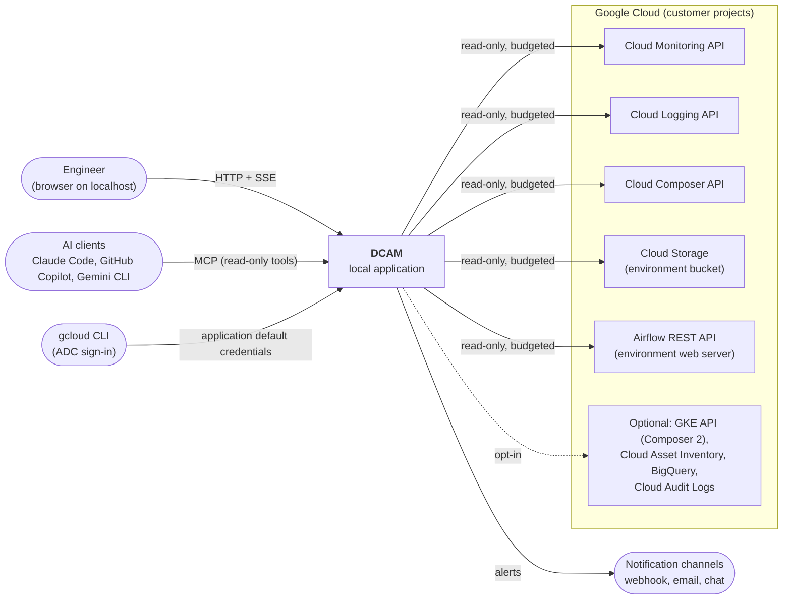

### 11.3 Containers and runtime processes

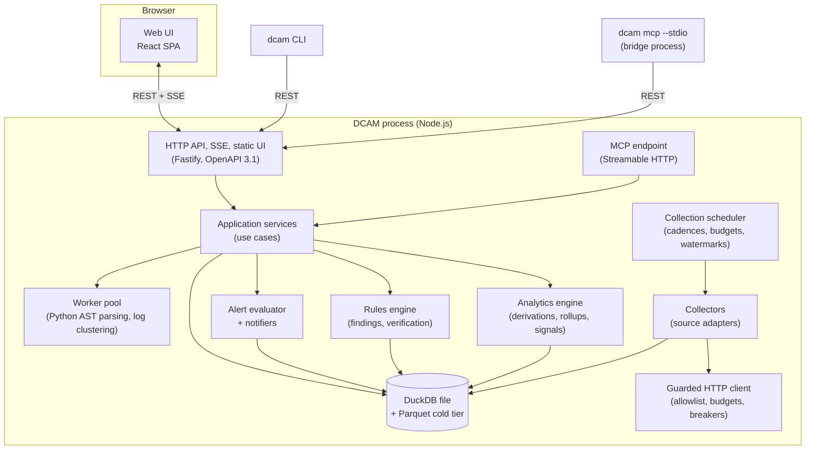

| Container | Responsibility | Notes |
|---|---|---|
| Web UI | All user interaction | Talks only to the DCAM API; never to Google Cloud directly |
| HTTP API | Serves the OpenAPI contract, SSE stream and static UI | Same-origin; loopback by default ([§18](#18-security-privacy-and-compliance)) |
| MCP endpoint | Read-only tools and resources for AI clients | Reuses application services; outputs pass the redaction pipeline |
| Collection scheduler | Decides what to fetch, when, under which budget | Priorities `live` > `standard` > `background` |
| Collectors | Source-specific fetch and normalisation into canonical records | One collector per source family and version |
| Guarded HTTP client | The only path to the network for monitored systems | Enforces the read-only allowlist and observer budgets ([§18.2](#182-read-only-guarantee)) |
| Analytics engine | Incremental derivations, rollups and hidden metrics ([§8](#8-hidden-metrics-and-derived-signals-catalog)) | SQL executed by DuckDB |
| Rules engine | Evaluates rules, maintains findings, runs verification loops | Rules are data ([§13](#13-recommendation-engine-and-rule-catalog)) |
| Alert evaluator | Evaluates alert rules, routes notifications | Notifiers are plugins |
| Worker pool | CPU-heavy, isolated tasks | Small fixed pool (default 1–2 threads) |
| Store | Single DuckDB database file plus Parquet partitions | One writer process; see [§11.7](#117-data-architecture-and-storage) |
| `dcam` CLI | `start`, `doctor`, `demo`, `export`, `import`, `mcp`, `config validate`, `rules test` | Talks to a running instance or starts one |
| MCP stdio bridge | Lets stdio-only MCP clients reach the running instance | Never opens the database itself (single-writer constraint) |

### 11.4 Hexagonal components and dependency rules

```text
            ┌─────────────────────────── apps/server (composition root) ───────────────────────────┐
            │                                                                                     │
  driving   │   HTTP/SSE handlers   MCP tools   CLI commands   scheduler ticks                      │
  adapters  │            │              │            │               │                            │
            │            ▼              ▼            ▼               ▼                            │
            │   ┌──────────────────── application (use cases) ─────────────────────┐              │
            │   │  QueryLeagueTable ・ EvaluateRules ・ CollectCycle ・ ExplainOption │              │
            │   └───────────────┬───────────────────────────────┬──────────────────┘              │
            │                   ▼                               ▼                                 │
            │            domain (pure)                    ports (interfaces)                      │
            │   entities, value objects, formulas    MetricsSource, LogsSource, ComposerSource,   │
            │   classifiers, ranking, statistics     AirflowSource, BucketSource, Store, Clock,   │
            │                                        Notifier, Redactor, SecretStore, LlmProvider │
            │                                                   ▲                                 │
  driven    │                                                   │ implements                      │
  adapters  │   gcp-monitoring ・ gcp-logging ・ composer ・ airflow-v1 ・ airflow-v2 ・ gcs ・ gke     │
            │   duckdb-store ・ notifiers/* ・ keychain ・ llm/* ・ fakes/* (tests and demo mode)     │
            └─────────────────────────────────────────────────────────────────────────────────────┘
```

Dependency rules (enforced by `dependency-cruiser` in CI, `NFR-MAINT-01`):

1. `domain` imports no other workspace package and no I/O library.
2. `application` imports only `domain`, `ports` and `contracts` types.
3. Adapters implement ports. They may import SDKs, but never `application` or another adapter.
4. Only `apps/server` wires adapters to ports.
5. `apps/web` imports only `contracts` (generated client and types), `ui-kit` and content packages; never server packages.
6. Content packages (metrics, rules, config knowledge base, wiki) contain data, schemas and tests; no runtime code.
7. Outbound calls to monitored systems MUST go through the guarded HTTP client. Importing `undici`, `node:http`, `node:https`, `google-gax` or `@google-cloud/*` anywhere else fails the build.
8. Every port has an in-memory or recorded-fixture fake in `adapters/fakes`, used by unit tests, demo mode and end-to-end tests.

### 11.5 Repository layout

```text
dcam/
├── apps/
│   ├── server/                 # Fastify composition root, HTTP + SSE + MCP endpoint, static UI hosting
│   ├── web/                    # React SPA (standalone) + embeddable bundle entry (host adapter)
│   └── docs/                   # Documentation site (shares MDX with the in-app wiki)
├── packages/
│   ├── contracts/              # openapi.yaml (source of truth), JSON Schemas, generated TS types and client
│   ├── domain/                 # Pure model, formulas, statistics, classifiers, ranking
│   ├── application/            # Use cases, orchestration, policies
│   ├── ports/                  # Port interfaces
│   ├── adapters/
│   │   ├── http-guard/         # Read-only allowlist, budgets, circuit breakers, proxy and CA support
│   │   ├── gcp-auth/           # ADC, impersonation, quota project, gcloud child process for sign-in
│   │   ├── gcp-monitoring/     # timeSeries.list, metricDescriptors.list
│   │   ├── gcp-logging/        # entries.list, (optional) log-based metrics read
│   │   ├── composer/           # environments, operations, imageVersions, executeAirflowCommand (opt-in)
│   │   ├── airflow-v1/         # Airflow 2 stable REST API (generated client)
│   │   ├── airflow-v2/         # Airflow 3 REST API (generated client)
│   │   ├── gcs/                # objects.list/get for the environment bucket
│   │   ├── gke/                # Composer 2 only (optional)
│   │   ├── duckdb-store/       # Migrations, staging, upserts, query runner, Parquet tiering
│   │   ├── notifiers/          # inbox, desktop, webhook, smtp, slack, teams, google-chat, pagerduty
│   │   ├── llm/                # none (default), copilot-cli, vertex-gemini, anthropic, openai-compatible, local
│   │   └── fakes/              # Fakes and recorded-fixture replayers for every port
│   ├── collectors/             # Collector manifests and normalisers (source → canonical records)
│   ├── analytics/              # Derivation jobs, rollups, signal runner
│   ├── metrics-pack/           # HM-* definitions: YAML + SQL + explanations + golden tests
│   ├── rules-pack/             # REC-* definitions: YAML + SQL + templates + golden tests
│   ├── config-kb/              # Config knowledge base (Appendix D), YAML + MDX
│   ├── wiki-content/           # MDX pages, diagrams (draw.io sources + exported SVG and PNG), runbooks
│   ├── alerting/               # Alert rule model, evaluator, default alert pack
│   ├── redaction/              # Redaction policy and test corpus
│   ├── mcp-server/             # MCP tools and resources (read-only), stdio bridge
│   ├── static-analysis/        # tree-sitter-based Python analyzers (SCAN)
│   ├── ui-kit/                 # Design tokens, theme, charts, tables, (i) popovers, state colours
│   ├── plugin-sdk/             # Public SDK (M8): manifests, types, scaffolding templates
│   └── cli/                    # dcam CLI
├── tools/
│   ├── emulator/               # Docker Compose Airflow, scenario DAGs, load generator, fake GCP sources
│   ├── fixtures/               # Recorded API responses (sanitised) for contract tests
│   └── scripts/                # Code generation, diagram export, release helpers
├── docs/
│   ├── adr/                    # MADR 4.0 records
│   ├── diagrams/               # *.drawio sources with *.drawio.svg / *.png exports
│   └── spec/                   # This specification and derived documents (traceability, feature briefs)
├── specs/                      # Spec Kit feature folders (spec.md, plan.md, tasks.md, contracts/)
├── .specify/                   # Spec Kit memory (constitution) and templates
├── .claude/                    # Claude Code settings, hooks, subagents, commands, skills
├── CLAUDE.md
└── dcam.config.example.yaml
```

### 11.6 Technology stack

Versions are "latest stable at M0, pinned in the lockfile" unless stated. Items marked ⚠️ VERIFY must be confirmed in the M0 ADRs.

| Concern | Choice | Rationale | Alternatives considered | ADR |
|---|---|---|---|---|
| Runtime | Node.js Active LTS (minimum 22, required by the Google Cloud client libraries) | One language end to end; mature Google auth libraries | Bun, Deno (less mature support for the Google SDKs and DuckDB bindings) | ADR-0002 |
| Language | TypeScript, `strict` | Type safety across contract, server and UI. TypeScript 7 (the native compiler) is current, but `typescript-eslint` supported TypeScript only up to 6.0 at the time of writing; ADR-0002 picks the major that the lint and test tooling supports | ― | ADR-0002 |
| Monorepo | pnpm workspaces + Turborepo | Fast, cache-friendly, simple | Nx | ADR-0002 |
| HTTP server | Fastify | Performance, JSON Schema validation, plugin model | Hono, Express | ADR-0003 |
| Contract | OpenAPI 3.1 (JSON Schema 2020-12) with generated types (`openapi-typescript`) and client (`openapi-fetch`) | Contract-first; one schema dialect for API, configuration and plugin manifests | tRPC (TypeScript-only, blocks a Python twin) | ADR-0003 |
| Runtime validation | Ajv (server, configuration), Zod at adapter boundaries for third-party responses | Strict validation of untrusted inputs | ― | ADR-0003 |
| Architecture enforcement | `dependency-cruiser` | Codifies [§11.4](#114-hexagonal-components-and-dependency-rules) | ESLint boundaries plugin | ADR-0004 |
| Analytical store | DuckDB through `@duckdb/node-api`; Parquet cold tier | Embedded, columnar, fast window functions and time bucketing; the same SQL runs in Python | SQLite (row store, slow analytics), ClickHouse (server), Postgres | ADR-0005 |
| Outbound access | REST through one guarded client using `google-auth-library` | Single read-only choke point; works with proxies; no gRPC dependency | Official gRPC client libraries (harder to guard and proxy) | ADR-0006 |
| Live updates | Server-Sent Events | One-directional, proxy-friendly, simple reconnection | WebSocket | ADR-0008 |
| UI framework | React + Vite | Ecosystem; Airflow 3's UI is also React | ― | ADR-0009 |
| Component library | MUI (Material UI) with DCAM design tokens | Material conventions close to Google Cloud console; accessible primitives; dense data tables | Chakra UI (used by the Airflow 3 UI), Mantine | ADR-0009 |
| Routing and data | TanStack Router, TanStack Query, TanStack Table, TanStack Virtual | Type-safe URL state, caching, virtualisation | React Router, SWR, AG Grid | ADR-0009 |
| Charts | Apache ECharts (rich charts, heatmaps, treemaps, Gantt, large datasets on canvas) and uPlot (dense time series) | Performance and breadth | Recharts, Visx, Highcharts (licence) | ADR-0010 |
| Graphs and diagrams | React Flow (`@xyflow/react`) with dagre layout (`@dagrejs/dagre`) | Interactive DAG graphs, relationship graphs and architecture diagrams; MIT-licensed | Cytoscape.js; ELK (`elkjs`, EPL-2.0 or GPL-3.0, outside the licence allowlist in [§21.11](#2111-coding-standards-and-quality-gates)) | ADR-0010 |
| Code views | CodeMirror 6 (SQL, YAML, HCL, Python, diff) | Light, accessible | Monaco (heavier) | ― |
| Python parsing | `web-tree-sitter` + Python grammar (WebAssembly) | No native toolchain; fast incremental parsing | Spawning Python `ast` (requires a local Python) | ADR-0012 |
| MCP | Official TypeScript MCP SDK | Standard transports (stdio, Streamable HTTP) | ― | ADR-0018 |
| Logging | pino (JSON) with redaction paths | Fast, structured | winston | ― |
| Worker pool | Piscina | Bounded worker threads | ― | ― |
| Testing | Vitest, Testing Library, MSW, Playwright, axe-core, fast-check, Stryker, Schemathesis (contract fuzzing, in Docker) | See [§19](#19-testing-validation-and-quality-strategy) | Jest | ADR-0022 |
| Lint and format | ESLint (flat config, `typescript-eslint`, `jsx-a11y`) + Prettier | Plugin ecosystem | Biome | ADR-0004 |
| Docs site | Astro Starlight (MDX) | Fast static site; shares MDX with the in-app wiki | Docusaurus | ADR-0021 |
| Release | Changesets, GitHub Actions, CycloneDX SBOM, Sigstore signing, SLSA provenance | Supply-chain integrity (`NFR-SEC-05`) | semantic-release | ADR-0023 |

### 11.7 Data architecture and storage

**Store layout.** One DuckDB database file per workspace (`<dataDir>/dcam.duckdb`) plus a cold tier of Parquet files (`<dataDir>/cold/<table>/env_id=<id>/date=<YYYY-MM-DD>/*.parquet`). Only the DCAM server process opens the database for writing. The CLI, the MCP stdio bridge and any second process MUST use the HTTP API instead.

**Schemas.**

| Schema | Tables (examples) | Notes |
|---|---|---|
| `meta` | `schema_migrations`, `watermarks`, `collector_runs`, `budgets_usage`, `dirty_windows` | Operational state of DCAM itself |
| `dim` | `environment`, `environment_snapshot`, `workload_snapshot`, `config_snapshot`, `dag`, `dag_version`, `task`, `pool`, `dag_file`, `metric_series`, `team_mapping` | Slowly changing dimensions keep `valid_from` and `valid_to` |
| `fact` | `dag_run`, `task_instance`, `task_try`, `metric_point`, `log_signal`, `log_sample`, `import_error`, `parse_stat`, `change_event`, `pool_sample`, `bucket_object_event` | Append or upsert by natural key |
| `agg` | `ti_occupancy_1m`, `rollup_5m_*`, `rollup_1h_*`, `dag_daily`, `task_daily`, `baseline_*` | Derived, recomputable from `fact` within raw retention |
| `adv` | `finding`, `evidence`, `recommendation`, `verification`, `finding_event` | History kept for 400 days by default |
| `alert` | `alert_rule`, `alert_state`, `alert_event`, `silence`, `notification_log` | |
| `ui` | `saved_view`, `annotation`, `user_pref` | Local only |

**Natural keys and idempotency.** Every fact table has a primary key derived from source identity, so re-ingesting the same data is a no-op:

```sql
CREATE TABLE fact.task_instance (
  env_id         VARCHAR NOT NULL,
  dag_id         VARCHAR NOT NULL,
  run_id         VARCHAR NOT NULL,
  task_id        VARCHAR NOT NULL,
  map_index      INTEGER NOT NULL DEFAULT -1,
  try_number     INTEGER NOT NULL,
  state          VARCHAR,
  pool           VARCHAR,
  pool_slots     INTEGER,
  queue          VARCHAR,
  operator       VARCHAR,
  priority_weight INTEGER,
  hostname       VARCHAR,
  executor       VARCHAR,
  scheduled_at   TIMESTAMPTZ,      -- only where the API exposes it (capability flag)
  queued_at      TIMESTAMPTZ,
  start_at       TIMESTAMPTZ,
  end_at         TIMESTAMPTZ,
  duration_s     DOUBLE,
  source_updated_at TIMESTAMPTZ,   -- watermark column where available
  ingested_at    TIMESTAMPTZ NOT NULL,
  PRIMARY KEY (env_id, dag_id, run_id, task_id, map_index, try_number)
);
```

**Ingestion.** Collectors write canonical records into per-batch staging tables, then upsert into `fact` tables in one transaction together with the new watermark (`FR-COLL-03`, `FR-STORE-06`). Each batch records the affected `(env_id, family, time range)` in `meta.dirty_windows`.

**Retention and tiering.** A nightly (and on-start) maintenance job applies `FR-STORE-02` retention, moves partitions older than the hot window to Parquet (`FR-STORE-03`), runs `CHECKPOINT`, and enforces the disk budget (`FR-STORE-07`). Queries spanning tiers use views that `UNION ALL` the hot table and `read_parquet()` over the cold partitions.

**Precision across tiers.** Exact percentiles are computed from raw facts within raw retention. Beyond it, percentiles come from stored rollup quantiles and MUST be labelled "approximate" (`P-5`).

### 11.8 Analytics pipeline and incremental computation

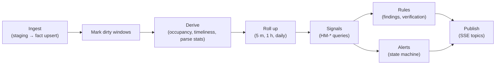

1. **Derivations** are declared jobs with inputs and outputs. They recompute only dirty windows, widened by a safety margin for late data (default 2 × the cadence of the input source).
2. **Occupancy sweep** is the core derivation. For each task instance try with a start, it emits `+pool_slots` at `start_at` and `−pool_slots` at `end_at` (or "now" while running); a cumulative window sum yields exact concurrency step functions per environment, pool, DAG and queue, which are bucketed per minute (average, maximum). Queued intervals (`queued_at` → `start_at`) are swept the same way to obtain queued counts. This powers `HM-001`, `HM-003`, `HM-005`, `HM-006`, `HM-011` and `HM-017`.
3. **Rollups** store counts, sums, minimum, maximum, average and selected quantiles per bucket. Counters are summed; gauges are averaged and their maxima kept.
4. **Signals** (`HM-*`) are parameterised SQL queries over facts and rollups, declared in `metrics-pack`. Example definition:

   ```yaml
   id: HM-003
   name: Slot-seconds per DAG
   version: 1
   unit: s
   scopes: [environment, pool, dag, team]
   grains: [5m, 1h, 1d]
   sources: [SRC-AF-API]
   inputs: [fact.task_instance, agg.ti_occupancy_1m]
   sql: sql/hm_003_slot_seconds.sql
   explanation: explain/hm-003.mdx
   quality:
     minSamples: 1
     approximateBeyondRawRetention: true
   tests: tests/hm-003/
   ```

5. **Rule evaluation** runs every 5 minutes by default and after relevant dirty windows complete; alert evaluation runs on every live cycle using only cheap signals.
6. **Determinism.** Every computation takes `now` from the injected clock and is reproducible from stored inputs. Golden tests freeze inputs and expected outputs (`NFR-DATA-01`).
7. **Portability.** Signal and rule SQL MUST use the DuckDB dialect only (no TypeScript post-processing that changes results), so a Python runtime with DuckDB can execute the same packs unchanged ([§11.12](#1112-embedding-path-into-airflow-and-composer)).

### 11.9 API contract and conventions

The OpenAPI 3.1 document in `packages/contracts/openapi.yaml` is the source of truth. The server validates requests and responses against it in development and test; types and the web client are generated from it.

| Convention | Rule |
|---|---|
| Base path | `/api/v1` (DCAM's own API version, independent of Airflow's API versions) |
| Resource naming | Plural nouns, kebab-case paths, `snake_case` JSON fields (aligns with Airflow's API) |
| Identifiers | `env_id` is the workspace slug (for example `acme-prod`); DAG, run and task IDs are URL-encoded; findings and events use ULIDs |
| Time ranges | `from` and `to` (RFC 3339) or `range` (`15m`, `24h`, `7d`); responses echo the resolved range and `data_as_of` |
| Pagination | Cursor-based: `page_size` (≤ 500) and `page_token`; responses include `next_page_token` and `total_size` when cheap |
| Filtering and sorting | `filter` (simple, documented expression grammar), `order_by` (`field asc` or `field desc`, multiple allowed) |
| Errors | RFC 9457 `application/problem+json` with a stable `type` URI per error class, `detail`, `instance`, and DCAM extensions `fix_hint` and `docs_url` |
| Caching | `ETag` and `If-None-Match` on aggregate endpoints; `Cache-Control: no-store` on anything containing log content |
| Exports | Content negotiation: `text/csv`, `application/vnd.apache.parquet`, `application/json` |
| Provenance | Every analytical response includes `sources[]`, `data_as_of`, `approximate` and `capabilities` metadata |
| Compatibility | Additive changes only within `v1`; breaking changes need a new version and an ADR |

Resource map (excerpt; the full list is generated into the documentation):

| Resource | Methods | Purpose | Requirements |
|---|---|---|---|
| `/workspace`, `/environments`, `/environments/{env_id}` | GET, PUT (local config only) | Workspace and environment configuration | `FR-SETUP-*` |
| `/environments/{env_id}/health`, `/workloads`, `/pools`, `/config` | GET | Cockpit data | `FR-ENV-*`, `FR-CFG-01` |
| `/environments/{env_id}/dags` | GET | League table (server-side columns, filters, sort) | `FR-DAGX-*` |
| `/environments/{env_id}/dags/{dag_id}`, `/runs`, `/runs/{run_id}/task-instances`, `/tasks/{task_id}/stats` | GET | DAG and run drill-down | `FR-DAGD-*`, `FR-TASK-*` |
| `/signals/{hm_id}` | GET | Generic signal query (scope, grain, range, group by) | [§8](#8-hidden-metrics-and-derived-signals-catalog) |
| `/findings`, `/findings/{id}`, `/findings/{id}/evidence` | GET, PATCH (local lifecycle state) | Advisor | `FR-ADV-*` |
| `/changes` | GET | Change timeline | `FR-CHG-*` |
| `/alerts/rules`, `/alerts/events`, `/silences` | GET, POST, PUT, DELETE (local objects) | Alerting | `FR-ALRT-*` |
| `/config-kb/{section}/{key}` | GET | Option explanations | `FR-CFG-02` |
| `/doctor`, `/collectors`, `/self` | GET, POST (run doctor) | Preflight and self-observability | `FR-AUTH-05`, `FR-SELF-*` |
| `/exports`, `/imports` | POST, GET | Bundles | `FR-STORE-04`, `FR-STORE-05` |
| `/events` | GET (SSE) | Live updates | [§11.10](#1110-live-updates-and-caching) |

Write methods on DCAM's own API change only DCAM's local state (configuration, findings lifecycle, alert rules, saved views). They never reach a monitored system.

### 11.10 Live updates and caching

- **Channel.** `GET /api/v1/events?topics=…` streams Server-Sent Events. Topics are scoped (`env:<env_id>`, `findings`, `alerts`, `collectors`, `self`). The server sends a heartbeat comment every 15 seconds and supports `Last-Event-ID` for resumption.
- **Event types.** `collector.cycle_completed`, `signal.updated`, `finding.opened`, `finding.updated`, `finding.resolved`, `alert.firing`, `alert.resolved`, `environment.health_changed`, `budget.fidelity_reduced`, `change.detected`, `doctor.completed`.
- **Client strategy.** Events carry query-key hints; the UI invalidates the matching TanStack Query keys instead of receiving full payloads. This keeps events small and the cache authoritative.
- **Focus signalling.** The UI reports visibility and the focused environment through `PUT /api/v1/session/focus` (DCAM-local state). The scheduler uses it for adaptive cadences (`FR-COLL-05`).
- **Server caching.** Aggregate responses are cached per (query, parameters, data version) and invalidated by dirty-window completion. Data version is a monotonic counter per environment and table family.

### 11.11 Deployment targets

| Target | Status | Description | Key constraints |
|---|---|---|---|
| Local process | v1 (primary) | `pnpm dcam` or `./dcam start`; serves on `127.0.0.1`; uses the user's ADC | Laptop sleep; single user |
| Docker image | v1 | `docker run` with the ADC file mounted read-only and a data volume | Browser sign-in happens on the host (`gcloud auth application-default login`) |
| Single executable | Could (post-v1) | Node.js single executable application bundling the server and UI | DuckDB native binary packaging |
| Team server | Future | Shared instance (for example Cloud Run behind Identity-Aware Proxy, or a VM) with a service account, persistent storage and SSO | Needs multi-user authorisation, durable storage strategy and an ADR; single-tenant only (`NG-6`) |
| Airflow plugin (embedded) | Future | Python implementation of the same OpenAPI contract mounted in Airflow 3 through the plugin attribute `fastapi_apps` (Airflow 3.0 and later), with DCAM's UI mounted through `react_apps` (Airflow 3.1 and later, experimental) or linked as an `external_views` page (Airflow 3.1 and later); reads the metadata database through Airflow's own interfaces | See [§11.12](#1112-embedding-path-into-airflow-and-composer); re-check the plugin interfaces and Composer's plugin support (VC-22) when the work starts |
| Composer-native | Aspirational | A managed or Marketplace offering, or upstream contribution | Requires Google partnership; out of scope for planning |

### 11.12 Embedding path into Airflow and Composer

DCAM is designed so that a future in-environment deployment reuses most assets. The *portability contract* is:

| Asset | Portable because | Reused by a Python runtime as |
|---|---|---|
| OpenAPI 3.1 contract | Language-neutral | Server stubs (for example FastAPI) and the same contract test suite |
| Metric definitions (`HM-*`) and rules (`REC-*`) | YAML + DuckDB SQL; no TypeScript semantics | Executed with DuckDB's Python package |
| Config knowledge base, wiki, runbooks | YAML and MDX | Rendered by the same web bundle |
| Web UI | Built twice: standalone SPA and an embeddable bundle behind a *host adapter* (base path, authentication, theme tokens, navigation, time zone) | Mounted as an Airflow `react_apps` plugin, or linked as an `external_views` page |
| Golden datasets and scenario library | Parquet and YAML | Cross-runtime conformance tests |

In an embedded deployment, collectors are replaced by in-environment adapters (metadata database queries through Airflow interfaces, listener events) that produce the same canonical records. Event-level fidelity improves (exact state transitions, no polling), while the analytics, rules, API and UI stay identical.

Requirements that keep this path open:

- `ARCH-EMB-01`: No business logic in HTTP handlers or React components; logic lives in `domain`, SQL packs or rules.
- `ARCH-EMB-02`: The web UI MUST NOT assume it runs at `/`; all URLs derive from the host adapter's base path.
- `ARCH-EMB-03`: The contract test suite MUST be runnable against any base URL, so a Python implementation can be certified.
- `ARCH-EMB-04`: Canonical record schemas are published as JSON Schema in `packages/contracts`.

### 11.13 Cross-cutting concerns

| Concern | Decision |
|---|---|
| Configuration | Layered: built-in defaults < `dcam.config.yaml` < environment variables (`DCAM_*`) < CLI flags. Validated at start and on reload ([§17](#17-configuration-reference)). Hot reload for environments, profiles, thresholds and alert rules |
| Time | UTC everywhere internally; an injectable `Clock` port; time zone conversion only at the edge; ISO 8601 durations in configuration |
| Identifiers | ULIDs for DCAM-generated entities; source IDs kept verbatim |
| Errors | Typed domain errors mapped to RFC 9457 problems; every external failure classified (auth, permission, quota, VPC Service Controls, not found, transient, contract drift) with a fix hint |
| Logging | pino JSON logs with redaction paths for tokens, cookies and secrets; log level per module; no log content from monitored systems in DCAM's own logs |
| Concurrency | One write queue for the store; bounded read connections; at most two concurrent requests per monitored API and environment by default |
| Feature flags | Configuration-driven (`features.*`), visible on the DCAM health page |
| Internationalisation | FormatJS (ICU MessageFormat) message catalogues; English first |
| Observability of DCAM | Internal metrics surfaced on the health page (`FR-SELF-01`); optional OpenMetrics endpoint (`FR-RPT-02`) |

### 11.14 Key runtime sequences

**Collection cycle.**

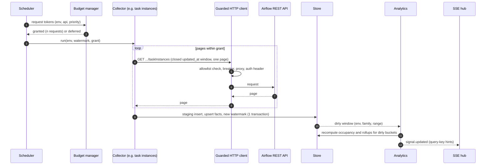

**Finding and verification loop.**

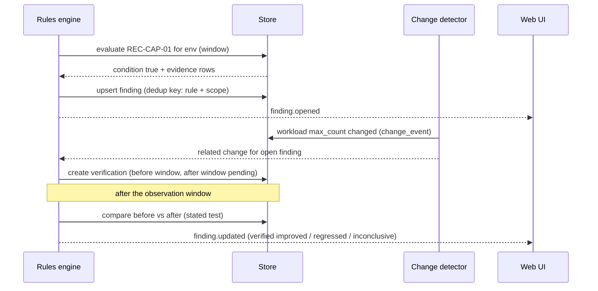

---

## 12. UX and visual design

### 12.1 Design principles

1. **Familiar to Google Cloud users.** Layout, density and vocabulary follow Google Cloud console conventions: left navigation, top context bar, cards, dense data tables, side drawers for details. DCAM's own identity comes from its dark, blueish default theme.
2. **Answer first, then evidence.** Every screen opens with the answer (status, top contributors, binding limit), followed by evidence charts and raw tables.
3. **Comparative by default.** Show baselines, peers, previous periods and distributions next to every number (`P-6`).
4. **Progressive disclosure.** Summary → chart → table → raw record → source deep link.
5. **Honest data.** Freshness, gaps, approximations and estimates are always visible (`P-5`).
6. **Explain everything.** An (i) on every metric, chart, KPI, option and finding ([§12.9](#129-the-i-explanation-pattern)).
7. **Calm under pressure.** Incident and alert views avoid noise: one primary action, grouped signals, no flashing.

### 12.2 Information architecture and navigation

```text
App bar:      [DCAM logo]  [Environment selector ▾ (multi)]  [Time range ▾]  [TZ]  [● Live/Paused]  [⌘K]  [Alerts 🔔]  [Doctor]  [Account]
Left nav:
  Fleet
  ── Environment (context-dependent)
     Overview ・ Capacity ・ Scheduler ・ DAG processing ・ Triggerer ・ Database ・ Web server ・ Pools
  ── Workloads
     DAGs (league table) ・ Tasks & reliability ・ Bottlenecks ・ Schedule intelligence ・ Code insights ・ Upgrade readiness
  ── Insights
     Advisor ・ Config Advisor ・ Compare environments ・ Changes ・ Incidents ・ Alerts ・ Logs & cost ・ Reports
  ── Learn
     Wiki ・ Runbooks ・ Glossary
  ── DCAM
     Settings ・ Doctor ・ DCAM health
```

### 12.3 Screen inventory

| ID | Screen | Route | Answers | Requirements |
|---|---|---|---|---|
| S-01 | Onboarding wizard | `/welcome` | Can I connect? | `FR-SETUP-03`, `FR-SETUP-04`, `FR-AUTH-02`, `FR-AUTH-05` |
| S-02 | Fleet overview | `/` | Q-01 | `FR-FLEET-*` |
| S-03 | Environment overview | `/env/{env}` | Q-01 | `FR-ENV-01` |
| S-04 | Capacity | `/env/{env}/capacity` | Q-04 | `FR-ENV-02`, `FR-BOTL-09` |
| S-05 | Scheduler | `/env/{env}/scheduler` | Q-01, Q-08 | `FR-ENV-03` |
| S-06 | DAG processing | `/env/{env}/dag-processing` | Q-05 | `FR-ENV-04`, `FR-SCAN-06` |
| S-07 | Triggerer | `/env/{env}/triggerer` | Q-15 | `FR-ENV-05` |
| S-08 | Database | `/env/{env}/database` | Q-17 | `FR-ENV-06` |
| S-09 | Web server | `/env/{env}/web-server` | Q-01 | `FR-ENV-07` |
| S-10 | Pools | `/env/{env}/pools` | Q-03 | `FR-ENV-08` |
| S-11 | DAG league table | `/env/{env}/dags` | Q-02 | `FR-DAGX-*` |
| S-12 | DAG detail (tabs: overview, runs, Gantt, tasks, concurrency, graph, code, findings) | `/env/{env}/dags/{dag}` | Q-07, Q-16 | `FR-DAGD-*` |
| S-13 | Run detail and run comparison | `/env/{env}/dags/{dag}/runs/{run}` | Q-08 | `FR-DAGD-03`, `FR-DAGD-09` |
| S-14 | Compare DAGs | `/compare/dags` | Q-02 | `FR-DAGD-08` |
| S-15 | Tasks and reliability | `/env/{env}/tasks` | Q-06, Q-07 | `FR-TASK-*` |
| S-16 | Bottlenecks | `/env/{env}/bottlenecks` | Q-03, Q-11, Q-15 | `FR-BOTL-01`, `FR-BOTL-02`, `FR-BOTL-06`, `FR-BOTL-07` |
| S-17 | Schedule intelligence | `/env/{env}/schedule` | Q-09, Q-10 | `FR-BOTL-03`, `FR-BOTL-04`, `FR-BOTL-05` |
| S-18 | Advisor | `/advisor` | Q-19 | `FR-ADV-*` |
| S-19 | Finding detail | `/findings/{id}` | Q-19 | `FR-ADV-02`, `FR-ADV-03`, `FR-ADV-06`, `FR-ADV-08` |
| S-20 | Config Advisor | `/env/{env}/config` | Q-13 | `FR-CFG-01` to `FR-CFG-05` |
| S-21 | Compare environments (drift) | `/compare/environments` | Q-14 | `FR-CFG-06`, `FR-FLEET-03` |
| S-22 | Changes | `/changes` | Q-12 | `FR-CHG-*` |
| S-23 | Incident workspace | `/incidents/{id}` | Q-03, Q-12 | `FR-INC-*` |
| S-24 | Alerts (rules, events, silences) | `/alerts` | ― | `FR-ALRT-*` |
| S-25 | Code insights | `/env/{env}/code` | Q-05 | `FR-SCAN-*` |
| S-26 | Upgrade readiness | `/env/{env}/upgrade` | Q-20 | `FR-SCAN-02`, `HM-026` |
| S-27 | Logs and cost | `/env/{env}/logs-cost` | Q-18 | `HM-020`, `HM-021` |
| S-28 | Reports | `/reports` | Q-02 | `FR-RPT-*` |
| S-29 | Wiki, runbooks, glossary | `/wiki/...` | J-8 | `FR-WIKI-*` |
| S-30 | Settings | `/settings/...` | ― | `FR-SETUP-07`, `FR-AI-03` |
| S-31 | Doctor | `/doctor` | ― | `FR-AUTH-05` |
| S-32 | DCAM health | `/self` | ― | `FR-SELF-*` |

### 12.4 Wireframes (key screens)

Wireframes are indicative; they fix content and hierarchy, not pixels.

**S-02 Fleet overview**

```text
┌ Fleet ─────────────────────────────────────────────────────────────── Last 24 h ▾ ・ Live ● ・ data as of 12:04:31 ┐
│ ┌ acme-prod  PROD ─────────────┐ ┌ acme-test  TEST ─────────────┐ ┌ acme-dev  DEV ──────────────┐                │
│ │ ● Degraded (i)  Composer 3   │ │ ● Healthy        Composer 3  │ │ ● Healthy       Composer 3   │                │
│ │ Running 182  Queued 240 ▲    │ │ Running 12  Queued 0         │ │ Running 3  Queued 0          │                │
│ │ Workers 6/6 (max) ⚠          │ │ Workers 1/4                  │ │ Workers 1/3                  │                │
│ │ Parse loop 11m 40s ⚠         │ │ Parse loop 2m 10s            │ │ Parse loop 1m 05s            │                │
│ │ Failed (24 h) 37  DB ● OK    │ │ Failed (24 h) 2   DB ● OK    │ │ Failed (24 h) 9   DB ● OK    │                │
│ │ Top findings:                │ │ Top findings: ―              │ │ Top findings:                │                │
│ │  ⚠ Workers at max + queue    │ │                              │ │  ⓘ Stale DAG risk            │                │
│ │  ⚠ Stale DAG risk            │ │                              │ │                              │                │
│ └──────────────────────────────┘ └──────────────────────────────┘ └──────────────────────────────┘                │
│ Fleet top issues (ranked)  ───────────────────────────────────────────────────────────────────────────────────── │
│  1 ⚠ REC-CAP-01  acme-prod  Workers at max_count for 47 min with 180+ tasks queued   impact ●●●  conf. 0.92  ▸   │
│  2 ⚠ REC-PARSE-02 acme-prod Parse loop 11m40s vs stale threshold 10m                   impact ●●○  conf. 0.98  ▸ │
└──────────────────────────────────────────────────────────────────────────────────────────────────────────────────┘
```

**S-11 DAG league table**

```text
┌ DAGs ・ acme-prod ── Last 7 d ▾  vs previous 7 d ── Preset: Capacity hogs ▾ ── Columns ▾ ── Export ▾ ─────────────┐
│ Pareto: 23 of 1,240 DAGs = 80 % of slot-seconds (i)    Gini 0.81    [treemap] [scatter] [heatmap]                 │
│ ┌─────────────────────┬──────┬───────┬────────┬──────────┬─────────┬──────────┬──────────┬──────────┬──────────┐ │
│ │ DAG                 │ Runs │ Succ. │ p95 dur│ Slot-h   │ Share ▼ │ p95 queue│ Sensor-h │ Est. cost│ Findings │ │
│ ├─────────────────────┼──────┼───────┼────────┼──────────┼─────────┼──────────┼──────────┼──────────┼──────────┤ │
│ │ orders_daily        │   7  │ 100 % │ 1h 12m │   412.0  │ 9.8 % ▲ │   14m    │   61.2   │  ≈ 38    │ ⚠ 2      │ │
│ │ customer_360        │ 168  │  97 % │   18m  │   388.5  │ 9.2 %   │    2m    │    0.0   │  ≈ 35    │ ⓘ 1      │ │
│ │ …virtualised rows…  │      │       │        │          │         │          │          │          │          │ │
│ └─────────────────────┴──────┴───────┴────────┴──────────┴─────────┴──────────┴──────────┴──────────┴──────────┘ │
└──────────────────────────────────────────────────────────────────────────────────────────────────────────────────┘
```

**S-16 Bottlenecks**

```text
┌ Bottlenecks ・ acme-prod ── 01:30–03:00 ────────────────────────────────────────────────────────────────────────────┐
│ Answer: 71 % of waiting task-minutes were caused by "executor slots exhausted" while workers were at max (i)       │
│ ┌ Waiting task-minutes by throttle reason (stacked) ──────────────────────────────┐ ┌ Top contributors ──────────┐ │
│ │ ██████████████████████ executor slots exhausted                                 │ │ orders_daily     22 %      │ │
│ │ ██████ pool "etl" exhausted                                                     │ │ customer_360     14 %      │ │
│ │ ██ DAG max_active_tasks                                                         │ │ ...                        │ │
│ │ ── change markers ▲ (config update 01:12)                                       │ │                            │ │
│ └─────────────────────────────────────────────────────────────────────────────────┘ └────────────────────────────┘ │
│ Related findings: REC-CAP-01 ・ REC-SCHED-01      Runbook: RB-01 Tasks stuck in queued      [Open incident ▸]      │
└────────────────────────────────────────────────────────────────────────────────────────────────────────────────────┘
```

**S-20 Config Advisor with (i) drawer**

```text
┌ Config Advisor ・ acme-prod ─────────────────────────────┐┌ celery.worker_concurrency (i) ─────────────────────────┐
│ Search options…        [Overridden only] [Drift]        ││ Effective: 12   Source: Composer default ⓘ             │
│ Section   Key                     Effective  Source     ││ Meaning: maximum task instances one worker runs …      │
│ celery    worker_concurrency      12         Composer   ││ Increase → more slots per worker, higher memory/CPU …  │
│ core      parallelism             128        Override ✎ ││ Decrease → fewer slots, less contention …              │
│ scheduler dag_stale_not_seen_dur… 600        Airflow    ││ Related: core.parallelism, pools, worker CPU/memory    │
│ …                                                       ││ Live evidence: worker memory p95 71 % ・ queue p95 6m   │
│                                                         ││ Snippets: [Terraform] [gcloud]   Docs: Airflow ・ GCP   │
└─────────────────────────────────────────────────────────┘└────────────────────────────────────────────────────────┘
```

### 12.5 Design tokens and theme

Tokens live in `packages/ui-kit/tokens` (JSON, consumed by MUI, ECharts, uPlot and React Flow themes). The dark theme is the default (`FR-UI-06`). Values below are a starting point; contrast MUST be verified automatically (`NFR-A11Y-01`).

| Token | Dark (default) | Light | Use |
|---|---|---|---|
| `color.bg.canvas` | `#0B1320` | `#F8F9FA` | Page background |
| `color.bg.surface` | `#111B2B` | `#FFFFFF` | Cards, tables |
| `color.bg.raised` | `#16233A` | `#FFFFFF` | Drawers, menus, popovers |
| `color.border.subtle` | `#22324D` | `#DADCE0` | Dividers, table lines |
| `color.text.primary` | `#E3E8F0` | `#202124` | Body text |
| `color.text.secondary` | `#9AA9BF` | `#5F6368` | Labels, metadata |
| `color.accent.primary` | `#8AB4F8` | `#1A73E8` | Primary actions, links, focus |
| `color.status.ok` | `#81C995` | `#188038` | Healthy |
| `color.status.warning` | `#FDD663` | `#E37400` | Warning |
| `color.status.error` | `#F28B82` | `#D93025` | Error, critical |
| `color.status.info` | `#78D9EC` | `#12B5CB` | Informational |
| `radius.card` | 8 px | 8 px | Cards |
| `space.unit` | 4 px | 4 px | Spacing scale (4, 8, 12, 16, 24, 32) |
| `density` | comfortable / compact | comfortable / compact | Tables default to compact |

Additional theme options: high contrast, and a colour-vision-deficiency-safe categorical palette (for example Okabe–Ito) for series colours.

### 12.6 Airflow state colours

Task instance and DAG run states MUST use Airflow's familiar state colour semantics so that users moving between the Airflow UI and DCAM read states instantly. Airflow 2 defines default state colours in `airflow.settings.STATE_COLORS` (overridable through `airflow_local_settings.py`). The Airflow 3 UI defines them in its theme, as Chakra UI semantic tokens over Tailwind CSS colour palettes with separate light and dark shades. DCAM maps each state to a token with a theme-tuned shade, an icon and a text label (`NFR-A11Y-02`).

| State | Airflow 2 colour name (`STATE_COLORS`, 2.10.5) | Airflow 3 UI palette (theme, 3.3.2) | DCAM token | Icon (Material Symbols) |
|---|---|---|---|---|
| `success` | green | green | `state.success` | `check_circle` |
| `running` | lime | cyan | `state.running` | `play_circle` |
| `failed` | red | red | `state.failed` | `cancel` |
| `upstream_failed` | orange | amber | `state.upstream_failed` | `call_split` |
| `up_for_retry` | gold | yellow | `state.up_for_retry` | `replay` |
| `up_for_reschedule` | turquoise | sky | `state.up_for_reschedule` | `schedule` |
| `queued` | gray | stone | `state.queued` | `hourglass_top` |
| `scheduled` | tan | zinc | `state.scheduled` | `event` |
| `deferred` | mediumpurple | purple | `state.deferred` | `pause_circle` |
| `awaiting_input` | ― (Airflow 3.3 and later) | orange | `state.awaiting_input` | `pending_actions` |
| `skipped` | hotpink | pink | `state.skipped` | `skip_next` |
| `removed` | lightgrey | slate | `state.removed` | `remove_circle` |
| `restarting` | violet | violet | `state.restarting` | `restart_alt` |
| no status | lightblue | gray | `state.none` | `radio_button_unchecked` |

Airflow 2's list also maps `shutdown` to blue; that state is no longer used and is kept only for compatibility, so DCAM shows it like `restarting`. `awaiting_input` is the state of human-in-the-loop tasks waiting for a response. The `workspace.stateColours` setting ([§17.2](#172-annotated-example)) selects the hues: `auto` (the default) uses the Airflow 2 hues when every configured environment runs Airflow 2 and the Airflow 3 hues otherwise, so colours never change from page to page; `airflow2` and `airflow3` force one set. DCAM tokens keep each hue and adjust lightness for contrast in both themes. If the monitored environment customises state colours, DCAM MAY read them from the Airflow UI configuration where exposed; otherwise it uses the defaults above.

### 12.7 Typography, iconography and density

- **Typeface.** Roboto Flex for UI text and Roboto Mono for code, IDs and tabular numbers (both SIL Open Font License). Google Sans, Google Sans Flex and Google Sans Code, the typefaces of the Google Cloud console, are also published on Google Fonts under the SIL Open Font License, so ADR-0009 MAY adopt them. Roboto stays the default because it looks familiar without suggesting that DCAM is a Google product.
- **Numbers.** Use tabular figures (`font-variant-numeric: tabular-nums`) in tables and KPIs; right-align numbers; humanise durations (`1h 12m`) with exact values on hover.
- **Icons.** Material Symbols (Outlined, weight 400), consistent with Google products.
- **Density.** Compact tables by default (row height 32 px); comfortable mode available; KPI tiles show value, unit, delta versus comparison period and a sparkline.

### 12.8 Data visualisation guidelines

| Guideline | Rule |
|---|---|
| Chart choice | Time series → uPlot; heatmaps, treemaps, Pareto, Gantt, Sankey, scatter → ECharts; graphs → React Flow |
| Time axis | All charts in a view share the time range and a synchronised crosshair; change markers and annotations overlay every time series (`FR-CHG-02`) |
| Distributions | Prefer percentiles (p50, p95, p99) and box or violin plots over averages |
| Units | Always visible on axes and tooltips; SI units; durations humanised |
| Gaps | Missing data renders as a gap, never as zero (`NFR-DATA-03`) |
| Estimates | Dashed lines or hatched areas, plus an "estimate" badge (`NFR-DATA-04`) |
| Large data | Server-side aggregation first; LTTB downsampling; canvas rendering (`NFR-PERF-06`) |
| Accessibility | Every chart has a title, an accessible description generated from data ("Peak 240 queued at 02:07"), and a "view as table" toggle (`NFR-A11Y-01`) |
| Interaction | Brush to zoom updates the global time range; click-through to the underlying entity |

### 12.9 The (i) explanation pattern

Every registered panel, KPI, column, metric, option and rule has an explanation entry (`FR-UI-05`), rendered as a popover (short) with an "open in drawer" action (long). The content model:

```yaml
id: hm-003-slot-seconds            # stable key referenced by panels
title: Slot-seconds
summary: Total time task instances occupied pool slots, weighted by pool_slots.
whyItMatters: The best available proxy for how much worker capacity a DAG consumes.
formula: "Σ (end − start) × pool_slots over task instance tries in range"
howToRead: Compare shares, not absolutes; check the Pareto chart for concentration.
sources: [SRC-AF-API]
freshness: "≤ 2 × task instance cadence"
caveats:
  - Excludes deferred time (the triggerer, not a worker slot, holds the task).
related: [hm-001-queue-wait, hm-004-cpu-attribution]
docs:
  - title: Airflow pools
    url: https://airflow.apache.org/docs/apache-airflow/stable/administration-and-deployment/pools.html
appliesTo: { composer: [2, 3], airflow: [2, 3] }
```

Explanations are MDX-capable, versioned with the metric or rule they describe, and searchable from the command palette.

### 12.10 States and feedback

| State | Treatment |
|---|---|
| Loading | Skeletons matching the final layout; no spinners longer than 300 ms without a skeleton |
| Empty | Reason plus next step ("No DAG runs in this range. Widen the range or check that the DAG is unpaused.") |
| Partial | Banner listing missing sources with links to the doctor |
| Stale | Freshness chip turns amber when data is older than 2 × cadence, red when older than 5 × |
| Reduced fidelity | Persistent banner when budgets force longer intervals (`FR-COLL-06`) |
| Error | RFC 9457 problem rendered as what happened, why, how to fix, documentation link (`NFR-UX-02`) |
| Permission denied | Shows the missing permission and the role that grants it ([Appendix E](#appendix-e-iam-permissions)) |
| Demo or imported data | Persistent, distinct banner (`FR-EMU-01`, `FR-STORE-05`) |

### 12.11 Accessibility checklist

- All interactive elements are reachable and operable by keyboard, with visible focus rings using `color.accent.primary`.
- Landmarks and headings structure every page; skip-to-content link.
- Tables use proper header associations; sortable headers announce the sort state.
- Charts provide accessible descriptions and table alternatives; colour is never the sole carrier of meaning.
- Motion respects `prefers-reduced-motion`; live regions announce alert state changes politely.
- Automated: axe-core in component and end-to-end tests; manual: screen reader smoke test (VoiceOver, NVDA) per release.

### 12.12 UX writing

- Follow the Google developer documentation style guide: sentence case, second person, active voice, present tense.
- Use Airflow and Composer terms exactly as their documentation does (`max_active_tasks`, *DAG processor*, *triggerer*).
- Findings are written as *observation → impact → action* ("Workers stayed at the maximum of 6 for 47 minutes while 180 tasks were queued. Runs started up to 22 minutes late. Consider raising `max_count` or staggering schedules.").
- Never blame users; never use exclamation marks in errors; always offer the next step.

---

## 13. Recommendation engine and rule catalog

The advisor turns signals into **findings** (observations with evidence) and **recommendations** (actions with snippets, risks and verification). Rules are declarative data (`packages/rules-pack`), evaluated by the rules engine (`FR-ADV-01`), and shared with any future runtime ([§11.12](#1112-embedding-path-into-airflow-and-composer)).

### 13.1 Rule model

```yaml
id: REC-CAP-01
title: Workers at maximum while tasks are queued
category: CAP
version: 3
appliesTo: { composer: [2, 3], airflow: [2, 3] }
scope: environment                       # environment | pool | dag | task | file | team
inputs: [agg.capacity_1m]                # tables or HM-* signals
condition:
  sql: sql/rec_cap_01.sql                # returns one row per violating scope with metric columns
  params:
    window: PT24H
    minQueued: 10
    queuedRatio: 0.2
    minMinutes: 15
  tierOverrides:
    dev: { minMinutes: 60 }
hysteresis: { openAfter: 2, resolveAfter: 3 }   # consecutive evaluations
severity:
  default: warning
  escalate: { critical: "minutes_bound >= 120" }
impact:
  model: waiting_task_minutes            # see 13.3
  expression: "SUM(queued_ti_minutes)"
confidence:
  minCoverage: 0.8                       # share of window with data
  minSamples: 30
effort: 2                                # 1 config, 2 sizing, 3 DAG change, 5 refactor
message:
  observation: "Workers stayed at the maximum of {{workers_max}} for {{minutes_bound}} min while up to {{queued_peak}} tasks were queued."
  impact: "Runs started up to {{max_delay_human}} late; {{waiting_task_hours}} task-hours were spent waiting."
  action: "Stagger colliding schedules first; if peaks are not schedule-driven, raise the worker maximum or increase per-worker concurrency where CPU and memory allow."
remediation:
  - kind: terraform
    template: snippets/workers_max_count.tf.hbs
  - kind: gcloud
    template: snippets/workers_max_count.sh.hbs
risks:
  - "Higher maximum increases peak cost."
  - "More concurrent tasks increase load on the metadata database and external systems."
rollback: "Restore the previous max_count; the change takes effect after the environment update completes."
verify:
  signal: HM-006
  expect: "share(executor_slots_exhausted) decreases"
  before: P7D
  after: P7D
inhibits: [REC-CAP-05]
links:
  wiki: /wiki/best-practices/worker-scaling
  runbook: RB-01
  docs:
    - https://cloud.google.com/composer/docs/composer-3/optimize-environments
tests: tests/rec-cap-01/
```

Rule schema rules: every rule MUST declare inputs, thresholds with units, a message template, at least one remediation or an explicit `remediation: none` with reason, a verification spec (or `verify: none` with reason), wiki and documentation links, and golden tests.

### 13.2 Evaluation semantics

- **Schedule.** Rules run every 5 minutes by default, and after dirty windows for their inputs complete. Expensive rules (`cost: high`) run hourly.
- **Deduplication.** The finding key is `(rule_id, scope_key)`. Re-evaluation updates the finding instead of creating a new one.
- **Hysteresis.** A finding opens after `openAfter` consecutive true evaluations and resolves after `resolveAfter` consecutive false ones, which prevents flapping.
- **Inhibition.** A rule can inhibit others for the same scope (for example, when memory pressure is present, "raise concurrency" advice is suppressed).
- **Data quality gates.** If coverage or sample size is below the rule's minimum, the rule produces no finding and records "insufficient data" on the health page.
- **Maintenance and silences.** Findings are still computed during maintenance windows but flagged, and verification windows exclude them.
- **Versioning.** Changing a rule's logic increments its `version`. Findings store the rule version that produced them.

### 13.3 Confidence and impact model

| Dimension | Definition | Scale |
|---|---|---|
| Impact | Rule-specific measurable consequence, normalised on a log scale: waiting task-minutes per day, late-start minutes, failed task instances, slot-hours wasted, estimated cost per month, or risk class for outage-type rules | 1 (minor) – 5 (severe) |
| Confidence | `coverage × sample_factor × agreement`: share of the window with data; saturation function of sample size; agreement of independent signals (for example metric and Airflow API both show queueing) | 0.0 – 1.0 |
| Effort | Expected effort to apply the remediation: 1 configuration override, 2 sizing change, 3 single-DAG code change, 5 multi-DAG refactor | 1 – 5 |
| Tier weight | Configured per tier (defaults: production 1.0, test 0.6, development 0.3) | 0.0 – 1.0 |

### 13.4 Prioritisation

```text
priority_score = tier_weight × impact × confidence ÷ effort
```

- Findings with severity `critical` always rank above others, regardless of score.
- Ties are broken by number of affected DAGs, then by recency.
- "Top actions this week" shows at most 10 items per environment and 15 for the fleet, grouping findings that share one remediation (for example, three DAGs fixed by one pool change).
- The UI shows every factor of the score (`FR-ADV-04`), so users can disagree with it in an informed way.

### 13.5 Remediation snippets

Snippets are rendered from templates with the environment's actual values. They are copy and download only (`FR-ADV-03`, `P-1`).

**Airflow configuration override (Terraform).** Composer uses `section-key` names in `airflow_config_overrides`:

```hcl
resource "google_composer_environment" "acme_prod" {
  name   = "acme-prod"
  region = "europe-west1"
  config {
    software_config {
      airflow_config_overrides = {
        "celery-worker_concurrency"             = "16"
        "scheduler-dag_stale_not_seen_duration" = "1800"
      }
    }
  }
}
```

**Airflow configuration override (gcloud).**

```bash
gcloud composer environments update acme-prod \
  --location europe-west1 \
  --update-airflow-configs=celery-worker_concurrency=16,scheduler-dag_stale_not_seen_duration=1800
```

**Workload sizing (Terraform, Composer 3).**

```hcl
config {
  workloads_config {
    worker {
      cpu        = 2
      memory_gb  = 7.5
      storage_gb = 5
      min_count  = 2
      max_count  = 8
    }
  }
}
```

**Workload sizing (gcloud).**

```bash
gcloud composer environments update acme-prod \
  --location europe-west1 \
  --max-workers 8
```

**DAG code change (diff).**

```diff
-wait_for_file = GCSObjectExistenceSensor(task_id="wait_for_file", bucket=BUCKET, object=OBJ, poke_interval=60, timeout=6 * 3600)
+wait_for_file = GCSObjectExistenceSensor(task_id="wait_for_file", bucket=BUCKET, object=OBJ, deferrable=True, timeout=6 * 3600)
```

Snippet rules:

- Templates are tested: generated Terraform passes `terraform fmt -check`; generated shell passes ShellCheck; diffs apply cleanly to the fixture file.
- Every snippet states what restarts or how long the update typically takes, and recommends a maintenance window for production (⚠️ VERIFY which updates restart which components on Composer 3).
- Snippets never contain secrets and never use values from masked fields.
- Option names that differ between Airflow 2 and Airflow 3 are rendered for the environment's actual version from the config knowledge base ([Appendix D](#appendix-d-config-knowledge-base-seed)).

### 13.6 Seed rule catalog

Default thresholds are starting points, configurable per environment and tier (`FR-ADV-07`). "M" is the milestone in which the rule ships.

#### PARSE ― DAG parsing and deployment

| ID | Title | Condition (defaults) | Recommendation | M |
|---|---|---|---|---|
| REC-PARSE-01 | Slow DAG files | File p95 parse time ≥ 10 s, or the top 10 files account for ≥ 50 % of the parse loop (`HM-013`) | Remove top-level work, split large generator files, lazy-import heavy libraries, exclude non-DAG files with `.airflowignore` | M2 |
| REC-PARSE-02 | Stale DAG risk | Parse loop duration p95 over 1 h ≥ 80 % of the effective stale threshold (`scheduler.dag_stale_not_seen_duration`; Airflow 2 only, because Airflow 3 removed the option) | Reduce parse cost first (REC-PARSE-01); add DAG processor capacity; then set the stale threshold to at least 2 × the loop duration as a safety margin | M2 |
| REC-PARSE-03 | Import errors | Any import error for ≥ 15 min (production: immediately) | Fix the file; add DAG import validation to CI before deployment | M2 |
| REC-PARSE-04 | DAG processor saturated | DAG processor CPU p95 ≥ 90 % of its limit for ≥ 30 min, or loop duration grows while file count is stable | Reduce parse cost; increase DAG processor CPU or count. On Composer 3, `[scheduler] parsing_processes` cannot be overridden; on Composer 2, raise it if CPU allows | M2 |
| REC-PARSE-05 | Slow deploy propagation | Deploy propagation latency p95 (`HM-014`) ≥ 10 min | Reduce loop duration; review file listing and re-parse intervals; check bucket synchronisation | M5 |
| REC-PARSE-06 | Wasteful re-parsing | ≥ 500 files, `min_file_process_interval` ≤ 60 s and DAG processor CPU p95 ≥ 70 % | Raise `min_file_process_interval` (trade-off: changes are picked up later) | M5 |
| REC-PARSE-07 | DAG explosion per file | A file declares ≥ 50 DAGs or its DAG count changes between parses | Make generation deterministic and cheap; split into multiple files | M7 |
| REC-PARSE-08 | Parse loop above guidance | Parse loop p95 over 1 h ≥ 5 min, Google's guidance for total parse time (`HM-013`) | Reduce parse cost (`REC-PARSE-01`); remove files of retired DAGs (`REC-DAG-10`); add DAG processor capacity | M2 |

#### CAP ― Capacity and autoscaling

| ID | Title | Condition (defaults) | Recommendation | M |
|---|---|---|---|---|
| REC-CAP-01 | Workers at maximum while tasks are queued | Workers = `max_count` and executor-queued task instances ≥ max(10, 20 % of slots) for ≥ 15 min in 24 h (`HM-011`, `HM-006`) | Stagger schedules if peaks are schedule-driven; otherwise raise `max_count`, or raise `worker_concurrency` where CPU and memory allow | M4 |
| REC-CAP-02 | Idle minimum capacity | `min_count` > 1 and slot utilisation p95 < 20 % in ≥ 80 % of hours over 14 days | Lower `min_count` (trade-off: scale-up latency on bursts) | M4 |
| REC-CAP-03 | Worker memory pressure | Worker memory p95 ≥ 85 % of the limit, or ≥ 1 OOM-kill signal per day | Lower `worker_concurrency`, raise worker memory, or isolate memory-heavy tasks (dedicated pool, or a container-based operator) | M4 |
| REC-CAP-04 | Worker CPU saturation | Worker CPU p95 ≥ 90 % of the limit for ≥ 30 min while slots are mostly busy | Raise worker CPU, or lower `worker_concurrency` | M4 |
| REC-CAP-05 | Under-packed workers | Executor slots exhausted (`HM-006`) while worker CPU p95 < 30 % and memory p95 < 40 % (`HM-027`) | Raise `worker_concurrency` for I/O-bound workloads, within the Composer 3 range (1–24) and the supported ceiling shown by `HM-027` | M4 |
| REC-CAP-06 | Autoscaling lag | Lag from demand to capacity (`HM-012`) p95 ≥ 5 min at recurring peaks | Stagger schedules; raise `min_count` if peaks are frequent; smooth bursts with pools | M4 |
| REC-CAP-07 | Scale-down disruption | Task failures (killed externally, heartbeat timeouts) within 5 min after worker scale-down events (`HM-018`) | Raise `min_count`; make tasks idempotent with retries; review long-running tasks | M6 |
| REC-CAP-08 | Scale-out suppressed by high `worker_concurrency` | Workers < `max_count` and the scale target stays at the current worker count, while worker CPU or memory p95 ≥ 85 % with slots mostly occupied and `worker_concurrency` above the supported ceiling (`HM-012`, `HM-027`) | Lower `worker_concurrency` towards the ceiling so that the autoscaler adds workers; for many short tasks, raise `min_count` instead | M4 |

#### CONC ― Concurrency limits and pools

| ID | Title | Condition (defaults) | Recommendation | M |
|---|---|---|---|---|
| REC-CONC-01 | Global parallelism is binding | Total `core.parallelism` (per scheduler, × schedulers) < worker `max_count` × `worker_concurrency`, and "global parallelism" explains ≥ 20 % of waiting task-minutes | Raise `core.parallelism` | M4 |
| REC-CONC-02 | Pool starvation | Pool has zero open slots with queued or scheduled work for ≥ 30 min per day | Raise pool slots, split the pool by workload class, or review `pool_slots` per task | M4 |
| REC-CONC-03 | `default_pool` overload | ≥ 70 % of slot-seconds run in `default_pool` and it starves | Introduce dedicated pools per workload class or team | M4 |
| REC-CONC-04 | Priority starvation | Low-priority DAGs wait ≥ 3 × their median queue wait while higher-priority work runs (`HM-023`) | Adjust `priority_weight` and `weight_rule`, or separate pools | M4 |
| REC-CONC-05 | Limits that cannot bind | A limit exceeds every upstream limit (for example DAG `max_active_tasks` above environment capacity) | Informational: document intent or align values to avoid confusion | M5 |

#### DAG ― DAG design and behaviour

| ID | Title | Condition (defaults) | Recommendation | M |
|---|---|---|---|---|
| REC-DAG-01 | DAG throttled by `max_active_tasks` | DAG is at its `max_active_tasks` limit for ≥ 10 % of its active time with its own tasks waiting (`HM-005`) | Raise `max_active_tasks` if the environment has headroom | M4 |
| REC-DAG-02 | Run backlog from `max_active_runs` | ≥ 2 queued runs for ≥ 30 min, or runs start late because the previous run is still running | Raise `max_active_runs` when runs are independent; otherwise shorten the run | M4 |
| REC-DAG-03 | Catchup storm risk | `catchup=True` and unpausing or a gap would create ≥ 10 runs (`HM-024`) | Set `catchup=False` and use explicit backfills | M4 |
| REC-DAG-04 | Missing safety limits | Tasks with failures or long hangs lacking `retries` or `execution_timeout` | Add retries with exponential backoff and a realistic timeout | M4 |
| REC-DAG-05 | Sensor slot waste | A poke-mode sensor or long-waiting task uses ≥ 1 slot-hour per day (`HM-008`) | Use `mode="reschedule"` or a deferrable operator | M4 |
| REC-DAG-06 | Critical path concentration | One task is on the critical path in ≥ 80 % of runs and takes ≥ 50 % of run duration (`HM-007`) | Optimise or split the task; parallelise independent branches | M4 |
| REC-DAG-07 | Flaky task | ≥ 5 % of runs succeed only after a retry, with ≥ 20 runs (`HM-015`) | Fix the root cause; ensure idempotency; use backoff | M3 |
| REC-DAG-08 | Duration regression | p95 duration ≥ 1.3 × baseline p95 with ≥ 10 samples (`HM-016`) | Investigate correlated changes ("What changed?") | M3 |
| REC-DAG-09 | Unbounded mapping risk | Mapped fan-out p95 ≥ 50 % of `core.max_map_length` | Batch inputs; cap fan-out | M4 |
| REC-DAG-10 | Inventory hygiene | DAGs paused for ≥ 90 days or never run, but still parsed | Remove or archive the files to cut parse cost | M3 |
| REC-DAG-11 | Overlapping runs | Run duration p95 exceeds the schedule interval | Lengthen the interval or shorten the run; consider `max_active_runs=1` deliberately | M4 |

#### CODE ― DAG source code (static analysis, `FR-SCAN-02`)

| ID | Title | Detects | Recommendation | M |
|---|---|---|---|---|
| REC-CODE-01 | Top-level external calls | `Variable.get`, `BaseHook.get_connection`, HTTP, database or cloud SDK calls at module level | Move into tasks or use Jinja templates | M7 |
| REC-CODE-02 | Heavy top-level imports | Imports of known heavy libraries at module level | Import inside task callables | M7 |
| REC-CODE-03 | Non-deterministic DAG structure | DAG or task IDs derived from time, randomness or external calls | Generate from static configuration | M7 |
| REC-CODE-04 | Airflow 3 deprecations | `schedule_interval`, `days_ago`, SubDAGs, SLA arguments (`sla`, `sla_miss_callback`), removed import paths, removed context variables (list maintained with the Airflow upgrade guide) | Apply the documented replacement. Run Ruff's `AIR301` and `AIR302` rules (breaking changes) and `AIR311` and `AIR312` (recommended updates) with Ruff 0.13.1 or later, as the Airflow upgrade guide describes. Replace SLAs with Deadline Alerts (experimental from Airflow 3.1) or DCAM timeliness targets (`HM-029`) | M7 |
| REC-CODE-05 | Dynamic `start_date` | `start_date=datetime.now()` or similar | Use a fixed, time zone-aware `start_date` | M7 |
| REC-CODE-06 | Poke sensors with long timeouts | Sensors in poke mode with `timeout` ≥ 1 h | Reschedule mode or deferrable operators | M7 |
| REC-CODE-07 | Large XCom patterns | Returning data frames or large objects from tasks | Store data externally; pass references | M7 |
| REC-CODE-08 | Implicit catchup | `catchup` unset where the environment default enables it | Set `catchup` explicitly | M7 |

#### SCHED ― Schedules and timeliness

| ID | Title | Condition (defaults) | Recommendation | M |
|---|---|---|---|---|
| REC-SCHED-01 | Schedule collisions | ≥ 20 % of daily scheduled starts fall in one minute-of-hour, coinciding with queueing (`HM-009`, `HM-006`) | Apply stagger offsets (`FR-BOTL-04`) | M4 |
| REC-SCHED-02 | Platform-caused late starts | Scheduling delay p95 ≥ 5 min with a non-dependency throttle reason (`HM-002`) | Address the binding limit shown | M4 |
| REC-SCHED-03 | Forecast saturation | Forecast demand exceeds capacity at maximum for ≥ 15 min in the next 24 h (`HM-010`) | Stagger or raise capacity before the window | M4 |
| REC-SCHED-04 | Deadline misses | Timeliness adherence < 95 % over 7 days (`HM-029`) | Reprioritise, shorten the critical path, or move the schedule | M4 |

#### SCH ― Scheduler health

| ID | Title | Condition (defaults) | Recommendation | M |
|---|---|---|---|---|
| REC-SCH-01 | Scheduler heartbeat gaps or restarts | Heartbeat missing ≥ 60 s, or ≥ 2 restarts per hour | Check scheduler CPU and memory; inspect scheduler logs ([RB-03](#155-runbook-catalog)) | M2 |
| REC-SCH-02 | Scheduler resource saturation | Scheduler CPU or memory p95 ≥ 90 % of the limit for ≥ 30 min | Raise scheduler CPU, memory or count | M2 |
| REC-SCH-03 | Scheduling throughput bound | Tasks wait in `scheduled` state with executor slots free (`HM-006` "unknown or scheduler") | Add schedulers or resources; review scheduler tuning options ([Appendix D](#appendix-d-config-knowledge-base-seed)) | M4 |

#### TRG ― Triggerer and deferral

| ID | Title | Condition (defaults) | Recommendation | M |
|---|---|---|---|---|
| REC-TRG-01 | Triggerer saturation | Running triggers ≥ 80 % of capacity, or triggerer CPU p95 ≥ 90 % (`HM-022`) | Add triggerers or CPU; review trigger capacity setting | M4 |
| REC-TRG-02 | Deferral without triggerer | Deferred task instances exist and the triggerer count is zero | Enable the triggerer workload | M2 |
| REC-TRG-03 | Blocking triggers | Log signal that the triggerer event loop was blocked | Fix synchronous code in triggers | M6 |

#### DB ― Metadata database

| ID | Title | Condition (defaults) | Recommendation | M |
|---|---|---|---|---|
| REC-DB-01 | Database growth | Projected size reaches the warning threshold within 30 days. The default threshold is 16 GB, which is 80 % of the 20 GB size above which Composer blocks upgrades and snapshots (`HM-019`) | Composer 3: check the built-in retention policy and lower its retention days (range 30–730). Composer 2: schedule `airflow db clean` through a maintenance DAG | M2 |
| REC-DB-02 | Database resource pressure | Database CPU or memory p95 ≥ 80 % for ≥ 1 h | Raise the environment size; reduce API polling (including DCAM's own cadence) | M2 |
| REC-DB-03 | Database connection errors | Connection errors in scheduler or worker logs ≥ 5 per hour | Reduce concurrency spikes; raise environment size | M3 |
| REC-DB-04 | Retention disabled or not running | Composer 3 built-in retention is disabled, or `database_retention/retention_gap` exceeds the configured retention by ≥ 48 h; Composer 2: no cleanup activity detected | Enable or repair retention; check the retention logs | M2 |
| REC-DB-05 | Redundant cleanup DAG | Composer 3 with built-in retention enabled, and a DAG that cleans metadata tables (detected from DAG IDs, tags and operators; confirmed by static analysis from M7) | Remove the cleanup DAG; Composer documents it as obsolete on Composer 3 | M5 |

#### REL ― Reliability

| ID | Title | Condition (defaults) | Recommendation | M |
|---|---|---|---|---|
| REC-REL-01 | Zombie or heartbeat-timeout spike | ≥ 5 per hour, or ≥ 3 × the 7-day baseline (`HM-018`) | Correlate with OOM and evictions; adjust memory or concurrency | M3 |
| REC-REL-02 | Out-of-memory kills | ≥ 1 per day in production | Raise memory, lower concurrency, or isolate the task | M3 |
| REC-REL-03 | New error signature | A failure signature first seen in the last 24 h in production (`FR-TASK-03`) | Triage; link to runbook by signature class | M6 |
| REC-REL-04 | Failures after a change | Failure rate ≥ 2 × baseline within 2 h after a change event | Review the change; consider rollback | M6 |
| REC-REL-05 | Transient failures without retries | Failures with transient signatures (timeouts, 5xx, connection resets) on tasks with `retries=0` | Add retries with backoff | M6 |

#### LOG, COST, DRIFT and UPG

| ID | Title | Condition (defaults) | Recommendation | M |
|---|---|---|---|---|
| REC-LOG-01 | Log volume concentration | One DAG produces ≥ 25 % of worker log volume (`HM-020`) | Lower log verbosity; avoid logging payloads | M6 |
| REC-LOG-02 | Diagnostic logs may be excluded | Exclusion filters match Composer log names (optional check, needs permission to read sink configuration) | Review exclusions so that incident evidence remains | M6 |
| REC-COST-01 | Over-sized workload | CPU p95 < 30 % and memory p95 < 40 % of the limit over 14 days for a workload type | Right-size the workload | M4 |
| REC-COST-02 | Idle non-production environment | Fewer than the configured task instances per day for 7 days | Reduce size and minimum workers | M4 |
| REC-COST-03 | Cost concentration | One team or DAG ≥ 50 % of estimated cost (`HM-021`) | Informational, for showback discussions | M7 |
| REC-DRIFT-01 | Suspicious configuration drift | A performance-critical option differs between tiers outside tier rules (`HM-025`) | Align values or document the reason | M5 |
| REC-DRIFT-02 | Image version drift | Production runs an older Airflow minor version or Composer build than lower tiers beyond the allowed lag | Plan the upgrade path | M5 |
| REC-DRIFT-03 | Package drift | PyPI package versions differ between tiers for packages imported by DAGs | Align requirements | M5 |
| REC-UPG-01 | Image support ending | Image build is within 60 days of the end of its support window, or past it. On Composer 3 the window is 12 months from the release date reported by `imageVersions.list` (`HM-026`) | Plan an upgrade to a supported build | M2 |
| REC-UPG-02 | Airflow 3 readiness blockers | Count of readiness blockers > 0 (`HM-026`) | Fix the listed DAGs | M7 |
| REC-UPG-03 | Known issue affects this build | The image build and installed packages match an entry in the known-issues knowledge base, for example a build and package range with slower DAG parsing and higher CPU (`HM-026`) | Apply the documented workaround, or upgrade to a fixed build | M2 |

### 13.7 Worked example: condition SQL for REC-CAP-01

```sql
-- inputs: agg.capacity_1m(env_id, ts, workers_current, workers_max, executor_slots, queued_ti)
WITH w AS (
  SELECT env_id, ts,
         (workers_current >= workers_max
          AND queued_ti >= GREATEST($min_queued, $queued_ratio * executor_slots)) AS bound
  FROM agg.capacity_1m
  WHERE env_id = $env_id AND ts >= $window_start AND ts < $window_end
),
islands AS (
  SELECT *, SUM(CASE WHEN bound THEN 0 ELSE 1 END) OVER (ORDER BY ts) AS grp
  FROM w
)
SELECT env_id,
       MIN(ts)                          AS start_ts,
       MAX(ts) + INTERVAL 1 MINUTE      AS end_ts,
       COUNT(*)                         AS minutes_bound
FROM islands
WHERE bound
GROUP BY env_id, grp
HAVING COUNT(*) >= $min_minutes
ORDER BY minutes_bound DESC;
```

### 13.8 Rule quality gates

A rule may ship only when:

1. Golden tests cover a true positive, a true negative and at least one edge case (missing data, threshold boundary).
2. An emulator scenario reproduces it ([§20.4](#204-scenario-library)) where technically feasible.
3. Its wiki page and explanation exist (`FR-WIKI-06`), and its official documentation links resolve (link checker in CI).
4. Its snippets pass template tests ([§13.5](#135-remediation-snippets)).
5. The `rule-authoring` checklist ([§21.7](#217-slash-commands-and-skills)) is complete, including a false-positive review.

### 13.9 Rule packs

- Built-in packs: `core` (all rules above), `strict-production` (lower thresholds), `cost-saver` (cost rules enabled with aggressive thresholds).
- Community packs use a namespaced prefix (`REC-X-<ORG>-<CAT>-NN`), semantic versioning and a compatibility range; they are data-only by default (`FR-EXT-04`).

---

## 14. Config Advisor

The Config Advisor answers `Q-13` and `Q-14`: what is the effective value of each option, where it comes from, what it does, how it interacts with others, how environments differ, and whether a change helped.

### 14.1 Effective configuration resolution

DCAM computes an effective value and its provenance for each option, using the most authoritative available source:

| Rank | Source | How DCAM reads it | Provenance label |
|---|---|---|---|
| 1 | Observed runtime value | The Airflow `/config` endpoint, only where the environment exposes it and the identity has the `Op` role. DCAM does not request `Op` by default, so this rank is rarely available. Composer 3 blocks the CLI configuration commands (`config list`, `config get-value`) | `observed` |
| 2 | Environment variable `AIRFLOW__{SECTION}__{KEY}` | Composer API environment variables (names; values masked by default) | `env-var` |
| 3 | Airflow configuration override | Composer API `airflowConfigOverrides` | `override` |
| 4 | Inferred from observed behaviour | `HM-032` for capacity-related options such as `core.parallelism` and `celery.worker_concurrency`, with a confidence level and evidence | `inferred` |
| 5 | Composer default or managed value | Config knowledge base, keyed by Composer version, image version range and environment size where applicable | `composer-default` / `composer-managed` |
| 6 | Airflow default | Config knowledge base generated from Airflow's configuration reference for the exact Airflow version | `airflow-default` |
| ― | Unknown | No source could resolve the value | `unknown` |

Rules:

- When rank 1 or rank 4 is available and disagrees with ranks 5–6, DCAM shows both values and raises a "provenance mismatch" note. This usually means the knowledge base needs an update.
- Some Composer defaults are documented only as "calculated automatically", for example `celery.worker_concurrency` on Composer 3. For these, rank 5 records the rule in words, and the numeric value comes from rank 4 when available.
- Values are typed (integer, float, boolean, duration, enum, string, list) and normalised (for example `"True"` → `true`).
- Sensitive options (connections, secrets, keys, passwords, tokens, Fernet) are always masked and never stored.

### 14.2 Knowledge base model

Each option has an entry in `packages/config-kb` (seed in [Appendix D](#appendix-d-config-knowledge-base-seed)):

```yaml
key: celery.worker_concurrency
type: integer
airflow:
  defaults: { "2.10": 16, "2.11": 16, "3": 16 }        # Celery provider configuration reference; one entry per supported line
  renamedIn: null
composer:
  managed: false
  blocked: false
  range: { "3": [1, 24] }                                  # allowed override range on Composer 3
  defaults:
    "3": auto                                              # "calculated automatically"; formula not published
  sizingGuidance: "worker vCPU ≥ worker_concurrency ÷ 12 and worker memory GB ≥ worker_concurrency ÷ 8 (⚠️ VERIFY)"
summary: Maximum number of task instances a single Celery worker runs at once.
increase: More slots per worker; higher CPU and memory use per worker; higher risk of OOM and noisy co-location.
decrease: Fewer slots; less contention per worker; more workers needed for the same throughput.
related: [core.parallelism, workloads.worker.cpu, workloads.worker.memory_gb, workloads.worker.max_count]
formulas: [executor_slots]
evidence: [HM-027, HM-001, worker_memory_p95, worker_cpu_p95]
risks: [Worker OOM, task slowdowns under CPU contention]
appliesTo: { composer: [2, 3], airflow: [2, 3] }
docs:
  - https://airflow.apache.org/docs/apache-airflow-providers-celery/stable/configurations-ref.html
  - https://docs.cloud.google.com/composer/docs/composer-3/optimize-environments
lastVerified: null                                         # set by the M1 reality check and later reviews
```

Generation: Airflow defaults and descriptions are generated by a script from the official configuration reference of each supported Airflow version (and provider packages, for example Celery). Composer-specific notes are curated by hand with links. Each entry has a `lastVerified` date; entries older than 12 months are flagged on the DCAM health page.

### 14.3 Relationship graph (concurrency stack)

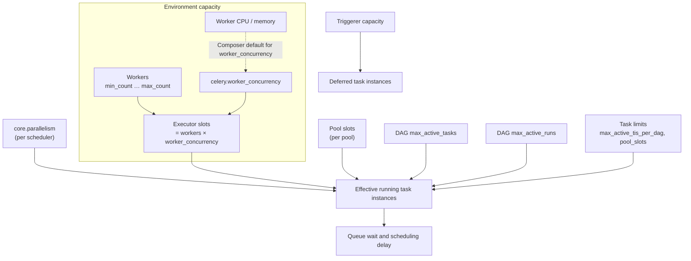

The interactive version (`FR-CFG-03`) shows live values on each node, the computed effective limit for the selected time, and highlights the binding limit from `HM-006`.

### 14.4 Key formulas

| Name | Formula | Notes |
|---|---|---|
| Executor slots | `workers_current × worker_concurrency` | Upper bound for running Celery task instances at a moment |
| Executor slots at maximum | `max_count × worker_concurrency` | Capacity ceiling for planning |
| Global limit | `core.parallelism × number_of_schedulers` | Parallelism applies per scheduler. Composer's default matches the maximum worker concurrency (⚠️ VERIFY for Airflow 3) |
| Inferred parallelism | `max over 24 h of (executor open_slots + running_tasks + queued_tasks)` | `HM-032`; per executor that reports the metric; provenance `inferred` |
| Effective concurrency | `min(global limit, executor slots, Σ open pool slots, per-DAG limits…)` evaluated per scope | Computed per minute by the occupancy sweep ([§11.8](#118-analytics-pipeline-and-incremental-computation)) |
| Composer default `worker_concurrency` | `auto`: calculated by Composer; the formula is not published | DCAM shows the supported ceiling `min(24, 12 × worker_vCPU, 8 × worker_memory_GB)` from the sizing guidance (⚠️ VERIFY), and the actual value inferred by `HM-032`; both are labelled |
| Stale risk ratio | `parse_loop_p95 ÷ stale_threshold` | Alert band at ≥ 0.8 |
| Parse guidance ratio | `parse_loop_p95 ÷ 300 s` | Google's guidance is a total parse time under 5 minutes (`REC-PARSE-08`) |
| Slot utilisation | `running_slots ÷ executor_slots` | Per minute; used by CAP rules |
| Database runway | `(threshold − size_now) ÷ growth_rate` | Days until the threshold. Theil–Sen slope over 30 days. The default threshold is 16 GB, which is 80 % of the 20 GB size above which Composer blocks upgrades and snapshots (`HM-019`) |

### 14.5 Option explanation content (the (i) for options)

Each option's drawer has fixed sections: **Effective value and provenance**, **What it does**, **If you increase it**, **If you decrease it**, **Related options** (clickable, with live values), **Formula** (if any), **Live evidence** (small charts bound to the knowledge base `evidence` list), **Composer notes** (managed, blocked, defaults), **Recommended ranges** (when documented), **Snippets** (Terraform and `gcloud`), **Official documentation**. The same content is exposed through the MCP server (`FR-AI-01`).

### 14.6 Drift analysis

Drift compares effective configuration, workloads, environment size, image version, PyPI packages and environment variable *names* across selected environments (`FR-CFG-06`). Tier rules declare expected differences:

```yaml
driftRules:
  expected:
    - key: workloads.worker.max_count
      when: "tier(a) != tier(b)"          # sizing differs by tier on purpose
    - key: core.default_timezone
      never: true                          # must be identical everywhere
  critical:                                # differences that are always worth reviewing
    - scheduler.dag_stale_not_seen_duration
    - scheduler.min_file_process_interval
    - celery.worker_concurrency
    - core.parallelism
```

Each difference is classified as **expected**, **suspicious** or **critical**, and links to the option drawer. Drift history shows when an environment diverged (from configuration change events).

### 14.7 Verification of configuration changes

When a change event touches an option or workload related to an open finding, or when the user starts it manually, DCAM creates a verification:

1. **Windows.** Before and after windows of equal length (default 7 days each, minimum 24 hours), aligned by hour of day and day of week to control for seasonality, excluding maintenance windows and the change's rollout period.
2. **Metrics.** The rule's `verify.signal` plus guard metrics (failure rate, worker memory p95, database CPU) to catch regressions elsewhere.
3. **Test.** Mann–Whitney U test for distributions (for example queue wait) and bootstrap confidence intervals for percentile differences; significance level 0.05 by default.
4. **Confounders.** Other change events in either window lower the confidence and are listed.
5. **Outcome.** `improved`, `regressed`, `no change` or `inconclusive`, with effect size, confidence and charts. The finding moves to `verified` only if improved and no guard metric regressed.

---

## 15. Interactive wiki and runbooks

The wiki teaches Composer and Airflow *with the user's own live data* (`G-8`, `J-8`). Content is MDX in `packages/wiki-content`, rendered both in the app and on the documentation site (`FR-WIKI-09`).

### 15.1 Content architecture

| Section | Pages (seed) | Live bindings |
|---|---|---|
| Start here | What Composer is; what Airflow is; Composer 3 versus Composer 2; how DCAM observes an environment; reading DCAM's freshness and estimates | Selected environment's versions and collectors |
| Architecture | Composer 3 architecture (interactive); Composer 2 architecture (interactive); components (scheduler, DAG processor, triggerer, workers, web server, metadata database, Celery broker, environment bucket); networking and access; identities and IAM | Component health, sizes, key metrics |
| Flows | DAG file lifecycle; scheduling loop; task instance lifecycle; Celery execution; deferral; autoscaling; logging pipeline; metrics pipeline; configuration override rollout; upgrades | Current counts per state, current loop durations |
| Concepts | Concurrency stack; pools and priority; timetables and data intervals; catchup and backfill; sensors and deferrable operators; dynamic task mapping; XCom; assets (datasets); deadlines and SLAs | Environment's actual limits and pools |
| Configuration | How overrides work; environment variables; managed and blocked options; browsing the knowledge base | Effective configuration |
| Best practices | One page per rule category ([§13.6](#136-seed-rule-catalog)), cross-linked with rules | Open findings for the selected environment |
| Runbooks | [§15.5](#155-runbook-catalog) | Pre-evaluated checks |
| Glossary | All terms ([§6.2](#62-glossary-core-terms) seed) | ― |
| How DCAM computes things | One page per hidden metric ([§8](#8-hidden-metrics-and-derived-signals-catalog)) and per data source ([§7](#7-data-sources-and-agentless-collection)); budgets; privacy | DCAM health and budgets |

### 15.2 Interactive architecture diagrams

The Composer 3 diagram is the centrepiece (`FR-WIKI-02`). The following simplified structure follows Google's Composer 3 architecture documentation:

- The environment cluster, the Celery broker (Redis) and the Airflow metadata database (Cloud SQL) run in a Google-managed tenant project.
- The environment bucket is in the customer project, and so are the exported logs and metrics.
- The executor is CeleryKubernetesExecutor, so tasks run on Celery workers or in Kubernetes worker pods.
- In high-resilience mode, the scheduler, web server, DAG processor and triggerer run at least two instances, and the database is regional.

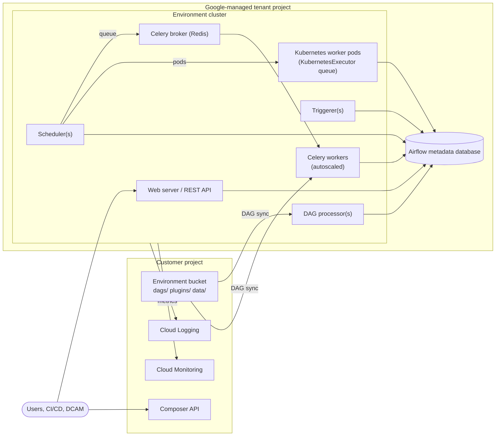

Each component node opens a drawer with: what it does; sizing knobs (Composer workloads configuration); related Airflow options; live health and key metrics for the selected environment; typical failure modes; linked runbooks; log deep links; official documentation. Nodes are coloured by live health (`FR-WIKI-02`) and keyboard-navigable.

Implementation: in-app interactive diagrams are rendered with React Flow from a JSON model (`nodes`, `edges`, `bindings`), so live data can be attached by component ID. Static documentation diagrams are authored in draw.io ([§15.7](#157-diagram-pipeline)).

### 15.3 Step-through flows

| Flow | Steps (summary) | Live data shown |
|---|---|---|
| DAG file lifecycle | Upload to bucket → sync → DAG processor parses → serialised DAG stored → scheduler sees it → visible in UI | Deploy propagation latency (`HM-014`), parse loop, import errors |
| Scheduling loop | Find runnable DAG runs → create task instances → check dependencies → check limits → queue to executor | Scheduling delay, throttle reasons |
| Task instance lifecycle | none → scheduled → queued → running → success / failed / up_for_retry / deferred … | Current counts per state |
| Celery execution | Scheduler → broker → worker slot → task process → heartbeat → result | Executor slots, worker utilisation |
| Deferral | Task defers → slot released → trigger runs in triggerer → event → task resumes on a worker | Deferred task instances, triggerer load |
| Autoscaling | Queued demand → worker scale-up → scale-down after idle | Worker count versus queue (`HM-012`) |
| Logging pipeline | Component and task logs → Cloud Logging → retention and exclusions | Log volume per DAG (`HM-020`) |
| Configuration rollout | Override changed → Composer update operation → components restart → new value effective | Recent change events |

### 15.4 Runbook format

```mdx
---
id: RB-01
title: Tasks stuck in queued or scheduled
symptoms: ["Queued task instances grow", "Runs start late", "Workers idle while tasks wait"]
appliesTo: { composer: [2, 3], airflow: [2, 3] }
relatedRules: [REC-CAP-01, REC-CONC-01, REC-CONC-02, REC-DAG-01, REC-SCHED-01]
checks:
  - id: binding-limit
    title: Which limit is binding?
    signal: HM-006
    pass: "share('unknown') < 0.2"
  - id: workers-at-max
    title: Are workers at max_count?
    signal: HM-011
    pass: "minutes_at_max == 0"
  - id: scheduler-healthy
    title: Is the scheduler heartbeating?
    signal: composer.scheduler_heartbeat
    pass: "gaps == 0"
---

<RunbookChecks />   {/* renders checks pre-evaluated for the finding's scope and window */}

## Likely causes
…
## Fixes
…
```

Runbook checks reuse signal definitions; they are evaluated for the scope and time window of the finding or incident from which the runbook was opened (`FR-WIKI-05`).

### 15.5 Runbook catalog

| ID | Runbook | Automated checks (examples) | Related rules |
|---|---|---|---|
| RB-01 | Tasks stuck in queued or scheduled | Binding limit, workers at maximum, pool starvation, scheduler heartbeat, triggerer capacity | REC-CAP-01, REC-CONC-01, REC-CONC-02, REC-DAG-01, REC-SCHED-01 |
| RB-02 | DAG missing or disappeared from the UI | Import errors, stale risk ratio, file present in bucket, last parsed time, paused or deactivated state | REC-PARSE-02, REC-PARSE-03 |
| RB-03 | Scheduler unhealthy | Heartbeat completeness, loop and critical-section duration (`HM-031`), restarts, CPU and memory versus limits, scheduler error signatures | REC-SCH-01, REC-SCH-02 |
| RB-04 | Worker out-of-memory kills, evictions and zombie tasks | Memory p95 versus limit, OOM signals, scale-down correlation, heartbeat timeouts | REC-CAP-03, REC-CAP-07, REC-REL-01, REC-REL-02 |
| RB-05 | Slow DAG parsing and deploy propagation | Parse loop trend, slowest files, DAG processor CPU, propagation latency | REC-PARSE-01, REC-PARSE-04, REC-PARSE-05, REC-PARSE-06, REC-PARSE-08 |
| RB-06 | DAG runs start late | Scheduling delay decomposition, collisions, `max_active_runs` backlog | REC-SCHED-02, REC-DAG-02, REC-SCHED-01 |
| RB-07 | Metadata database pressure or growth | Size and growth, CPU and memory, connection errors, retention status | REC-DB-01 to REC-DB-05 |
| RB-08 | Deferred tasks not resuming or triggerer overloaded | Triggerer count and capacity, blocked event loop signals, deferred counts | REC-TRG-01 to REC-TRG-03 |
| RB-09 | Environment update or upgrade failed | Recent Composer operations and errors, PyPI conflicts, image support status, known issues for the build | REC-UPG-01, REC-UPG-03 |
| RB-10 | DCAM cannot reach the Airflow API | IAM permission, Airflow role, web server access control, proxy, VPC Service Controls | ― (doctor checks) |
| RB-11 | Failure spike after a change | Failure rate versus baseline, change events in lookback, new error signatures | REC-REL-03, REC-REL-04 |
| RB-12 | Missing or partial logs | Log exclusions, logging quota errors, task log availability | REC-LOG-02 |
| RB-13 | Unexpected cost increase | Workload sizes and counts over time, worker hours, log volume, top DAGs by slot-time | REC-COST-01, REC-COST-02, REC-LOG-01 |
| RB-14 | Autoscaling not keeping up | Scale-up lag, time at maximum, queue during scale-up, `worker_concurrency` versus the supported ceiling | REC-CAP-01, REC-CAP-06, REC-CAP-08 |

### 15.6 Content governance

- Every page declares `appliesTo`, `owner`, `lastVerified` and `sources` (official documentation URLs).
- CI runs a link checker, an MDX linter and Vale with the Google developer documentation style package; it fails if a rule lacks a wiki page (`FR-WIKI-06`) or a page lacks `appliesTo`.
- Screenshots are generated by Playwright from demo mode, never captured by hand, so they stay current.
- Pages older than 12 months since `lastVerified` are flagged for review.

### 15.7 Diagram pipeline

- **Documentation diagrams** (architecture overview, C4 views, data flows) are authored in draw.io (`docs/diagrams/*.drawio`) and exported to SVG and PNG with the draw.io desktop command-line interface, or its Docker image in CI. The harness provides a `drawio-diagrams` skill for this ([§21.7](#217-slash-commands-and-skills)).
- **In-app interactive diagrams** are React Flow models with stable component IDs bound to live data.
- **Lightweight diagrams** in Markdown (this specification, ADRs) use Mermaid.
- CI verifies that every `.drawio` file has up-to-date exports (export, then compare hashes).

---

## 16. Alerting

DCAM alerts locally while it runs, and exports durable policies to Cloud Monitoring for 24/7 coverage (`NG-1`).

### 16.1 Alert rule model

```yaml
id: AL-05
name: Tasks queued while workers are at maximum
scope: environment
query:
  signal: agg.capacity_1m
  expr: "workers_current >= workers_max AND queued_ti >= 10"
condition:
  type: threshold              # threshold | rate_of_change | absence | anomaly | finding
  for: PT15M
  clearFor: PT10M              # hysteresis
noData: keep_state             # alerting | ok | keep_state
severity: warning
tiers: [prod, test]
labels: { component: workers }
annotations:
  summary: "{{env}}: {{queued_ti}} tasks queued with workers at {{workers_max}}"
  runbook: RB-01
notify: [inbox, desktop, route:default]
export:
  cloudMonitoring: partial     # yes | partial | no ― see 16.6
```

### 16.2 Evaluation semantics

- **States:** `inactive` → `pending` (condition true, `for` not yet elapsed) → `firing` → `resolved` (condition false for `clearFor`).
- **Cadence:** each rule is evaluated on its signal's live cadence; at most once per 10 seconds.
- **Staleness guard:** if the rule's source is stale beyond 3 × its cadence, the alert moves to `unknown` and notifies only if `notifyOnUnknown` is set. DCAM never alerts on data it does not have.
- **Anomaly conditions:** robust seasonal baselines (median and median absolute deviation per hour of week) with a minimum history; anomalies are labelled as such.
- **Finding conditions:** an alert can fire when a finding of a given rule and severity opens.

### 16.3 Notifiers and routing

- Routes match labels (`tier`, `team`, `severity`, `component`) and select receivers; the first matching route wins unless `continue: true`.
- Messages are rendered from templates with the alert context, including deep links to DCAM (local) and to the Cloud console (shareable).
- Grouping, deduplication, re-notification intervals and rate limits follow `FR-ALRT-04`.
- Notifier secrets come from environment variables or the OS keychain (`FR-ALRT-03`, `NFR-SEC-03`).

### 16.4 Default alert pack

| ID | Alert | Condition (defaults) | Severity (prod / non-prod) | Runbook | Cloud Monitoring export |
|---|---|---|---|---|---|
| AL-01 | Environment unhealthy | `environment/healthy` reports unhealthy for 10 min, or healthy < 90 % of the time over 4 h | critical / warning | RB-03 | Yes |
| AL-02 | Scheduler heartbeat missing | No scheduler heartbeat for 5 min, or heartbeat completeness < 90 % over 4 h (`HM-031`) | critical / warning | RB-03 | Yes (absence); completeness: No |
| AL-03 | Stale DAG risk | Parse loop ≥ 80 % of the stale threshold for 30 min | warning / info | RB-02 | Partial (threshold must be a constant) |
| AL-04 | Import errors | Import errors > 0 for 15 min | warning / info | RB-02 | Yes |
| AL-05 | Tasks queued while workers are at maximum | Workers at maximum and ≥ 10 queued for 15 min | warning / info | RB-01 | Partial (combined condition) |
| AL-06 | Queue wait high | p95 queue wait ≥ 10 min over 15 min | warning / info | RB-01 | No (derived from the Airflow API) |
| AL-07 | Worker memory pressure | Worker memory ≥ 90 % of the limit for 10 min, or an OOM kill (`health/container_restart_count`, reason `OOMKilled`) | warning / info | RB-04 | Yes |
| AL-08 | Zombie or heartbeat-timeout tasks | ≥ 5 in 1 h (`zombie_task_killed_count`); production also reports > 1 per 24 h at info | warning / info | RB-04 | Yes |
| AL-09 | Failure spike | Failed task instances ≥ 3 × the same-hour baseline over 1 h | warning / info | RB-11 | Partial |
| AL-10 | Database CPU or memory high | Database CPU ≥ 90 % for 15 min, or CPU or memory ≥ 80 % over 12 h | warning / info | RB-07 | Yes |
| AL-11 | Database size runway | Projected to reach the threshold within 14 days | warning / info | RB-07 | No (forecast) |
| AL-12 | Airflow API unreachable from DCAM | Health checks fail for 5 min | warning / warning | RB-10 | No (DCAM-local) |
| AL-13 | Triggerer saturated | ≥ 90 % of capacity for 15 min | warning / info | RB-08 | Partial |
| AL-14 | Timeliness target missed | A DAG run misses its configured target (opt-in per DAG) | warning / info | RB-06 | No |
| AL-15 | Pool starvation | A pool has no open slots with queued work for 30 min | warning / info | RB-01 | No |
| AL-16 | Environment operation failed | A Composer update or upgrade operation ended in error | warning / warning | RB-09 | Yes (via audit or operation logs) |
| AL-17 | DCAM collection stale | A collector has had no successful cycle for 10 min | info / info | RB-10 | No (DCAM-local) |
| AL-18 | Database unhealthy | `database_health` healthy < 95 % of the time over 4 h | critical / warning | RB-07 | Yes |
| AL-19 | Worker restarts | > 1 worker container restart in 24 h, excluding scale-down and maintenance | warning / info | RB-04 | Yes |

Several defaults (AL-01, AL-02, AL-08, AL-10, AL-18 and AL-19) follow the alert thresholds Google suggests for Composer key metrics; DCAM adds faster symptom-based variants for paging.

### 16.5 Silences and maintenance windows

- Manual silences match labels and have an end time and a reason.
- The Composer maintenance window is imported per environment; alerts during it are recorded and flagged, and notified only if `notifyDuringMaintenance` is set.
- Verification windows ([§14.7](#147-verification-of-configuration-changes)) exclude maintenance windows.

### 16.6 Export to Cloud Monitoring

For rules expressible on Cloud Monitoring metrics (including log-based metrics), DCAM generates alert policy JSON for the Cloud Monitoring API and Terraform `google_monitoring_alert_policy` resources (`FR-ALRT-07`). Export is preview and copy only. Example for AL-02. `scheduler_heartbeat_count` is a DELTA INT64 counter, so a 60 s `ALIGN_SUM` suits an absence condition:

```hcl
resource "google_monitoring_alert_policy" "dcam_al_02_acme_prod" {
  project      = "acme-data-prod"
  display_name = "[DCAM AL-02] acme-prod: scheduler heartbeat missing"
  combiner     = "OR"

  conditions {
    display_name = "No scheduler heartbeat for 5 minutes"
    condition_absent {
      filter = join(" AND ", [
        "resource.type = \"cloud_composer_environment\"",
        "resource.labels.environment_name = \"acme-prod\"",
        "metric.type = \"composer.googleapis.com/environment/scheduler_heartbeat_count\"",
      ])
      duration = "300s"
      aggregations {
        alignment_period   = "60s"
        per_series_aligner = "ALIGN_SUM"
      }
    }
  }

  documentation {
    content   = "Scheduler heartbeat missing. Runbook: RB-03 (DCAM wiki)."
    mime_type = "text/markdown"
  }

  notification_channels = [var.oncall_notification_channel]
  user_labels           = { managed_by = "dcam-export", dcam_rule = "al-02" }
}
```

Export rules:

- Alerts that depend on Airflow API data or DCAM-derived signals are marked "not exportable" with the closest exportable alternative (for example a log-based metric for heartbeat-timeout messages, with the generated log filter from [Appendix C](#appendix-c-cloud-logging-query-library)).
- Exports include `user_labels` for traceability and never include notification channel IDs other than as variables.
- A PromQL-based condition MAY be generated as an alternative where Cloud Monitoring supports it for the metric.

### 16.7 Noise control

- Page on symptoms (unhealthy, heartbeat missing, capacity-bound with late runs); report causes as findings, not pages.
- Every alert has a runbook and an owner label.
- The alerts page shows per-rule fire counts, mean time to resolve and the share of alerts with no follow-up action, to help prune noisy rules.

---

## 17. Configuration reference

### 17.1 Files and precedence

- Workspace file: `dcam.config.yaml` in the working directory, or the path from `--config` or `DCAM_CONFIG`. A JSON Schema is published with each release and referenced from the file for editor completion.
- Precedence: built-in defaults < configuration file < environment variables < command-line flags.
- The file contains no secrets and is safe to commit (`FR-SETUP-07`). Secret values are referenced by environment variable name or keychain entry.

### 17.2 Annotated example

```yaml
# yaml-language-server: $schema=./node_modules/@dcam/contracts/schemas/dcam.config.schema.json
version: 1

workspace:
  name: acme-data-platform
  dataDir: ~/.dcam/data            # DuckDB file, Parquet cold tier, caches
  displayTimezone: browser        # browser | environment | IANA name
  stateColours: auto              # auto | airflow2 | airflow3 (§12.6)

server:
  host: 127.0.0.1                 # non-loopback requires --allow-remote and an access token
  port: 8787
  openBrowser: true

auth:
  quotaProjectId: acme-data-ops   # project billed for API quota
  # Per-environment impersonation is configured below.

network:
  proxy: from-env                 # honours HTTPS_PROXY, HTTP_PROXY, NO_PROXY
  caBundlePath: null              # or a PEM path; NODE_EXTRA_CA_CERTS is also honoured

tiers:
  prod: { profile: standard, alertPack: production,     weight: 1.0 }
  test: { profile: eco,      alertPack: non-production, weight: 0.6 }
  dev:  { profile: eco,      alertPack: non-production, weight: 0.3 }

environments:
  - id: acme-prod                 # stable slug used in URLs and the API
    projectId: acme-data-prod
    location: europe-west1
    environment: acme-prod        # Composer environment name
    tier: prod
    displayName: Production
    color: "#F28B82"
    team: data-platform
    impersonateServiceAccount: dcam-reader@acme-data-prod.iam.gserviceaccount.com
    collectors:
      airflowCli: { enabled: false, intervalMinutes: 60 }     # opt-in (FR-COLL-12)
      bucket: { enabled: true, includePlugins: false, maxFileSizeKb: 512 }
      logging: { enabled: true }
      gke: { enabled: false }                                  # Composer 2 only
    backfill: { taskInstancesDays: 7, metricsDays: 14 }
  - id: acme-test
    projectId: acme-data-test
    location: europe-west1
    environment: acme-test
    tier: test
  - id: acme-dev
    projectId: acme-data-dev
    location: europe-west1
    environment: acme-dev
    tier: dev

discovery:
  projects: [acme-data-dev, acme-data-test, acme-data-prod]
  locations: [europe-west1]
  assetInventoryScope: null       # for example folders/123456789 (optional)

profiles:                         # seconds; defaults shown
  live:       { airflowLive: 10,  airflowFacts: 30,  monitoring: 60,  composer: 300,  bucket: 300 }
  standard:   { airflowLive: 30,  airflowFacts: 60,  monitoring: 60,  composer: 600,  bucket: 900 }
  eco:        { airflowLive: 120, airflowFacts: 300, monitoring: 300, composer: 1800, bucket: 3600 }
  background: { airflowLive: 300, airflowFacts: 600, monitoring: 600, composer: 3600, bucket: 3600 }

budgets:                          # per environment unless stated (NFR-OBS-*, §7.11); hard maxima cannot be exceeded
  airflowApi: { live: 60, standard: 12, eco: 4, background: 2, maxConcurrent: 2 }   # requests per minute
  monitoring: { perProjectPerMinute: 30 }
  logging:    { shareOfProjectQuota: 0.2 }   # of 60 entries.list requests/min per project; hard maximum 0.5
  composerApi: { perMinute: 6 }
  gcs:        { perMinute: 4 }
  patientMode: { enabled: true, airflowApiLatencyP95Ms: 2000, databaseCpu: 0.9, recoverAfterMinutes: 10 }

retention:
  rawTaskInstancesDays: 90
  rawMetricPointsDays: 14
  rollup5mDays: 90
  rollup1hDays: 400
  logSignaturesDays: 30
  findingsDays: 400
  diskBudgetGb: 5

teams:
  mapping:                        # first match wins (FR-DAGX-08)
    - team: marketing
      match: { tags: [marketing] }
    - team: finance
      match: { pathRegex: "^dags/finance/" }
    - team: unassigned
      match: { any: true }

cost:
  currency: EUR
  pricing:
    source: manual                # manual | billing-export (optional BigQuery)
    rates: {}                     # fill from your price list; all outputs are labelled estimates

advisor:
  packs: [core]
  thresholds:
    REC-PARSE-02: { ratio: 0.8 }
    REC-DAG-05: { slotHoursPerDay: 1 }

alerting:
  notifiers:
    - id: oncall-webhook
      type: webhook
      urlFromEnv: DCAM_ONCALL_WEBHOOK_URL
    - id: team-chat
      type: google-chat
      urlFromKeychain: dcam/team-chat-webhook
  routes:
    - match: { tier: prod, severity: [critical, warning] }
      notify: [inbox, desktop, oncall-webhook]
    - match: { }
      notify: [inbox]

ai:
  mcp: { enabled: false, http: true, stdio: true }
  llm: { provider: none }         # none | copilot-cli | vertex-gemini | anthropic | openai-compatible | local

redaction:
  customPatterns: []

features:
  staticAnalysis: true
  openMetricsEndpoint: false
```

### 17.3 Environment variables

| Variable | Purpose |
|---|---|
| `DCAM_CONFIG` | Path to the workspace configuration file |
| `DCAM_DATA_DIR` | Overrides `workspace.dataDir` |
| `DCAM_HOST`, `DCAM_PORT` | Override `server.host` and `server.port` |
| `DCAM_LOG_LEVEL` | `trace`, `debug`, `info` (default), `warn`, `error` |
| `DCAM_ACCESS_TOKEN` | Required access token when binding to a non-loopback interface |
| `DCAM_DEMO` | `1` starts in demo mode |
| `HTTPS_PROXY`, `HTTP_PROXY`, `NO_PROXY` | Proxy configuration |
| `NODE_EXTRA_CA_CERTS` | Additional CA certificates |
| `GOOGLE_APPLICATION_CREDENTIALS` | Standard ADC override (for example a mounted credential in Docker) |
| Notifier variables | As named by `urlFromEnv`, `tokenFromEnv` in the configuration |

### 17.4 Command-line interface

| Command | Purpose |
|---|---|
| `dcam start [--config <file>] [--port <n>] [--no-open] [--demo] [--allow-remote]` | Start the server and UI |
| `dcam doctor [--env <id>] [--json]` | Run preflight checks (`FR-AUTH-05`) |
| `dcam discover --project <id>… [--location <loc>…]` | List Composer environments and print configuration stubs |
| `dcam config init`, `dcam config validate`, `dcam config print-effective` | Manage configuration |
| `dcam export --env <id> --from <t> --to <t> [--format parquet]` | Export a bundle |
| `dcam import <bundle>` | Import a bundle as a read-only snapshot |
| `dcam mcp [--stdio] [--demo-only]` | Run the MCP stdio bridge to a running instance. With `--demo-only`, the bridge refuses to connect unless the instance runs in demo mode; repository-level MCP configuration always uses it, so a coding assistant can never read real monitoring data |
| `dcam rules test [--rule <id>]`, `dcam metrics test [--metric <id>]` | Run golden tests for content packs |
| `dcam kb verify` | Check knowledge base entries against the configured Airflow versions |
| `dcam version` | Print versions and build provenance |

### 17.5 Data directory layout

```text
~/.dcam/data/
├── dcam.duckdb            # hot store
├── dcam.duckdb.wal
├── cold/                 # Parquet partitions (env_id=…/date=…)
├── cache/bucket/<env>/   # DAG source cache for static analysis (never exported by default)
├── backups/              # pre-migration backups (last 3 kept)
└── logs/                 # DCAM's own JSON logs (rotated)
```

The directory is created with owner-only permissions (`0700`).

---

## 18. Security, privacy and compliance

### 18.1 Threat model

| Threat (STRIDE) | Scenario | Mitigation |
|---|---|---|
| Spoofing | A malicious web page calls DCAM's localhost API (CSRF, DNS rebinding) | Host header allowlist, Origin checks, session token exchanged for a `SameSite=Strict` cookie, CSRF tokens, no CORS ([§18.5](#185-local-web-application-security)) |
| Spoofing | A local process impersonates an MCP client | MCP HTTP endpoint requires a bearer token and validates `Origin`; stdio bridge authenticates with a local token file readable only by the user |
| Tampering | A malicious plugin or content pack | Explicit enablement, integrity hashes, declarative-first plugins, code plugins labelled as trusted code (`FR-EXT-03`, `FR-EXT-04`) |
| Repudiation | Unclear who exported or sent data | Local audit log of exports, prompt sends, LLM calls and MCP calls |
| Information disclosure | Secrets or personal data in logs, DAG code or configuration leave the machine | Redaction at ingest and egress; masked sensitive options; DAG source cache excluded from exports by default; no telemetry |
| Information disclosure | Another OS user reads DCAM data | Owner-only data directory; no credentials stored |
| Denial of service | DCAM overloads a production environment | Observer budgets, circuit breakers, priority scheduling ([§7.11](#711-observer-budget-do-no-harm)) |
| Denial of service | Huge API responses or logs exhaust DCAM memory | Streaming parsers, response size limits, pagination caps |
| Elevation of privilege | DCAM runs with a user identity that can modify environments | Read-only guarantee ([§18.2](#182-read-only-guarantee)); doctor recommends a read-only identity |
| Prompt injection | Log lines or DAG code instruct an AI assistant to take actions | MCP tools are read-only; untrusted content is delimited and labelled; the LLM explainer cannot call tools that change anything |
| Supply chain | Compromised dependency or release | Lockfile, provenance, signatures, dependency review, OpenSSF Scorecard ([§18.8](#188-supply-chain-security)) |

### 18.2 Read-only guarantee

DCAM MUST be incapable of changing a monitored system, even when the user's identity has write permissions (`P-1`).

1. **Single choke point.** All calls to Google Cloud and Airflow go through the guarded HTTP client ([§11.4](#114-hexagonal-components-and-dependency-rules), rule 7).
2. **Default-deny allowlist.** The client permits only declared (host pattern, method, path template, optional body validator) entries. Some read operations use `POST` (for example Cloud Logging `entries:list`); they are allowed explicitly with body validation. Airflow reads are `GET` only. Everything else is rejected before any network I/O and logged as a security event.

   | Service | Allowed (examples) | Explicitly not allowed (examples) |
   |---|---|---|
   | Composer API | `GET` environments, operations, image versions; `POST executeAirflowCommand` only for allowlisted read-only subcommands when opted in, plus the matching poll call | `PATCH` environments, `DELETE`, snapshot save or load, database failover |
   | Cloud Monitoring | `GET` time series, metric descriptors, monitored resource descriptors | Creating or changing alert policies, dashboards, channels (export is copy-only) |
   | Cloud Logging | `POST entries:list` (read); `GET` log metrics and sinks (optional) | Writing entries, changing sinks, exclusions or buckets |
   | Cloud Storage | `GET` object list and object media in the environment bucket | Any upload, delete or ACL change |
   | Airflow REST API | `GET` endpoints for DAGs, DAG runs, task instances, pools, import errors, health, version, event logs, task logs; the doctor's `GET /providers` privilege probe ([§18.3](#183-authentication-and-identity)) | Every method other than `GET`, including `PATCH` DAGs (pause), `POST` DAG runs (trigger), clear task instances, set state, pools or variables changes. Also never read, although read-only: configuration, connections, variables and XCom values |

3. **Composer CLI execution guard.** When `FR-COLL-12` is enabled, only `dags report`, `dags list-import-errors`, `dags list` and `version` may be executed, with validated arguments. Composer 3 blocks the configuration commands (`config list`, `config get-value`) in any case. Arguments are passed as a structured list, never as a shell string.
4. **Static enforcement.** Lint and dependency rules forbid network modules and Google SDK imports outside adapters.
5. **Tests.** Unit tests for the allowlist; property-based tests that generate mutating requests and assert rejection; an end-to-end test that runs every screen against a recording proxy and asserts that no non-allowlisted request was made (`NFR-SEC-04`).
6. **Change control.** The allowlist file is owned by security code owners; changes require their review and a changelog entry.
7. **Identity hygiene.** The doctor warns when the active principal holds write roles on a monitored environment and links to setting up impersonation of a read-only service account.

### 18.3 Authentication and identity

- **Google identity.** Application Default Credentials; optional service account impersonation per environment (requires `iam.serviceAccounts.getAccessToken` on the target, for example through the Service Account Token Creator role). Tokens are held in memory only (`FR-AUTH-01`).
- **Sign-in.** `gcloud auth application-default login` is started with fixed arguments using a no-shell process API (`FR-AUTH-02`).
- **Airflow REST API.** Requests go to the environment's `airflowUri` and carry a Google OAuth 2.0 access token for the same identity. Access requires:
  - the IAM permission `composer.environments.get`, which is included in `roles/composer.viewer`;
  - an Airflow role in the environment.

  The web server's IP access rules also apply ([§18.9](#189-enterprise-network-and-policy-constraints)).
- **Airflow role: `Viewer` is sufficient.** It reads DAGs, DAG runs, task instances, task logs, pools, import errors, jobs and, on Airflow 2, SLA misses. DCAM does not need configuration, connections, variables, plugins or providers, which require `Op`. No custom role is needed.
- **Registration default.** Composer registers an identity as an Airflow user on first access, with the role from `[api] composer_auth_user_registration_role` (API) or `[webserver] rbac_user_registration_role` (UI). The default is **`Op`**, which can trigger, clear and pause DAGs.
  - Administrators SHOULD register the DCAM identity (user or service account) as `Viewer` before its first access, or lower the registration default.
  - DCAM's guarded client prevents writes in any case ([§18.2](#182-read-only-guarantee)), but least privilege still applies.
- **Privilege probe.** The doctor calls `GET /providers?limit=1`. This is harmless metadata that `Viewer` cannot read. If the call succeeds, the identity has `Op` or higher, and the doctor warns and shows how to assign `Viewer` (⚠️ VERIFY per Airflow version).

### 18.4 Least-privilege IAM

| Need | Predefined role (simplest) | Notes |
|---|---|---|
| Read environments, workloads, operations and image versions; access the Airflow web server and API | `roles/composer.viewer` | Includes `composer.environments.get`. Combine with the Airflow `Viewer` role ([§18.3](#183-authentication-and-identity)). `roles/composer.user` also works but adds permissions DCAM does not need |
| Read the environment bucket (DAG inventory and source) | `roles/storage.objectViewer`, granted on the environment bucket only | Needed for `HM-014` and `SCAN`. Avoid `roles/composer.environmentAndStorageObjectViewer`, which grants object read on every bucket in the project |
| Read metrics | `roles/monitoring.viewer` | |
| Read logs | `roles/logging.viewer` | Private logs (Data Access audit logs) are not needed |
| Quota project usage | `roles/serviceusage.serviceUsageConsumer` on the quota project | Provides `serviceusage.services.use` |
| Discovery across folders (optional) | `roles/cloudasset.viewer` | |
| Composer 2 GKE adapter (optional) | `roles/container.viewer` | |
| Cost from billing export and BigQuery job labels (optional) | `roles/bigquery.dataViewer` on the export dataset; `roles/bigquery.jobUser` on the query project; `roles/bigquery.resourceViewer` for project-wide `INFORMATION_SCHEMA.JOBS` (⚠️ VERIFY) | Every query is dry-run first and capped with `maximumBytesBilled` |
| Opt-in Airflow CLI (optional, `FR-COLL-12`) | Custom role with `composer.environments.get` and `composer.environments.executeAirflowCommand`, on a dedicated identity | Predefined roles that contain this permission also allow changing environments |
| Impersonation (optional) | `roles/iam.serviceAccountTokenCreator` on the reader service account | |

A ready-made custom role definition with the minimal permission list is provided in [Appendix E](#appendix-e-iam-permissions).

### 18.5 Local web application security

- Bind to `127.0.0.1` by default (`NFR-SEC-01`). Binding elsewhere requires `--allow-remote` and `DCAM_ACCESS_TOKEN`.
- On start, DCAM prints a URL with a one-time session token; the browser exchanges it for an `HttpOnly`, `SameSite=Strict` session cookie.
- Validate the `Host` header against `localhost:<port>` and `127.0.0.1:<port>` (DNS rebinding protection) and the `Origin` header on every state-changing request.
- CSRF tokens on state-changing requests; no CORS headers.
- Content Security Policy: `default-src 'self'`, scripts from self only, style nonces for the CSS-in-JS runtime, `frame-ancestors 'none'`, `object-src 'none'`.
- The MCP Streamable HTTP endpoint requires its own bearer token and validates `Origin`, following the MCP transport security guidance.
- Rate limiting on the local API protects against runaway clients.

### 18.6 Data handling and redaction

| Data | Stored | Retention (default) | Sensitivity and handling |
|---|---|---|---|
| Metrics and derived signals | Yes | [§17.2](#172-annotated-example) | Low |
| DAG, run and task instance metadata | Yes | 90 days raw | Medium (IDs, hostnames, owners); owner emails redacted in exports |
| Log signatures and bounded samples | Yes | 30 days | High; redacted at ingest |
| Full task logs | No (fetched on demand, displayed, not stored) | ― | High |
| DAG source cache | Yes (local cache) | Until the file changes | High (may contain secrets); never exported by default |
| Configuration values | Yes | Snapshot history 400 days | Sensitive options masked and never stored |
| Environment variable values | No (names only by default) | ― | High |
| Credentials and tokens | Never | ― | ― |

The redaction pipeline detects common credential formats (Google API keys, OAuth access tokens, private keys, JSON Web Tokens, passwords in connection URIs), email addresses, IP addresses and custom patterns, plus high-entropy strings. It runs at log ingest and at every egress (`NFR-PRIV-02`) and is tested against a corpus of known formats (`FR-AI-04`).

### 18.7 Secrets

- No secrets in configuration files; references only (`urlFromEnv`, `tokenFromEnv`, `urlFromKeychain`).
- OS keychain integration (macOS Keychain, Secret Service on Linux, Windows Credential Manager) through a maintained native binding (⚠️ VERIFY library choice in an ADR).
- Secrets are never logged, exported, included in debug bundles or sent to AI providers.

### 18.8 Supply-chain security

- Locked dependencies; automated updates (Renovate or Dependabot) with grouped, tested pull requests.
- Dependency review and vulnerability scanning (OSV-Scanner or `pnpm audit`) in CI; CodeQL static analysis; secret scanning (for example gitleaks).
- GitHub Actions pinned by commit SHA; least-privilege workflow tokens.
- Release artifacts and container images signed with Sigstore; SLSA build provenance attestations; npm packages published with provenance; CycloneDX SBOM attached to each release (`NFR-SEC-05`).
- OpenSSF Scorecard tracked with a target of 7 or more.

### 18.9 Enterprise network and policy constraints

- **VPC Service Controls.** A laptop outside a service perimeter may be denied access to Monitoring, Logging, Storage or Composer APIs. DCAM classifies these errors (`FR-AUTH-06`) and the documentation explains options: access levels for corporate networks or devices, or running DCAM on a machine inside the perimeter.
- **Airflow web server access control.** Composer can restrict web server access to IP ranges. The restriction also applies to the Airflow REST API, so the egress IP of the laptop or corporate proxy must be allowed. The doctor detects blocked access and explains the setting (⚠️ VERIFY the error signature, and behaviour for private environments).
- **Organization policies** may restrict service account impersonation or key usage; DCAM never requires service account keys.
- **Proxies and TLS inspection.** Supported through proxy variables and custom CA bundles (`FR-AUTH-07`).

### 18.10 Privacy and compliance notes

- DCAM is a local tool; the organisation running it remains the data controller for any personal data in logs or metadata. Documentation includes a data inventory ([§18.6](#186-data-handling-and-redaction)) to support privacy assessments.
- Data minimisation: no full log storage, bounded samples, configurable retention, redaction by default.
- Licence compliance: third-party notices are generated at build time; fonts and icons use open licences.

### 18.11 Security testing

| Test | Tooling | Gate |
|---|---|---|
| Read-only enforcement | Unit, property-based and recording-proxy end-to-end tests | Blocking |
| Static analysis | CodeQL, ESLint security rules | Blocking on high severity |
| Dependencies | OSV-Scanner or `pnpm audit`, dependency review | Blocking on critical |
| Secrets | gitleaks | Blocking |
| Web security baseline | OWASP ZAP baseline scan against the local server | Blocking on high |
| Redaction | Corpus tests | Blocking |
| Parsers | Fuzzing of configuration, filter expressions and log parsers (fast-check) | Non-blocking, tracked |

---

## 19. Testing, validation and quality strategy

Testing is how DCAM keeps its promises: read-only behaviour, bounded load, correct analytics and an honest UI. Principle P-12 applies everywhere. No production code is written without a failing test linked to a requirement ID, and no requirement is complete without its tests.

### 19.1 Test pyramid and tooling

| Layer | Scope | Tooling | Runs on | Coverage target |
|---|---|---|---|---|
| Unit | Domain formulas, statistics, classifiers, parsers, redaction, budget arithmetic | Vitest, fast-check (property-based) | Watch mode, pre-commit (changed packages), every PR | Most of the suite; ≥ 90 % lines in `domain`, `analytics`, `rules-pack` (`NFR-MAINT-02`) |
| Golden analytics | Each `HM-*` signal and `REC-*` rule on frozen datasets | Vitest + DuckDB + golden files with per-column tolerances | Every PR | 100 % of signals and rules |
| Contract (adapters) | Each adapter against recorded responses from Google APIs and Airflow API v1 and v2 | Vitest + recorded fixtures + Zod schemas | Every PR | Every endpoint and field DCAM reads |
| Contract (DCAM API) | DCAM's own OpenAPI document | Schemathesis (Docker), response validation in development, `oasdiff` breaking-change check | Every PR (diff), nightly (fuzzing) | 100 % of operations |
| Component | React components, states, (i) registry entries, chart table alternatives | Vitest + Testing Library + MSW + axe-core | Every PR | Every panel and every state (empty, loading, partial, error, ready) |
| Integration | Server + store + fakes, use-case level | Vitest, Fastify `inject`, fake clocks | Every PR | Every use case |
| End-to-end | Full application against demo data and the emulator | Playwright + `@axe-core/playwright` | PR smoke; full suite in the merge queue and nightly | Every journey and every top question `Q-01`…`Q-20` |
| Mutation | Rules engine, throttle classifier, statistics | Stryker | Nightly | Mutation score ≥ 70 % (`NFR-MAINT-02`) |
| Performance | API latency, query plans, rendering, interaction latency, bundle size | Vitest bench, autocannon, Playwright traces with `web-vitals`, Lighthouse CI | Nightly; bundle size on every PR | `NFR-PERF-*` |
| Footprint and budget | CPU, memory, disk and outbound requests per profile | Fake clocks + recording proxy + emulator | Every PR (simulated day), nightly (soak) | `NFR-RES-*`, `NFR-OBS-*` |
| Security | Read-only guarantee, web hardening, secrets, supply chain | See [§18.11](#1811-security-testing) | Every PR and nightly | Blocking |

### 19.2 Test-first workflow and traceability

1. **Red.** Write the test from the requirement's EARS acceptance criterion. "When X, the system shall Y" maps to Given/When/Then.
2. **Green.** Write the minimum code that makes the test pass.
3. **Refactor.** Improve the design with the tests green and boundaries enforced.

Test names carry requirement and catalog IDs, so traceability can be computed rather than maintained by hand:

```ts
// packages/analytics/test/hm-006.throttle-classifier.test.ts
describe('[HM-006][FR-BOTL-01] throttle reason classifier', () => {
  it('attributes waiting time to the pool when the pool has no open slots', async () => {
    const facts = await loadGolden('sc-03-saturated-pool');
    const result = await runSignal('HM-006', facts, { grain: '1m' });
    expect(result.shareOf('pool')).toBeGreaterThanOrEqual(0.8);
    expect(result.shareOf('unknown')).toBeLessThan(0.05);
  });
});
```

Production code that implements a requirement carries a `@implements FR-…` tag in its doc comment. `pnpm trace` builds `docs/spec/traceability.md` from:

- the requirement IDs in this specification,
- `specs/*/spec.md` and `tasks.md`,
- test names,
- `@implements` tags,
- documentation front matter.

CI fails when a Must requirement of a milestone marked done has no passing test.

### 19.3 Golden datasets and analytics correctness

- **Golden datasets.** They live next to each signal and rule (`packages/metrics-pack/<HM-ID>/golden/`, `packages/rules-pack/<REC-ID>/golden/`). Each dataset has:
  - input facts (NDJSON or Parquet);
  - expected outputs with tolerances per column;
  - a `README` that explains the situation it represents.

  Datasets come from emulator scenarios ([§20.4](#204-scenario-library)) or from the deterministic fact synthesiser ([§20.6](#206-demo-mode-and-the-demo-dataset)). They are frozen and version-controlled. `pnpm golden:update` regenerates them, and every change needs review.
- **Micro-fixtures.** Each formula has small, hand-computed cases. Examples are the occupancy sweep, slot-seconds, percentile interpolation, schedule delay, stale-risk ratio and the budget arithmetic.
- **Property-based invariants** (fast-check):
  - Running counts are never negative.
  - Slot-seconds equal the sum of duration × slots.
  - Percentiles are monotonic (p50 ≤ p95 ≤ p99).
  - Shares sum to 1 ± ε.
  - Rolling up rollups equals a direct rollup for additive measures.
  - Attribution never assigns more waiting time than exists.
- **Metamorphic tests:**
  - Shifting every timestamp by a constant leaves durations unchanged.
  - Ingesting the same batch twice changes nothing (idempotency).
  - Splitting a batch arbitrarily gives the same result (incremental equals full recomputation).
  - Re-labelling DAG IDs permutes the rankings consistently.
- **Incremental versus full equivalence.** Every derivation job runs both ways on the same data, and the results must match within tolerance. This catches bugs in dirty-window handling ([§11.7](#117-data-architecture-and-storage)).
- **Time correctness.** UTC storage, daylight-saving transitions in display time zones, cron schedules across DST, late-arriving data and clock skew between sources.
- **Degradation tests.** Each signal is run with each capability flag off ([§8.10](#810-capability-and-degradation-matrix)). The test asserts the documented fallback, a lower confidence and a visible label, and never a silent wrong value.
- **Classifier accuracy.** On every scenario with a known ground truth, the throttle classifier (`HM-006`) must attribute at least 90 % of waiting minutes to the right reason (goal G-3). The CI report includes a confusion matrix.

### 19.4 Contract tests and recorded fixtures

- **Recording.** `dcam dev record` is a developer-only command, disabled in release builds. It captures responses from a real environment through the guarded client. It needs explicit opt-in and runs read-only with the observer budget applied. Before anything is written, it pseudonymises:
  - project IDs become `acme-*`;
  - environment names and DAG IDs are replaced from a dictionary;
  - e-mail addresses and IPs are removed;
  - hostnames are normalised.
- **Fixture metadata.** Each fixture records its source, API version, Airflow version, Composer image family, recording date and the capability flags it exercises. Fixtures live in `tools/fixtures/<source>/<version>/`.
- **Fixture linter.** CI fails if a fixture contains anything that looks like a real project ID, e-mail address, token, private key or internal hostname. It uses a deny-list of patterns plus a high-entropy string check.
- **Adapter contract tests.** Each fixture is parsed with the adapter's Zod schema and normalised. The test asserts the canonical records produced. Unknown fields are tolerated and counted; missing required fields fail.
- **Assumption tests.** Every assumption marked ⚠️ VERIFY in this specification gets a contract test once it is verified at M1 ([§22.5](#225-m1-reality-check-spike)). Examples:
  - "workflow metrics have no `environment_name` label";
  - "`workflow/task/cpu_usage` is a percentage";
  - "`workflow/dag/run_duration` is in milliseconds";
  - "the Viewer role receives 403 on `/config`".

  If Google or Airflow changes a behaviour, the test makes the drift explicit.
- **Real Airflow, not mocks.** The Airflow v1 and v2 adapters are also tested against real Airflow in the emulator ([§20](#20-local-airflow-emulator-synthetic-load-and-demo-mode)). The matrix pins one Airflow 2 version and one Airflow 3 version that match current Composer builds.
- **Live drift check (optional).** A nightly job in a maintainers' sandbox environment calls the allowlisted read endpoints and validates the responses against the schemas. On drift it opens an issue with a redacted diff. Contributors never need cloud access to run the suite.

### 19.5 End-to-end, visual and accessibility tests

- **Playwright projects.**
  - `chromium` runs on every PR.
  - `firefox` and `webkit` run nightly (`NFR-COMP-02`).
  - The suites run in demo mode (deterministic) and against the emulator (realistic).
- **Three-click tests (goal G-1).** For each question `Q-01`…`Q-20`, a test starts on the Fleet overview and asserts that the panel answering the question is reached in three clicks or fewer, with the expected values from the demo dataset.
- **Journey tests.** Each journey in [§4.4](#44-key-journeys) is an end-to-end test that also checks URL state round-trips (deep links reproduce the same view).
- **Visual regression.** Playwright screenshots of key screens in light and dark themes, at 1280 × 800 and 1920 × 1080. Clocks and relative times are masked or fixed with a fake clock.
- **Accessibility.** Every screen is scanned with axe in each theme, with zero serious or critical violations allowed (`NFR-A11Y-01`). Keyboard-only tests cover the global shortcuts, tables, charts with table alternatives, dialogs and the command palette.
- **Determinism.** Demo mode fixes "now" with `DCAM_FAKE_NOW` and seeds every random source. Tests never depend on wall-clock time.

### 19.6 Browser-driven UI validation loop

Every user-facing change is validated in a real browser before review. Automated tests check what we thought of; the browser loop catches what we did not, such as layout breaks, confusing copy, missing explanations and dead ends.

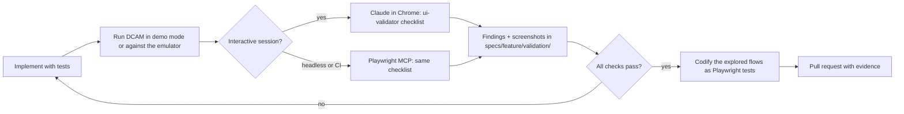

**Tools**

- **Claude in Chrome** (the Claude browser extension) is the primary tool for interactive sessions. The `ui-validator` subagent drives the developer's browser to navigate, click, type, read the page and capture screenshots of the locally running DCAM. Start validation sessions with `claude --chrome` and check the connection with `/chrome`. It needs the extension (version 1.0.36 or later), a Chromium-based browser such as Chrome or Edge, and a direct Anthropic plan with `/login`. It is not available with API-key authentication, through third-party model providers or in WSL. Contributors without it use Playwright MCP.
- **Playwright MCP** (`@playwright/mcp`) is the headless fallback for CI and for environments without the extension. It drives a browser through accessibility snapshots, with an optional vision capability (`--caps vision`) for visual checks. The same checklist runs headlessly and writes a report.
- **Chrome DevTools MCP** (`chrome-devtools-mcp`, optional) records performance traces and inspects network requests, which helps `perf-auditor` investigate `NFR-PERF-01` and `NFR-PERF-03`. It is opt-in per developer and runs with `--isolated --headless --no-usage-statistics --no-performance-crux`: usage statistics are collected by default, and the performance tools otherwise query the Chrome UX Report API.

**Safety rules for browser automation**

- Point the browser only at local DCAM: `http://127.0.0.1:<port>` or `http://localhost:<port>`, in demo mode or against the emulator.
- Never point it at the Google Cloud console, at production Airflow UIs or at any authenticated third-party site.
- Use a dedicated Chrome profile with no corporate sessions, and restrict the extension's site permissions to localhost.
- Playwright MCP runs with an origin allowlist for the local origins and an isolated, in-memory profile. Its documentation states that the allowlist is not a security boundary, so demo mode and DCAM's loopback binding remain the real protection.

**UI validation checklist** (the `ui-validation` skill, [§21.7](#217-slash-commands-and-skills))

| # | Check | Pass criterion |
|---|---|---|
| UV-01 | Renders all specified states | Empty, loading (skeleton), partial (degraded capability label), error (actionable message) and ready states all reachable with demo toggles |
| UV-02 | Explanations | Every metric, chart, KPI and config value has a working (i) popover with a definition, formula, source, freshness and documentation link (`P-7`) |
| UV-03 | Time and freshness | The global time range applies to every panel; the "data as of" footer and source lag are visible; times show the configured time zone |
| UV-04 | URL state | Copy the URL, open it in a new tab, and the same view appears (filters, range, selection, tab) |
| UV-05 | Layout | No overflow or overlap at 1024, 1280, 1440 and 1920 px widths; dense tables scroll virtually; sticky headers work |
| UV-06 | Themes and colour | Light and dark themes are both correct; Airflow state colours are consistent; state is never conveyed by colour alone (`NFR-A11Y-02`) |
| UV-07 | Keyboard | All actions are reachable by keyboard; focus is visible; Escape closes overlays; the command palette works |
| UV-08 | Copy | Sentence case, active voice, no jargon without an (i), no truncated labels (`NFR-UX-03`) |
| UV-09 | Console and network | No console errors or warnings; network requests go only to DCAM's local origin; no request bypasses the API |
| UV-10 | Performance | Interactions on large tables and charts feel immediate (sampled INP within `NFR-PERF-03`) |
| UV-11 | Read-only affordances | No control suggests DCAM will change the environment; fix snippets are clearly "copy" actions |
| UV-12 | Deep links out | Links to the Cloud console, Airflow UI and documentation open in a new tab with the right context |

**Evidence.** The loop writes `specs/<feature>/validation/report.md` with the checklist result, plus light and dark screenshots. The PR template requires a link to it for any change under `apps/web/` or `packages/ui-kit/`.

**Codification.** Flows explored in the loop become Playwright tests, so exploration turns into regression protection.

### 19.7 Performance, footprint and observer-budget tests

- **Reference scale.** The fact synthesiser ([§20.6](#206-demo-mode-and-the-demo-dataset)) generates 3 environments × 5,000 DAGs × 100,000 task instances per day × 90 days, about 27 million task instances. Performance tests run on this dataset.
- **API benchmarks.**
  - autocannon measures p50 and p95 for the key endpoints against `NFR-PERF-01` and `NFR-PERF-02`.
  - DuckDB query plans for the heaviest queries are snapshotted.
  - A nightly regression of more than 10 % fails the run.
- **Front end.**
  - Lighthouse CI enforces the bundle and performance budgets (`NFR-PERF-05`).
  - Playwright traces with `web-vitals` measure interaction latency on the virtualised league table and the Gantt view (`NFR-PERF-03`).
- **Footprint soak.**
  - Nightly: two hours in the `standard` profile against fakes.
  - Weekly: 24 hours.
  - Both record CPU, resident memory, heap growth slope, disk growth and file handles against `NFR-RES-*`.
- **Observer budget.** A fake clock drives the collectors through a simulated day against the recording proxy. The test asserts:
  - requests per API and per minute stay within each profile's budget ([§7.11](#711-observer-budget-do-no-harm));
  - patient mode engages when latency or 5xx errors are injected, and recovers after the healthy period;
  - circuit breakers open on injected 429 responses and honour `Retry-After`;
  - eco mode reduces outbound requests by at least 70 % (`FR-SELF-02`);
  - Cloud Logging use stays within its share of the project quota (`NFR-OBS-02`).
- **Ingest scale.** Sustained ingest at the reference rate without growing lag (`NFR-SCALE-*`).

### 19.8 Resilience and failure-injection tests

| Fault injected | Expected behaviour |
|---|---|
| Network loss and recovery | Collectors pause with backoff, then resume from watermarks with no gaps or duplicates |
| Laptop sleep (clock jump) | Catch-up within budget; staleness banners while catching up (`FR-COLL-10`) |
| Token expiry or revoked credentials | A clear re-authentication prompt; no retry storm |
| HTTP 403 on one source | Capability flag off, affected panels degraded with an explanation, no crash |
| HTTP 429 and 5xx bursts | Circuit breaker opens, patient mode engages, budget respected |
| Schema drift (unknown or missing fields) | Unknown fields counted; missing required fields quarantine the batch with a doctor finding |
| DuckDB process crash mid-batch | Atomic batch commit; restart resumes cleanly (`NFR-REL-03`) |
| Disk almost full | Retention tightening, then read-only store mode with a banner; never corruption |
| Environment in `UPDATING` or deleted | Collection adapts; history is preserved and marked |

### 19.9 CI pipeline and quality gates

| Stage | Trigger | Contents | Gate |
|---|---|---|---|
| PR fast lane | Every push to a PR | Install from lockfile; lint (zero warnings); typecheck; `dependency-cruiser`; unit, golden, contract, component and integration tests; read-only enforcement suite; OpenAPI lint and `oasdiff`; bundle size; secrets scan; licence check; fixture linter; Playwright smoke (chromium, demo mode) with axe | Blocking |
| PR full lane | Merge queue, or the `full-ci` label | Full Playwright suite on demo data and on the emulator (Airflow 2 and Airflow 3 profiles), visual regression, scenario assertions ([§20.4](#204-scenario-library)) | Blocking for merge |
| Nightly | Schedule | Performance and footprint soak, mutation testing, Schemathesis fuzzing, OWASP ZAP baseline, cross-browser E2E, optional live drift check | Opens an issue on failure; release-blocking if unresolved |
| Release | Tag | Everything above, plus SBOM, signing, provenance and install smoke tests on macOS, Linux and Docker ([§22.8](#228-versioning-and-release-process)) | Blocking |

**Definition of Done** (every feature):

- [ ] Requirement IDs referenced in the spec, tasks, tests and code.
- [ ] Tests written first; coverage thresholds met; golden datasets reviewed.
- [ ] Every new metric, chart, KPI or config value has an (i) registry entry and a documentation link.
- [ ] OpenAPI updated with examples; no unapproved breaking changes.
- [ ] UI validation evidence attached for user-facing changes ([§19.6](#196-browser-driven-ui-validation-loop)).
- [ ] Wiki or runbook updated if behaviour or content changed.
- [ ] ADR written if a structural decision changed ([§21.9](#219-architecture-decision-records)).
- [ ] No new ⚠️ VERIFY facts without an owner and a contract test plan.
- [ ] Changeset added; DCO sign-off present.

### 19.10 Test data governance

- The repository contains no real customer data, project IDs, DAG code or logs.
- Demo and synthetic data use the fictitious `acme` organisation and documentation-reserved values (for example `example.com` domains and documentation IP ranges).
- Recorded fixtures need review by a maintainer and must pass the fixture linter.
- Users who attach diagnostics to issues use `dcam support-bundle`, which applies the redaction policy ([§18.6](#186-data-handling-and-redaction)) and shows a preview before anything is written.

---

## 20. Local Airflow emulator, synthetic load and demo mode

DCAM must be developable, testable and demonstrable without a Google Cloud project. Three tools provide this:

| Tool | Purpose | Realism | Speed |
|---|---|---|---|
| **Emulator** | A real Airflow (CeleryExecutor) plus fake Google Cloud APIs, with scenarios that reproduce bottlenecks | High for Airflow semantics; approximate for Composer infrastructure | Real time (minutes per scenario) |
| **Synthetic load generator** | Generates DAG packs and load patterns for the emulator | Real executions | Real time |
| **Fact synthesiser and demo mode** | Generates canonical facts directly, at any scale and time span | Statistical | Seconds to minutes for 90 days |

### 20.1 Goals and fidelity boundaries

| Aspect | Emulator fidelity | Notes |
|---|---|---|
| Scheduling semantics: pools, `parallelism`, per-DAG limits, priorities, retries, sensors, deferral, dynamic task mapping, catch-up | **Faithful**: real Airflow | Pinned to the Airflow versions of current Composer builds |
| Airflow REST API v1 and v2 | **Faithful**: real Airflow | Auth is simplified (basic auth or no auth locally); the role model is real |
| DAG parsing and import errors | **Faithful** | Parse loop timing depends on local hardware |
| Celery workers and `worker_concurrency` | **Faithful** | Workers are containers with CPU and memory limits |
| Worker autoscaling | **Approximate** | A simplified scaler follows the documented inputs of the scaling factor ([§20.2](#202-emulator-architecture)) |
| Component CPU, memory and restarts | **Approximate** | Container statistics mapped to `workload/*` metric shapes |
| Composer environment metrics | **Approximate** | Airflow StatsD metrics translated into Composer metric names and units |
| Composer API, Cloud Logging, environment bucket | **Simulated** | Fakes serve the allowlisted read endpoints, including quota behaviour |
| Google authentication, IAM, VPC Service Controls | **Not reproduced** | Covered by recorded fixtures and the doctor's own tests |
| Tenant-project internals, Cloud SQL behaviour | **Not reproduced** | Database metrics are synthesised in scenarios that need them |

**Why not only `composer-local-dev`?** Google's local development CLI runs Composer images with LocalExecutor or SequentialExecutor only, in a single container with a small resource limit. It copies only the image version, PyPI packages and environment-variable names. It cannot reproduce Celery worker capacity, autoscaling, multiple schedulers or contention, which are the behaviours DCAM analyses. DCAM therefore:

- builds its emulator on the official Apache Airflow Docker Compose setup with CeleryExecutor, Redis and Postgres, pinned to the Airflow version of the target Composer build;
- uses `composer-local-dev` optionally, for image and package parity only. For example, a user can check that the static analyser's import findings match the exact Composer image.

### 20.2 Emulator architecture

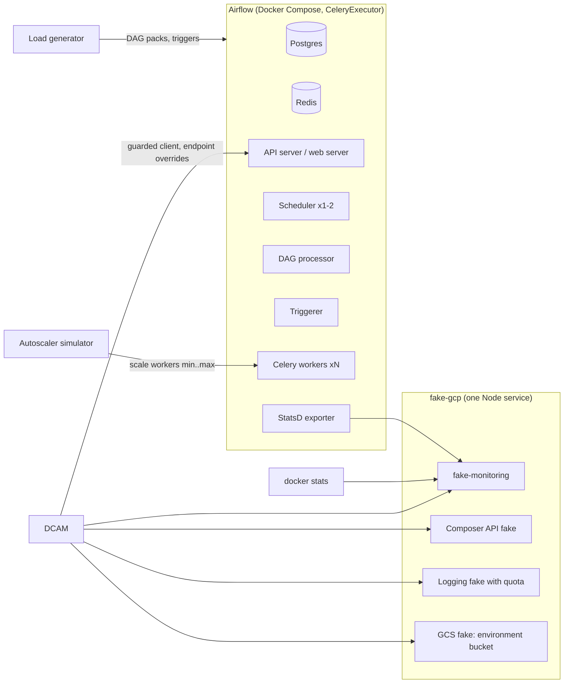

**Components** (all under `tools/emulator/`):

- **`compose.yaml`.** Two profiles, `airflow2` and `airflow3`, each pinned to the Airflow version of a current Composer build. Airflow configuration mirrors Composer defaults from [Appendix D](#appendix-d-config-knowledge-base-seed), for example:
  - `max_active_runs_per_dag` 25 and `max_active_tasks_per_dag` 16;
  - `dag_dir_list_interval` 120 s and `min_file_process_interval` 30 s;
  - `task_queued_timeout` 2400 s.

  Scenarios override what they need.
- **Metrics bridge.** Airflow StatsD output goes to a StatsD exporter, then to `fake-monitoring`. `fake-monitoring` translates the metrics into Composer metric types, labels and units. Examples:
  - `dagrun.duration.success.<dag_id>` becomes `workflow/dag/run_duration` in milliseconds;
  - pool gauges become `environment/pool/*`.

  It serves `timeSeries.list` and `metricDescriptors.list` in the real response shape, validated against the recorded-fixture schemas. Container statistics feed `workload/*` metrics.
- **`fake-gcp`.**
  - **Composer API:** `environments.get` and `list`, `workloads.list`, `operations.list` and `imageVersions.list`, with configurable fields such as size, workloads configuration, overrides and image version.
  - **Cloud Logging:** `entries.list`, with a simulated 60 requests per minute quota that returns 429 responses.
  - **Environment bucket:** a GCS JSON API subset backed by the emulator's `dags/` folder.

  The fake accepts any bearer token. Each fake can inject latency, errors and schema drift for the resilience tests ([§19.8](#198-resilience-and-failure-injection-tests)).
- **Autoscaler simulator.** Every 30 seconds it reads the four documented inputs (queued Celery tasks, current workers, idle workers and `worker_concurrency`) and computes a simplified scaling factor. It scales the worker service between the configured minimum and maximum, with a configurable reaction delay, and records scale events. Scenarios such as `SC-21` and `SC-22` use it.
- **DCAM configuration.** `tools/emulator/dcam.config.emulator.yaml` declares emulator environments. These point every adapter at the emulator's endpoints and turn off Google authentication. DCAM accepts emulator environments only for loopback addresses:

  ```yaml
  environments:
    - id: emu-airflow2
      kind: emulator                    # loopback endpoints only; Google authentication off
      endpoints: { airflow: "http://127.0.0.1:8080", gcp: "http://127.0.0.1:9090" }
      tier: dev
  ```

### 20.3 Running the emulator

```bash
pnpm emu up --airflow 2 --workers 1..4           # start Airflow + fakes (profile airflow2)
pnpm emu scenario run SC-03                      # load a scenario: DAGs, pools, config, load
pnpm dcam --config tools/emulator/dcam.config.emulator.yaml
pnpm emu scenario verify SC-03                   # assert expected signals, findings and alerts
pnpm emu down --volumes
```

The default setup has two workers and needs about 6 GB of memory and 4 CPUs allocated to Docker. `pnpm emu doctor` checks Docker resources and port conflicts before starting.

### 20.4 Scenario library

Each scenario is a folder `tools/emulator/scenarios/<ID>/` containing:

- `scenario.yaml`: the setup, load and expectations;
- a DAG pack;
- configuration overrides;
- optional fault injections.

`pnpm emu scenario verify` asserts the expectations. The same scenarios generate golden datasets ([§19.3](#193-golden-datasets-and-analytics-correctness)) and drive end-to-end tests (`FR-EMU-03`).

```yaml
# tools/emulator/scenarios/SC-03/scenario.yaml
id: SC-03
title: Saturated pool
airflow: [2, 3]
setup:
  pools: { etl_pool: 2 }
  dags: [fanout_pool_20]          # 20 parallel tasks, all in etl_pool
  config:
    core.parallelism: 64
    celery.worker_concurrency: 8
  workers: { min: 2, max: 2 }
load: { profile: steady, durationMinutes: 20 }
expect:
  within: 25m
  signals:
    - { id: HM-006, assert: "shareOf('pool') >= 0.8", window: last-15m }
    - { id: HM-001, assert: "p95(pool='etl_pool') >= 5m" }
  findings: [REC-CONC-02]
  alerts: [AL-15]
  negativeControls: [REC-CAP-01, REC-CONC-01]   # must NOT fire
```

| ID | Scenario | Setup (summary) | Expected signals | Expected findings and alerts | Runbook |
|---|---|---|---|---|---|
| SC-01 | Healthy baseline (negative control) | 50 staggered DAGs, ample capacity | Health score ≥ 90; no throttling | None. Any finding is a false positive | ― |
| SC-02 | Workers at maximum | Burst load above capacity; `max` workers reached | `HM-011` capacity-bound; `HM-006` executor exhausted | `REC-CAP-01`, `AL-05` | RB-14, RB-01 |
| SC-03 | Saturated pool | Pool of 2 slots, 20 parallel tasks | `HM-006` pool; pool utilisation ≥ 95 % | `REC-CONC-02`, `AL-15` | RB-01 |
| SC-04 | `default_pool` overload | Most tasks in `default_pool`, small slot count | `HM-006` pool reason concentrated on `default_pool` | `REC-CONC-03` | RB-01 |
| SC-05 | Global `parallelism` binding | `parallelism` 8, worker slots 32 | `HM-006` parallelism; `HM-032` inferred limit ≈ 8 | `REC-CONC-01` | RB-01 |
| SC-06 | DAG `max_active_tasks` throttling | Wide DAG with `max_active_tasks` 2 | `HM-005` self-throttling; `HM-006` task limit | `REC-DAG-01` | RB-01 |
| SC-07 | `max_active_runs` backlog | Long runs, frequent schedule, `max_active_runs` 1 | `HM-006` run limit; `HM-002` growing scheduling delay | `REC-DAG-02`, `REC-DAG-11` | RB-06 |
| SC-08 | Schedule collisions | 200 DAGs at `0 * * * *` | `HM-009` collision index high; queued spikes at the hour | `REC-SCHED-01` | RB-06 |
| SC-09 | Poke-mode sensor waste | Long poke-mode sensors holding slots | `HM-008` sensor slot share | `REC-DAG-05` | RB-01 |
| SC-10 | Deferrable tasks without a triggerer | Deferrable operators; triggerer stopped | Deferred tasks never resume | `REC-TRG-02` | RB-08 |
| SC-11 | Triggerer saturation | Triggerer capacity lowered; 200 deferred tasks | `HM-022` triggerer load | `REC-TRG-01`, `AL-13` | RB-08 |
| SC-12 | Slow DAG parsing | Files with heavy top-level code and imports | `HM-013` loop ≥ 5 min; slowest files ranked | `REC-PARSE-01`, `REC-PARSE-08` | RB-05 |
| SC-13 | Stale-DAG risk | Stale threshold below the parse loop | `HM-013` stale-risk ratio ≥ 1 | `REC-PARSE-02`, `AL-03` | RB-02 |
| SC-14 | Import errors | A broken DAG file is deployed | Import error count > 0 | `REC-PARSE-03`, `AL-04` | RB-02 |
| SC-15 | Worker out-of-memory kills | Task allocates beyond the container limit | `HM-018` OOM signature | `REC-REL-02`, `REC-CAP-03`, `AL-07` | RB-04 |
| SC-16 | Zombie tasks | Worker container killed during running tasks | `HM-018` zombies and heartbeat timeouts | `REC-REL-01`, `AL-08` | RB-04 |
| SC-17 | Flaky task | 10 % random failures with retries | `HM-015` flakiness score | `REC-DAG-07` | ― |
| SC-18 | Duration regression | Step change in one task's duration | `HM-016` change point detected | `REC-DAG-08` | ― |
| SC-19 | Noisy neighbour | One heavy DAG overlapping many small DAGs | `HM-017` contention attribution | Ranked in the bottleneck view (`FR-BOTL-06`) | RB-01 |
| SC-20 | Catch-up storm | `catchup=True` with 30 missed intervals, then unpaused | `HM-024` catch-up backlog | `REC-DAG-03` | RB-06 |
| SC-21 | Autoscaling lag | Scaler reaction delay of 5 minutes | `HM-012` scale-up lag | `REC-CAP-06` | RB-14 |
| SC-22 | Scale-out suppressed by high `worker_concurrency` | `worker_concurrency` 24 on small workers, CPU-heavy tasks | `HM-012` no scale-out despite load; `HM-027` CPU saturation | `REC-CAP-08`, `REC-CAP-04` | RB-14 |
| SC-23 | Under-packed workers | I/O-bound tasks, low `worker_concurrency`, idle CPU | `HM-027` low packing efficiency | `REC-CAP-05` | ― |
| SC-24 | Priority starvation | Low-priority tasks in a contended pool | `HM-023` starvation | `REC-CONC-04` | RB-01 |
| SC-25 | Scheduler stall | Scheduler CPU throttled or paused | `HM-031` loop duration and heartbeat gaps | `REC-SCH-01`, `AL-02` | RB-03 |
| SC-26 | Metadata database growth | High task volume; retention disabled in the fake | `HM-019` growth and runway | `REC-DB-01`, `REC-DB-04` | RB-07 |
| SC-27 | Failure spike after a change | Config change event, then failures | Failure rate above baseline after the change | `REC-REL-04`, `AL-09` | RB-11 |
| SC-28 | Airflow API distress | Latency and 5xx errors injected at the API | Patient mode engaged; `HM-030` footprint reduced | `AL-12` if failures persist for 5 min | RB-10 |

**Scenario rules**

- Every rule in [§13.6](#136-seed-rule-catalog) that can be reproduced locally has at least one positive scenario. Every scenario lists negative controls.
- Rules that depend on Google-only signals or Composer-only state use recorded fixtures instead. Their golden tests document this. Examples are `REC-UPG-*`, `REC-DB-02`, `REC-DB-05` and the cost rules.
- A rule may ship when its precision on the scenario library is at least 90 %, measured as findings that are true positives ([§13.8](#138-rule-quality-gates)).

### 20.5 Synthetic load generator

`pnpm emu load` generates DAG packs and load patterns from a seed:

| Dimension | Options |
|---|---|
| DAG shapes | Chain, fan-out/fan-in, diamond, dynamically mapped, sensor-heavy, deferrable, TaskGroup-heavy, cross-DAG dependencies (datasets or assets) |
| Task bodies | `sleep` (I/O-bound), CPU burn, memory allocation, log volume, random failure, timeout |
| Durations | Log-normal per task with configurable median and spread; optional step changes (regressions) and drift |
| Schedules | Cron mix with a configurable "round-minute clustering" factor; timetables; data-aware scheduling |
| Limits | Pools and slots, priorities, `max_active_runs`, `max_active_tasks`, queues |
| Parse load | Top-level work per file (sleep, imports, Variable access), DAGs per file, total files |
| Profiles | `steady`, `burst`, `diurnal`, `catch-up`, `chaos` (random faults) |

The generator writes DAG files into the emulator's `dags/` folder and triggers runs through the local Airflow API. It also writes a manifest of what it generated, so tests can compute the expected ground truth.

### 20.6 Demo mode and the demo dataset

`dcam --demo` (`FR-EMU-01`) starts DCAM with a synthetic workspace. It needs no credentials and makes no network access.

- **Workspace.** The fictitious organisation "acme" has three environments: `acme-dev`, `acme-test` and `acme-prod`. They span different sizes, Airflow 2 and Airflow 3 builds, and 90 days of history. Project IDs are clearly fake (`acme-data-dev`, …).
- **Fact synthesiser.** The synthesiser generates canonical facts directly, not through Airflow, with realistic patterns:
  - daily and weekly seasonality;
  - collisions at round hours;
  - log-normal durations;
  - correlated failures;
  - autoscaling behaviour;
  - database growth.

  It is deterministic for a given seed and anchored to a fake "now". It also produces the reference-scale datasets for performance tests (`--scale reference`).
- **Stories.** Each demo environment contains annotated incidents. Each story links to the findings, alerts and runbooks it should trigger, and the end-to-end tests assert them:
  - a pool starvation episode;
  - a duration regression after a change event;
  - a parse-time incident;
  - triggerer saturation;
  - database growth towards the limit;
  - a noisy neighbour;
  - an upgrade deadline.
- **Uses.** First-run experience, documentation screenshots (regenerated in CI so docs never drift), end-to-end tests, performance tests and conference demos.
- **Labelling.** A persistent "Demo data" banner. Exports from demo mode are watermarked.

---

## 21. Claude Code harness

DCAM is designed to be built mostly by Claude Code under human review. The harness turns this specification into a safe, repeatable engineering system with:

- guardrails that make unsafe actions impossible, not merely discouraged;
- specialists (subagents) for recurring kinds of work;
- commands and skills that encode the team's workflows;
- spec-driven development, test-first implementation and recorded decisions;
- automated quality gates.

The concrete starter files are in [Appendix F](#appendix-f-starter-harness-files).

> ⚠️ VERIFY at M0: Claude Code configuration formats evolve quickly. These include permission rule syntax, hook events and payloads, subagent and skill front matter, and Chrome integration. Check every snippet against the current Claude Code documentation when the harness is created, and record the checked version in ADR-0022.

### 21.1 Harness goals

| ID | Goal | Mechanism |
|---|---|---|
| H-1 | Claude Code can never mutate cloud resources, even by mistake | Permission deny rules, a `PreToolUse` guard hook, no credentials in the dev loop, and loopback-only network for tests |
| H-2 | Every change is traceable to a requirement | Spec Kit features, requirement IDs in tasks, tests and code, `pnpm trace` |
| H-3 | Tests come first | `/tdd` command, `test-first-implementer` subagent, `Stop` hook running affected tests |
| H-4 | Consistent quality without micromanagement | Formatting hook, lint and boundary rules, `code-reviewer` subagent, CI gates |
| H-5 | Decisions are explicit and durable | MADR ADRs, `/adr` command, ADR backlog ([§21.9](#219-architecture-decision-records)) |
| H-6 | The UI is validated as a user sees it | `/validate-ui`, `ui-validator` subagent, Claude in Chrome or Playwright MCP ([§19.6](#196-browser-driven-ui-validation-loop)) |
| H-7 | Domain facts stay correct | `gcp-composer-expert` and `airflow-expert` subagents with an official-docs-first policy; ⚠️ VERIFY workflow |
| H-8 | Contributors without cloud access are fully productive | Demo mode, emulator, recorded fixtures; no task needs Google Cloud credentials |

### 21.2 Harness layout

```text
CLAUDE.md                          # Project memory: short, imperative, links to details
AGENTS.md                          # Short pointer to CLAUDE.md for other coding agents (§21.3)
.claude/
├── settings.json                  # Shared permissions, hooks, environment (committed)
├── settings.local.json            # Personal overrides (git-ignored)
├── hooks/
│   ├── guard-bash.mjs             # PreToolUse(Bash): blocks mutating cloud and infrastructure commands
│   ├── guard-paths.mjs            # PreToolUse(Edit|Write): protects credentials, lockfile, accepted ADRs
│   ├── post-edit.mjs              # PostToolUse(Edit|Write): format, lint-fix, fixture linter
│   ├── stop-checks.mjs            # Stop: typecheck + affected tests; asks Claude to continue if red
│   └── session-start.mjs          # SessionStart: current milestone, open ⚠️ items, next ready tasks
├── agents/                        # Subagents (§21.6)
├── commands/                      # Slash commands (§21.7)
├── rules/                         # Path-scoped rules with paths: front matter (§21.3)
└── skills/                        # Skills (§21.7), plus Spec Kit's speckit-<step>/ skills (§21.8)
.mcp.json                          # Project MCP servers (§21.10)
.specify/                          # Spec Kit: memory/constitution.md, templates, scripts
specs/                             # One folder per feature (spec.md, plan.md, tasks.md, contracts/, validation/)
docs/adr/                          # MADR 4.0 records
```

Hooks are written in Node.js (`.mjs`) rather than shell with `jq`, so they behave identically on macOS, Linux and WSL2 and need no extra tools.

### 21.3 Project memory (`CLAUDE.md`)

`CLAUDE.md` is loaded into every session, so it is kept short (aim for under 150 lines). It states rules and points to details instead of copying them. It contains:

1. **What DCAM is**, in three sentences, with a link to this specification.
2. **Commands:** `pnpm i`, `pnpm dev`, `pnpm test`, `pnpm test:e2e`, `pnpm emu up`, `pnpm dcam --demo`, `pnpm trace`, `pnpm diagrams`.
3. **Non-negotiables:**
   - read-only by construction;
   - no network I/O outside adapters;
   - test first;
   - requirement IDs everywhere;
   - never use real Google Cloud credentials or projects in development or tests.
4. **Architecture map:** packages and dependency rules ([§11.4](#114-hexagonal-components-and-dependency-rules), [§11.5](#115-repository-layout)).
5. **Domain glossary pointer** ([§6](#6-domain-model-and-glossary)) and the ⚠️ VERIFY policy: never invent Composer or Airflow facts; check official documentation; mark uncertainty.
6. **Workflow:** Spec Kit feature flow, `/tdd`, `/validate-ui`, `/adr`, and when to use each subagent.
7. **Style:** coding standards ([§21.11](#2111-coding-standards-and-quality-gates)) and UX writing ([§12.12](#1212-ux-writing)).

Detailed material is referenced by path (for example `docs/spec/dcam-spec.md`, section 13), so Claude reads it only when a task needs it. `@path` imports are used only for small files, because imported files are loaded into every session.

**Path-scoped rules.** Rules for one area live in `.claude/rules/*.md` with `paths:` front matter (glob patterns), so Claude loads them only when it works on matching files. Examples: `adapters.md` for `packages/adapters/**` (guarded client only, capability flags, recorded fixtures), `web.md` for `apps/web/**` (design tokens, the (i) registry, UX writing, accessibility) and `packs.md` for `packages/metrics-pack/**` and `packages/rules-pack/**` (the signal and rule definition standards).

**Other coding agents.** Claude Code reads `AGENTS.md` only when there is no `CLAUDE.md`. DCAM keeps `CLAUDE.md` as the source of truth and adds a short `AGENTS.md` that points to it and to this specification, for contributors who use other agents.

### 21.4 Settings and permissions

`.claude/settings.json` is committed and shared. It defines three lists of rules:

- **`allow`:** routine, safe commands, so sessions are not interrupted. Examples are `pnpm` scripts, `git status`, `git diff`, `git log`, `docker compose` for the emulator, and read access to the repository.
- **`ask`:** commands with side effects outside the working tree, such as `git push` and `gh pr create`, and every cloud CLI (`gcloud`, `gsutil`, `bq`).
- **`deny`:**
  - `kubectl`, `helm`, and `terraform` or `tofu` with `apply`, `destroy`, `import` or `state`;
  - package publishing (`npm publish`, `pnpm publish`): releases happen only in CI;
  - reading credential stores such as `~/.config/gcloud/**`, `**/*.pem`, `**/*.key`, `.env*` and `~/.ssh/**`.

Claude Code evaluates the lists in the order deny, ask, allow, and the first matching rule wins. A `PreToolUse` hook that blocks a call (exit code 2) stops it before the rules are evaluated, while a hook that returns "allow" never overrides a `deny` or `ask` rule. DCAM's hooks therefore only add protection.

Cloud CLIs (`gcloud`, `gsutil`, `bq`) are in `ask`, and the guard hook blocks them entirely by default. Two modes can be turned on only by a human, in their personal `.claude/settings.local.json` (`env`):

- **Cloud-read mode** (`DCAM_HARNESS_CLOUD_READ=1`), for the M1 reality check: the guard allows read verbs only.
- **Harness maintenance mode** (`DCAM_HARNESS_MAINTENANCE=1`): Claude may edit the guardrails themselves (`.claude/settings*.json`, `.claude/hooks/**`, `.mcp.json`), for example to apply a reviewed hook change.

The hooks prevent Claude from changing these files or variables outside maintenance mode, so it cannot turn a mode on for itself.

Permission rules are the first line of defence, and the hooks are the enforcement point. Prefix-based command rules can be bypassed by shell composition (`env`, `sh -c`, `xargs`, command substitution). `guard-bash.mjs` therefore parses the full command line, including compound and nested commands, and blocks by verb.

The guard is not a sandbox: a determined program (for example a script that spawns processes) could evade it. It is one layer of defence in depth, together with:

- no credentials in the session environment;
- `DCAM_NETWORK=loopback-only`;
- `ask` prompts;
- human review.

**Environment for sessions** (in `settings.json`, `env`):

| Variable | Value | Effect |
|---|---|---|
| `DCAM_NETWORK` | `loopback-only` | The guarded HTTP client refuses any non-loopback host in development and tests; live access requires an explicit `dcam` run by the human user |
| `CLOUDSDK_CORE_DISABLE_PROMPTS` | `1` | No interactive `gcloud` prompts can hang a session |
| `DCAM_FAKE_NOW` | unset (tests set it) | Deterministic time in demo mode and tests |

**Optional sandboxing.** Claude Code's sandboxed Bash tool adds operating-system limits on files and network beneath the hooks. It uses Seatbelt on macOS and `bubblewrap` with `socat` on Linux and WSL2; it is not available on native Windows. Because it needs per-machine setup, the committed settings leave it off, and maintainers turn it on in `settings.local.json`, for example:

```json
{ "sandbox": { "enabled": true, "allowUnsandboxedCommands": false,
               "network": { "allowedDomains": ["registry.npmjs.org", "github.com"] } } }
```

- By default, sandboxed commands can write only to the working directory and the temporary directory.
- Localhost differs by platform. On macOS, set `sandbox.network.allowLocalBinding` so tests can reach a local DCAM. On Linux and WSL2, a sandboxed command reaches only servers it started itself, so run `pnpm dev` outside the sandbox for UI validation.
- If the sandbox cannot start, Claude Code runs commands without it unless `sandbox.failIfUnavailable` is set.

### 21.5 Hooks

| Event | Matcher | Script | What it does | On failure |
|---|---|---|---|---|
| `SessionStart` | ― | `session-start.mjs` | Prints the current milestone, the next ready tasks in `specs/*/tasks.md`, open ⚠️ VERIFY items for the active feature, and the failing tests on the branch, if any | Never blocks |
| `PreToolUse` | `Bash` | `guard-bash.mjs` | Blocks mutating cloud and infrastructure commands and outbound mutating HTTP (list below); blocks commands that read credential files | Exit code 2 with a reason, which Claude sees and adapts to |
| `PreToolUse` | `Edit\|Write\|MultiEdit` | `guard-paths.mjs` | Blocks edits to: credential-like files; `pnpm-lock.yaml` (use `pnpm` instead); generated code (`packages/contracts/generated/**`, regenerate instead); accepted ADRs, except their status line (supersede instead); harness files outside maintenance mode; anything outside the repository except the temporary directory | Exit code 2 with a reason |
| `PostToolUse` | `Edit\|Write\|MultiEdit` | `post-edit.mjs` | Runs Prettier and ESLint `--fix` on the changed file; runs the fixture linter on `tools/fixtures/**`; runs the read-only allowlist test when `packages/adapters/http-guard/**` changes | Reports problems back to Claude (exit code 2), so it fixes them immediately |
| `Stop` | ― | `stop-checks.mjs` | Runs typecheck and the tests of affected packages (Turborepo `--filter=...[HEAD]`). If they fail, it asks Claude to continue fixing. It checks `stop_hook_active` to avoid loops and gives up after three consecutive attempts | Blocks stopping (exit code 2) while red |

**Commands checked by `guard-bash.mjs`** (verbs are matched after the command line is normalised; any command that touches credential stores is blocked):

| Tool | Allowed | Blocked |
|---|---|---|
| `gcloud` | Only in cloud-read mode: commands whose verb is `list`, `describe` or `ls`, plus `config list`, `auth list`, `version`, `info` and `help`. Environment descriptions need a `--format` projection, because full descriptions can contain environment variable values | Everything else, including `composer environments run`, `update`, `create`, `delete`, snapshots, storage writes, IAM changes, `services enable`, `auth login`, and `auth print-access-token` (tokens must never enter a transcript) |
| `gsutil` | Only in cloud-read mode: `ls` | Everything else, including `cat` (DAG code can contain secrets) |
| `bq` | Only in cloud-read mode: `ls`, `show` | Everything else, including `query` and `head` (data exposure) |
| `terraform`, `tofu` | `fmt`, `validate`, `version` | Everything else: `plan` reads state and needs credentials; `apply`, `destroy`, `import` and `state` change infrastructure |
| `kubectl`, `helm` | ― | Everything: DCAM development never needs them |
| `curl`, `wget` | `GET` requests, for example to localhost and documentation sites | Other methods, request bodies and uploads; any request to `*.googleapis.com` or `*.googleusercontent.com` (live calls go through DCAM itself, run by a human) |
| `git` | Normal work | Force pushes, remote branch deletes, mirrors, `reset --hard`, `filter-branch`, `filter-repo`, `config --global`: these need a human |
| `sudo`, `doas`, `su` | ― | Everything: these need a human |
| Harness files | Reading them with Claude Code's Read tool | Shell commands that mention `.claude/settings*.json`, `.claude/hooks/`, `.mcp.json` or a `DCAM_HARNESS_*` variable, outside maintenance mode |
| Unverifiable commands | ― | `eval`, `source` and `.`, and commands whose name is computed at runtime (`$TOOL …`, `$(…) …`) |

The guard sees through wrappers before applying these rules: `env`, `time`, `timeout`, `nice`, `nohup`, variable assignments, `sh -c` and `bash -c`, `xargs`, `find -exec`, command substitution (`$(…)` and backticks) and process substitution (`<(…)`). It fails closed: if it cannot read its input, it blocks. Both guards are also registered with `"onFailure": "block"` (Claude Code v2.1.295 or later). By default Claude Code treats a hook that is missing, crashes or times out as a non-blocking error and lets the action through; with this setting, the tool call is blocked instead.

The hooks are tested like product code. `tools/scripts/hooks/*.test.ts` runs each hook as Claude Code does (JSON on stdin, exit code checked) against allowed and blocked corpora, including obfuscation attempts. The starter versions in [Appendix F](#appendix-f-starter-harness-files) pass such a corpus.

### 21.6 Subagents

Subagents live in `.claude/agents/<name>.md`. Each has a focused prompt, a restricted tool list and a clear "done" definition. The main session delegates to them, which keeps its own context small.

| Subagent | Purpose | Tools (least privilege) | Invoked by |
|---|---|---|---|
| `spec-author` | Turns requirement IDs and this specification into a feature brief for `/speckit-specify` (user stories, EARS criteria, requirement IDs, open questions), and checks the generated `spec.md` against the cited requirements | Read, Grep, Glob, Edit, Write | `/spec` |
| `adr-author` | Drafts MADR 4.0 ADRs with options, drivers, consequences and confirmation | Read, Grep, Glob, Edit, Write, WebFetch | `/adr` |
| `test-first-implementer` | Implements one task with red, green, refactor; refuses to write production code without a failing test | Read, Grep, Glob, Edit, Write, Bash (`pnpm` test scripts only) | `/tdd` |
| `code-reviewer` | Reviews the diff for boundaries, the read-only rule, test quality, error handling, naming and (i) coverage; reports only actionable issues | Read, Grep, Glob, Bash (`git diff`, lint, test) | Before every commit; required for PRs |
| `ui-validator` | Runs the UI validation checklist in a browser and writes the evidence report | Claude in Chrome tools or Playwright MCP tools, Read, Write (reports only) | `/validate-ui` |
| `gcp-composer-expert` | Answers and verifies Composer, Cloud Monitoring, Cloud Logging and IAM questions from official documentation; updates ⚠️ VERIFY items and fact tables | Read, Grep, WebFetch (allowlisted Google documentation domains), Edit | Rules, metrics, Config KB, doctor checks |
| `airflow-expert` | Same for Airflow semantics, REST API v1 versus v2, configuration and deprecations | Read, Grep, WebFetch (Airflow documentation and source), Edit | Adapters, classifier, static analysis |
| `perf-auditor` | Runs benchmarks, inspects DuckDB plans, checks bundle size and rendering performance; proposes measured fixes | Read, Grep, Bash (bench scripts), Edit | Performance-sensitive changes, nightly regressions |
| `security-reviewer` | Reviews changes to the guarded client allowlist, redaction, the local web server, MCP tools and dependencies against [§18](#18-security-privacy-and-compliance) | Read, Grep, Glob, Bash (security test scripts) | Required for `http-guard`, `redaction`, `mcp-server`, auth and dependency changes |
| `docs-diagrammer` | Writes wiki and documentation pages in MDX, creates and exports draw.io diagrams, keeps (i) registry entries complete | Read, Grep, Edit, Write, Bash (`drawio` export, docs build) | `/diagram`, wiki features |

**Rules for the domain experts.** Prefer official documentation (`docs.cloud.google.com`, `cloud.google.com`, `airflow.apache.org`) and the source code at a pinned tag. Cite the URL in the change. If sources conflict, keep the ⚠️ VERIFY marker and record the conflict.

### 21.7 Slash commands and skills

**Slash commands** (`.claude/commands/<name>.md`) are entry points for recurring workflows. They take `$ARGUMENTS` and delegate to subagents and skills. Claude Code has merged custom commands into skills: files in `.claude/commands/` keep working, and a skill with the same name creates the same slash command. DCAM keeps these thin entry points as command files and puts procedures in skills; new workflows MAY be written as skills directly.

| Command | Arguments | What it does |
|---|---|---|
| `/spec` | Requirement IDs or an epic slice, for example `FR-BOTL-01..03`; or a feature folder to check | Drafts the feature brief through `spec-author`, saves it as `docs/spec/briefs/<feature>.md`, and prints the `/speckit-specify` and `/speckit-clarify` commands to run next, because Spec Kit skills are user-invocable only ([§21.8](#218-spec-driven-development-with-spec-kit)). Given a feature folder, it checks the generated `spec.md` against the cited requirements. Stops for human review |
| `/adr` | A title, or an ADR number from the backlog | Creates the next ADR from the MADR template through `adr-author`, linking the requirements and specs it affects |
| `/tdd` | A task ID from `tasks.md`, or a requirement ID | Runs the red, green, refactor loop through `test-first-implementer`, then `code-reviewer` |
| `/validate-ui` | A route or screen ID, for example `S-07` | Starts DCAM in demo mode if needed and runs the checklist through `ui-validator` ([§19.6](#196-browser-driven-ui-validation-loop)) |
| `/diagram` | A diagram name and intent | Creates or updates `docs/diagrams/<name>.drawio` and exports SVG and PNG through the `drawio-diagrams` skill |
| `/rule` | A new rule title or an existing `REC-*` ID | Scaffolds or updates a rule (YAML, SQL, templates, golden tests, scenario link, wiki page) through the `rule-authoring` skill |
| `/metric` | A new signal title or an existing `HM-*` ID | Scaffolds or updates a signal following the definition standard ([§8.1](#81-signal-definition-standard)) through the `metric-entry` skill |
| `/verify-fact` | A ⚠️ VERIFY item or a free-text claim | Checks the claim against official sources through the domain experts, updates the specification and the Config KB, and proposes a contract test |
| `/release` | A version | Runs the release checklist in dry-run mode: changesets, changelog, SBOM, docs and the upgrade notes draft. Publishing happens only in CI from a signed tag |

**Skills** (`.claude/skills/<name>/SKILL.md`) package knowledge and procedures that Claude loads only when relevant. Each skill has a short description (used for discovery), the procedure, a checklist, and templates or scripts in the same folder.

| Skill | Contents |
|---|---|
| `drawio-diagrams` | Conventions: C4 levels, Google Cloud and Airflow icon sets, DCAM design tokens as colours, one diagram per file, page naming. Export with the draw.io desktop CLI in both formats: `drawio -x -f svg -e -b 10 -o out.drawio.svg in.drawio` and `drawio -x -f png -e -s 2 -b 10 -o out.png in.drawio` (`-x` export, `-f` format, `-e` embed the diagram so the exported file stays editable, `-s` scale, `-b` border, `-o` output). In CI it runs headless under `xvfb-run` with `--no-sandbox`. The skill includes `scripts/export-all.mjs`, which exports every changed `.drawio` file and fails if exports are stale |
| `adr-madr` | MADR 4.0 template, numbering, status lifecycle (proposed, accepted, deprecated, superseded by), the rule that accepted ADRs are never edited, only superseded, and examples |
| `spec-driven-feature` | The Spec Kit flow for DCAM ([§21.8](#218-spec-driven-development-with-spec-kit)), feature naming, the Definition of Done ([§19.9](#199-ci-pipeline-and-quality-gates)) and traceability tags |
| `rule-authoring` | The rule model ([§13.1](#131-rule-model)), the evidence and confidence requirements, the snippet template rules, the false-positive review questions and the quality gates ([§13.8](#138-rule-quality-gates)) as a checklist |
| `metric-entry` | The signal definition standard ([§8.1](#81-signal-definition-standard)), unit and provenance conventions, the (i) explanation template, the capability-flag and degradation rules, and the golden test template |
| `ui-validation` | The UV-01…UV-12 checklist, safety rules for browser automation, how to use Claude in Chrome and the Playwright MCP tools, and the evidence report template |
| `wiki-authoring` | MDX conventions, runbook format ([§15.4](#154-runbook-format)), live-data embeds, UX writing style, link checking and the documentation-link policy (official sources only) |

**Official draw.io plugin.** draw.io publishes its `drawio` skill as a Claude Code plugin (`/plugin marketplace add jgraph/drawio-mcp`, then `/plugin install drawio@drawio`; Apache-2.0). The skill writes `.drawio` files locally and exports them with the local draw.io desktop CLI, but the plugin also bundles draw.io's hosted MCP App Server, which receives the content of diagrams drawn with it. DCAM keeps its own `drawio-diagrams` skill, which adds the project's conventions and never sends diagrams off the machine. Adopting the plugin, or self-hosting the App Server, requires an ADR.

### 21.8 Spec-driven development with Spec Kit

DCAM uses GitHub Spec Kit to turn this specification into small, verifiable features.

**Setup at M0.** A maintainer runs this once, on a clean branch and outside Claude Code. The Spec Kit CLI needs Python 3.11 or later and `uv`; this is a maintainer tool, not a runtime dependency of DCAM.

```bash
uv tool install specify-cli
specify init --here --force --integration claude \
  --integration-options="--no-model-invocation --events false"
git status && git diff --stat        # review every generated file before committing
```

- **`--here --force`** initialises the existing repository. `--force` allows a non-empty directory and may replace files at paths Spec Kit manages, so review the diff before committing.
- **Skills, not commands.** For Claude Code, Spec Kit installs each step as a skill in `.claude/skills/speckit-<step>/SKILL.md`, invoked as `/speckit-specify`, `/speckit-plan` and so on. Spec Kit's own reference pages write the same steps in dotted form (`/speckit.specify`).
- **`--no-model-invocation`** makes the core Spec Kit skills user-invocable only. Their descriptions stay out of Claude's context, and Claude cannot start a Spec Kit step on its own.
- **`--events false`** keeps Spec Kit's event handlers out of `.claude/settings.json`, which stays owned by the harness ([§21.4](#214-settings-and-permissions)).
- **Upgrades.** Run `specify integration upgrade claude` with the same `--integration-options`. Passing options replaces all stored options, so repeat both.

**Constitution.** `.specify/memory/constitution.md` is derived from the guiding principles ([§3.3](#33-guiding-principles)) and these engineering articles:

| Article | Rule |
|---|---|
| I. Read-only | No code path may issue a mutating request to a monitored system. Allowlist changes need `security-reviewer` approval |
| II. Do no harm | Every collector declares a budget; budgets are tested; DCAM degrades its own fidelity before adding load |
| III. Test-first | No production code without a failing test that names a requirement ID |
| IV. Contract-first | OpenAPI is the source of truth; generated types only; breaking changes need an ADR and a major version |
| V. Boundaries | Hexagonal architecture is enforced by `dependency-cruiser`; network I/O only in adapters |
| VI. Evidence | Every finding is reproducible from stored evidence; every number has a unit, a source and a freshness |
| VII. Honest precision | Estimates are labelled with their method and confidence; unknown is shown as unknown |
| VIII. Accessible by default | WCAG 2.2 AA; state is never shown by colour alone |
| IX. Simplicity | No new runtime dependency or service without justification; prefer data (packs) over code |
| X. Traceability | Requirement → spec → task → test → code → documentation is kept current and checked in CI |

**Feature flow**

| Step | Command | Artefact | Gate |
|---|---|---|---|
| 1. Specify | `/spec` → `/speckit-specify` | `specs/NNN-<epic>-<name>/spec.md`, with user stories, EARS acceptance criteria and requirement IDs copied from [§9](#9-functional-requirements) and [§10](#10-non-functional-requirements) | Human review |
| 2. Clarify | `/speckit-clarify` | Clarifications recorded in `spec.md`; unresolved items linked to [§25](#25-open-questions) | No `[NEEDS CLARIFICATION]` markers left |
| 3. Plan | `/speckit-plan`, then optionally `/speckit-checklist` | `plan.md`, `research.md`, `data-model.md`, `contracts/` (OpenAPI fragments), `quickstart.md`; requirement-quality checklists | Constitution check passes; ADRs drafted if needed; checklist items resolved |
| 4. Tasks | `/speckit-tasks` | `tasks.md`: ordered, test-first tasks, each tagged with requirement IDs; parallel tasks marked | Every acceptance criterion has a test task |
| 5. Analyze | `/speckit-analyze` | Consistency report across spec, plan and tasks | No critical inconsistencies |
| 6. Implement | `/tdd <task>` (repeated), or `/speckit-implement` for small features | Code, tests, docs | Definition of Done ([§19.9](#199-ci-pipeline-and-quality-gates)) |
| 7. Converge | `/speckit-converge` | Findings report; missing work appended to `tasks.md` (it never edits code) | Reports "converged" |
| 8. Validate | `/validate-ui` (UI changes) | `validation/report.md` and screenshots | Checklist passes |

**Feature granularity.** A feature is a vertical slice that one pull request can deliver and review, typically 3 to 15 tasks. Epics are split by milestone ([§22.2](#222-milestone-overview)). Feature folders use `NNN-<epic>-<name>`, for example `014-botl-throttle-classifier`.

**Traceability.** `pnpm trace` checks the full chain and publishes `docs/spec/traceability.md`:

```text
FR-BOTL-01 ─▶ specs/014-botl-throttle-classifier/spec.md ─▶ tasks.md T-003, T-004
           ─▶ packages/analytics/test/hm-006.throttle-classifier.test.ts
           ─▶ packages/analytics/src/signals/hm-006/*.ts (@implements FR-BOTL-01)
           ─▶ packages/wiki-content/signals/hm-006.mdx
```

**Keeping this specification alive.** This document is the product-level source of truth. When a feature changes a requirement, the same pull request updates this specification, and an ADR records the reason if the change is structural.

### 21.9 Architecture decision records

ADRs use **MADR 4.0**. They are stored as `docs/adr/NNNN-title-with-dashes.md`, with YAML front matter (`status`, `date`, `decision-makers`, `consulted`, `informed`) and these sections:

- Context and Problem Statement
- Decision Drivers
- Considered Options
- Decision Outcome, with Consequences and Confirmation
- Pros and Cons of the Options
- More Information

Accepted ADRs are immutable: a change of mind is a new ADR that supersedes the old one.

**ADR backlog.** Each ADR starts as "proposed" with the recommended option from this specification. The listed milestone is when the decision must be accepted.

| ADR | Title | Proposed decision | Accept by |
|---|---|---|---|
| ADR-0001 | Record architecture decisions with MADR | MADR 4.0 in `docs/adr/` | M0 |
| ADR-0002 | Language, runtime and monorepo | TypeScript `strict` (major chosen for tooling support) on Node.js Active LTS, minimum 22; pnpm workspaces + Turborepo | M0 |
| ADR-0003 | Contract-first HTTP API | OpenAPI 3.1, Fastify, Ajv on the server, Zod at adapter boundaries, generated client | M0 |
| ADR-0004 | Hexagonal architecture and enforcement | Ports and adapters; `dependency-cruiser` rules in CI | M0 |
| ADR-0005 | Analytical store | DuckDB with Parquet cold tier; migrations; single-writer model | M0 |
| ADR-0006 | Guarded read-only outbound client | One HTTP client with method and endpoint allowlist, budgets and circuit breakers | M0 |
| ADR-0007 | Observer budgets and polling profiles | Token buckets per API and environment; `live`, `standard`, `eco`, `background`; patient mode | M1 |
| ADR-0008 | Live updates transport | Server-Sent Events | M1 |
| ADR-0009 | UI framework and component library | React + Vite, MUI with DCAM tokens, TanStack Router, Query, Table and Virtual | M0 |
| ADR-0010 | Charts and graphs | ECharts and uPlot; React Flow with dagre (ELK only if ADR-0020 admits its licence) | M2 |
| ADR-0011 | Declarative packs for signals and rules | YAML manifests + DuckDB SQL + templates, schema-validated | M3 |
| ADR-0012 | Python static analysis engine | `web-tree-sitter` with the Python grammar | M7 |
| ADR-0013 | Airflow API adapters | Separate v1 and v2 adapters behind one port; capability probing; version detection | M1 |
| ADR-0014 | Cloud Monitoring query strategy | `timeSeries.list` with server-side aggregation as default; PromQL API where it reduces calls; no MQL | M1 |
| ADR-0015 | Cloud Logging access | Metrics first; bounded, budgeted `entries.list`; no tailing by default; optional user-managed sinks | M1 |
| ADR-0016 | Authentication | Application Default Credentials, optional impersonation, quota project handling, `gcloud` for sign-in | M1 |
| ADR-0017 | Local web security model | Loopback bind, token for non-loopback, CSRF, CSP, Host validation | M1 |
| ADR-0018 | MCP server design | Read-only tools and resources, redaction, budgets shared with the UI, stdio and Streamable HTTP | M7 |
| ADR-0019 | Optional LLM explainer | Off by default; provider adapters; redaction preview; evidence-grounded prompts | M7 |
| ADR-0020 | Licence and contribution model | Apache-2.0, DCO, code of conduct, governance | M0 |
| ADR-0021 | Documentation site | Astro Starlight sharing MDX with the in-app wiki | M2 |
| ADR-0022 | Testing strategy and tools | [§19](#19-testing-validation-and-quality-strategy) toolset; the Claude Code harness version checked | M0 |
| ADR-0023 | Release and supply chain | Changesets, GitHub Actions, CycloneDX SBOM, Sigstore signing, SLSA provenance | M3 |

New ADRs continue from ADR-0024. Candidates already visible:

- desktop packaging;
- team-server mode;
- the companion transport ([§7.9](#79-future-in-environment-companion));
- the Python twin of the contract ([§11.12](#1112-embedding-path-into-airflow-and-composer)).

### 21.10 MCP servers and session workflow

**Project MCP servers** (`.mcp.json`, committed; each server needs explicit approval in a session):

| Server | Purpose | Notes |
|---|---|---|
| `playwright` | Headless UI validation and exploratory E2E authoring | Pinned `@playwright/mcp` version, headless, isolated profile, origins limited to DCAM (`127.0.0.1:8787`, `localhost:8787`) and the Vite dev server (`localhost:5173`) with `--headless --isolated --allowed-origins` (semicolon-separated). The allowlist is not a security boundary |
| `dcam-demo` | Dogfooding: DCAM's own read-only MCP server over the demo dataset | `pnpm dcam mcp --stdio --demo-only`, bridging to a running `pnpm dcam --demo` instance; the bridge refuses non-demo instances. Lets Claude query realistic data while building UI and rules. Never configured against real environments in the repository |

Claude in Chrome is configured per developer, not in the repository. Start it per session with `claude --chrome` rather than "Enabled by default", which loads the browser tools into every session and uses context. Its site permissions, managed in the extension, are restricted to localhost ([§19.6](#196-browser-driven-ui-validation-loop)). Chrome DevTools MCP, when used for performance work, is also configured per developer, with the flags listed in [§19.6](#196-browser-driven-ui-validation-loop).

**Session workflow**

1. **Pick work.** `session-start` lists the next ready tasks. Take one task, or one small feature.
2. **Plan.** Use plan mode for anything touching more than one package. The plan names the requirement IDs and the tests to write first.
3. **Implement** with `/tdd`, one task at a time. Commit after each green task (Conventional Commits, `git commit -s`).
4. **Review** with `code-reviewer`, and also with `security-reviewer` or `perf-auditor` when their areas are touched.
5. **Validate** UI changes with `/validate-ui`.
6. **Open a pull request** using the template, with links to the spec, tasks, ADRs and validation evidence.

**Context hygiene**

- Clear the context between features.
- Delegate wide searches to subagents.
- Keep `CLAUDE.md` lean.
- Prefer `@path` references over pasting large files.

**Parallel sessions.** Run parallel Claude Code sessions in separate git worktrees, one feature each, to avoid interference.

**Model choice.** Use the most capable available model for specification, ADRs, rule design and reviews, and a faster model for mechanical tasks such as fixture updates and formatting.

### 21.11 Coding standards and quality gates

**TypeScript**

- `strict`, plus `noUncheckedIndexedAccess`, `exactOptionalPropertyTypes`, `noImplicitOverride` and `useUnknownInCatchVariables`.
- ES modules and named exports only.
- No `any`: an ESLint error. Use `unknown` and validate at boundaries.
- Branded types for IDs (`EnvironmentKey`, `DagId`) and units.
- **Units in names.** Every numeric field and variable that carries a unit has a suffix: `queueWaitMs`, `sizeBytes`, `cpuCores`, `ratio`, `pct`. Internal durations are milliseconds; storage times are UTC epoch milliseconds; display conversion happens only in the UI.
- **Errors.**
  - Domain code returns typed results (discriminated unions) for expected failures.
  - Adapters map transport errors to `SourceError` with a stable code.
  - User-facing errors carry what happened, why, how to fix it and a documentation link (`NFR-UX-02`).
  - No swallowed errors.
- **No hidden I/O.** Domain and application packages are pure. Time, randomness and I/O come through ports, so tests can use fake clocks and seeded generators.

**SQL (packs and store)**

- DuckDB dialect.
- Linted with `sqlfluff` (dialect `duckdb`).
- One statement per file.
- Named parameters only, never string concatenation.
- Every query has a golden test and, for heavy queries, a plan snapshot.

**React and UI**

- Function components and hooks.
- Data only through generated TanStack Query hooks, never `fetch` in components.
- Theme tokens only: a lint rule forbids literal colours, and the state colours come from [§12.6](#126-airflow-state-colours).
- Every chart has an accessible description and a table alternative.
- Strings are externalised (ICU).
- Every (i) has a registry entry.

**Dependencies**

- A new runtime dependency needs a justification in the pull request covering purpose, size, maintenance, licence and security posture.
- Allowed licences in distributed artefacts: Apache-2.0, MIT, BSD-2/3-Clause, ISC, 0BSD and MPL-2.0 (file-level), plus OFL-1.1 for fonts. GPL, AGPL and SSPL are not allowed. `license-checker` enforces this in CI.
- Build and authoring tools that are not distributed, such as draw.io desktop (GPL-3.0), are outside this rule.

**Pull requests**

- Small and focused: about 400 changed lines excluding generated files and fixtures, as a guideline.
- Conventional Commits and DCO sign-off.
- A changeset when the user-facing behaviour changes.

**Quality gates** (all blocking unless marked otherwise):

| Gate | Tool | Threshold |
|---|---|---|
| Format | Prettier | No diff |
| Lint | ESLint (`typescript-eslint`, `jsx-a11y`, import rules) | Zero warnings (`NFR-MAINT-01`) |
| Types | `tsc --noEmit` (project references) | Zero errors |
| Architecture | `dependency-cruiser` | No boundary violations ([§11.4](#114-hexagonal-components-and-dependency-rules)) |
| Unit and integration tests | Vitest | All pass; coverage ≥ 90 % lines in `domain`, `analytics` and `rules-pack`; ≥ 80 % overall (`NFR-MAINT-02`) |
| Golden and scenario tests | Vitest + emulator | All pass; rule precision ≥ 90 % on the scenario library |
| Mutation | Stryker | ≥ 70 % for the rules engine and classifier (nightly; release-blocking) |
| Contract | `oasdiff`, Schemathesis, adapter fixtures | No unapproved breaking changes; zero schema violations |
| Read-only | Read-only enforcement suite ([§18.2](#182-read-only-guarantee)) | 100 % pass |
| Accessibility | axe (component and E2E) | Zero serious or critical violations |
| Performance | Bundle size, Lighthouse CI, benchmarks | Within `NFR-PERF-*` budgets; nightly regression ≤ 10 % |
| Security | Secrets scan, dependency audit, CodeQL, OWASP ZAP baseline (nightly) | No high or critical findings without an approved exception |
| Supply chain | Lockfile integrity, licence check, SBOM generation, OpenSSF Scorecard | Scorecard ≥ 7 (`NFR-SEC-05`) |
| Documentation | Link checker, (i) registry completeness, diagram export freshness | Zero broken links; zero missing explanations; no stale exports |
| Traceability | `pnpm trace` | No Must requirement of a completed milestone without a test |

---

## 22. Roadmap and milestones

### 22.1 Planning principles

- **Vertical slices.** Every milestone ends with a working, demonstrable product increment that runs in demo mode and against the emulator. Most also run against a real environment.
- **Retire risk first.** M1 includes a reality-check spike that verifies every ⚠️ VERIFY assumption before features depend on it ([§22.5](#225-m1-reality-check-spike)).
- **Exit criteria, not dates.** This specification contains no time estimates. A milestone is done when its exit criteria are met and its Must requirements pass their tests (`pnpm trace`).
- **Release every milestone.** From M1, each milestone produces a tagged pre-1.0 release with release notes, so early adopters can give feedback.
- **MoSCoW within milestones.** Should and Could requirements may move to a later milestone. Must requirements move only through an explicit change to this specification.

### 22.2 Milestone overview

| Milestone | Theme | Main scope (epics and IDs) | Key signals and rules | Exit criteria (demonstration) | Release |
|---|---|---|---|---|---|
| **M0** | Foundations and harness | Repository, harness ([§21](#21-claude-code-harness)), constitution, CI skeleton, OpenAPI skeleton, guarded client skeleton with read-only tests, demo mode skeleton (`FR-EMU-01`), `FR-SETUP-01`, ADRs 0001–0006, 0009, 0020, 0022 | ― | `pnpm dcam --demo` serves the app shell with a fake dataset; CI runs all gate types (even if most suites are still small); a Claude Code session can complete a `/tdd` task end to end with the hooks active | Internal |
| **M1** | Connect and collect | `AUTH`, `COLL` core, `STORE` core, `UI` shell, `SELF`, `FR-SETUP-02..07`, `FR-EMU-02`; reality-check spike; ADRs 0007, 0008, 0013–0017 | `HM-030` (observer footprint) | The doctor passes against a real Composer 3 environment and the emulator; collectors run within budget for a day (budget tests green); the DCAM health page shows the footprint; every ⚠️ VERIFY item is resolved or has an owner and a fallback | 0.1.0 |
| **M2** | Fleet and environment cockpit | `FLEET`, `ENV`, `CFG` basic (effective config view), `CHG` basic, `FR-COLL-05`, `FR-COLL-07`, `FR-COLL-10`; ADRs 0010, 0021 | `HM-011`, `HM-013`, `HM-018`, `HM-019`, `HM-022`, `HM-026` (image), `HM-028`, `HM-031`, `HM-032`; rules at M2 in [§13.6](#136-seed-rule-catalog) | Journey J-2 (morning check) works against a real environment; `Q-01` and the environment-level questions pass their three-click tests | 0.2.0 |
| **M3** | DAG analytics (**MVP**) | `DAGX`, `DAGD` core, `TASK` core, `FR-BOTL-02`, `FR-COLL-04` (backfill), Airflow API v2 adapter (`FR-COLL-08`), `FR-INC-03`, CSV export; ADRs 0011, 0023 | `HM-001`–`HM-005`, `HM-006` v0, `HM-015`, `HM-016`, `HM-021` (estimate) | MVP demo script ([§22.6](#226-mvp-definition-and-demo-script)) passes on demo data, on the emulator and on a real environment; 5,000-DAG performance tests pass; first public release | 0.3.0 |
| **M4** | Bottlenecks and Advisor | `BOTL`, `ADV`, `FR-FLEET-04`, `DAGD` compare and critical path, internal plugin interfaces (`FR-EXT-01`) | `HM-006` full, `HM-007`–`HM-010`, `HM-012`, `HM-017`, `HM-023`, `HM-024`, `HM-027`; most rules (M4) | Journeys J-3 (partly) and J-4 work; the throttle classifier reaches ≥ 90 % attribution accuracy and rules ≥ 90 % precision on the scenario library | 0.4.0 |
| **M5** | Config Advisor and wiki | `CFG` full, `WIKI`, runbooks, `FR-SCAN-06`, opt-in Airflow CLI (`FR-COLL-12`), deploy propagation (`FR-ENV-04`) | `HM-014`, `HM-025`, `HM-029`; rules at M5 | Journeys J-5 and J-8 work; every option in the KB seed has an (i) explanation; runbooks RB-01…RB-14 link to live data | 0.5.0 |
| **M6** | Alerting, incidents and change intelligence | `ALRT`, `INC`, `CHG` full, `FR-TASK-03`, `FR-UI-09` | `HM-020`; alert pack `AL-01`…`AL-19`; export to Cloud Monitoring and Terraform | Journey J-3 works end to end; exported alert policies validate in a sandbox project with Terraform `plan` (human-run) | 0.6.0 |
| **M7** | Static analysis, reports, AI and cost | `SCAN`, `RPT`, `AI` (MCP server, copy-as-prompt, optional explainer), `FR-STORE-03`, `FR-STORE-05`, `FR-DAGD-10`, `FR-SETUP-08`; ADRs 0012, 0018, 0019 | Code rules `REC-CODE-*`, `REC-UPG-02`, cost rules; `HM-021` with billing export (optional) | Journeys J-6 and J-7 work; the MCP server passes its security review; the HTML report renders offline | 0.7.0 |
| **M8** | Extensibility, Composer 2 and v1.0 hardening | `EXT` (public plugin SDK), Composer 2 GKE adapter (optional), Docker image, documentation completion, v1.0 launch checklist ([§22.7](#227-v10-launch-checklist)) | All remaining signals; packaging | All Must requirements pass; the launch checklist is complete | **1.0.0** |

### 22.3 Milestone dependencies

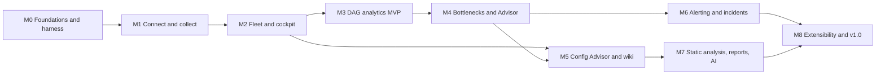

M5 depends on M4 because the wiki and Config Advisor link to rules and findings. M6 and M7 can proceed in parallel once M4 and M5 are done.

### 22.4 M0 foundation checklist

- [ ] Repository created from the layout in [§11.5](#115-repository-layout), with pnpm workspaces, Turborepo, TypeScript project references and the shared ESLint, Prettier and `dependency-cruiser` configuration.
- [ ] Harness installed: `CLAUDE.md`, `.claude/settings.json`, hooks with their tests, subagents, commands, skills and `.mcp.json` ([Appendix F](#appendix-f-starter-harness-files)).
- [ ] Spec Kit initialised; constitution derived from [§3.3](#33-guiding-principles) and [§21.8](#218-spec-driven-development-with-spec-kit).
- [ ] ADRs 0001–0006, 0009, 0020 and 0022 accepted.
- [ ] OpenAPI skeleton (`/api/v1/health`, `/api/v1/meta`) with generated types and client; contract test and `oasdiff` gate working.
- [ ] Guarded HTTP client skeleton with the allowlist, `DCAM_NETWORK=loopback-only` and the read-only enforcement suite ([§18.2](#182-read-only-guarantee)).
- [ ] Demo mode skeleton: fact synthesiser v0, DuckDB store, app shell with theme, navigation and one panel with an (i).
- [ ] CI with every gate type wired: lint, types, boundaries, unit, component, E2E smoke, axe, bundle size, secrets, licences, fixture linter.
- [ ] Governance files: `LICENSE`, `CONTRIBUTING.md` (with DCO), `CODE_OF_CONDUCT.md`, `SECURITY.md`, issue and PR templates.
- [ ] Documentation site skeleton, with the first draw.io architecture diagram exported in both formats.

### 22.5 M1 reality-check spike

The spike runs against at least one real Composer 3 environment with Airflow 2 and, if available, one with Airflow 3. It uses the read-only identity from [§18.4](#184-least-privilege-iam). Each item ends in one of two outcomes:

- **Confirmed.** A contract test records the fact, and the ⚠️ marker is removed.
- **Refuted.** The specification is updated, the fallback is applied and the change is recorded in the relevant ADR.

| ID | Assumption to verify | Method | Affects | Fallback if refuted |
|---|---|---|---|---|
| VC-01 | Workflow metrics carry no environment discriminator; DAG IDs can collide across environments sharing a project and location | `timeSeries.list` on `cloud_composer_workflow` in a project with two environments | [§7.2](#72-cloud-monitoring-src-mon), `HM-003`, `HM-016` | Already designed: collision detection and Airflow API as the per-DAG source |
| VC-02 | Per-task CPU and memory metrics exist on Composer's Airflow 2.10+ builds and not on Airflow 3 builds; memory percentage base (node or container limit) | Series existence per image version; compare with workload memory for known tasks | `HM-004`, `mon.taskCpuMetrics` | Method B (slot-time allocation) only, labelled as an estimate |
| VC-03 | Cloud Monitoring read quota and read pricing | Quotas page in the console; pricing page; measured series per day | [§7.10](#710-quotas-limits-and-cost-of-observation), budgets | Lower Monitoring budgets; longer cadences |
| VC-04 | Task instance `hostname` maps to `workload_name` of `cloud_composer_workload` | Compare hostnames from the Airflow API with workload names | `HM-004`, `HM-027` | Environment-level worker aggregation only |
| VC-05 | Metric availability per image version, including `workload/scheduler/loop_duration`, and `zombie_task_killed_count` on Airflow 3 builds | `metricDescriptors.list` plus series probes | Capability flags, [§8.10](#810-capability-and-degradation-matrix), `HM-018` | Capability off; degraded panels |
| VC-06 | Log names on Composer 3 (triggerer, database retention, OOM events, start-up failures), and the message texts matched by the Appendix C queries | `projects.logs.list` per project; sample entries per Airflow version | [§7.3](#73-cloud-logging-src-log), [Appendix C](#appendix-c-cloud-logging-query-library) | Discovery-only log names; queries adapt |
| VC-07 | Task log labels beyond `workflow`, `execution-date` and `try-number` (for example `task-id`, `map-index`), and the `execution-date` value format | Inspect entries for known task instances | Incident log correlation | Correlate by time window and text match |
| VC-08 | Composer API quotas | Quotas page; observed 429 behaviour under budget | [§7.10](#710-quotas-limits-and-cost-of-observation) | Lower Composer API budget |
| VC-09 | Which Composer 3 updates restart which components, and typical duration | Composer documentation and operation history | Snippet notes ([§13.5](#135-remediation-snippets)) | Conservative generic warning |
| VC-10 | The task instance `tries` endpoint (Airflow 2.10+ and API v2), the API v2 `dagVersions` and `jobs` endpoints, and `last_parse_duration` on API v2 `GET /dags` (3.1+) exist upstream (checked in the Airflow 2.10.5, 3.1.0 and 3.3.2 OpenAPI specifications). `GET /dagReports` existed only in Airflow 3.0 and 3.1 and is not used. Confirm that Composer serves them to a `Viewer` identity | Call the endpoints on both API generations | [§7.5](#75-airflow-rest-api-src-af-api), [Appendix B](#appendix-b-airflow-rest-api-usage), `HM-013`, `HM-015` | Derive retries from `try_number` and logs; use bucket diffs, Monitoring and the opt-in CLI instead of the v2 endpoints |
| VC-11 | Page size limits and ordering on Composer's Airflow API. Upstream, API v1 task instance lists have no defined order and no `limit` cap; API v2 `GET` lists default to 50 rows with a maximum of 100 and support `cursor` from 3.2.2 (checked in the Airflow 2.11.1 and 3.3.2 source) | Request `limit` above 100 and observe the cap; compare repeated pages | Collector paging ([§7.5](#75-airflow-rest-api-src-af-api)) | Page at 100 with window splitting |
| VC-12 | `scheduled_when` is in the API v2 task instance schema (checked in Airflow 3.0.0, 3.1.0 and 3.3.2); confirm that Composer's Airflow 3 builds populate it | Inspect API v2 responses | `HM-006`, `af.scheduledWhen` | Inferred ready time, as on Airflow 2 |
| VC-13 | `max_active_tasks` is per DAG on Airflow 2 and per DAG run on Airflow 3 (scheduler source, 2.10.5, 3.1.0 and 3.3.2), and task-level limits count deferred tries from 3.2.2 | Emulator test with two concurrent runs per Airflow version | `HM-005`, `HM-006`, `af.maxActiveTasksScope` | Keep the Airflow 2 semantics behind the flag |
| VC-14 | `priority_weight` reported by the API is the effective weight | Compare with `weight_rule` on emulator DAGs | `HM-023` | Compute effective weight from the DAG structure |
| VC-15 | Stale-DAG behaviour on Airflow 3: `dag_stale_not_seen_duration` was removed, and deactivation follows `[dag_processor] stale_dag_threshold` | Emulator test with a slow DAG processor on Airflow 3 | `HM-013`, `REC-PARSE-02` | `REC-PARSE-02` limited to Airflow 2 |
| VC-16 | Composer's default triggerer capacity (Airflow 2 `triggerer.default_capacity`, Airflow 3 `triggerer.capacity`; Airflow default 1000) | Composer configuration page; effective configuration of a real environment | `HM-022`, `REC-TRG-01` | Default 1000 labelled `airflow-default` |
| VC-17 | `Viewer` gets 403 on `/providers` and `/config`; `Op` gets 200. The custom role permission lists and the service-account registration commands in Appendix E work as written | Call with identities registered as Viewer and Op; apply the custom roles in a sandbox project | Doctor privilege probe ([§18.3](#183-authentication-and-identity)) | Probe a different Op-only endpoint |
| VC-18 | Web server access control also restricts API calls from the user's egress IP, with a recognisable error | Call from an address outside the allowlist in a sandbox | Doctor, RB-10 | Generic network diagnosis |
| VC-19 | `worker_concurrency` sizing guidance (CPU ≥ value ÷ 12, memory GB ≥ value ÷ 8, maximum 24) | Composer documentation; compare with environments' effective behaviour | `HM-027`, `REC-CAP-05`, `REC-CAP-08`, Config KB | Show the guidance as "documented guidance" without a computed ceiling |
| VC-20 | `parallelism` default semantics on Composer for Airflow 3 | Composer documentation; `HM-032` inference on a real environment | `HM-032`, Config KB | Inference only, labelled `inferred` |
| VC-21 | Config KB defaults per supported Airflow version | Airflow configuration reference per version | [Appendix D](#appendix-d-config-knowledge-base-seed) | Per-version table corrected |
| VC-22 | Listener and plugin support on Composer 3 for each Airflow version | Composer documentation; test plugin in a sandbox | [§7.9](#79-future-in-environment-companion), [§11.12](#1112-embedding-path-into-airflow-and-composer) | Companion design adjusted (future) |
| VC-23 | State colours per pinned Airflow version (Airflow 2.10.5 `STATE_COLORS` and the Airflow 3.3.2 UI theme already checked) | Airflow source at the pinned tags | [§12.6](#126-airflow-state-colours) | DCAM tokens remain; mapping documented |
| VC-24 | Reschedule-mode sensors keep the first `start_date` | Emulator test with a reschedule sensor | `HM-003`, `HM-008` | Adjust occupancy formula |
| VC-25 | Harness formats: Claude Code permissions, hooks, subagents and skills; Spec Kit CLI and skill names; Playwright MCP flags; draw.io CLI flags. Most were checked against current documentation when this document was written, but they change quickly | Current official documentation; a smoke session | [§21](#21-claude-code-harness), [Appendix F](#appendix-f-starter-harness-files) | Adjust the starter files (M0) |
| VC-26 | OS keychain library; BigQuery role for `INFORMATION_SCHEMA.JOBS` | Library maintenance; IAM documentation | [§18.7](#187-secrets), [§18.4](#184-least-privilege-iam) | Environment variables only; narrower BigQuery features |

VC-23, VC-25 and VC-26 can be resolved at M0 because they do not need a Composer environment.

### 22.6 MVP definition and demo script

The MVP (end of M3) is the smallest product that changes how an operator works with Composer every day. It is demonstrated with this script, on demo data and on a real environment:

1. **Install and run.** Install and start DCAM with one command; the onboarding wizard opens (J-1).
2. **Connect.** Add two projects. Discovery lists their environments. The doctor shows green checks, plus one actionable warning (for example "Airflow role is Op; Viewer is enough").
3. **Fleet overview.** One environment is amber. Health score breakdown (`HM-028`); freshness footer visible.
4. **Environment cockpit.** Workers at maximum overnight while tasks were queued. Queue wait (`HM-001`) and capacity utilisation (`HM-011`) charts with (i) explanations. Parse loop (`HM-013`) against the 5-minute guidance.
5. **DAG league table.** Sort by share of slot-seconds (`HM-003`); a Pareto view shows a few DAGs using most capacity; filter by owner and tag; virtualised at 5,000 DAGs.
6. **DAG detail.** Duration regression (`HM-016`) after a change event; Gantt with queue wait and run time; failures and retries (`HM-015`).
7. **Bottleneck v0.** Throttle reasons for a selected window (`HM-006` v0) with confidence and evidence.
8. **Effective configuration.** Values with provenance labels (`override`, `inferred`, `composer-default`, `airflow-default`).
9. **Export and footprint.** CSV export of the league table. The DCAM health page shows requests per API within budget.

### 22.7 v1.0 launch checklist

- [ ] All Must requirements in [§9](#9-functional-requirements) and [§10](#10-non-functional-requirements) pass their tests; `pnpm trace` is clean.
- [ ] Composer 3 with Airflow 2.10/2.11 is fully supported. Airflow 3 passes the parity suite at the level decided in OQ-03 ([§25](#25-open-questions)). The supported-version matrix is published.
- [ ] Scenario library: every reproducible rule has a positive scenario and negative controls; precision ≥ 90 %.
- [ ] Security: threat model reviewed, ZAP baseline clean, read-only suite green, `SECURITY.md` and disclosure process tested, OpenSSF Scorecard ≥ 7.
- [ ] Performance and footprint budgets met at reference scale on a mid-range laptop.
- [ ] Accessibility audit (automated plus manual keyboard and screen-reader pass) with no serious issues.
- [ ] Documentation complete: quickstart, IAM guide, configuration reference, troubleshooting, architecture with diagrams, contribution guide, rule and signal references generated from the packs.
- [ ] Release artefacts signed, with SBOM and provenance; install smoke tests pass on macOS, Linux and Docker; WSL2 checked.
- [ ] Final name chosen and trademark-checked (OQ-01); trademark notices in the README and docs.
- [ ] Launch materials: README with screenshots from demo mode, a short demo recording, and a blog-style announcement draft.

### 22.8 Versioning and release process

- **Semantic versioning** for the product. Before 1.0, minor versions may contain breaking changes, and these are always documented in upgrade notes.
- **Versioned surfaces**, each with its own compatibility rules:

  | Surface | Versioning | Compatibility rule |
  |---|---|---|
  | DCAM HTTP API | `/api/v1` path version | Additive changes only within v1; breaking changes need `/api/v2` and an ADR |
  | Configuration file | `version:` key | Automatic migration with a backup; the old format is accepted for one major version |
  | Local data store | Schema migrations | Automatic migration with a backup (`NFR-REL-04`); downgrade documented as unsupported |
  | Signal and rule packs | Pack `version` and `compatibility` range | Packs declare the DCAM versions they support |
  | Plugin SDK | Semantic versioning (from M8) | Deprecations are announced one minor version before removal |
  | MCP tools | Tool names and schemas | Additive; removals follow the deprecation rule |

- **Release flow.**
  1. Changesets accumulate in pull requests.
  2. A release pull request aggregates them into the changelog.
  3. A signed tag triggers the release workflow.
  4. The workflow builds, tests, generates the SBOM, signs and attests, then publishes the npm package, the container image and checksummed archives.
- **Channels:** `latest` (stable) and `next` (pre-releases from the main branch).
- **Support policy:** the latest minor version receives fixes. The previous minor version receives security fixes until the next minor version ships.
- **Supported-version matrix.** Composer generations, Airflow versions and image families are re-checked at every release against Composer's version list and release notes. `REC-UPG-*` uses the same data.

### 22.9 Post-v1 directions

These are ordered by expected user value. Each needs its own specification update and ADRs.

1. **Airflow 3 parity and beyond.** Use the Airflow 3 UI and API capabilities fully as Composer adoption grows.
2. **In-environment listener companion.** Precise per-task timing, resource and lineage events ([§7.9](#79-future-in-environment-companion)).
3. **Team-server mode.** Single-tenant deployment on Cloud Run behind Identity-Aware Proxy, with shared findings and scheduled reports.
4. **What-if simulator.** Replay recorded demand against alternative configurations, such as worker sizes, `worker_concurrency`, pools and staggered schedules.
5. **Embedding.** The Python implementation of the contract and the Airflow plugin ([§11.12](#1112-embedding-path-into-airflow-and-composer)), as a path towards integration with Composer itself.

### 22.10 Future backlog

| ID | Item | Description | Prerequisites | Related |
|---|---|---|---|---|
| FB-01 | Listener companion | Optional Airflow listener plugin that emits task lifecycle, resource and timing events to a sink DCAM can read (Cloud Logging, Pub/Sub or the bucket) | VC-22; ADR on transport; security review | [§7.9](#79-future-in-environment-companion) |
| FB-02 | Airflow 3 plugin embedding | Python twin of the OpenAPI contract plus a React app plugin inside the Airflow 3 UI | Contract stability; FB-01 helpful | [§11.12](#1112-embedding-path-into-airflow-and-composer) |
| FB-03 | Composer-native integration path | Package DCAM's analytics and UI so that a managed service could adopt them, for example as a console or Airflow UI extension; contribute signals upstream | FB-02; community traction | [§1](#1-executive-summary) |
| FB-04 | Guarded opt-in actions | Strictly opt-in, audited actions (pause a DAG, clear a task, apply a config override) with dry-run, confirmation, change records and a separate permission profile | ADR; threat model update; separate build flag | `NG-2` |
| FB-05 | What-if capacity simulator | Discrete-event simulation of the scheduler and executor using recorded demand | `HM-006`, `HM-010` maturity | [§22.9](#229-post-v1-directions) |
| FB-06 | Metadata database snapshot forensics | Import a user-provided snapshot (saved by the user into their own Cloud SQL or local Postgres) for deep historical analysis beyond API retention | Snapshot format stability; privacy review | [§7.8](#78-optional-and-future-sources) |
| FB-07 | Lineage and data-aware views | Dataset or asset dependency graphs, cross-DAG impact analysis, optional Dataplex lineage read | Airflow datasets or assets API | ― |
| FB-08 | Google MCP interoperability | Use Composer's remote MCP server as an additional read-only source, or expose DCAM's tools next to it in agent workflows | ADR-0018 follow-up | [Appendix G](#appendix-g-oss-landscape-and-positioning) |
| FB-09 | ML anomaly models | Seasonal and multivariate anomaly detection beyond the statistical methods in [§8.9](#89-statistical-methods-and-data-quality) | Labelled incident data from users (opt-in) | `HM-016` |
| FB-10 | BigQuery sink for team analytics | Optional export of derived facts to a BigQuery dataset the user owns | Team-server mode | [§5](#5-scope-and-release-overview) |
| FB-11 | Autofix pull requests | Generate pull requests for static-analysis findings in the user's DAG repository (opt-in) | SCAN maturity; Git provider integration | `REC-CODE-*` |
| FB-12 | Community packs registry | Discover and install signed rule, signal and wiki packs | Plugin SDK; signing | `FR-EXT-04` |
| FB-13 | Self-managed Airflow and other managed services | Use the Airflow adapter beyond Composer, with source adapters for other platforms | Demand; adapter contracts | `NG-8` |
| FB-14 | Desktop packaging | Optional desktop wrapper with tray notifications and auto-update | ADR | OQ-13 |
| FB-15 | Localisation | Additional UI languages through the existing ICU catalogs | Community translators | `NFR-I18N-01` |

---

## 23. Success metrics

DCAM collects **no telemetry** (`NFR-PRIV-01`). Success is measured from CI results, public repository signals, voluntary feedback and user-initiated local reports.

| ID | Metric | Target | Measured by |
|---|---|---|---|
| SM-01 | Time to first insight from `git clone` (prerequisites installed) | ≤ 10 minutes (`NFR-UX-01`) | Moderated usability sessions each milestone from M2 |
| SM-02 | Top questions answerable in three clicks or fewer | 20 of 20 (`G-1`) | Three-click E2E tests ([§19.5](#195-end-to-end-visual-and-accessibility-tests)) |
| SM-03 | Throttle attribution accuracy | ≥ 90 % of waiting minutes correctly attributed on the scenario library (`G-3`) | Scenario CI report |
| SM-04 | Rule precision | ≥ 90 % true positives on scenarios; dismissed-as-false-positive rate < 10 % in user reports | Scenario CI; opt-in exported feedback summaries |
| SM-05 | Recommendation usefulness | Majority of surveyed users applied at least one recommendation per month and verified the effect | Voluntary survey; local "verified improvement" counts users may share |
| SM-06 | Observer footprint | 100 % of budget tests green; no user-reported load incidents | CI; issue tracker |
| SM-07 | Performance and resource budgets | All `NFR-PERF-*` and `NFR-RES-*` met at reference scale | Nightly benchmarks |
| SM-08 | Quality | Coverage and mutation thresholds met; zero open critical bugs at release | CI; issue tracker |
| SM-09 | Security posture | OpenSSF Scorecard ≥ 7; vulnerability fix lead time tracked; no unresolved high findings at release | Scorecard; advisories |
| SM-10 | Adoption | Growth in stars, forks, release downloads and container pulls; organisations self-listed in `ADOPTERS.md` | Public GitHub and registry statistics |
| SM-11 | Community health | Median time to first response on issues and pull requests; number of external contributors; external packs published | GitHub insights |
| SM-12 | Documentation quality | Zero broken links; every signal, rule and option documented; low "docs unclear" label rate | CI link checker; issue labels |

---

## 24. Risks and mitigations

| ID | Risk | Likelihood | Impact | Mitigation | Early warning |
|---|---|---|---|---|---|
| R-01 | Google changes metrics, APIs or names (renames, deprecations such as MQL, new resource types) | High | Medium | Capability probing; contract tests; nightly live drift check; adapters isolated behind ports; supported-version matrix per release | Drift issues; new release notes |
| R-02 | DCAM adds harmful load to the Airflow web server or database | Medium | High | Observer budgets, patient mode and circuit breakers ([§7.11](#711-observer-budget-do-no-harm)); measured in M1; conservative defaults; self-measurement | `HM-030`; API latency during collection |
| R-03 | Cloud Logging quota contention with other tools (60 reads per minute per project, not increasable) | High | Medium | Metrics first; 20 % share by default; backoff; logs only on demand or for specific signals | 429 responses; collector lag |
| R-04 | Enterprise constraints block access (VPC Service Controls, web server IP allowlists, organisation policies, proxies) | High | High | Doctor with precise diagnoses; documentation; proxy and custom CA support; Monitoring-only degraded mode | Doctor failures in onboarding feedback |
| R-05 | Effective configuration cannot be read with read-only permissions | Certain | Medium | Inference (`HM-032`) with provenance labels; knowledge base; optional opt-in CLI; honest "unknown" | ― (designed in) |
| R-06 | Per-task CPU and memory metrics are unavailable on Airflow 3 builds | High | Medium | Slot-time allocation method (Method B); clear estimate labels; future companion | VC-02 outcome |
| R-07 | Recommendations are wrong or noisy, and users lose trust | Medium | High | Evidence and confidence for every finding; golden tests and scenario precision gates; verification after change; easy dismissal with reason; conservative defaults | Dismissal rate; issues labelled `false-positive` |
| R-08 | Scope is too large for the team's capacity | High | High | Milestones with exit criteria; MVP focus; MoSCoW; packs make content additive; community contribution paths | Milestones slipping their exit criteria repeatedly |
| R-09 | Local performance at reference scale on modest laptops | Medium | Medium | DuckDB rollups; retention tiers; eco mode; performance tests in CI | Nightly benchmark regressions |
| R-10 | Vulnerability in the local web server or MCP server exposes data | Low | High | Loopback bind; token for other interfaces; CSRF, CSP and Host validation; ZAP; security reviewer; read-only tools | Security reports; scanner findings |
| R-11 | Naming or trademark conflict | Medium | Medium | Independent final name (OQ-01); trademark check before 1.0; nominative use of Google and Apache marks only | Legal feedback |
| R-12 | Maintainer bandwidth and bus factor | Medium | High | Governance document; maintainers from more than one organisation; harness makes contributions easier; documented release process | Issue backlog growth; single-maintainer releases |
| R-13 | Google-native features overlap with DCAM (Gemini investigations, the Composer MCP server, dashboards, the Data Agent Kit) | High | Medium | Focus on gaps native tools do not cover ([Appendix G](#appendix-g-oss-landscape-and-positioning)); interoperate rather than compete; re-check positioning each release | New Composer release notes |
| R-14 | Privacy concerns about logs and DAG code in a local tool | Medium | Medium | Local-only data; redaction; opt-in AI with a preview; no telemetry; clear data map in the docs | Questions from security teams |
| R-15 | AI-generated code quality drifts (subtle bugs, overfitted tests) | Medium | High | Test-first; mutation testing; human review; `code-reviewer` and `security-reviewer` subagents; ADRs; small pull requests | Mutation score drop; bug escape rate |
| R-16 | Users move to Airflow 3 faster than planned: upstream Airflow 2 is past end of life, and Composer offers Airflow 3.2 and 3.3 builds next to the Airflow 2.11 default | Medium | High | API v2 adapter at M3 with a parity suite; the emulator matrix includes the Airflow 3 versions of Composer's latest builds; OQ-03 revisited at M1 | Share of Airflow 3 environments among users; Composer changing its default build |

---

## 25. Open questions

Each question has a default assumption, so work can proceed, and a milestone by which it must be resolved through an ADR or a specification update.

| ID | Question | Default assumption | Decide by |
|---|---|---|---|
| OQ-01 | What is the final OSS name? "deep-gcp-airflow-monitoring" is a working name. "Composer" is a Google product name, so the final name should not depend on it | Working name DCAM; shortlist names that describe Airflow observability without third-party marks; trademark search before the first public release | M3 (public release) |
| OQ-02 | Licence | Apache-2.0 with DCO (ADR-0020) | M0 |
| OQ-03 | Should Airflow 3 be first-class (full parity) by v1.0, or "supported" through the API v2 adapter? | Supported at M3, with a parity suite; promoted to first-class by v1.0 if VC-02, VC-12 and VC-13 allow equivalent signals | M5 (revisit at M1, R-16) |
| OQ-04 | Scope of the Composer 2 adapter (GKE metrics from the customer project) | Optional, M8, environment-level parity only | M6 |
| OQ-05 | Desktop notifications without a desktop wrapper: are browser notifications plus the system notifier enough? | Browser notifications and OS notifications from the Node process | M6 |
| OQ-06 | Default LLM providers and the Copilot CLI integration for the optional explainer | No provider by default; copy-as-prompt always available; providers behind adapters | M7 |
| OQ-07 | Which Cloud Monitoring path is primary: `timeSeries.list` or the PromQL API? | `timeSeries.list` by default; PromQL where it reduces calls (ADR-0014) | M1 |
| OQ-08 | Can worker hostnames be mapped reliably to Composer 3 workloads? | Not assumed; environment-level aggregation until VC-04 confirms | M1 |
| OQ-09 | Should DCAM read a user-managed log sink (BigQuery or a log bucket view) to escape the Logging read quota? | Optional source, off by default; documented setup | M6 |
| OQ-10 | Are default local retention and disk budgets right for laptops (`NFR-RES-03`)? | 90 days hot plus rollups within 2 GB at reference scale | M3 |
| OQ-11 | Should static analysis read DAG code from the environment bucket only, or also from a local Git checkout? | Both: bucket by default, local path optional (preferred when available) | M7 |
| OQ-12 | Transport for the future companion: Cloud Logging, Pub/Sub or the bucket? | Cloud Logging structured entries (no new infrastructure) | Post-v1 |
| OQ-13 | Is a desktop wrapper (for example Tauri or Electron) worth it? | No; browser plus CLI | Post-v1 |
| OQ-14 | Should usage statistics ever exist? | No telemetry. Revisit only with an ADR, explicit opt-in and public aggregate data | Post-v1 |
| OQ-15 | Governance model: single-vendor maintainers or a foundation path? | Neutral GitHub organisation with a `GOVERNANCE.md`; consider a foundation after 1.0 | M8 |
| OQ-16 | How should DCAM interoperate with Google's remote MCP server and Gemini features? | Document complementary use; read-only interoperability candidate (FB-08) | M7 |

---

## Appendix A. Cloud Composer metric catalog

This catalog lists the Cloud Monitoring metrics DCAM reads and what it uses them for. It was verified against the Google Cloud metrics list and the Composer 3 monitoring documentation ([Appendix H](#appendix-h-references)). Google adds metrics regularly, so DCAM discovers the full list at runtime with `metricDescriptors.list` and never assumes availability (capability flags, [§8.10](#810-capability-and-degradation-matrix)).

### A.1 Conventions

- **Full type.** `composer.googleapis.com/` followed by the name in the tables, for example `composer.googleapis.com/environment/executor/queued_tasks`.
- **Monitored resources.**
  - `cloud_composer_environment` has the labels `project_id`, `location` and `environment_name`.
  - `cloud_composer_workflow` (per DAG) has `project_id`, `location` and `workflow_name`. It has **no `environment_name`**.
  - `cloud_composer_workload` (per component instance) has `project_id`, `location`, `environment_name`, `workload_name` and `type`.
  - Every metric is also published under an `internal_composer_*` resource type. Filters MUST always name `resource.type`, and PromQL queries MUST set `monitored_resource`.
- **Common label.** Every metric carries `image_version`.
- **Sampling.** Every 60 s by default; data is visible after up to 120 s. Exceptions are listed in the Sample/delay column (seconds).
- **Retention.** Composer metrics are kept for **6 weeks**, which is why DCAM keeps its own long-term rollups.
- **Workflow metrics** appear only for completed DAG runs and task instances.
- **Alignment used by DCAM.**

  | Kind | Aligner | Notes |
  |---|---|---|
  | `GAUGE` | `ALIGN_MEAN` or `ALIGN_MAX` | ― |
  | `DELTA` | `ALIGN_SUM` (counts per period) or `ALIGN_RATE` | ― |
  | `CUMULATIVE` | `ALIGN_DELTA` or `ALIGN_RATE` | Reset handling is done by Monitoring |
  | `DISTRIBUTION` | `ALIGN_DELTA`, then percentiles | Or `ALIGN_PERCENTILE_*` |

- **Units differ between similar metrics.** For example, `workflow/run_duration` is in seconds and `workflow/dag/run_duration` is in milliseconds. DCAM converts at ingest and stores a unit with every value (`P-5`).

### A.2 Environment: health and components

| Metric | Kind, type, unit | Labels | Sample/delay | DCAM use |
|---|---|---|---|---|
| `environment/healthy` | GAUGE, BOOL | ― | 300/120 | `HM-028`, `AL-01`. Driven by the `airflow_monitoring` liveness DAG |
| `environment/database_health` | GAUGE, BOOL | `environment_type` | 60/120 | `HM-028`, `AL-18` |
| `environment/web_server/health` | GAUGE, BOOL | ― | 60/120 | `HM-028`; patient mode trigger ([§7.11](#711-observer-budget-do-no-harm)) |
| `environment/active_schedulers`, `active_dag_processors`, `active_triggerers`, `active_webservers` | GAUGE, INT64 | ― | 60/120 | `HM-028`, `HM-031`, `HM-022` |
| `environment/scheduler_heartbeat_count` | DELTA, INT64 | ― | 60/120 | `HM-031`, `AL-02` |
| `environment/job/count` | CUMULATIVE, INT64 | `status`, `job_name` | 60/120 | `HM-031` |
| `environment/job/heartbeat_failure_count` | CUMULATIVE, INT64 | `job_name` | 60/120 | `HM-031`, `HM-022` |
| `environment/health/airflow_api_check_count` | CUMULATIVE, INT64 | `request_status`, `node_name` | 600/120 | `HM-028`; doctor context |
| `environment/health/autoscaling_check_count` | CUMULATIVE, INT64 | `component`, `status`, `error` | 600/120 | `HM-012` |
| `environment/health/container_restart_count` | CUMULATIVE, INT64 | `workload_type`, `reason` (for example `OOMKilled`, `CrashLoopBackOff`), `container_name` | 600/120 | `HM-018`, `AL-07`, `AL-19` |
| `environment/health/pod_event_count` | CUMULATIVE, INT64 | `workload_type`, `event_type` (for example `Evicted`, `BackOff`, `Unhealthy`) | 600/120 | `HM-018` |
| `environment/health/dependency_check_count` | CUMULATIVE, INT64 | `dependency`, `status`, `node_name` | 60/120 | `HM-028` |
| `environment/health/dependency_permissions_check_count` | CUMULATIVE, INT64 | `status`, `permission` | 600/120 | `HM-028` |
| `environment/health/redis_queue_check_count` | CUMULATIVE, INT64 | `status`, `node_name` | 600/120 | `HM-028` |
| `environment/health/cmek_encryption_check_count` | CUMULATIVE, INT64 | `status` | 600/120 | `HM-028` |
| `environment/maintenance_operation` | GAUGE, INT64 | `type` (`INFRASTRUCTURE`, `COMPOSER`) | 60/120 | Change timeline; suppresses `AL-19` and disruption findings during maintenance |

### A.3 Environment: scheduler, executor, pools and task instances

| Metric | Kind, type, unit | Labels | DCAM use |
|---|---|---|---|
| `environment/scheduler/critical_section_duration` | GAUGE, DOUBLE, ms | ― | `HM-031` |
| `environment/scheduler/critical_section_lock_failure_count` | CUMULATIVE, INT64 | ― | `HM-031` |
| `environment/scheduler/tasks` | GAUGE, INT64 | `status` (`running`, `starving`, `executable`) | `HM-006`, `HM-031` |
| `environment/scheduler/task/externally_killed_count` | CUMULATIVE, INT64 | ― | `HM-018` |
| `environment/scheduler/task/orphan_count` | CUMULATIVE, INT64 | `status` | `HM-018` |
| `environment/scheduler/pod_eviction_count` | DELTA, INT64 | ― | `HM-018`, `HM-031` |
| `environment/executor/open_slots`, `queued_tasks`, `running_tasks` | GAUGE, INT64 | `executor` | `HM-011`, `HM-032`, `HM-006` |
| `environment/unfinished_task_instances` | GAUGE, INT64 | `state` (`queued`, `running`, `scheduled`, `deferred`) | `HM-006`, `HM-011` |
| `environment/task_queue_length` | GAUGE, INT64 | `queue_name` | `HM-011`, `HM-012` |
| `environment/pool/open_slots`, `queued_slots`, `running_slots`, `starving_tasks` | GAUGE, INT64 | `pool_name` | `HM-006`, `AL-15` |
| `environment/finished_task_instance_count` | DELTA, INT64 | `state` | `HM-015`, `AL-09` |
| `environment/zombie_task_killed_count` | DELTA, INT64 | ― | `HM-018`, `AL-08` |
| `environment/task_instance/previously_succeeded_count` | CUMULATIVE, INT64 | ― | `HM-015` (re-runs) |
| `environment/operator/created_task_instance_count` | CUMULATIVE, INT64 | `operator` | `HM-015` by operator; static-analysis context |
| `environment/operator/finished_task_instance_count` | CUMULATIVE, INT64 | `operator`, `status` | `HM-015` by operator |
| `environment/celery/execute_command_failure_count`, `task_timeout_error_count` | CUMULATIVE, INT64 | ― | `HM-018` |
| `environment/dag_callback/exception_count` | CUMULATIVE, INT64 | ― | `HM-015` |
| `environment/sla_callback_notification_failure_count` (CUMULATIVE), `environment/email/sla_notification_failure_count` (DELTA) | INT64 | ― | `HM-028` (notification health) |

### A.4 Environment: workers and autoscaling

| Metric | Kind, type, unit | Labels | Sample/delay | DCAM use |
|---|---|---|---|---|
| `environment/num_celery_workers` | GAUGE, INT64 | ― | 60/120 | `HM-011`, `HM-012`, `AL-05` |
| `environment/worker/min_workers`, `max_workers` | GAUGE, INT64 | ― | 60/120 | `HM-011`, `HM-012`, `AL-05` |
| `environment/worker/scale_factor_target` | GAUGE, DOUBLE | `queue_name` | **30**/120 | `HM-012` |
| `environment/worker/pod_eviction_count` | DELTA, INT64 | ― | 60/120 | `HM-018`, `REC-CAP-07` |
| `environment/workloads_cpu_quota`, `workloads_cpu_quota_usage` | GAUGE, INT64 | ― | 60/120 | `HM-011`, `HM-021` |

### A.5 Environment: DAG processing

| Metric | Kind, type, unit | Labels | DCAM use |
|---|---|---|---|
| `environment/dag_processing/total_parse_time` | GAUGE, DOUBLE, s | ― | `HM-013`, `REC-PARSE-08`. Google's guidance is to keep it under 5 minutes; gaps in this series are themselves a symptom |
| `environment/dag_processing/last_duration` | GAUGE, DOUBLE, ms | `dag_file` | `HM-013` per file, `REC-PARSE-01` |
| `environment/dag_processing/last_run_elapsed_time` | GAUGE, DOUBLE, s | `dag_file` | `HM-013`, `HM-014` |
| `environment/dag_processing/processes` | GAUGE, INT64 | ― | `HM-013` |
| `environment/dag_processing/parse_error_count`, `processor_timeout_count` | DELTA, INT64 | ― | `HM-013`, `REC-PARSE-03` |
| `environment/dag_processing/manager_stall_count` | CUMULATIVE, INT64 | ― | `HM-013` |
| `environment/dagbag_size` | GAUGE, INT64 | ― | `HM-013`; inventory trend |
| `environment/dag_file/refresh_error_count` | CUMULATIVE, INT64 | ― | `HM-013` |
| `environment/collect_db_dag_duration` | GAUGE, DOUBLE, ms | ― | `HM-013`, `HM-031` |

### A.6 Environment: triggerer, database, Airflow API and snapshots

| Metric | Kind, type, unit | Labels | Sample/delay | DCAM use |
|---|---|---|---|---|
| `environment/trigger/blocking_count`, `failed_count`, `succeeded_count` | DELTA, INT64 | ― | 60/120 | `HM-022`, `REC-TRG-03` |
| `environment/database/airflow/size` | GAUGE, INT64, By | ― | 60/120 | `HM-019`, `AL-11` |
| `environment/database/cpu/reserved_cores` (GAUGE, DOUBLE), `cpu/usage_time` (DELTA, DOUBLE, s), `cpu/utilization` (GAUGE, DOUBLE) | see cell | ― | 60/180 | `HM-019`, `AL-10` |
| `environment/database/memory/bytes_used`, `quota` (GAUGE, INT64, By), `memory/utilization` (GAUGE, DOUBLE) | see cell | ― | 60/180 | `HM-019`, `AL-10` |
| `environment/database/disk/bytes_used`, `quota` (GAUGE, INT64, By), `disk/utilization` (GAUGE, DOUBLE) | see cell | ― | 60/180 | `HM-019` |
| `environment/database/network/connections`, `max_connections` (GAUGE, INT64); `received_bytes_count`, `sent_bytes_count` (DELTA, INT64, By) | see cell | ― | 60/180 | `HM-019`, `REC-DB-03` |
| `environment/database/auto_failover_request_count` (CUMULATIVE), `available_for_failover` (GAUGE), beta | INT64 | ― | 60/120 | `HM-028` (high-resilience environments) |
| `environment/database_retention/execution_durations` | CUMULATIVE, DISTRIBUTION, s | ― | 60/120 | `HM-019` |
| `environment/database_retention/finished_execution_count` | CUMULATIVE, INT64 | `status` | 60/120 | `HM-019`, `REC-DB-04` |
| `environment/database_retention/retention_gap` | GAUGE, INT64, h | ― | 60/120 | `HM-019`, `REC-DB-04` |
| `environment/api/request_count` | DELTA, INT64 | `status`, `api_version`, `api_method` | 60/180 | `HM-030`; patient mode |
| `environment/api/request_latencies` | DELTA, DISTRIBUTION, ms | `status`, `api_version`, `api_method` | 60/180 | `HM-030`; patient mode |
| `environment/snapshot/creation_count` (DELTA, `result`), `creation_elapsed_time` (GAUGE, s), `size` (GAUGE, By) | see cell | see cell | 60/120 | Change timeline; `HM-019` context |

**Deprecated.** These are not used by DCAM. Use the `workload/*` metrics instead:

- `environment/smart_sensor/*`;
- `environment/web_server/cpu/*`;
- `environment/web_server/memory/*`.

### A.7 Workflow metrics (per DAG)

The resource is `cloud_composer_workflow`, and `workflow_name` is the DAG ID. Because there is no environment label, DCAM detects DAG IDs shared by several environments in the same project and location, and prefers the Airflow API for those DAGs ([§7.2](#72-cloud-monitoring-src-mon)).

| Metric | Kind, type, unit | Labels | Airflow source metric | DCAM use |
|---|---|---|---|---|
| `workflow/run_count` | DELTA, INT64 | `state` | ― | `HM-015` |
| `workflow/run_duration` | GAUGE, DOUBLE, **s** | `state` (`success`, `shutdown`, `skipped`, `failed`) | ― | `HM-016` (cross-check) |
| `workflow/dag/run_duration` | GAUGE, DOUBLE, **ms** | `status` (`success`, `failed`) | `dagrun.duration.{success,failed}.<dag_id>` | `HM-016` |
| `workflow/dependency_check_duration` | GAUGE, DOUBLE, ms | ― | `dagrun.dependency-check.<dag_id>` | `HM-031` (per-DAG scheduler cost) |
| `workflow/schedule_delay` | GAUGE, DOUBLE, ms | ― | `dagrun.schedule_delay.<dag_id>` | `HM-002` |
| `workflow/task/run_count` | DELTA, INT64 | `state`, `queue`, `task_name`, `operator` | ― | `HM-015` |
| `workflow/task/run_duration` | GAUGE, DOUBLE, s | `state`, `task_name`, `operator` | ― | `HM-003` fallback |
| `workflow/task/schedule_delay` | GAUGE, DOUBLE, ms | ― | `dagrun.<dag_id>.first_task_scheduling_delay` | `HM-002` |
| `workflow/task/cpu_usage`, `workflow/task/mem_usage` | GAUGE, DOUBLE, % | `task_id` | `task.cpu_usage` and `task.mem_usage` (Airflow 2.10+; sampled every 5 s by the task runner) | `HM-004` (Method A); not emitted upstream in Airflow 3 (VC-02) |
| `workflow/task/log_file_size` | GAUGE, INT64, By | `state`, `task_name`, `operator` | ― | `HM-020` |
| `workflow/task/removed_from_dag_count`, `restored_to_dag_count` | CUMULATIVE, INT64 | ― | ― | Change timeline: DAG structure changes (`FR-CHG-01`) |
| `workflow/task_instance/finished_count` | CUMULATIVE, INT64 | `task_id`, `status` | ― | `HM-015` |
| `workflow/task_instance/queued_duration`, `run_duration` | GAUGE, DOUBLE, ms | `task_id` | `dag.<dag_id>.<task_id>.duration` | `HM-001`, `HM-003` fallback |
| `workflow/task_instance/started_count` | CUMULATIVE, INT64 | `task_id` | `ti.start.<dag_id>.<task_id>` | `HM-010` (demand history) |
| `workflow/task_runner/terminated_count` | DELTA, INT64 | `task_id`, `return_code` | ― | `HM-018` (for example return code −9 for SIGKILL) |

### A.8 Workload metrics (per component instance)

The resource is `cloud_composer_workload`. On Composer 3 these metrics are the only source of per-component CPU, memory, disk and restarts, because the cluster runs in the tenant project.

| Metric | Kind, type, unit | Labels | DCAM use |
|---|---|---|---|
| `workload/cpu/reserved_cores` | GAUGE, DOUBLE | ― | `HM-011`, `HM-027`, `HM-021` |
| `workload/cpu/usage_time` | DELTA, DOUBLE, s | ― | `HM-011`, `HM-027`, `REC-CAP-04`, `REC-SCH-02` |
| `workload/memory/bytes_used`, `quota` | GAUGE, INT64, By | ― | `HM-011`, `HM-018`, `AL-07`, `REC-CAP-03` |
| `workload/disk/bytes_used`, `quota` | GAUGE, INT64, By | ― | `HM-011` |
| `workload/dags_sync_duration`, `plugins_sync_duration` | GAUGE, INT64, s | `initial_sync` | `HM-014` |
| `workload/log_entry_count` | CUMULATIVE, INT64 | `severity` | `HM-020`; error-rate trends without spending Logging quota |
| `workload/restart_count` | CUMULATIVE, INT64 | `type` (`PROCESS`, `CONTAINER`, `POD`) | `HM-018`, `AL-19` |
| `workload/scheduler/loop_duration` | GAUGE, DOUBLE, ms | `hostname` | `HM-031` (recently added; probe availability) |
| `workload/trigger/num_running` | GAUGE, INT64 | ― | `HM-022` |
| `workload/uptime` | GAUGE, INT64, s | ― (Redis workload only) | `HM-028` |

### A.9 Query examples

**`timeSeries.list`** (the default path, ADR-0014):

```text
GET https://monitoring.googleapis.com/v3/projects/acme-data-prod/timeSeries
  ?filter=metric.type="composer.googleapis.com/environment/executor/queued_tasks"
          AND resource.type="cloud_composer_environment"
          AND resource.labels.environment_name="acme-prod"
  &interval.startTime=START_RFC3339
  &interval.endTime=END_RFC3339
  &aggregation.alignmentPeriod=60s
  &aggregation.perSeriesAligner=ALIGN_MAX
```

**PromQL** (UTF-8 metric names; the `monitored_resource` matcher is mandatory because every Composer metric has two resource types):

```promql
max by (environment_name) (
  {"composer.googleapis.com/environment/executor/queued_tasks",
   monitored_resource="cloud_composer_environment",
   environment_name="acme-prod"}
)
```

The legacy name form `composer_googleapis_com:environment_executor_queued_tasks` is equivalent. Distribution metrics use the `_count`, `_sum` and `_bucket` suffixes. MQL is not used: it is no longer supported in the console, and Google recommends PromQL.

---

## Appendix B. Airflow REST API usage

### B.1 Rules

- **Generated clients.** Clients are generated from the official OpenAPI documents of the pinned Airflow versions. Exact parameter and body field names come from those documents, not from this table.
- **Public API only.** DCAM never calls UI-private endpoints, such as the `/ui/*` routes in Airflow 3 or the grid and graph data routes in Airflow 2. They are unstable and not covered by the API's compatibility promise.
- **Base URLs.** `{airflowUri}/api/v1` for Airflow 2 and `{airflowUri}/api/v2` for Airflow 3. Authentication uses a Google OAuth 2.0 bearer token; the Airflow role `Viewer` is sufficient ([§18.3](#183-authentication-and-identity)).
- **`GET` only.** DCAM sends no `POST`, `PATCH` or `DELETE` request to the Airflow REST API ([§18.2](#182-read-only-guarantee)).
- **Paging.** Every request sets an explicit page size of at most 100, because API v1 task instance lists do not cap it (VC-11). Fact reads use closed `updated_at` windows that are split until they fit in one page (B.3); on Airflow 3.2.2 and later, keyset paging with `cursor` replaces splitting. An overlap re-read and idempotent upserts complete the pattern ([§7.5](#75-airflow-rest-api-src-af-api)).
- **Budget.** Every call counts against the Airflow API budget of its environment ([§7.11](#711-observer-budget-do-no-harm)).

### B.2 Endpoints

| Purpose | Airflow 2 (`/api/v1`) | Airflow 3 (`/api/v2`) | When | DCAM use |
|---|---|---|---|---|
| Version | `GET /version` | `GET /version` | At connect; daily | Adapter selection (`FR-COLL-08`) |
| Health | `GET /health` | `GET /monitor/health` | Every minute | Scheduler and triggerer heartbeat as seen by Airflow; patient mode |
| DAG inventory | `GET /dags` | `GET /dags` | Trickled across the hour | Inventory, paused state, owners, tags, schedule, `next_dagrun` |
| DAG details | `GET /dags/{dag_id}/details` | `GET /dags/{dag_id}/details` | When the file changes | `max_active_runs`, `max_active_tasks`, `catchup`, timetable, `fileloc` |
| DAG tasks | `GET /dags/{dag_id}/tasks` | `GET /dags/{dag_id}/tasks` | When the file changes | Pool, priority weight, weight rule, queue, retries, operator, deferrable or sensor mode |
| DAG source (fallback only) | `GET /dagSources/{file_token}` | `GET /dagSources/{dag_id}` | On demand | The environment bucket is preferred ([§7.6](#76-environment-bucket-src-gcs)) |
| DAG runs | `GET /dags/~/dagRuns` | `GET /dags/~/dagRuns` | Live (queued and running); facts (finished, by `updated_at` watermark) | `HM-002`, `HM-007`, `HM-016`, `HM-024`, `HM-029` |
| Task instances | `GET /dags/~/dagRuns/~/taskInstances` | `GET /dags/~/dagRuns/~/taskInstances` | Live (non-terminal states); facts (finished, by `updated_at` watermark) | `HM-001`, `HM-003`, `HM-005`, `HM-006`, `HM-008`, `HM-015`, `HM-017`, `HM-023` |
| Mapped task instances | `GET …/taskInstances/{task_id}/listMapped` | `GET …/taskInstances/{task_id}/listMapped` | On demand | Mapping fan-out (`REC-DAG-09`) |
| Task instance tries | `GET …/taskInstances/{task_id}/tries` (2.10+, VC-10) | `GET …/taskInstances/{task_id}/tries` | For failed or retried task instances | `HM-015` |
| Pools | `GET /pools` | `GET /pools` | Every live cycle | Running, queued, scheduled, open and deferred slots per pool |
| Import errors | `GET /importErrors` | `GET /importErrors` | Facts cycle | `REC-PARSE-03`, `AL-04` |
| DAG warnings | `GET /dagWarnings` | `GET /dagWarnings` | Facts cycle | Inventory hygiene |
| Event log | `GET /eventLogs` (time-filtered) | `GET /eventLogs` (time-filtered) | Facts cycle, by watermark | Change timeline: pauses, triggers, clears (`FR-CHG-01`). Scheduler events `heartbeat timeout`, `stuck in queued reschedule` and `stuck in queued tries exceeded` feed `HM-018` and `HM-001` without Cloud Logging |
| Data-aware scheduling | `GET /datasets/events` | `GET /assets/events` | Facts cycle | Lineage-aware delay explanations |
| DAG versions | ― | `GET /dags/{dag_id}/dagVersions` (VC-10) | When the file changes | Change timeline (`FR-CHG-01`) |
| Per-file parse duration | ― (Monitoring `dag_processing/last_duration`; opt-in CLI `dags report`) | `last_parse_duration` and `last_parsed_time` on `GET /dags` (3.1 and later; VC-10) | With the inventory | Cross-check for `HM-013`. `GET /dagReports` existed only in Airflow 3.0 and 3.1 and is not used |
| Jobs | ― | `GET /jobs` filtered by job type and liveness (VC-10) | Every few minutes | Scheduler, triggerer and DAG processor heartbeats (`HM-031`) |
| Task logs | `GET …/logs/{try_number}` | `GET …/logs/{try_number}` | On demand only, size-limited and paged | Incident workspace (`FR-TASK-06`) |
| Privilege probe | `GET /providers?limit=1` | `GET /providers?limit=1` | Doctor only | Detects an `Op` or higher role ([§18.3](#183-authentication-and-identity)) |

**Never requested:** `/config`, `/connections`, `/variables`, XCom values, `/users`, `/roles`, `/plugins`, rendered templates, and any non-read method.

### B.3 Example: incremental task instance facts (Airflow 2)

```http
GET {airflowUri}/api/v1/dags/~/dagRuns/~/taskInstances
    ?updated_at_gte=<watermark − overlap>
    &updated_at_lte=<window end>
    &state=success&state=failed&state=upstream_failed&state=skipped
    &limit=100&offset=0
Authorization: Bearer <access token>
```

The query string is wrapped for readability. The window end is a closed boundary (now minus a settling delay). `updated_at` changes whenever the row changes, so the window also returns finished task instances that were marked again by hand; Airflow keeps the first `end_date` in that case, so an `end_date` window would miss them. The state filter keeps running work out of the window, because its rows change often. The API v1 task instance endpoints return rows in no defined order, so offset paging within a window can skip or repeat rows. DCAM therefore keeps each request to one page: when `total_entries` exceeds the page size, the window is split in half and each half is requested, recursively. At the minimum window width (1 s by default), DCAM falls back to offset paging within that window and, within the budget, re-reads it until the number of distinct natural keys equals `total_entries`; otherwise the window is marked incomplete and retried in the next cycle. When every window up to the window end is complete, the watermark advances to it. On Airflow 3.2.2 and later, the same request adds `order_by=id` and pages with `cursor` instead of splitting; earlier Airflow 3 builds split windows in the same way.

---

## Appendix C. Cloud Logging query library

### C.1 Rules for every query

- Restrict by `resource.type`, the environment's labels, a narrow `timestamp` window and `log_id(...)`.
- Prefer metrics when a count is enough (`workload/log_entry_count`, `health/*`, `zombie_task_killed_count`). Logs are for signatures, samples and evidence.
- Use the largest page size the API allows and stop after the bounded sample size. Reuse `nextPageToken` (valid for 24 h) instead of re-querying.
- Batch up to 100 resource names per request, and respect the project's 60 reads per minute shared quota ([§7.3](#73-cloud-logging-src-log)).
- Free-text (`:`) searches only inside narrow windows. They are slow on large ranges.
- Log names other than those confirmed below are discovered with `projects.logs.list` (VC-06).

### C.2 Base filter

```text
resource.type="cloud_composer_environment"
resource.labels.project_id="PROJECT_ID"
resource.labels.location="LOCATION"
resource.labels.environment_name="ENVIRONMENT"
timestamp>="START" AND timestamp<"END"
```

### C.3 Queries

| ID | Purpose | Filter (added to the base filter) | Used by |
|---|---|---|---|
| LQ-01 | Scheduler errors | `log_id("airflow-scheduler") AND severity>=ERROR` | `HM-015` signatures, RB-03 |
| LQ-02 | Task logs for one DAG run | `log_id("airflow-worker") AND labels.workflow="DAG_ID" AND labels."execution-date"="VALUE"` (the value format follows Google's example; VC-07) | Incident workspace |
| LQ-03 | Task killed by SIGKILL (often out of memory) | `log_id("airflow-worker") AND textPayload:("Negsignal.SIGKILL" OR "return code -9")` | `HM-018`, `REC-REL-02` |
| LQ-04 | Container out-of-memory and eviction events | Composer's OOM event log (name discovered, VC-06), or `textPayload:("OOMKilled" OR "Evicted")` | `HM-018`, `AL-07` |
| LQ-05 | Zombie and heartbeat-timeout detection | `log_id("airflow-scheduler") AND textPayload:("Detected zombie job" OR "Detected a task instance without a heartbeat")` (Airflow 2.10 and Airflow 3 wording, from source; the event log is the primary source) | `HM-018`, `REC-REL-01` |
| LQ-06 | Import failures | `log_id("dag-processor-manager") AND textPayload:("Failed to import" OR "Broken DAG")` | `REC-PARSE-03`, RB-02 |
| LQ-07 | Parse timeouts | `log_id("dag-processor-manager") AND textPayload:("timed out" OR "Timeout")` | `HM-013`, RB-05 |
| LQ-08 | Metadata database connectivity | `severity>=WARNING AND textPayload:("OperationalError" OR "could not connect to server" OR "too many connections" OR "server closed the connection unexpectedly")` | `REC-DB-03`, RB-07 |
| LQ-09 | Tasks failed by the queued timeout | `log_id("airflow-scheduler") AND textPayload:("Task requeue attempts exceeded max" OR "stuck in queued")` (wording from Airflow 2.10.5, 3.1.0 and 3.3.2 source; the event log is the primary source) | `HM-001`, RB-01 |
| LQ-10 | Tasks terminated during shutdown (scale-down, maintenance) | `log_id("airflow-worker") AND textPayload:"Received SIGTERM"` | `HM-018`, `REC-CAP-07` |
| LQ-11 | Web server and API errors | `log_id("airflow-webserver") AND severity>=ERROR` | RB-10 |
| LQ-12 | Workload start-up failures | Composer's start-up failure log (name discovered, VC-06) | `HM-028`, RB-09 |
| LQ-13 | Environment changes (who and when) | `logName="projects/PROJECT_ID/logs/cloudaudit.googleapis.com%2Factivity" AND protoPayload.serviceName="composer.googleapis.com"` (methods such as `UpdateEnvironment`) | Change timeline actor (`FR-CHG-01`) |
| LQ-14 | Database retention runs | The database retention log (name discovered, VC-06) | `HM-019`, `REC-DB-04` |

Error signatures (`HM-015`) are computed locally from bounded samples. Normalisation removes numbers, IDs, timestamps and paths before hashing, so the same failure in different runs gets the same signature.

---

## Appendix D. Config knowledge base seed

The Config KB ([§14.2](#142-knowledge-base-model)) starts with these entries. Each entry in the product also carries the documentation links, an increase/decrease explanation, its relationships and the signals that show its effect. Values were verified against the Composer and Airflow configuration references for the versions in scope. Version-dependent items are marked and tracked in the M1 reality check (VC-15, VC-16, VC-19 to VC-21).

### D.1 Airflow options

| Option | Airflow default | Composer default and Composer 3 limits | What it controls | Related signals and rules |
|---|---|---|---|---|
| `core.parallelism` | 32 | Matches the maximum worker concurrency; applies **per scheduler** | Maximum running task instances per scheduler | `HM-032`, `HM-006`, `REC-CONC-01` |
| `core.max_active_tasks_per_dag` | 16 | 16 | Default for a DAG's `max_active_tasks`: running and queued tasks across all runs of the DAG on Airflow 2, per DAG run on Airflow 3 | `HM-005`, `REC-DAG-01` |
| `core.max_active_runs_per_dag` | 16 | **25** | Default per-DAG concurrent runs (`max_active_runs`) | `HM-006`, `REC-DAG-02` |
| `core.default_pool_task_slot_count` | 128 | ― | Slots of `default_pool` when it is created | `REC-CONC-03` |
| `core.dagbag_import_timeout` | 30 s | Maximum 600 s | Time limit for importing one DAG file | `HM-013`, `REC-PARSE-01` |
| `core.dag_file_processor_timeout` (Airflow 3: `dag_processor.dag_file_processor_timeout`) | 50 s | Maximum 600 s | Time limit for processing one DAG file | `HM-013` |
| `core.max_map_length` | 1024 | ― | Maximum expansion of a mapped task | `REC-DAG-09` |
| `core.max_consecutive_failed_dag_runs_per_dag` | 0 (off) | ― | Auto-pause after consecutive failed runs (Airflow 2.9+) | `HM-015` |
| `scheduler.parsing_processes` (Airflow 3: `dag_processor.parsing_processes`) | 2 | **Blocked** on Composer 3 (managed by Composer) | Parallel DAG file parsing | `REC-PARSE-04` |
| `scheduler.min_file_process_interval` (Airflow 3: `dag_processor.min_file_process_interval`) | 30 s | Minimum 30 s | Minimum time between re-parses of a file | `REC-PARSE-06` |
| `scheduler.dag_dir_list_interval` (Airflow 3: `dag_processor.refresh_interval`) | 300 s | **120 s** | How often the DAG folder is scanned for new files | `HM-014` |
| `scheduler.scheduler_heartbeat_sec` | 5 s | Minimum 15 s | Scheduler heartbeat interval | `HM-031` |
| `scheduler.scheduler_health_check_threshold` | 30 s | At least 2 × heartbeat | When a scheduler is considered unhealthy | `HM-031` |
| `scheduler.task_queued_timeout` | 600 s | **2400 s** | Queued tasks are failed after this time | `HM-001`, LQ-09 |
| `scheduler.num_runs` | −1 (unlimited) | **5000** | Scheduler loops before a planned restart | `HM-031` (expected restarts) |
| `scheduler.max_tis_per_query` | 16 | ― | Task instances examined per scheduling query | `REC-SCH-03` |
| `scheduler.max_dagruns_to_create_per_loop` | 10 | ― | DAG runs created per scheduler loop | `HM-024`, `REC-SCH-03` |
| `scheduler.max_dagruns_per_loop_to_schedule` | 20 | ― | DAG runs examined per loop | `REC-SCH-03` |
| `scheduler.dag_stale_not_seen_duration` | 600 s | ― | With a standalone DAG processor, DAGs not updated for this long are deactivated (Airflow 2 only; removed in Airflow 3) | `HM-013`, `REC-PARSE-02` |
| `scheduler.stale_dag_threshold` (Airflow 3: `dag_processor.stale_dag_threshold`) | 50 s | ― | Wait after re-parsing a file before deactivating DAGs that are no longer in it | `HM-013` |
| `scheduler.scheduler_zombie_task_threshold` (Airflow 3: `scheduler.task_instance_heartbeat_timeout`) | 300 s | ― | Heartbeat age after which a running task is a zombie | `HM-018` |
| `scheduler.catchup_by_default` | Airflow 2: `True`; Airflow 3: `False` | ― | Default `catchup` for DAGs that do not set it | `HM-024`, `REC-CODE-08` |
| `celery.worker_concurrency` | 16 | **`auto`** (calculated by Composer; formula not published); Composer 3 range **1–24**; sizing guidance CPU ≥ value ÷ 12, memory GB ≥ value ÷ 8 (VC-19) | Task slots per Celery worker | `HM-027`, `REC-CAP-05`, `REC-CAP-08` |
| `triggerer.default_capacity` (Airflow 3: `triggerer.capacity`) | 1000 | ― | Triggers one triggerer runs concurrently | `HM-022`, `REC-TRG-01` |
| `triggerer.job_heartbeat_sec` | ― | Minimum 30 s | Triggerer heartbeat interval | `HM-022` |
| `triggerer.triggerer_health_check_threshold` | 30 s | Minimum 30 s or 2 × `job_heartbeat_sec` | When a triggerer is considered unhealthy | `HM-022` |
| `api.maximum_page_limit` | 100 | ― | Maximum `limit` on API list calls | Collector paging (VC-11) |
| `api.composer_auth_user_registration_role` (Composer-specific) | ― | **`Op`** | Airflow role given to identities registered through the API | Doctor ([§18.3](#183-authentication-and-identity)) |
| `webserver.rbac_user_registration_role` | `Public` | **`Op`** | Airflow role given to identities registered through the UI | Doctor |
| `kubernetes_executor.worker_pods_queued_check_interval` | 60 s | Range 30–60 s | Check interval for queued Kubernetes worker pods | ― |

**Blocked sections on Composer 3:** `[metrics]` (no custom StatsD), `[logging]`, `[cli]`, most of `[celery]` broker settings, `[kubernetes]` internals, and core paths and executor settings. Airflow 3 additionally blocks the JWT and DAG bundle options. The Config Advisor shows blocked options as "Managed by Composer" and never recommends them.

### D.2 Composer environment settings

| Setting | Values and limits (Composer 3) | Notes |
|---|---|---|
| Schedulers (`workloadsConfig.scheduler`) | Count 1–3; 0.5–2 vCPU; 1–8 GB | Google recommends 2 schedulers; more than 3 hurts. Not autoscaled |
| DAG processors (`workloadsConfig.dagProcessor`) | Count 1–3 (⚠️ the documentation also mentions up to 10 in high-resilience mode); 0.5–32 vCPU; 1–256 GB | Not autoscaled |
| Triggerers (`workloadsConfig.triggerer`) | Count 0–10 (high resilience: 0 or 2–10); 0.5–1 vCPU; 1–8 GB | ― |
| Web server (`workloadsConfig.webServer`) | 1–4 vCPU; 2–32 GB | Serves the Airflow REST API on Airflow 2 |
| Workers (`workloadsConfig.worker`) | `minCount`–`maxCount` within 1–100; 0.5–32 vCPU; 1–256 GB | Autoscaled from the scaling factor (queued tasks, workers, idle workers, `worker_concurrency`) |
| Memory per vCPU | 1–8 GB per vCPU (Airflow 3 components need at least 2 GB) | ― |
| Environment size | Small, Medium, Large, Extra Large | Google's presets: 50, 250, 1,000 and 3,000 DAGs, with matching run and task concurrency |
| Resilience mode | Standard or high resilience | High resilience: 2 schedulers, 2 web servers, at least 2 DAG processors, triggerers 0 or at least 2, at least 2 workers, regional database |
| Airflow database retention | On by default; 60 days; range 30–730; runs at least daily | `HM-019`, `REC-DB-04`, `REC-DB-05` |
| Airflow database size | Upgrades and snapshots are blocked above 20 GB; disk never shrinks | `HM-019`, `AL-11` |
| Image support | Each Composer 3 build is supported for 12 months from its release | `HM-026`, `REC-UPG-01` |

---

## Appendix E. IAM permissions

### E.1 Permissions by feature

| DCAM feature | Permission or role | If missing |
|---|---|---|
| Discover and read environments, workloads, operations and image versions | `roles/composer.viewer` | Environment is not usable; doctor error |
| Airflow REST API | `composer.environments.get` (in `roles/composer.viewer`) **and** Airflow role `Viewer` | DAG-level analytics degrade to Monitoring workflow metrics |
| Cloud Monitoring | `roles/monitoring.viewer` | Environment-level health and capacity unavailable; doctor error |
| Cloud Logging | `roles/logging.viewer` | Log-derived signals and samples off; counts still come from metrics |
| Environment bucket | `roles/storage.objectViewer` **on the environment bucket only** | Deploy propagation (`HM-014`) and static analysis off |
| Quota project | `roles/serviceusage.serviceUsageConsumer` on the quota project | API calls fail with quota-project errors when using user credentials |
| Impersonation | `roles/iam.serviceAccountTokenCreator` on the reader service account | Falls back to the user's own identity |
| Folder-wide discovery (optional) | `roles/cloudasset.viewer` | Discovery limited to configured projects |
| Cost from billing export (optional) | `roles/bigquery.dataViewer` on the export dataset; `roles/bigquery.jobUser` on the query project | Cost shown as list-price estimates only |
| Composer 2 GKE adapter (optional) | `roles/container.viewer` | Composer 2 component details from Monitoring only |
| Opt-in Airflow CLI (optional) | Custom role in E.3 on a dedicated identity | Per-file parse times from Monitoring only |

### E.2 Optional custom reader role

Organisations that prefer custom roles can use this definition instead of the predefined Composer, Monitoring and Logging viewer roles. Grant bucket read separately on the environment bucket.

```yaml
# dcam-reader.yaml  (⚠️ VERIFY the permission list against the IAM reference at M1; log views may also need logging.views.access)
title: "DCAM reader"
description: "Read-only access for DCAM (deep-gcp-airflow-monitoring)"
stage: "GA"
includedPermissions:
  # Composer API (also covers environments.workloads.list and access to the Airflow web server and API)
  - composer.environments.get
  - composer.environments.list
  - composer.operations.get
  - composer.operations.list
  - composer.imageversions.list
  # Cloud Monitoring
  - monitoring.timeSeries.list
  - monitoring.metricDescriptors.get
  - monitoring.metricDescriptors.list
  - monitoring.monitoredResourceDescriptors.get
  - monitoring.monitoredResourceDescriptors.list
  # Cloud Logging
  - logging.logEntries.list
  - logging.logs.list
  # Project metadata
  - resourcemanager.projects.get
```

### E.3 Opt-in Airflow CLI role

```yaml
# dcam-airflow-cli.yaml  (opt-in, FR-COLL-12; ⚠️ VERIFY whether polling needs further permissions)
title: "DCAM Airflow CLI (opt-in)"
description: "Lets DCAM run its allowlisted read-only Airflow CLI commands. Warning: this permission also allows mutating CLI commands. Use a dedicated identity."
stage: "GA"
includedPermissions:
  - composer.environments.get
  - composer.environments.executeAirflowCommand
```

`composer.environments.executeAirflowCommand` is otherwise only in administrator and editor roles. DCAM's guard restricts the commands it will send ([§18.2](#182-read-only-guarantee)), but the permission does not. Grant it only to a dedicated identity that DCAM impersonates when the collector runs.

### E.4 Setup commands (run by an administrator, not by DCAM)

```bash
# Reader service account and roles (project level)
gcloud iam service-accounts create dcam-reader --project=PROJECT_ID --display-name="DCAM reader"
for ROLE in roles/composer.viewer roles/monitoring.viewer roles/logging.viewer; do
  gcloud projects add-iam-policy-binding PROJECT_ID \
    --member="serviceAccount:dcam-reader@PROJECT_ID.iam.gserviceaccount.com" --role="$ROLE"
done

# Bucket read on the environment bucket only
gcloud storage buckets add-iam-policy-binding gs://ENVIRONMENT_BUCKET \
  --member="serviceAccount:dcam-reader@PROJECT_ID.iam.gserviceaccount.com" --role="roles/storage.objectViewer"

# Let a user impersonate the reader
gcloud iam service-accounts add-iam-policy-binding dcam-reader@PROJECT_ID.iam.gserviceaccount.com \
  --member="user:USER_EMAIL" --role="roles/iam.serviceAccountTokenCreator"
```

**Airflow role.** Register the reader identity as `Viewer` before its first access, or replace `Op` with `Viewer` if it has already registered. Follow the "Airflow access control" page of the Composer documentation. The `users` CLI commands are available through `gcloud composer environments run`, which needs an administrator (⚠️ VERIFY the exact arguments for service accounts on each Airflow version).

### E.5 Quota project

With user credentials, client-based APIs bill quota to a quota project. DCAM sends `x-goog-user-project` with the target project of each call. The caller then needs `serviceusage.services.use` on that project, and the API must be enabled there. The doctor checks both (`FR-AUTH-05`) and explains how to fix them.

---

## Appendix F. Starter harness files

These files are the starting point for the M0 harness ([§21](#21-claude-code-harness)). Because they are guardrails, a human applies them and reviews later changes (harness maintenance mode, [§21.4](#214-settings-and-permissions)).

- **Tested.** The three hook scripts (F.3 to F.5) were run against a corpus of nearly 100 allowed and blocked cases while this specification was written; F.12 shows an excerpt. Port the corpus to `tools/scripts/hooks/*.test.ts` at M0.
- **To verify.** Claude Code permission syntax, hook payloads, subagent and skill front matter, Playwright MCP flags and the draw.io CLI change over time. Check them against the current documentation at M0 (VC-25) and record the versions in ADR-0022.

### F.1 `CLAUDE.md`

```markdown
# DCAM (deep-gcp-airflow-monitoring)

DCAM is a local-first, read-only monitoring and advisory tool for Google Cloud Composer (Apache Airflow).
It shows what limits each environment (capacity, concurrency, parsing, scheduling), with evidence,
and recommends copy-paste fixes that humans review and apply.
Product specification: docs/spec/dcam-spec.md (read the sections a task needs; do not load it all).
Engineering constitution: .specify/memory/constitution.md

## Commands
- `pnpm i`: install dependencies
- `pnpm dev`: server and UI with hot reload (UI http://localhost:5173, API http://127.0.0.1:8787)
- `pnpm dcam --demo`: run DCAM on the synthetic demo dataset (no Google Cloud access)
- `pnpm test` ・ `pnpm test:e2e` ・ `pnpm golden`: unit and integration, end-to-end, golden tests
- `pnpm emu up` ・ `pnpm emu down` ・ `pnpm emu scenario <SC-ID>`: local Airflow emulator
- `pnpm trace`: requirement traceability check
- `pnpm diagrams`: export changed draw.io diagrams

## Non-negotiables
1. Read-only by construction. Never add a code path that changes Google Cloud or Airflow.
   Outbound HTTP goes only through packages/adapters/http-guard.
2. No network I/O outside adapters. Domain code is pure.
3. Test first. A failing test that names a requirement ID comes before production code.
4. Requirement IDs (FR-, NFR-, HM-, REC-) in specs, tasks, tests and code (`@implements FR-…`).
5. Never use real Google Cloud credentials, projects or data in development, tests, fixtures,
   screenshots or prompts. Use demo mode, the emulator and recorded fixtures.
6. Never invent Composer or Airflow facts. Check official documentation, cite it,
   and mark anything uncertain with ⚠️ VERIFY.

## Architecture
Hexagonal (spec §11.4 and §11.5). `packages/domain` is pure; `packages/application` uses domain and
`packages/ports`; `packages/adapters/*` implement ports; `apps/server` wires everything; `apps/web`
uses `packages/ui-kit`. dependency-cruiser enforces these rules in CI.
Signals, rules, the Config KB and runbooks are declarative packs (YAML + SQL + MDX), not code.

## Workflow
- New capability: `/spec <requirement IDs>`, then `/speckit-clarify`, `/speckit-plan`, `/speckit-tasks`,
  `/speckit-analyze`, then `/tdd <task>` for each task, then `/speckit-converge`.
- UI change: `/validate-ui <screen ID>` before asking for review.
- Lasting decision: `/adr`. New signal or rule: `/metric`, `/rule`. Unsure about a fact: `/verify-fact`.
- Run the code-reviewer subagent before every commit. Changes to http-guard, redaction, mcp-server,
  authentication or dependencies also need the security-reviewer subagent.

## Style
- TypeScript strict, no `any`, named exports, Zod at adapter boundaries, typed errors in domain code.
- Every number has a unit and a source; estimates are labelled with their method.
- UI text: sentence case, plain words, no blame, and always say what to do next (spec §12.12).
- Conventional Commits; one requirement slice per pull request.
```

### F.2 `.claude/settings.json`

```json
{
  "$schema": "https://json.schemastore.org/claude-code-settings.json",
  "permissions": {
    "allow": [
      "Bash(pnpm:*)",
      "Bash(git status:*)", "Bash(git diff:*)", "Bash(git log:*)", "Bash(git show:*)",
      "Bash(git add:*)", "Bash(git commit:*)", "Bash(git switch:*)", "Bash(git restore:*)",
      "Bash(docker compose:*)",
      "Bash(drawio:*)",
      "WebFetch(domain:docs.cloud.google.com)",
      "WebFetch(domain:cloud.google.com)",
      "WebFetch(domain:airflow.apache.org)"
    ],
    "ask": [
      "Bash(git push:*)",
      "Bash(gh pr create:*)",
      "Bash(gcloud:*)", "Bash(gsutil:*)", "Bash(bq:*)",
      "Bash(pnpm dlx:*)", "Bash(npx:*)"
    ],
    "deny": [
      "Bash(kubectl:*)", "Bash(helm:*)",
      "Bash(terraform apply:*)", "Bash(terraform destroy:*)", "Bash(terraform import:*)", "Bash(terraform state:*)",
      "Bash(tofu apply:*)", "Bash(tofu destroy:*)",
      "Bash(npm publish:*)", "Bash(pnpm publish:*)",
      "Read(~/.config/gcloud/**)", "Read(~/.ssh/**)",
      "Read(./.env)", "Read(./.env.*)",
      "Read(**/*.pem)", "Read(**/*.key)"
    ]
  },
  "env": {
    "DCAM_NETWORK": "loopback-only",
    "CLOUDSDK_CORE_DISABLE_PROMPTS": "1"
  },
  "hooks": {
    "SessionStart": [
      { "hooks": [{ "type": "command", "command": "node \"$CLAUDE_PROJECT_DIR/.claude/hooks/session-start.mjs\"" }] }
    ],
    "PreToolUse": [
      { "matcher": "Bash",
        "hooks": [{ "type": "command", "command": "node \"$CLAUDE_PROJECT_DIR/.claude/hooks/guard-bash.mjs\"",
                    "onFailure": "block" }] },
      { "matcher": "Edit|MultiEdit|Write",
        "hooks": [{ "type": "command", "command": "node \"$CLAUDE_PROJECT_DIR/.claude/hooks/guard-paths.mjs\"",
                    "onFailure": "block" }] }
    ],
    "PostToolUse": [
      { "matcher": "Edit|MultiEdit|Write",
        "hooks": [{ "type": "command", "command": "node \"$CLAUDE_PROJECT_DIR/.claude/hooks/post-edit.mjs\"", "timeout": 120 }] }
    ],
    "Stop": [
      { "hooks": [{ "type": "command", "command": "node \"$CLAUDE_PROJECT_DIR/.claude/hooks/stop-checks.mjs\"", "timeout": 600 }] }
    ]
  }
}
```

Notes:

- Deny rules take precedence over `ask` and `allow`. For example, `pnpm publish` is denied even though `pnpm` is allowed.
- `"onFailure": "block"` makes the guards fail closed even when the script is missing or crashes (Claude Code v2.1.295 or later). The minimum Claude Code version is recorded in ADR-0022.
- `Bash(tool:*)` is equivalent to `Bash(tool *)`; the `:*` form is recognised only at the end of a rule.
- `.gitignore` must contain `.claude/settings.local.json` and `.claude/.stop-attempts`.
- DCAM does not use `.env` files; configuration examples live in `dcam.config.example.yaml`.
- A maintainer's personal `.claude/settings.local.json` turns on a mode only for the session that needs it, for example `{ "env": { "DCAM_HARNESS_CLOUD_READ": "1" } }`.

### F.3 `.claude/hooks/guard-bash.mjs`

```js
#!/usr/bin/env node
// PreToolUse(Bash) guard for DCAM (§21.5). Blocks commands that could change cloud
// resources, expose credentials or data, or rewrite shared Git history.
// Exit code 2 blocks the call; stderr is shown to Claude. One layer of defence, not a sandbox.
import { readFileSync } from 'node:fs';

const CLOUD_READ = process.env.DCAM_HARNESS_CLOUD_READ === '1';
const MAINTENANCE = process.env.DCAM_HARNESS_MAINTENANCE === '1';
const MAX_DEPTH = 3;
const SUBST = '__DCAM_SUBST__';

const CREDENTIALS =
  /\.config\/gcloud|application_default_credentials|\.ssh\/|\.netrc|\.git-credentials|\.docker\/config\.json|\.kube\/config|\.(pem|key|p12)\b|(^|[\s/'"=])\.env(?!\.example\b)\b/i;
const HARNESS = /\.claude\/(settings[^/\s]*\.json|hooks\/)|\.mcp\.json|DCAM_HARNESS_/;
const CLOUD_HOSTS = /googleapis\.com|googleusercontent\.com|metadata\.google\.internal|169\.254\.169\.254/i;
const SHELLS = new Set(['sh', 'bash', 'zsh', 'dash', 'ksh']);
const PREFIXES = new Set(['env', 'exec', 'time', 'nice', 'nohup', 'command', 'builtin', 'timeout', 'stdbuf']);
const NEEDS_HUMAN = new Set(['sudo', 'doas', 'su']);
const UNVERIFIABLE = new Set(['eval', 'source', '.']);
const GCLOUD_READ_VERBS = new Set(['list', 'describe', 'ls']);
const GCLOUD_READ_COMMANDS = ['config list', 'auth list', 'version', 'info', 'help'];
const NOT_ALLOWED_DEFAULT =
  'cloud CLIs are blocked in Claude Code sessions. A maintainer can enable read-only verification with DCAM_HARNESS_CLOUD_READ=1 (§21.4)';

const positional = (args) => args.filter((a) => !a.startsWith('-'));

const RULES = {
  gcloud(args) {
    const words = positional(args).join(' ');
    if (/\bprint-(access|identity)-token\b/.test(words)) return 'it prints a credential; tokens must never enter a transcript';
    if (!CLOUD_READ) return NOT_ALLOWED_DEFAULT;
    if (GCLOUD_READ_COMMANDS.some((c) => words === c || words.startsWith(`${c} `))) return null;
    const pos = positional(args);
    const format = args.map((a, i) => (a === '--format' ? `--format=${args[i + 1]}` : a)).find((a) => a.startsWith('--format='));
    if (pos.includes('environments') && (pos.includes('describe') || format) && !format?.includes('('))
      return 'add a --format projection such as --format="value(config.softwareConfig.imageVersion)": full environment descriptions can contain environment variable values';
    return pos.some((w) => GCLOUD_READ_VERBS.has(w)) && !pos.includes('run')
      ? null
      : `only list, describe and ls are allowed, not "gcloud ${words}"`;
  },
  gsutil(args) {
    if (!CLOUD_READ) return NOT_ALLOWED_DEFAULT;
    return positional(args)[0] === 'ls' ? null : 'only "gsutil ls" is allowed';
  },
  bq(args) {
    if (!CLOUD_READ) return NOT_ALLOWED_DEFAULT;
    return ['ls', 'show'].includes(positional(args)[0]) ? null : 'only "bq ls" and "bq show" are allowed';
  },
  terraform: (args) =>
    ['fmt', 'validate', 'version'].includes(positional(args)[0]) ? null : 'only fmt, validate and version are allowed',
  kubectl: () => 'DCAM development never needs kubectl',
  helm: () => 'DCAM development never needs helm',
  http: () => 'use curl for GET requests instead',
  curl(args) {
    if (args.some((a) => CLOUD_HOSTS.test(a))) return 'requests to Google APIs go through DCAM itself, run by a human';
    for (let i = 0; i < args.length; i++) {
      const a = args[i];
      const method =
        a === '-X' || a === '--request' ? args[i + 1] : a.startsWith('--request=') ? a.slice(10) : /^-X./.test(a) ? a.slice(2) : null;
      if (method && !/^(GET|HEAD)$/i.test(method)) return `HTTP method ${method} is not allowed`;
      if (/^--(data|form|upload-file|json)/.test(a) || /^-[a-zA-Z]*[dFT]/.test(a)) return 'request bodies and uploads are not allowed';
    }
    return null;
  },
  wget(args) {
    if (args.some((a) => CLOUD_HOSTS.test(a))) return 'requests to Google APIs go through DCAM itself, run by a human';
    const bad = args.find((a) => /^--(post-data|post-file|body-data|body-file)/.test(a) || /^--method=(?!GET\b|HEAD\b)/i.test(a));
    return bad ? `"${bad}" is not allowed` : null;
  },
  git(args) {
    let i = 0;
    while (i < args.length && args[i].startsWith('-')) i += ['-C', '-c'].includes(args[i]) ? 2 : 1;
    const [sub, ...rest] = args.slice(i);
    if (sub === 'push' && rest.some((a) => /^(-f|-d|--force.*|--mirror|--delete)$/.test(a) || /^[+:]/.test(a)))
      return 'force pushes, remote deletes and mirrors need a human';
    if (sub === 'reset' && rest.includes('--hard')) return '"reset --hard" needs a human';
    if (sub === 'filter-branch' || sub === 'filter-repo') return 'history rewriting needs a human';
    if (sub === 'config' && rest.some((a) => a === '--global' || a === '--system')) return 'global Git configuration needs a human';
    return null;
  },
};
RULES.tofu = RULES.terraform;
RULES.https = RULES.http;
RULES.xh = RULES.http;

/** Replaces $(…), <(…), >(…) and `…` with a placeholder and returns their contents. */
function extractSubstitutions(line) {
  const inner = [];
  let outer = '';
  for (let i = 0; i < line.length; i++) {
    if ('$<>'.includes(line[i]) && line[i + 1] === '(') {
      let depth = 1;
      let j = i + 2;
      for (; j < line.length && depth > 0; j++) depth += line[j] === '(' ? 1 : line[j] === ')' ? -1 : 0;
      inner.push(line.slice(i + 2, j - 1));
      outer += SUBST;
      i = j - 1;
    } else if (line[i] === '`') {
      const end = line.indexOf('`', i + 1);
      inner.push(line.slice(i + 1, end === -1 ? line.length : end));
      outer += SUBST;
      i = end === -1 ? line.length : end;
    } else {
      outer += line[i];
    }
  }
  return { outer, inner };
}

/** Splits on ; && || | & and newlines outside quotes, keeping redirections such as 2>&1. */
function splitCommands(line) {
  const parts = [];
  let cur = '';
  let quote = null;
  for (let i = 0; i < line.length; i++) {
    const c = line[i];
    if (quote) {
      cur += c;
      if (c === '\\' && quote === '"') cur += line[++i] ?? '';
      else if (c === quote) quote = null;
    } else if (c === '\\') {
      cur += c + (line[++i] ?? '');
    } else if (c === '"' || c === "'") {
      quote = c;
      cur += c;
    } else if (';\n|&'.includes(c) && !(c === '&' && (line[i - 1] === '>' || line[i - 1] === '<' || line[i + 1] === '>'))) {
      parts.push(cur);
      cur = '';
      if (line[i + 1] === c) i++;
    } else {
      cur += c;
    }
  }
  parts.push(cur);
  return parts.map((p) => p.trim()).filter(Boolean);
}

/** Splits a simple command into words, removing quotes. */
function words(cmd) {
  const out = [];
  let cur = '';
  let quote = null;
  let started = false;
  for (let i = 0; i < cmd.length; i++) {
    const c = cmd[i];
    if (quote) {
      if (c === quote) quote = null;
      else cur += c;
    } else if (c === '"' || c === "'") {
      quote = c;
      started = true;
    } else if (c === '\\') {
      cur += cmd[++i] ?? '';
      started = true;
    } else if (/\s/.test(c)) {
      if (started) out.push(cur);
      cur = '';
      started = false;
    } else {
      cur += c;
      started = true;
    }
  }
  if (started) out.push(cur);
  return out;
}

const base = (w) => w.split('/').pop();

function stripPrefixes(w) {
  let i = 0;
  while (i < w.length) {
    if (/^[A-Za-z_][A-Za-z0-9_]*=/.test(w[i])) i++;
    else if (PREFIXES.has(base(w[i]))) {
      i++;
      while (i < w.length && (w[i].startsWith('-') || /^\d+[smhd]?$/.test(w[i]))) i++;
    } else break;
  }
  return w.slice(i);
}

function checkWords(w, depth) {
  w = stripPrefixes(w);
  if (w.length === 0) return null;
  if (w[0].includes(SUBST) || w[0].includes('$')) return 'the command name is computed at runtime and cannot be verified';
  const cmd = base(w[0]);
  const args = w.slice(1);
  if (NEEDS_HUMAN.has(cmd)) return `"${cmd}" needs a human`;
  if (UNVERIFIABLE.has(cmd)) return `"${cmd}" runs code that cannot be verified`;
  if (SHELLS.has(cmd)) {
    const flag = args.findIndex((a) => /^-[a-zA-Z]*c[a-zA-Z]*$/.test(a));
    return flag === -1 ? null : check(args[flag + 1] ?? '', depth + 1);
  }
  if (cmd === 'xargs') {
    let i = 0;
    while (i < args.length && args[i].startsWith('-')) i += /^-[IinPLdEs]$/.test(args[i]) ? 2 : 1;
    return checkWords(args.slice(i), depth + 1);
  }
  if (cmd === 'find') {
    const at = args.findIndex((a) => /^-(exec|execdir|ok|okdir)$/.test(a));
    return at === -1 ? null : checkWords(args.slice(at + 1).filter((a) => a !== ';' && a !== '+' && a !== '{}'), depth + 1);
  }
  return RULES[cmd]?.(args) ?? null;
}

function check(line, depth = 0) {
  if (depth > MAX_DEPTH) return 'the command is nested too deeply to verify';
  if (CREDENTIALS.test(line)) return 'it touches a credential store';
  if (HARNESS.test(line) && !MAINTENANCE) return 'harness guardrails and modes are changed only by a human (§21.4)';
  const { outer, inner } = extractSubstitutions(line);
  for (const sub of inner) {
    const reason = check(sub, depth + 1);
    if (reason) return reason;
  }
  for (const part of splitCommands(outer)) {
    const reason = checkWords(words(part), depth);
    if (reason) return reason;
  }
  return null;
}

let command = '';
try {
  command = JSON.parse(readFileSync(0, 'utf8'))?.tool_input?.command ?? '';
} catch {
  process.stderr.write('DCAM guard: could not read the hook input, so the command is blocked.\n');
  process.exit(2);
}
const reason = check(command);
if (reason) {
  process.stderr.write(`Blocked by the DCAM guard: ${reason}. See CLAUDE.md (non-negotiables) and spec §21.5.\n`);
  process.exit(2);
}
```

### F.4 `.claude/hooks/guard-paths.mjs`

```js
#!/usr/bin/env node
// PreToolUse(Edit|MultiEdit|Write) guard for DCAM (§21.5). Exit code 2 blocks the edit.
import { existsSync, readFileSync } from 'node:fs';
import { tmpdir } from 'node:os';
import { isAbsolute, relative, resolve } from 'node:path';

const root = process.env.CLAUDE_PROJECT_DIR ?? process.cwd();
const maintenance = process.env.DCAM_HARNESS_MAINTENANCE === '1';

const RULES = [
  [/(^|\/)\.env(?!\.example$)[^/]*$|\.(pem|key|p12)$|(^|\/)\.ssh\//, 'credential-like files are never edited in a Claude Code session'],
  [/^pnpm-lock\.yaml$/, 'change dependencies with pnpm commands instead of editing the lockfile'],
  [/^packages\/contracts\/generated\//, 'this is generated code: edit packages/contracts/openapi.yaml and regenerate'],
  [/^\.claude\/(hooks\/|settings(\.local)?\.json$)|^\.mcp\.json$/, 'guardrails change only in harness maintenance mode (DCAM_HARNESS_MAINTENANCE=1, set by a human)', () => !maintenance],
];

function block(reason) {
  process.stderr.write(`Blocked by the DCAM path guard: ${reason}. See spec §21.5.\n`);
  process.exit(2);
}

let input;
try {
  input = JSON.parse(readFileSync(0, 'utf8'));
} catch {
  block('could not read the hook input');
}
const { tool_name: tool, tool_input: ti = {} } = input;
const abs = resolve(root, ti.file_path ?? '');
const rel = relative(root, abs);

if (rel.startsWith('..') || isAbsolute(rel)) {
  const scratch = [resolve(tmpdir()), '/tmp', '/private/tmp'].some((d) => abs.startsWith(`${d}/`));
  if (!scratch) block(`edits outside the repository are not allowed (${abs})`);
  process.exit(0);
}
for (const [pattern, reason, applies = () => true] of RULES) if (pattern.test(rel) && applies()) block(reason);

// Accepted ADRs are immutable; only the status line may change (for "superseded by ADR-NNNN").
if (/^docs\/adr\/\d{4}-.*\.md$/.test(rel) && existsSync(abs) && /^status:\s*"?accepted/m.test(readFileSync(abs, 'utf8'))) {
  const edits = tool === 'MultiEdit' ? ti.edits ?? [] : tool === 'Edit' ? [ti] : null;
  const statusOnly = edits?.every((e) => /^status:[^\n]*$/.test(e.old_string ?? '') && /^status:[^\n]*$/.test(e.new_string ?? ''));
  if (!statusOnly) block('accepted ADRs are immutable: write a new ADR that supersedes this one, then change only its status line');
}
```

### F.5 `.claude/hooks/stop-checks.mjs`

```js
#!/usr/bin/env node
// Stop hook for DCAM (§21.5): Claude keeps working until typecheck and the affected tests pass.
// Exit code 2 blocks stopping and shows stderr to Claude; after three attempts it hands over to a human.
import { spawnSync } from 'node:child_process';
import { readFileSync, rmSync, writeFileSync } from 'node:fs';
import { join } from 'node:path';

const MAX_ATTEMPTS = 3;
const root = process.env.CLAUDE_PROJECT_DIR ?? process.cwd();
const counterFile = join(root, '.claude', '.stop-attempts'); // git-ignored

const read = (path) => {
  try {
    return readFileSync(path, 'utf8');
  } catch {
    return '';
  }
};
const input = JSON.parse(read(0) || '{}');
const attempts = input.stop_hook_active ? Number(read(counterFile)) || 0 : 0;

const changed = spawnSync('git', ['status', '--porcelain'], { cwd: root, encoding: 'utf8' }).stdout?.trim();
if (!changed) {
  rmSync(counterFile, { force: true });
  process.exit(0);
}

for (const task of ['typecheck', 'test']) {
  const run = spawnSync('pnpm', ['turbo', 'run', task, '--filter=...[HEAD]', '--output-logs=errors-only'], {
    cwd: root,
    encoding: 'utf8',
    maxBuffer: 64 * 1024 * 1024,
  });
  if (run.status === 0) continue;
  const tail = `${run.stdout ?? ''}\n${run.stderr ?? ''}`.trim().split('\n').slice(-40).join('\n');
  if (attempts + 1 >= MAX_ATTEMPTS) {
    rmSync(counterFile, { force: true });
    process.stderr.write(`"${task}" is still failing after ${MAX_ATTEMPTS} attempts. Stopping so a human can take a look.\n${tail}\n`);
    process.exit(1); // non-blocking: shown to the user
  }
  writeFileSync(counterFile, String(attempts + 1));
  process.stderr.write(
    `"pnpm turbo run ${task}" fails for the changed packages (attempt ${attempts + 1} of ${MAX_ATTEMPTS}). Fix it before finishing:\n${tail}\n`,
  );
  process.exit(2);
}
rmSync(counterFile, { force: true });
```

`session-start.mjs` and `post-edit.mjs` are simple scripts that follow [§21.5](#215-hooks):

- **`session-start.mjs`** prints a short context block, which Claude Code adds to the session: milestone, next ready tasks, open ⚠️ VERIFY items of the active feature, and failing tests.
- **`post-edit.mjs`** runs Prettier and ESLint `--fix` on the edited file and reports remaining problems with exit code 2.

### F.6 `.claude/agents/ui-validator.md`

```markdown
---
name: ui-validator
description: Validates DCAM user interface changes in a real browser against the UV checklist (spec §19.6) and writes an evidence report. Use after changes under apps/web or packages/ui-kit, and whenever /validate-ui runs.
tools: Read, Grep, Glob, Write, Bash, mcp__playwright__browser_navigate, mcp__playwright__browser_snapshot, mcp__playwright__browser_click, mcp__playwright__browser_type, mcp__playwright__browser_press_key, mcp__playwright__browser_resize, mcp__playwright__browser_wait_for, mcp__playwright__browser_take_screenshot, mcp__playwright__browser_console_messages, mcp__playwright__browser_network_requests
---

You validate DCAM screens the way a user sees them. You never change product code; you report.

## Safety
- Open only DCAM: http://127.0.0.1:8787, http://localhost:8787 or http://localhost:5173.
  Never open other sites, never sign in anywhere, never type credentials.
- Validate demo mode only. If GET http://127.0.0.1:8787/api/v1/self does not report demo mode,
  stop and report.
- With Claude in Chrome, use a dedicated browser profile with no signed-in accounts.

## Procedure
1. Read the feature's spec.md and the screen's section in spec §12 for intent and acceptance criteria.
2. If DCAM is not running, start it with `pnpm dcam --demo --no-open` and wait for /api/v1/self.
3. For each viewport (1440×900, 1024×768, 390×844): navigate, take an accessibility snapshot,
   take a screenshot.
4. Run checklist items UV-01 to UV-12 (spec §19.6). For each item record pass or fail with evidence:
   a snapshot excerpt, a screenshot path, or a console or network entry.
5. Confirm there are no console errors and no requests to hosts other than DCAM.
6. Write specs/<feature>/validation/report.md using the template below; save screenshots next to it.
7. Reply with a summary: failed items first, each with the smallest suggested fix.

## Report template
# UI validation: <screen ID> <screen name>
- Build: <git SHA> ・ Mode: demo ・ Date: <date>
| Item | Result | Evidence | Suggested fix |
|---|---|---|---|
| UV-01 … | Pass/Fail | … | … |
```

The Claude in Chrome tools are not listed because the set depends on the extension version. To see them, run `/mcp`, select `claude-in-chrome`, then **View tools**. Like all MCP tools they are named `mcp__claude-in-chrome__<tool>`; add the ones the checklist needs to the `tools` line.

### F.7 `.claude/commands/tdd.md`

```markdown
---
description: Implement one task test-first (red, green, refactor), then review it
argument-hint: <task ID from tasks.md, or a requirement ID>
---

Implement $ARGUMENTS test-first.

1. Find $ARGUMENTS in specs/*/tasks.md or in the specification. Restate its acceptance criteria and
   requirement IDs. If anything is ambiguous, stop and ask.
2. Use the test-first-implementer subagent. For each acceptance criterion:
   a. Red: write the smallest failing test, named after the requirement ID. Run it and show that
      it fails for the expected reason.
   b. Green: write the least production code that makes it pass. Run the package tests.
   c. Refactor: improve names and structure while the tests stay green.
3. Run `pnpm turbo run typecheck lint test --filter=...[HEAD]`.
4. Use the code-reviewer subagent on the diff and fix every actionable finding.
5. If the UI changed, run /validate-ui for the affected screen.
6. Mark the task done in tasks.md. Summarise the tests added, the files changed and any open questions.
```

### F.8 `.claude/skills/drawio-diagrams/SKILL.md`

```markdown
---
name: drawio-diagrams
description: Create, update and export draw.io diagrams for DCAM documentation and the in-app wiki, such as architecture, data flow and the concurrency stack. Use when a task mentions a diagram, a .drawio file, or an illustration for the docs or the wiki.
---

# draw.io diagrams

## Conventions
- One diagram per file: docs/diagrams/<kebab-name>.drawio. Use one page per C4 level when needed.
- Exports sit next to the source: <name>.drawio.svg (diagram embedded, stays editable) and <name>.png (2× scale).
  Documentation and wiki pages embed the SVG.
- Colours come from the DCAM design tokens (spec §12): neutral surfaces, tier colours for environments,
  and Airflow state colours only for task and run states. Never rely on colour alone: label everything.
- Use the official Google Cloud icons and the Apache Airflow logo as published; never redraw or recolour them.
- Every Composer diagram shows the boundary between the customer project and the Google-managed tenant project.
- Flow left to right. Label arrows with what flows and how often, for example "metrics, 60 s".

## Export
- Binary: `drawio` on Linux, /Applications/draw.io.app/Contents/MacOS/draw.io on macOS.
  In CI: `xvfb-run -a drawio --no-sandbox …`.
- SVG: drawio -x -f svg -e -b 10 -o docs/diagrams/<name>.drawio.svg docs/diagrams/<name>.drawio
- PNG: drawio -x -f png -e -s 2 -b 10 -o docs/diagrams/<name>.png docs/diagrams/<name>.drawio
- Multi-page files: export pages one by one with `-p <index>`. Indexes are 1-based from draw.io desktop
  27.0.2 (0-based before), so pin the draw.io version in CI.
- All changed diagrams: `pnpm diagrams` (runs scripts/export-all.mjs). CI fails if an export is older than its source.

## Checklist
- [ ] Source and both exports committed together
- [ ] Every shape and arrow labelled; a legend if more than three colours are used
- [ ] Contrast at least 3:1 for shapes and 4.5:1 for text
- [ ] Customer and tenant project boundary shown (Composer diagrams)
- [ ] Embedded in its wiki page with alt text
```

### F.9 `.mcp.json`

```json
{
  "mcpServers": {
    "playwright": {
      "command": "npx",
      "args": [
        "-y", "@playwright/mcp@PINNED_VERSION",
        "--headless", "--isolated",
        "--allowed-origins", "http://127.0.0.1:8787;http://localhost:8787;http://localhost:5173"
      ]
    },
    "dcam-demo": {
      "command": "pnpm",
      "args": ["--silent", "dcam", "mcp", "--stdio", "--demo-only"]
    }
  }
}
```

- Replace `PINNED_VERSION` with an exact version at M0; the dependency bot proposes updates. Re-check the flags against the Playwright MCP README on each upgrade (VC-25).
- Claude in Chrome connects per user through the browser extension, not through `.mcp.json`.

### F.10 ADR example

`docs/adr/0014-cloud-monitoring-query-strategy.md`, in MADR 4.0 format:

```markdown
---
status: proposed
date: YYYY-MM-DD
decision-makers: DCAM maintainers
consulted: gcp-composer-expert subagent; early adopters
informed: contributors
---

# Use timeSeries.list with server-side aggregation as the default Cloud Monitoring query path

## Context and Problem Statement
DCAM reads Composer metrics for many environments every minute. Cloud Monitoring offers timeSeries.list
(filters and aligners), PromQL through a Prometheus-compatible API, and MQL. Every Composer metric is also
published under an internal resource type. Which query path should DCAM use by default?

## Decision Drivers
- Observer budget: few, predictable requests (spec §7.11)
- Correctness: units, aligners, duplicate resource types
- Testability with recorded fixtures
- Portability to a future in-environment companion

## Considered Options
- timeSeries.list with server-side alignment and reduction
- PromQL through the Prometheus HTTP API
- MQL (timeSeries.query)

## Decision Outcome
Chosen option: "timeSeries.list with server-side alignment and reduction", because it supports every metric
kind with explicit aligners, returns typed points with units, and is simple to record and replay.
PromQL remains available behind the same port for multi-metric expressions.

### Consequences
- Good, because explicit resource.type filters remove the duplicate internal series.
- Good, because request counts per cycle are easy to budget and test.
- Bad, because ratios across metrics are computed in DCAM instead of in the query.

### Confirmation
Contract tests replay recorded responses; the budget test asserts requests per cycle;
the M1 reality check measures series per day (VC-03).

## Pros and Cons of the Options
### timeSeries.list
- Good, because it is documented for every metric kind.
- Bad, because each request covers one metric type.
### PromQL
- Good, because one expression can combine metrics.
- Bad, because UTF-8 metric names and the mandatory monitored_resource matcher make queries harder to test.
### MQL
- Bad, because it is no longer supported in the console and Google recommends PromQL.

## More Information
Spec §7.2 and Appendix A.9. Revisit if read pricing or quotas change.
```

### F.11 Pull request template

`.github/pull_request_template.md`:

```markdown
## What and why
<!-- Requirement IDs (FR-…, NFR-…, HM-…, REC-…), spec folder, related ADRs -->

## How it was verified
- [ ] Tests written first and passing (`pnpm test`); golden and contract tests updated if signals, rules or adapters changed
- [ ] UI validated with /validate-ui; report: specs/<feature>/validation/report.md
- [ ] Accessibility: axe clean, keyboard path checked

## Safety
- [ ] No new outbound endpoint, or the allowlist change was reviewed by the security-reviewer subagent and a maintainer
- [ ] No credentials, real project IDs or customer data in code, fixtures, screenshots or logs
- [ ] Observer budget unchanged, or the budget test updated with a reason

## Documentation
- [ ] (i) explanations, wiki pages and the specification updated
- [ ] Changeset added
```

### F.12 Hook test corpus (excerpt)

| Command | Mode | Expected | Why |
|---|---|---|---|
| `pnpm test --filter @dcam/domain` | default | Allowed | Routine work |
| `gcloud composer environments list --locations=europe-west1` | default | Blocked | Cloud CLIs are off by default |
| `gcloud composer environments list --locations=europe-west1` | cloud-read | Allowed | Read verb |
| `gcloud composer environments describe acme-prod --location europe-west1` | cloud-read | Blocked | Needs a `--format` projection |
| `gcloud composer environments run acme-prod --location europe-west1 dags list` | cloud-read | Blocked | `run` executes Airflow CLI commands |
| `gcloud auth print-access-token` | cloud-read | Blocked | Token would enter the transcript |
| `sh -c "gcloud composer environments delete x"` | cloud-read | Blocked | Nested shell is unwrapped |
| `echo x \| xargs -I {} gcloud composer environments delete {}` | cloud-read | Blocked | `xargs` is unwrapped |
| `find . -name "*.yaml" -exec kubectl apply -f {} \;` | default | Blocked | `find -exec` is unwrapped |
| `curl -s http://127.0.0.1:8787/api/v1/self` | default | Allowed | Local GET |
| `curl -sd @body.json http://localhost/x` | default | Blocked | Request body in a combined flag |
| `curl -H "Metadata-Flavor: Google" http://169.254.169.254/computeMetadata/v1/` | default | Blocked | Metadata server |
| `git -C ../other push -f` | default | Blocked | Force push after a global option |
| `$TOOL delete everything` | default | Blocked | Command name computed at runtime |
| `echo '{"env":{"DCAM_HARNESS_CLOUD_READ":"1"}}' > .claude/settings.local.json` | default | Blocked | Claude cannot turn on a mode |
| `echo 'gcloud composer environments delete x'` | default | Allowed | Quoted text is not a command |
| Edit `docs/adr/0005-…md` (accepted), body change | ― | Blocked | Accepted ADRs are immutable |
| Edit the same ADR, `status:` line only | ― | Allowed | Superseding is allowed |
| Write `~/.zshrc` | ― | Blocked | Outside the repository |

---

## Appendix G. OSS landscape and positioning

DCAM complements Google's own tools and general observability platforms; it does not replace them. Its position: deep, explainable, fleet-wide analysis of Composer environments from a read-only, local-first tool, with an open contract that can later move into the environment itself.

### G.1 Google-native capabilities

| Capability | What it offers | Where DCAM adds value | How DCAM relates |
|---|---|---|---|
| Composer monitoring dashboard (console) | Per-environment charts: environment overview, Airflow components, DAG statistics, scheduler, workers, triggerer, web server, SQL database | Fleet view; per-DAG attribution and ranking; cause classification; history beyond the 6-week metric retention | Deep links from DCAM charts to the matching console views |
| Cloud Monitoring alerting and Google's key-metric guidance | Alert policies on published metrics, with suggested thresholds | Alerts on derived signals (for example the binding limit, stale-DAG risk, queue wait per pool) | DCAM exports exportable alerts as Cloud Monitoring policies and Terraform ([§16.6](#166-export-to-cloud-monitoring)) |
| Liveness DAG `airflow_monitoring` | Drives `environment/healthy` | Explains *why* an environment is unhealthy | One input of the health score (`HM-028`); never modified |
| Gemini troubleshooting ("Investigate" on failed DAG runs and tasks) | Problem, evidence and recommendation report for one failure, on demand. Google documents its data residency separately | Continuous, deterministic, fleet-wide analysis that is reproducible from stored evidence | Complementary. DCAM's "copy as prompt" and MCP server can feed any assistant |
| Google agent skills for managed Airflow (recommendations, migrations) | On-demand advice on utilisation, restarts, parsing latency and bucket hygiene; Airflow 3 migration help | History-based, explainable rules with confidence; prioritised backlog; verification after changes | Overlapping topics. DCAM cites Google guidance and shows the evidence behind each rule |
| Remote MCP server for Composer | Read-only tools for assistants, such as listing environments, failed task instances and DAG source | Derived signals, findings, history and runbooks | Can be used side by side with DCAM's MCP server in the same assistant |
| Recommender | No Composer or Airflow recommender exists | DCAM's Advisor fills this gap | ― |
| Airflow UI (grid, graph, Cluster Activity) | Per-environment, per-DAG operational views | Cross-DAG and cross-environment comparison | Deep links to the matching Airflow views |
| Environment labels in billing | Cost per environment | Estimated cost per DAG (`HM-021`) | Uses billing export data when configured |
| `composer-local-dev` | Local DAG development with Composer images (LocalExecutor, single container) | Not a monitoring tool | Optional image and package parity for the emulator ([§20](#20-local-airflow-emulator-synthetic-load-and-demo-mode)) |

### G.2 Open-source and commercial landscape

| Category | Typical use | Limits for Composer 3 users | DCAM relationship |
|---|---|---|---|
| Airflow's own metrics (StatsD, OpenTelemetry) with Prometheus and Grafana | Standard for self-managed Airflow | Composer 3 blocks the `[metrics]` section, so custom StatsD or OpenTelemetry export is not available; Composer publishes its own selection to Cloud Monitoring | DCAM uses what Composer publishes and derives the rest |
| General-purpose observability platforms | Dashboards, alerting and log search across many systems, often with Google Cloud integrations | They work with metrics as published. Airflow-specific depth varies by product, but concurrency-limit modelling, per-DAG capacity attribution and configuration explanation are uncommon | DCAM can export derived signals as files (`FR-STORE-04`) or through an opt-in OpenMetrics endpoint (`FR-RPT-02`) for use in such platforms |
| Data lineage and data observability (for example OpenLineage) | Dataset lineage, data quality, freshness of data products | Focus on data, not on platform capacity | Complementary; data-aware scheduling events appear in DCAM's delay explanations |
| Airflow linters (Ruff's `AIR` rules) | Code-level checks: `AIR301` and `AIR302` flag Airflow 3 breaking changes, `AIR311` and `AIR312` recommended updates | No runtime evidence such as parse cost or failure history | DCAM's static analysis links code findings to measured cost ([§9.18](#918-scan--dag-static-analysis)); `REC-CODE-04` points to the Ruff rules |
| Google's diagnostics tool (gcpdiag, Apache-2.0) | One-shot lint of a project. Its Composer rules cover, for example, total DAG parse time, task SIGKILLs and resource pressure, worker pod evictions, scheduler and database health and CPU, zombie detection, DAG timeouts and service-account permissions | Point-in-time checks of the current state; no history, per-DAG attribution or continuous view | DCAM SHOULD cover the same checks continuously, and runbooks cite the matching gcpdiag rule so users can cross-check |
| Google's sample dashboards (`monitoring-dashboard-samples`, Apache-2.0) | Importable Cloud Monitoring dashboards, including one for Composer | Charts of published metrics only; no derived signals or explanations | Complementary: a reference for the published metrics teams already watch, linked from the wiki |
| Airflow platform vendors | Managed Airflow with built-in observability | Specific to their platform | Not applicable to Composer |

At the time of writing, no open-source tool combined Cloud Monitoring, Cloud Logging, the Composer API, the Airflow API and the environment bucket into one explainable view of Composer capacity and configuration. This is the gap DCAM addresses.

### G.3 Capability comparison

| Capability | Google-native | General observability | DCAM |
|---|---|---|---|
| Fleet view across environments and projects | Partly (metrics scopes, custom dashboards) | Yes | Yes (`FR-FLEET-*`) |
| Per-DAG capacity attribution and ranking | No | Partly | Yes (`HM-003`, `HM-004`) |
| Binding-limit classification for queued work | No | No | Yes (`HM-006`) |
| Schedule collisions and 24-hour load forecast | No | No | Yes (`HM-009`, `HM-010`) |
| Parse cost per file and stale-DAG risk | Partly (per-file metric) | Partly | Yes (`HM-013`) |
| Effective configuration with provenance and explanations | Partly (overrides only) | No | Yes ([§14](#14-config-advisor)) |
| Drift across tiers | No | No | Yes (`HM-025`) |
| Change timeline correlated with signals | Partly (separate sources) | Partly (deploy markers) | Yes (`FR-CHG-*`) |
| History beyond six weeks | No (metric retention) | Yes | Yes (local rollups) |
| Prioritised, evidence-backed recommendations | Partly (on-demand AI help) | No | Yes (`FR-ADV-*`) |
| Read-only guarantee and observer budget | Not applicable | Varies | Yes ([§18.2](#182-read-only-guarantee), [§7.11](#711-observer-budget-do-no-harm)) |
| Assistant integration | Yes (remote MCP server) | Varies | Yes (`FR-AI-01`) |

### G.4 Path into Composer and Airflow

DCAM is built so that it can later run inside an environment or become part of the platform:

- **Portable contract.** The OpenAPI contract, the event schema and the declarative packs (signals, rules, Config KB, runbooks) do not depend on where DCAM runs ([§11.12](#1112-embedding-path-into-airflow-and-composer)).
- **In-environment companion.** An optional listener plugin can provide event-level data without polling ([§7.9](#79-future-in-environment-companion)).
- **Embedded mode.** The same contract can be served from an Airflow 3 plugin (`fastapi_apps`), with DCAM's UI mounted through `react_apps` or linked through `external_views` ([§11.11](#1111-deployment-targets)).
- **Upstream contributions.** Gaps found while building DCAM are proposed upstream, for example missing metrics, API fields or documentation corrections, rather than worked around privately.
- **Licence and governance.** Apache-2.0, a DCO and open governance (ADR-0020) remove barriers to adoption by Google or the Airflow community.

---

## Appendix H. References

Official sources were preferred throughout. Google Cloud URLs use the current documentation host; older `cloud.google.com/composer/docs/...` links redirect. "C3" means `https://docs.cloud.google.com/composer/docs/composer-3/`.

### H.1 Google Cloud Composer (Managed Service for Apache Airflow)

| Topic | Source |
|---|---|
| Monitor environments; monitoring dashboard; key metrics | C3 `monitor-environments`, `use-monitoring-dashboard`, `monitor-key-metrics` |
| Architecture; scaling; autoscaling; optimisation | C3 `environment-architecture`, `scale-environments`, `environment-scaling`, `optimize-environments` |
| Troubleshooting scheduling, DAGs and the DAG processor; known issues | C3 `troubleshooting-scheduling`, `troubleshooting-dags`, `troubleshooting-dag-processor`, `known-issues` |
| Logs | C3 `view-logs` |
| Airflow REST API, Airflow CLI, Airflow access control | C3 `access-airflow-api`, `access-airflow-cli`, `airflow-rbac` |
| IAM access control | C3 `access-control`; https://docs.cloud.google.com/iam/docs/roles-permissions/composer |
| Database retention and clean-up | C3 `configure-db-retention`, `cleanup-airflow-database` |
| Upgrades; environment labels | C3 `upgrade-environments`, `manage-environment-labels` |
| Agentic capabilities; troubleshooting with the agent; MCP server | C3 `agentic-capabilities-overview`, `troubleshoot-tasks-and-dag-runs-with-agent`, `use-composer-mcp` |
| Local Airflow environments | C3 `run-local-airflow-environments`; https://github.com/GoogleCloudPlatform/composer-local-dev |
| Airflow configuration overrides (blocked and limited options) | https://docs.cloud.google.com/composer/docs/airflow-configurations |
| Versions, versioning and release notes | https://docs.cloud.google.com/composer/docs/ (`versions-packages`, `composer-versioning-overview`, `release-notes`) |
| Composer REST API reference | https://docs.cloud.google.com/composer/docs/reference/rest/v1 |
| `gcloud composer environments run` | https://cloud.google.com/sdk/gcloud/reference/composer/environments/run |
| Pricing | https://cloud.google.com/products/managed-service-for-apache-airflow/pricing |

### H.2 Google Cloud observability and platform

| Topic | Source |
|---|---|
| Composer metrics list | https://cloud.google.com/monitoring/api/metrics_gcp_c#gcp-composer |
| Monitored resource types | https://cloud.google.com/monitoring/api/resources#tag_cloud_composer_environment |
| PromQL in Cloud Monitoring; MQL status | https://docs.cloud.google.com/monitoring/promql; https://docs.cloud.google.com/monitoring/mql |
| Monitoring quotas; Logging quotas | https://docs.cloud.google.com/monitoring/quotas; https://docs.cloud.google.com/logging/quotas |
| Quota project and Application Default Credentials | https://cloud.google.com/docs/quotas/quota-project; https://cloud.google.com/docs/authentication/troubleshoot-adc |
| Recommenders list | https://docs.cloud.google.com/recommender/docs/recommenders |
| gcpdiag Composer rules | https://github.com/GoogleCloudPlatform/gcpdiag (`gcpdiag/lint/composer/`); https://gcpdiag.dev/rules/composer/ |
| Sample Cloud Monitoring dashboards | https://github.com/GoogleCloudPlatform/monitoring-dashboard-samples (`dashboards/google-cloud-composer`) |

### H.3 Apache Airflow

| Topic | Source |
|---|---|
| REST API (Airflow 3 and Airflow 2) | https://airflow.apache.org/docs/apache-airflow/stable/stable-rest-api-ref.html and the versioned pages for each pinned 2.x release |
| Configuration reference | https://airflow.apache.org/docs/apache-airflow/stable/configurations-ref.html |
| Metrics | https://airflow.apache.org/docs/apache-airflow/stable/administration-and-deployment/logging-monitoring/metrics.html |
| Listeners | https://airflow.apache.org/docs/apache-airflow/stable/administration-and-deployment/listeners.html |
| Plugins (`fastapi_apps`, `react_apps`, `external_views`) | https://airflow.apache.org/docs/apache-airflow/stable/administration-and-deployment/plugins.html |
| Upgrading to Airflow 3 (including Ruff `AIR` rules) | https://airflow.apache.org/docs/apache-airflow/stable/installation/upgrading_to_airflow3.html |
| Deadline Alerts | https://airflow.apache.org/docs/apache-airflow/stable/howto/deadline-alerts.html |
| Best practices | https://airflow.apache.org/docs/apache-airflow/stable/best-practices.html |
| UI (including Cluster Activity, Airflow 2.11) | https://airflow.apache.org/docs/apache-airflow/2.11.0/ui.html |
| Docker Compose setup (emulator base) | https://airflow.apache.org/docs/apache-airflow/stable/howto/docker-compose/index.html |
| Source code (state colours, API schemas) | https://github.com/apache/airflow at the pinned release tags |

### H.4 Engineering method and tools

| Topic | Source |
|---|---|
| Claude Code (settings, permissions, hooks, sandboxing, subagents, skills, MCP, Chrome integration) | https://code.claude.com/docs (older `docs.claude.com/en/docs/claude-code/...` links redirect) |
| Spec Kit | https://github.com/github/spec-kit; documentation and Claude Code integration: https://github.github.io/spec-kit/ |
| MADR | https://adr.github.io/madr/ |
| Playwright MCP | https://github.com/microsoft/playwright-mcp |
| draw.io desktop and CLI | https://github.com/jgraph/drawio-desktop |
| draw.io MCP servers and assistant plugins | https://github.com/jgraph/drawio-mcp |
| Chrome DevTools MCP | https://github.com/ChromeDevTools/chrome-devtools-mcp |
| Model Context Protocol | https://modelcontextprotocol.io |
| DuckDB | https://duckdb.org |
| OpenAPI 3.1 | https://spec.openapis.org/oas/v3.1.0 |
| EARS requirement syntax | https://alistairmavin.com/ears/ |
| C4 model | https://c4model.com |
| Conventional Commits | https://www.conventionalcommits.org |
| OpenLineage | https://openlineage.io |
| Ruff Airflow rules | https://docs.astral.sh/ruff/rules/ (Airflow, `AIR`) |

### H.5 Standards and supply chain

| Topic | Source |
|---|---|
| WCAG 2.2 | https://www.w3.org/TR/WCAG22/ |
| Google developer documentation style guide | https://developers.google.com/style |
| OpenSSF Scorecard; OpenSSF Best Practices badge | https://github.com/ossf/scorecard; https://www.bestpractices.dev |
| SLSA | https://slsa.dev |
| CycloneDX | https://cyclonedx.org |
| Sigstore | https://www.sigstore.dev |
| Apache License 2.0; Developer Certificate of Origin | https://www.apache.org/licenses/LICENSE-2.0; https://developercertificate.org |

---

## Appendix I. Traceability to the original brief

The original brief (`gcp-composer-deep-monitroing.md`) is kept unchanged for history. This table maps each requirement in it to this specification. Repeated statements in the brief are merged.

**Status:** *Addressed* means covered as asked. *Interpreted* means covered, but the brief was ambiguous and the interpretation is explained in I.2. *Adapted* means covered differently because of a platform constraint or a principle of this specification, also explained in I.2.

### I.1 Mapping

| ID | Brief requirement (paraphrased) | Where it is addressed | Status |
|---|---|---|---|
| BR-01 | After migrating from Composer 2 to 3, Airflow tuning had to be reset to defaults for Composer 3 to scale | [§2.3](#23-composer-3-realities); Config Advisor ([§14](#14-config-advisor)) with Composer defaults and provenance; `HM-032`; `REC-CAP-08`; [Appendix D](#appendix-d-config-knowledge-base-seed) | Addressed |
| BR-02 | Default Composer monitoring is not enough for performance, autoscaling, resource utilisation and task failures | [§2.1](#21-signals-exist-but-they-are-scattered), [§2.2](#22-gap-analysis); `HM-011`, `HM-012`, `HM-015`, `HM-018` | Addressed |
| BR-03 | Custom dashboards and proactive alerting | [§12](#12-ux-and-visual-design); [§16](#16-alerting) | Addressed |
| BR-04 | Runs locally against several environments (dev, prod, UAT, others); project IDs set in a config file | [§17.2](#172-annotated-example); `FR-SETUP-*`; `FR-FLEET-*` | Addressed |
| BR-05 | Reads metrics, logs and other data from Google Cloud | [§7.2](#72-cloud-monitoring-src-mon), [§7.3](#73-cloud-logging-src-log), [§7.4](#74-composer-api-src-composer) | Addressed |
| BR-06 | Also covers Airflow, the underlying GKE cluster and other relevant services that are hard to monitor | [§7.5](#75-airflow-rest-api-src-af-api), [§7.6](#76-environment-bucket-src-gcs), [§7.8](#78-optional-and-future-sources); workload metrics ([Appendix A](#appendix-a-cloud-composer-metric-catalog)) | Adapted |
| BR-07 | Friendly UI with filters and drill-down into DAGs, tasks and components, showing performance, resource use and error rates | [§12](#12-ux-and-visual-design); `FR-DAGX-*`, `FR-DAGD-*`, `FR-TASK-*`, `FR-ENV-*` | Addressed |
| BR-08 | Recommendations to optimise the environment from metrics and logs | [§13](#13-recommendation-engine-and-rule-catalog); `FR-ADV-*` | Addressed |
| BR-09 | Which DAGs fail most, which tasks take longer than expected, which resources are under- or over-used | `HM-015`, `HM-016`, `HM-011`, `HM-027`; DAG league table (`FR-DAGX-*`) | Addressed |
| BR-10 | Rank DAGs by task usage; find parallelism problems and bottlenecks in DAGs | `HM-003`, `HM-005`, `HM-006`, `HM-007`; `FR-BOTL-*` | Addressed |
| BR-11 | Track each DAG's consumption and compare it with other DAGs, to allocate resources | `HM-003`, `HM-004`, `HM-021`; league table and comparison (`FR-DAGX-*`, `FR-DAGD-*`) | Addressed |
| BR-12 | A DAG tuning recommender | `REC-DAG-*`; remediation snippets ([§13.5](#135-remediation-snippets)) | Addressed |
| BR-13 | Works with thousands of DAGs, comparing usage (slots, tasks, Celery, parallelism) | [§2.4](#24-scale-realities-thousands-of-dags); `NFR-SCALE-*`; incremental analytics ([§11.8](#118-analytics-pipeline-and-incremental-computation)) | Addressed |
| BR-14 | Clear visualisations at environment level, DAG versus DAG, and of each DAG's impact on the environment | [§12](#12-ux-and-visual-design); `HM-017`; `HM-006` | Addressed |
| BR-15 | Near real time (every 30 to 60 seconds, configurable) with sustainable local resource use | [§7.7](#77-cadences-watermarks-and-freshness); polling profiles ([§17.2](#172-annotated-example)); [§7.11](#711-observer-budget-do-no-harm); [§10.2](#102-resource-footprint) | Addressed |
| BR-16 | "Hidden" metrics that default monitoring does not show but that affect performance and reliability | [§8](#8-hidden-metrics-and-derived-signals-catalog) (`HM-001` to `HM-032`) | Addressed |
| BR-17 | Use the Cloud Monitoring API and other APIs to collect them | [§7](#7-data-sources-and-agentless-collection); [Appendix A](#appendix-a-cloud-composer-metric-catalog) to [Appendix C](#appendix-c-cloud-logging-query-library) | Addressed |
| BR-18 | Use OSS tools and libraries for Airflow and Composer to anticipate issues | Technology stack ([§11.6](#116-technology-stack)); static analysis (`FR-SCAN-*`); [Appendix G](#appendix-g-oss-landscape-and-positioning) | Interpreted |
| BR-19 | Configurable alerting on thresholds and conditions | [§16](#16-alerting); `FR-ALRT-*`; `AL-01` to `AL-19` | Addressed |
| BR-20 | Research existing OSS tools that give a unified view of Google Cloud, Airflow and GKE | [Appendix G](#appendix-g-oss-landscape-and-positioning) | Addressed |
| BR-21 | Runs on localhost, built with TypeScript and React | [§11](#11-architecture); ADR-0002, ADR-0009 | Addressed |
| BR-22 | Stores history locally (database or files) for trend analysis | [§11.7](#117-data-architecture-and-storage); `FR-STORE-*` | Adapted |
| BR-23 | Exports data for further analysis and reporting | `FR-STORE-04`; `FR-RPT-*`; `dcam export` ([§17.4](#174-command-line-interface)) | Addressed |
| BR-24 | Extensible, so new metrics and logs can be added | Packs and the signal standard ([§8.1](#81-signal-definition-standard)); plugin SDK (`FR-EXT-*`) | Addressed |
| BR-25 | Launched locally after a git pull; project IDs configurable; easy `gcloud` sign-in from the terminal or a button in the UI | `FR-SETUP-01`; `FR-AUTH-*`; [§18.3](#183-authentication-and-identity) | Addressed |
| BR-26 | Dark, blue-toned theme in the spirit of Airflow and Composer; an OSS tool any Composer user can adopt, with clear documentation | [§12.5](#125-design-tokens-and-theme); documentation site (ADR-0021); [§10.10](#1010-maintainability-documentation-and-oss-readiness) | Addressed |
| BR-27 | Google Cloud wording and style; a professional look that does not feel AI-generated | [§12.12](#1212-ux-writing); [§12.7](#127-typography-iconography-and-density); design tokens ([§12.5](#125-design-tokens-and-theme)) | Interpreted |
| BR-28 | Show Airflow and Composer configuration with links to official documentation, an (i) explanation of the effect of increasing or decreasing each value and how it interacts with others, and configuration recommendations | [§14](#14-config-advisor); [§12.9](#129-the-i-explanation-pattern); [Appendix D](#appendix-d-config-knowledge-base-seed) | Adapted |
| BR-29 | Interactive wiki on Airflow and Composer concepts, with diagrams of Cloud SQL, Celery, scheduler, triggerer, web server, Cloud Storage and workers, official links, best practices, troubleshooting, and drill-down into live configuration, metrics and logs | [§15](#15-interactive-wiki-and-runbooks); [§15.2](#152-interactive-architecture-diagrams); runbooks ([§15.5](#155-runbook-catalog)) | Addressed |
| BR-30 | Use the "Claude Explorer extension" to validate, evaluate and fix the tool proactively | [§19.6](#196-browser-driven-ui-validation-loop); `ui-validator` subagent ([§21.6](#216-subagents), [Appendix F](#appendix-f-starter-harness-files)) | Interpreted |
| BR-31 | A local Airflow emulator that simulates Composer behaviour (DAG execution, scheduling, resource use) for safe testing | [§20](#20-local-airflow-emulator-synthetic-load-and-demo-mode) | Addressed |
| BR-32 | `CLAUDE.md` and harness, ADRs, spec-driven development, TDD and good practice; visual documentation with draw.io, including a skill for draw.io and PNG exports | [§21](#21-claude-code-harness); [Appendix F](#appendix-f-starter-harness-files) | Addressed, with `CLAUDE.md` scope interpreted |

### I.2 Interpretations and adaptations

| Brief item | Decision | Reason |
|---|---|---|
| BR-06 (GKE cluster) | On Composer 3, DCAM uses Composer workload metrics and the Composer API instead of the cluster. A GKE adapter exists only for Composer 2 | Composer 3 runs its cluster in a Google-managed tenant project that customers cannot access |
| BR-22 (store logs) | DCAM stores derived signals, rollups, error signatures and bounded log samples, not full logs | Logging read quotas and cost, privacy, and the local disk budget (`NFR-RES-03`) |
| BR-15 (cadence) | The standard profile polls live Airflow data every 30 seconds and facts and metrics every 60 seconds; other profiles trade freshness for load | Matches the brief while respecting the observer budget; most Composer metrics are sampled every 60 seconds, so faster polling of Cloud Monitoring adds load without adding information |
| BR-28 (configuration changes) | DCAM never changes configuration. It produces reviewed, copy-paste snippets (`gcloud`, Terraform, DAG code) | Read-only guarantee ([§18.2](#182-read-only-guarantee)); changes go through each organisation's normal change process |
| BR-30 ("Claude Explorer extension") | Interpreted as Claude in Chrome, with Playwright MCP as the headless fallback for CI | No product with that exact name was found; both options drive a real browser for validation |
| BR-27 (online theme reference) | DCAM follows Google Cloud console and Airflow UI conventions through its own design tokens, without copying proprietary themes or fonts | Licensing (VC-26) and a consistent, accessible design system |
| BR-18 (OSS tools) | DCAM builds on open-source libraries and documented APIs, and positions itself against existing tools in Appendix G | No existing OSS tool covers this scope for Composer 3 |
| BR-32 (`CLAUDE.md` content) | `CLAUDE.md` holds a short architecture overview, the setup, test and run commands, and the non-negotiable rules. Design decisions and implementation details live in this specification, the ADRs and the documentation site, which it links to | `CLAUDE.md` is loaded into every session, so a long file lowers quality and raises cost |
| BR-01 (organisation context) | This specification is generic and contains no organisation-specific data; the experience behind BR-01 shapes the Config Advisor and the Composer 3 rules | DCAM is an open-source tool for any Composer user |